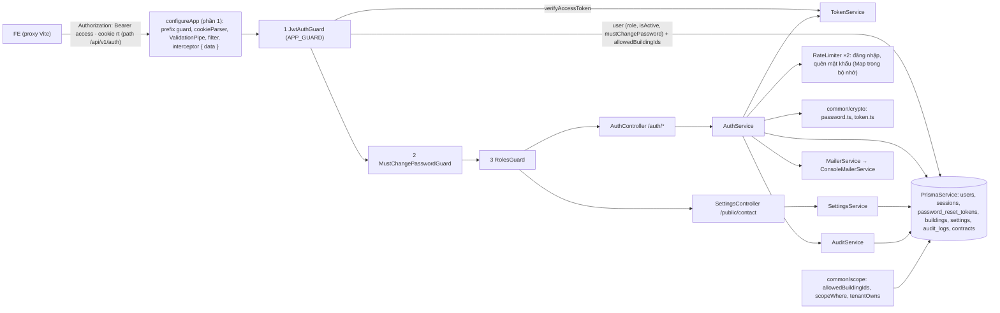

# PLAN – BE-LOGIN-09..25: đăng nhập, phiên, mật khẩu, guard và phạm vi (backend)

Feature: `docs/phase-1-foundation/feature_p1-2-backend-auth.md` · Gốc: `9536e8d`
Bản nháp: `Source/backend/artifact_BE/2026-10-29-BE-LOGIN-09-25/`. Trong file này `D/` = thư mục đó; đường dẫn trong `D/` mirror `Source/backend/`. Mọi lệnh chạy từ `D:\Rooms\Source\backend`, nơi `D/` viết là `artifact_BE/2026-10-29-BE-LOGIN-09-25/`.
Trạng thái 29/10/2026: chủ dự án đã trả lời Q1–Q6 và chỗ spec chưa khớp (mục 3.1, 3.4). **Không còn câu hỏi bỏ ngỏ.** CP-1..CP-7 làm được theo thứ tự.

## 0. Luật chung cho coder và tester (đọc trước mọi checkpoint)

- **`REVIEW.md` do phiên chính giữ.** Coder và tester không sửa, không dùng làm đầu vào. Không checkpoint nào FAIL vì `REVIEW.md` còn trống hay chưa cập nhật.
- **Không đụng DB dev.** Cấm trong pipeline: `prisma migrate *`, `prisma db *`, `prisma studio`, `npx prisma db seed`, `node prisma/seed.ts`, `npm run start*`, và **mọi lần chạy e2e**: `npm run test:e2e`, `vitest … --config ./vitest.config.e2e.ts` với bất kỳ đường dẫn nào. Lý do: từ CP-7, `D/test/auth.e2e-spec.ts` nạp `.env` và ghi vào DB dev; nó chỉ chạy sau khi chủ dự án duyệt và phiên chính áp bản nháp (mục 5).
- **Không đọc, in, chép `Source/backend/.env`** (kể cả bằng Read, hay `process.loadEnvFile` trong lệnh tự gõ). Không log giá trị biến môi trường.
- **Biến giả `$TEST`** đặt trước mọi lệnh chạy test (`npx vitest …`, `npm run test`) và mọi lệnh Prisma, chạy bằng Bash:
  `DATABASE_URL=postgresql://u:p@127.0.0.1:1/db DIRECT_URL=postgresql://u:p@127.0.0.1:1/db JWT_SECRET=test-only-secret-0123456789abcdef0123 APP_URL=http://localhost:5173`
  Prisma Client 6 tự nạp `.env` lúc import nhưng không ghi đè biến đã có. Cổng 1 không có server, nên nếu test quên thay `PrismaService` bằng bản giả thì truy vấn hỏng ngay, không chạm Supabase.
- **Không cài/gỡ package**, không sửa `package-lock.json`. Kế hoạch **không cần package mới**: chỉ dùng `@nestjs/jwt`, `argon2`, `cookie-parser`, `class-validator`, `class-transformer`, `@prisma/client` và `node:crypto`. Không dùng `@nestjs/throttler`, `passport`.
- **Không đổi `schema.prisma`, không migration**: mọi bảng/cột cần đã có (mục 2.4).
- `prisma generate` chỉ khi kiểu `@prisma/client` bị thiếu (`PrismaClient: any`): `$TEST npx prisma generate` (schema chính, chỉ ghi `node_modules/.prisma/client`). Schema không đổi nên bình thường không cần.
- **Chỉ ghi file trong `D/` bằng Edit/Write.** Không lệnh shell nào ghi file (ngoại lệ migration của phần 1 không áp dụng ở đây).
- **Bản nháp tự đủ.** File nháp chỉ import/đọc file trong `D/` hoặc package. Vì code mới import code chính chưa đổi (`ErrorCode`, `PrismaService`, `configureApp`…), CP-1 chép **y nguyên từng byte** 11 file chính vào `D/` (mục 2.2, loại "Bản sao"). Coder không sửa bản sao (câu trả lời của chủ dự án không cần mã lỗi mới, không sửa seed), trừ `D/src/app.module.ts`: bản sao ở CP-1 (vì `D/src/main.ts` import `./app.module.js`), CP-2 và CP-3 sửa nó theo mục 2.3.
- **Làn của từng agent** (`.claude/hooks/agent-guard.mjs`): coder ghi file code, không ghi `*.spec.ts`/`*.e2e-spec.ts` hay file nào dưới `test/`; tester chỉ ghi `*.spec.ts`, `*.e2e-spec.ts` và file dưới `test/` (gồm `D/test/fixtures/fake-prisma.ts`).
- **Kiểm tra bản nháp** (`npm run build`/`npm run lint` chỉ xem file chính):
  - test nháp: `$TEST npx vitest run artifact_BE/2026-10-29-BE-LOGIN-09-25`
  - typecheck: `npx tsc --noEmit -p tsconfig.json --incremental false` → không lỗi nào (`tsconfig.json` không có `include`, nên quét cả `D/`)
  - lint nháp: `npx oxlint --type-aware artifact_BE/2026-10-29-BE-LOGIN-09-25` → 0 error
  - toàn app: `$TEST npm run test`, `npm run lint`, `npm run build` vẫn xanh
  - Một lượt PASS của tester phải gồm đủ 5 lệnh trên.
- Tên test có mã spec hoặc mã task: `it('AUTH-04: 6th failed attempt -> 429', …)`.
- **G-03:** mọi decorator class-validator có `message` tiếng Việt (câu chữ ở mục 2.3). Không để message mặc định tiếng Anh.
- **Quy ước throw** (từ phần 1): exception có sẵn của Nest với message = mã, vd `throw new UnauthorizedException(ErrorCode.INVALID_CREDENTIALS)`, `throw new HttpException(ErrorCode.TOO_MANY_REQUESTS, 429)`. Lỗi theo trường: `throw new BadRequestException({ code: ErrorCode.VALIDATION_FAILED, fields: { <field>: '<tiếng Việt>' } })` (filter quy tắc 1).
- **DI trong vitest:** test phần 1 đã dùng metadata `design:paramtypes` (ValidationPipe) nên tiêm qua constructor chạy được. Nếu một provider nhận `undefined` trong test, coder thêm `@Inject(<Class>)` cho tham số đó, không đổi cấu hình build.

## 1. Mục tiêu và phạm vi

**Trong phạm vi** (giữ nguyên mã task của feature):

| Task | Nội dung | Spec | CP |
|---|---|---|---|
| BE-LOGIN-09 | `hashPassword`/`verifyPassword` argon2id, `PASSWORD_MIN_LENGTH = 8` | AUTH-03 | CP-1 |
| BE-LOGIN-10 | `TokenService`: JWT 15 phút (`sub`, `role`); refresh token 32 byte, chỉ lưu SHA-256; hạn 30 ngày / 12 giờ | AUTH-T1, AUTH-T2, A-07 | CP-1 |
| BE-LOGIN-11 | `POST /auth/login` | AUTH-01, AUTH-02 | CP-4 |
| BE-LOGIN-12 | Giới hạn đăng nhập sai (trượt 15 phút), bộ nhớ trong tiến trình | AUTH-04 | CP-4 |
| BE-LOGIN-13 | `POST /auth/refresh` xoay vòng | AUTH-T2 | CP-4 |
| BE-LOGIN-14 | `POST /auth/logout` | AUTH-T2 | CP-4 |
| BE-LOGIN-15 | `GET /auth/me` | AUTH-05, SCOPE-02 | CP-3 |
| BE-LOGIN-16 | `PATCH /auth/me` | AUTH-09 | CP-5 |
| BE-LOGIN-17 | `POST /auth/change-password` | AUTH-05, AUTH-T3 | CP-5 |
| BE-LOGIN-18 | `POST /auth/forgot-password` (5 yêu cầu / số / 15 phút), `POST /auth/reset-password`, `MailerService` (console) | AUTH-07, AUTH-T3 | CP-6 |
| BE-LOGIN-19 | `GET /public/contact` | AUTH-10, D-02 | CP-3 |
| BE-LOGIN-20 | `JwtAuthGuard` toàn cục + `@Public()`, `RolesGuard` + `@Roles()`, mặc định từ chối | SCOPE-01, AUTH-T1 | CP-2 |
| BE-LOGIN-21 | `MustChangePasswordGuard` | AUTH-05 | CP-2 |
| BE-LOGIN-22 | `allowedBuildingIds`, `scopeWhere`, `tenantOwns` trong `src/common/scope` | SCOPE-02, SCOPE-03 | CP-2 |
| BE-LOGIN-23 | `AuditService.log` cho đổi / đặt lại mật khẩu | AUD-01, AUD-02 | CP-5 (dùng tiếp ở CP-6) |
| BE-LOGIN-24 | Test e2e (DB dev, chạy sau khi áp) + bản sao kịch bản chạy với Prisma giả | AUTH-01/02/04/05/10, AUTH-T2/T3, SCOPE-01 | CP-7 |
| BE-LOGIN-25 | Kiểm toàn bộ; liệt kê `[ASSUMPTION]` | – | CP-7 (phần e2e ở mục 5) |

Đi kèm (cần để test phần 1 vẫn xanh sau khi áp, và theo follow-up review phần 1):
- `src/common/env.ts`: thêm `JWT_SECRET`, `APP_URL` vào `REQUIRED_ENV` (ràng buộc 5 của chủ dự án), kiểm độ dài `JWT_SECRET` (P10). Cập nhật `src/common/env.spec.ts` theo.
- `src/common/prisma/prisma.service.spec.ts`: test "AppModule imports only PrismaModule" đổi thành danh sách mới.
- `src/common/errors/validation.ts`: body không phải object (vd `[]`) đang trả chữ tiếng Anh `an unknown value was passed…` trong `fields`; sửa để không lộ chữ tiếng Anh (G-03, P13).

**Ngoài phạm vi:** `/managers` (AUTH-08), SCOPE-04, `POST /contracts/:id/reset-password`, nhà cung cấp email thật, `?buildingId=` + `OUT_OF_SCOPE` của API-08 (thêm cùng endpoint danh sách đầu tiên), chạy e2e trên DB dev (mục 5), sửa spec (mục 3.4 là việc của phiên chính), mẫu email trong `settings.email_templates` (module settings sau này).

## 2. Kiến trúc

### 2.1 Sơ đồ



Thứ tự guard: không có token → 401 trước; người bị buộc đổi mật khẩu → `PASSWORD_CHANGE_REQUIRED` trước `FORBIDDEN` (AUTH-05 nói "every API"); cuối cùng mới xét vai trò. Route `@Public()` bỏ qua cả ba.

### 2.2 File thêm / sửa

| Đích (`Source/backend/…`) | Bản nháp | Mục đích | CP | Loại |
|---|---|---|---|---|
| `src/app.setup.ts` | `D/src/app.setup.ts` | Test HTTP import `configureApp` | CP-1 | Bản sao |
| `src/main.ts` | `D/src/main.ts` | `env.spec.ts` đọc file này | CP-1 | Bản sao |
| `src/common/errors/error-code.ts` | `D/…` | `ErrorCode` | CP-1 | Bản sao |
| `src/common/errors/all-exceptions.filter.ts` | `D/…` | `app.setup.ts` import | CP-1 | Bản sao |
| `src/common/response.interceptor.ts` | `D/…` | `app.setup.ts` import | CP-1 | Bản sao |
| `src/common/prisma/prisma.service.ts` | `D/…` | `PrismaService` | CP-1 | Bản sao |
| `src/common/prisma/prisma.module.ts` | `D/…` | `PrismaModule` | CP-1 | Bản sao |
| `.env.example` | `D/.env.example` | `env.spec.ts` đọc; đã có đủ `JWT_SECRET`, `APP_URL` | CP-1 | Bản sao |
| `package.json` | `D/package.json` | `env.spec.ts` đọc; không package mới | CP-1 | Bản sao |
| `prisma/seed.ts` | `D/prisma/seed.ts` | `DEV_ACCOUNTS`, `seed()` cho fixture và e2e (Q6 = A: không sửa) | CP-1 | Bản sao |
| `src/app.module.ts` | `D/src/app.module.ts` | `D/src/main.ts` import `./app.module.js` (thiếu thì tsc TS2307); `env.spec.ts` đọc `../app.module.ts`. Chỉ y nguyên trong CP-1, CP-2 sửa (dòng "Sửa" bên dưới) | CP-1 | Bản sao |
| `src/common/env.ts` | `D/src/common/env.ts` | `REQUIRED_ENV` + `JWT_SECRET`, `APP_URL`; độ dài `JWT_SECRET` | CP-1 | Sửa |
| `src/common/errors/validation.ts` | `D/…` | Body không phải object → không chữ tiếng Anh | CP-1 | Sửa |
| `src/common/crypto/password.ts` | `D/…` | argon2id | CP-1 | Thêm |
| `src/common/crypto/token.ts` | `D/…` | `randomToken`, `sha256Hex` | CP-1 | Thêm |
| `src/modules/auth/token.service.ts` | `D/…` | JWT + hạn refresh | CP-1 | Thêm |
| `src/common/guards/auth.decorators.ts` | `D/…` | `Public`, `Roles`, `AllowPasswordChangeRequired`, `CurrentUser`, `AuthUser` | CP-2 | Thêm |
| `src/common/guards/jwt-auth.guard.ts` | `D/…` | Guard 1 | CP-2 | Thêm |
| `src/common/guards/must-change-password.guard.ts` | `D/…` | Guard 2 | CP-2 | Thêm |
| `src/common/guards/roles.guard.ts` | `D/…` | Guard 3 | CP-2 | Thêm |
| `src/common/scope/scope.ts` | `D/…` | SCOPE-02, SCOPE-03 | CP-2 | Thêm |
| `src/modules/auth/auth.module.ts` | `D/…` | Module auth + 3 `APP_GUARD` | CP-2 (tạo), CP-3, CP-5, CP-6 (thêm) | Thêm |
| `src/app.module.ts` | `D/src/app.module.ts` | Ghi đè bản sao CP-1: thêm `AuthModule` (CP-2), `SettingsModule` (CP-3) | CP-2, CP-3 | Sửa |
| `src/modules/settings/settings.module.ts`, `settings.controller.ts`, `settings.service.ts` | `D/…` | `GET /public/contact` | CP-3 | Thêm |
| `src/modules/auth/auth.controller.ts` | `D/…` | Route `/auth/*` | CP-3..6 | Thêm |
| `src/modules/auth/auth.service.ts` | `D/…` | Nghiệp vụ auth | CP-3..6 | Thêm |
| `src/modules/auth/dto/auth.dto.ts` | `D/…` | 5 DTO | CP-4..6 | Thêm |
| `src/modules/auth/rate-limiter.ts` | `D/…` | `RateLimiter` cửa sổ trượt, 2 bản: AUTH-04 (đăng nhập, CP-4) và quên mật khẩu (Q4e, CP-6) | CP-4 | Thêm |
| `src/modules/audit/audit.module.ts`, `audit.service.ts` | `D/…` | AUD-01 | CP-5 | Thêm |
| `src/modules/mailer/mailer.module.ts`, `mailer.service.ts` | `D/…` | `MailerService` + console | CP-6 | Thêm |
| *(tester)* `src/common/env.spec.ts` | `D/…` | Cập nhật theo `REQUIRED_ENV` mới | CP-1 | Sửa |
| *(tester)* `src/common/prisma/prisma.service.spec.ts` | `D/…` | Cập nhật import của `AppModule` | CP-2, CP-3 | Sửa |
| *(tester)* `src/common/crypto/password.spec.ts`, `src/common/crypto/token.spec.ts`, `src/modules/auth/token.service.spec.ts`, `src/common/errors/validation.spec.ts` | `D/…` | CP-1 | CP-1 | Thêm |
| *(tester)* `test/fixtures/fake-prisma.ts` | `D/…` | Prisma giả dùng chung (mục 2.5) | CP-2 | Thêm |
| *(tester)* `src/common/guards/guards.spec.ts`, `src/common/scope/scope.spec.ts` | `D/…` | CP-2 | CP-2 | Thêm |
| *(tester)* `src/modules/settings/settings.spec.ts`, `src/modules/auth/auth.me.spec.ts` | `D/…` | CP-3 | CP-3 | Thêm |
| *(tester)* `src/modules/auth/rate-limiter.spec.ts`, `src/modules/auth/auth.session.spec.ts` | `D/…` | CP-4 | CP-4 | Thêm |
| *(tester)* `src/modules/audit/audit.service.spec.ts`, `src/modules/auth/auth.account.spec.ts` | `D/…` | CP-5 | CP-5 | Thêm |
| *(tester)* `src/modules/auth/auth.reset.spec.ts` | `D/…` | CP-6 | CP-6 | Thêm |
| *(tester)* `src/modules/auth/auth.flow.spec.ts` | `D/…` | 9 kịch bản e2e chạy với Prisma giả | CP-7 | Thêm |
| *(tester)* `test/auth.e2e-spec.ts` | `D/…` | e2e trên DB dev, **chỉ chạy sau khi áp** | CP-7 | Thêm |

Tên file test là đề xuất; tester đổi được nếu vẫn đúng làn. Không xóa file chính nào. 11 bản sao y nguyên ở CP-1; từ CP-2, `src/app.module.ts` thành file "Sửa", 10 bản sao còn lại giữ y nguyên tới hết CP-7 (không câu trả lời nào cần mã lỗi mới hay sửa seed).

### 2.3 Hợp đồng code (coder làm đúng như sau)

**`src/common/env.ts`** (sửa)
```ts
export const REQUIRED_ENV: readonly string[]; // đúng ['DATABASE_URL', 'DIRECT_URL', 'JWT_SECRET', 'APP_URL']
export const JWT_SECRET_MIN_LENGTH = 32;
export function validateEnv(env?: NodeJS.ProcessEnv): void;
```
- Thiếu biến: giữ nguyên hành vi và câu chữ phần 1 (`Thiếu biến môi trường: <tên, …> (xem .env.example)`, theo thứ tự `REQUIRED_ENV`).
- Đủ biến nhưng `JWT_SECRET.trim().length < 32` → `throw new Error('JWT_SECRET phải dài ít nhất 32 ký tự (xem .env.example)')`. Không đưa giá trị vào message.
- Sửa chú thích dòng 1 (không còn "part 2 adds JWT_SECRET").

**`src/common/errors/validation.ts`** (sửa) – chữ ký giữ nguyên. Lỗi không có `property` (class-validator `unknownValue`, khi body là mảng hay giá trị không phải object) không tạo khóa trong `fields`. Nếu `fields` rỗng thì exception là `new BadRequestException({ code: ErrorCode.VALIDATION_FAILED })` (không có khóa `fields`). Mọi trường hợp khác giữ như phần 1.

**`src/common/crypto/password.ts`**
```ts
export const PASSWORD_MIN_LENGTH = 8;                               // AUTH-03
export function hashPassword(plain: string): Promise<string>;       // argon2.hash(plain, { type: argon2.argon2id })
export function verifyPassword(hash: string, plain: string): Promise<boolean>; // hash hỏng/rỗng → false, không throw
```

**`src/common/crypto/token.ts`**
```ts
export function randomToken(): string;          // randomBytes(32).toString('base64url'), 43 ký tự
export function sha256Hex(value: string): string; // 64 ký tự hex thường
```

**`src/modules/auth/token.service.ts`**
```ts
export const ACCESS_TOKEN_TTL_SECONDS = 900;                 // 15 phút, AUTH-T1
export const REFRESH_TTL_REMEMBER_MS = 30 * 24 * 60 * 60 * 1000; // AUTH-T2
export const REFRESH_TTL_SESSION_MS = 12 * 60 * 60 * 1000;       // A-07
export interface AccessPayload { sub: string; role: Role }       // Role: import type từ '@prisma/client'
@Injectable()
export class TokenService {
  constructor(jwt: JwtService);
  signAccessToken(user: { id: number; role: Role }): Promise<string>; // { sub: String(id), role }, HS256
  verifyAccessToken(token: string): Promise<AccessPayload>;           // chỉ HS256; sai/hết hạn → throw
  refreshExpiresAt(remember: boolean, now?: Date): Date;             // now + 30 ngày | now + 12 giờ, tính bằng ms
}
```
`secret` = `process.env.JWT_SECRET`, đọc lúc gọi (không lúc dựng module), truyền vào `signAsync`/`verifyAsync`. `AuthModule` import `JwtModule.register({})`.

**`src/common/guards/auth.decorators.ts`**
```ts
export interface AuthUser { id: number; role: Role; mustChangePassword: boolean; buildingIds: number[] | null } // null = BOSS (mọi tòa)
export const Public: () => CustomDecorator;
export const Roles: (...roles: Role[]) => CustomDecorator;
export const AllowPasswordChangeRequired: () => CustomDecorator;
export const CurrentUser: () => ParameterDecorator;   // trả req.user (AuthUser)
```

**Guard** (`@Injectable()`, `implements CanActivate`; đọc metadata bằng `Reflector.getAllAndOverride([handler, class])`):
- `JwtAuthGuard(reflector, tokens: TokenService, prisma: PrismaService)`: `@Public` → cho qua (bỏ qua token kể cả token hỏng). Còn lại: cần header `Authorization: Bearer <token>`; thiếu, sai dạng, chữ ký sai, hết hạn, `sub` không phải số nguyên dương, user không tồn tại hoặc `isActive = false` → `UnauthorizedException(ErrorCode.UNAUTHENTICATED)`. Vai trò và cờ lấy từ DB (không tin `role` trong token). Gắn `req.user: AuthUser` với `buildingIds = await allowedBuildingIds(prisma, user)`.
- `MustChangePasswordGuard(reflector)`: `@Public` hoặc `@AllowPasswordChangeRequired` → cho qua; `req.user.mustChangePassword` → `ForbiddenException(ErrorCode.PASSWORD_CHANGE_REQUIRED)`.
- `RolesGuard(reflector)`: `@Public` → cho qua; route không có `@Roles` → `ForbiddenException(ErrorCode.FORBIDDEN)` (SCOPE-01); vai trò không nằm trong danh sách → `FORBIDDEN`.
- Đăng ký trong `AuthModule.providers` đúng thứ tự: `{ provide: APP_GUARD, useClass: JwtAuthGuard }`, `MustChangePasswordGuard`, `RolesGuard`.

**`src/common/scope/scope.ts`**
```ts
export function allowedBuildingIds(db: Pick<PrismaClient, 'building'>, user: { id: number; role: Role }): Promise<number[] | null>;
// MANAGER: id các tòa managerId = user.id AND isActive (1 truy vấn) · BOSS: null (không lọc) · TENANT: [] (không truy vấn)
export function scopeWhere(user: Pick<AuthUser, 'buildingIds'>): { buildingId?: { in: number[] } };
// null → {} · mảng → { buildingId: { in: ids } } (mảng rỗng = không thấy gì)
export function tenantOwns(db: Pick<PrismaClient, 'contract'>, user: { id: number }, contractId: number): Promise<void>;
// không có contract { id, tenantId: user.id } → throw new NotFoundException() (404 NOT_FOUND, SCOPE-03), không phân biệt "của người khác" với "không tồn tại"
```
Model khác lọc qua quan hệ thì lồng fragment, vd `{ contract: scopeWhere(user) }` (module sau).

**`src/modules/audit/audit.service.ts`** + `audit.module.ts` (`providers`/`exports: [AuditService]`)
```ts
@Injectable()
export class AuditService {
  constructor(prisma: PrismaService);
  log(actorId: number | null, action: string, entity: string, entityId: number,
      before?: Prisma.InputJsonValue, after?: Prisma.InputJsonValue,
      ip?: string | null, db?: Prisma.TransactionClient): Promise<void>; // db mặc định this.prisma
}
```
6 tham số đầu đúng thứ tự của feature; `ip` (AUD-01 có cột `ip`) và `db` (để ghi trong cùng transaction) thêm ở cuối. `before`/`after` `undefined` → cột null. Không bao giờ ghi hash hay mật khẩu vào `before`/`after`.
Action (AUD-02): `user.change_password`, `user.reset_password`; `entity = 'user'`, `entityId` = id người bị đổi mật khẩu, `actorId` = chính người đó.

**`src/modules/mailer/mailer.service.ts`** + `mailer.module.ts` (`providers: [{ provide: MailerService, useClass: ConsoleMailerService }]`, `exports: [MailerService]`)
```ts
export interface Mail { to: string; subject: string; text: string }
export abstract class MailerService { abstract send(mail: Mail): Promise<void> }
@Injectable() export class ConsoleMailerService extends MailerService { send(mail: Mail): Promise<void> } // Logger.log to/subject/text
```
Có chú thích `shortcut: logs the reset link (secret) to the console, dev only; replace with a real provider before production`.

**`src/modules/auth/rate-limiter.ts`** (AUTH-04, Q2a, Q4e)
```ts
export const RATE_LIMIT_MAX = 5;                  // AUTH-04; quên mật khẩu dùng chung ngưỡng (Q4e)
export const RATE_LIMIT_WINDOW_MS = 15 * 60 * 1000;
export class RateLimiter {                        // lớp thường, không DI
  isBlocked(key: string, now?: number): boolean;  // now mặc định Date.now(); true khi có ≥ 5 mốc với ts > now − 15 phút
  record(key: string, now?: number): void;        // thêm 1 mốc
  reset(key: string): void;                       // xóa khóa
}
```
`Map<string, number[]>` mốc thời gian, cửa sổ trượt (Q2a): mốc `ts` còn tính khi `ts > now − RATE_LIMIT_WINDOW_MS`, nên tại đúng `ts + 15 phút` mốc đó hết tính. Lần bị chặn không gọi `record`. Không `setInterval`/timer (để app đóng được trong test). Khi `Map` > 10 000 khóa thì dọn các khóa không còn mốc nào trong cửa sổ. Chú thích bắt buộc: `shortcut: in-memory, single instance only; move to a shared store (DB/Redis) before running more than one instance`.
`AuthService` giữ 2 bản riêng: `private readonly loginLimiter = new RateLimiter()` (CP-4, khóa = `phone`) và `private readonly forgotLimiter = new RateLimiter()` (CP-6, khóa = `phone`). Hai bộ đếm độc lập. Trạng thái sống trong instance `AuthService`, nên mỗi app test mới có bộ đếm mới.

**DTO – `src/modules/auth/dto/auth.dto.ts`** (không bật `transform`, handler nhận object thô đã kiểm)

| Class | Trường | Decorator (message) |
|---|---|---|
| `LoginDto` | `phone: string` | `@Matches(/^0[0-9]{9}$/, 'Số điện thoại không hợp lệ')` (G-04) |
| | `password: string` | `@IsString` + `@IsNotEmpty`, cùng 'Vui lòng nhập mật khẩu' (không kiểm độ dài lúc đăng nhập) |
| | `remember?: boolean` | `@IsOptional() @IsBoolean('Giá trị ghi nhớ đăng nhập không hợp lệ')`; thiếu = `false` |
| `ChangePasswordDto` | `currentPassword: string` | `@IsString` + `@IsNotEmpty`, 'Vui lòng nhập mật khẩu hiện tại' |
| | `newPassword: string` | `@IsString` + `@MinLength(PASSWORD_MIN_LENGTH)`, 'Mật khẩu tối thiểu 8 ký tự' (AUTH-03) |
| `ForgotPasswordDto` | `phone: string` | như `LoginDto.phone` |
| `ResetPasswordDto` | `token: string` | `@IsString` + `@IsNotEmpty`, 'Liên kết đặt lại mật khẩu không hợp lệ hoặc đã hết hạn' |
| | `newPassword: string` | như `ChangePasswordDto.newPassword` |
| `UpdateMeDto` (Q5) | `email?: string \| null` | `@IsOptional()` (cho `null` = xóa, Q5b) + `@IsEmail({}, …)` + `@MaxLength(255, …)`, cùng 'Email không hợp lệ' |
| | `contactPhone?: string \| null` | `@IsOptional()` + `@Matches(/^0[0-9]{9}$/, …)`, 'Số điện thoại không hợp lệ' (G-04) |
| | `zaloUrl?: string \| null`, `facebookUrl?: string \| null` | `@IsOptional()` + `@IsUrl({ protocols: ['https'], require_protocol: true }, …)`, 'Đường dẫn không hợp lệ' (chỉ `https://`, Q5c) |

Câu chữ là `[ASSUMPTION]` của kế hoạch, chủ dự án sửa được khi xem bản nháp.

**Kiểu trả về** (export từ `auth.service.ts` / `settings.service.ts`)
```ts
export interface MeBuilding { id: number; code: string; name: string }
export interface Me {
  id: number; role: Role; phone: string; fullName: string; email: string | null;
  mustChangePassword: boolean; contactPhone: string | null; zaloUrl: string | null; facebookUrl: string | null;
  buildings?: MeBuilding[]; // chỉ BOSS/MANAGER; TENANT không có khóa này
}
export interface PublicContact { phone: string | null; zaloUrl: string | null; facebookUrl: string | null }
export interface IssuedSession { token: string; expiresAt: Date; remember: boolean } // nội bộ controller, không trả ra body
```
`Me` dựng bằng cách chọn đúng các trường trên (không spread hàng `users`), nên không bao giờ có `passwordHash`, `isActive`, `lastLoginAt`, mốc thời gian. `buildings`: BOSS = mọi tòa `isActive`; MANAGER = tòa `managerId = id` và `isActive`; sắp theo `code` tăng dần.

**`AuthService`** (`src/modules/auth/auth.service.ts`)
```ts
@Injectable()
export class AuthService {
  constructor(prisma: PrismaService, tokens: TokenService, audit: AuditService, mailer: MailerService); // thêm dần theo CP; 2 RateLimiter là trường, không tiêm
  getMe(userId: number): Promise<Me>;
  login(dto: LoginDto, userAgent?: string): Promise<{ accessToken: string; user: Me; session: IssuedSession }>;
  refresh(rawToken: string | undefined, userAgent?: string): Promise<{ accessToken: string; session: IssuedSession }>;
  logout(rawToken: string | undefined): Promise<void>;
  updateMe(user: AuthUser, dto: UpdateMeDto): Promise<Me>;
  changePassword(user: AuthUser, dto: ChangePasswordDto, rawToken: string | undefined, ip?: string): Promise<void>;
  forgotPassword(dto: ForgotPasswordDto): Promise<void>;
  resetPassword(dto: ResetPasswordDto, ip?: string): Promise<void>;
}
```
Hành vi bắt buộc:
- **login** (AUTH-01, AUTH-02, AUTH-04, Q2): (1) `loginLimiter.isBlocked(phone)` → 429 `TOO_MANY_REQUESTS`, không đếm thêm, kể cả mật khẩu đúng (Q2a). (2) tìm user theo `phone`; không có thì vẫn `verifyPassword` với một hash giả tạo lười một lần (thời gian trả lời như sai mật khẩu, AUTH-01). (3) không có user (Q2c) hoặc sai mật khẩu (kể cả tài khoản khóa, Q2d) → `loginLimiter.record(phone)`, 401 `INVALID_CREDENTIALS`. (4) đúng mật khẩu mà `isActive = false` → 403 `ACCOUNT_LOCKED`, không `record`, không `reset` (Q2d). (5) thành công: `loginLimiter.reset(phone)` (Q2b); trong một `$transaction` cập nhật `lastLoginAt = now` và tạo `sessions` (`tokenHash = sha256Hex(token)`, `remember`, `expiresAt = refreshExpiresAt(remember)`, `userAgent`); trả `user = await getMe(id)`. Chỉ bước 5 xóa bộ đếm.
- **refresh** (AUTH-T2, Q1): không có cookie, không tìm thấy hash, `revokedAt` khác null, `expiresAt <= now`, user không tồn tại hoặc bị khóa → 401 `UNAUTHENTICATED`. Xoay trong một `$transaction`: `updateMany({ where: { id, revokedAt: null }, data: { revokedAt: now } })`, `count = 0` → 401 (hai lần refresh cùng lúc); tạo phiên mới cùng `userId`, `remember`, `userAgent` mới, **`expiresAt` = `expiresAt` của phiên cũ** (Q1: hạn tuyệt đối 12 giờ / 30 ngày tính từ lúc đăng nhập; không gọi `refreshExpiresAt`).
- **logout:** có cookie thì thu hồi phiên chưa thu hồi có hash đó; không có cookie hay không tìm thấy vẫn thành công.
- **updateMe** (AUTH-09, Q5): TENANT gửi khóa `contactPhone`, `zaloUrl` hoặc `facebookUrl` (khác `undefined`, kể cả `null`) → 403 `FORBIDDEN`, không ghi gì. `data` chỉ gồm khóa có gửi: `undefined` = không đổi, `null` = xóa (Q5b); `email` lưu `toLowerCase()` (Q5c). `user.update` ném `P2002` → 400 `{ code: VALIDATION_FAILED, fields: { email: 'Email đã được sử dụng' } }` (Q5a). Trả `getMe(user.id)`.
- **changePassword** (AUTH-05, AUTH-T3, Q3): (1) `verifyPassword(hash hiện tại, currentPassword)` sai → 400 `{ code: VALIDATION_FAILED, fields: { currentPassword: 'Mật khẩu hiện tại không đúng' } }` (Q3a), không ghi gì, không audit, không đụng `loginLimiter` (Q3c). (2) `newPassword === currentPassword` → 400 `{ code: VALIDATION_FAILED, fields: { newPassword: 'Mật khẩu mới phải khác mật khẩu hiện tại' } }` (Q3b). (3) hash mới; một `$transaction`: `user.update { passwordHash, mustChangePassword: false }`; thu hồi các phiên khác (P12, mục 3.4): có cookie → `session.updateMany({ where: { userId, revokedAt: null, tokenHash: { not: sha256Hex(rawToken) } } })`, không cookie → `{ userId, revokedAt: null }`; `audit.log(id, 'user.change_password', 'user', id, undefined, undefined, ip, tx)`.
- **forgotPassword** (AUTH-07, Q4): luôn trả `void` (200 `{ data: null }` y hệt). (1) `forgotLimiter.isBlocked(phone)` → dừng, không token, không email (Q4e); nếu không bị chặn thì `forgotLimiter.record(phone)` (mọi yêu cầu được nhận đều đếm, kể cả số không tồn tại). (2) user không tồn tại, `isActive = false` (Q4a) hoặc `email` null → dừng. (3) `t = randomToken()`; một `$transaction`: `passwordResetToken.updateMany({ where: { userId, usedAt: null }, data: { usedAt: now } })` (vô hiệu link cũ chưa dùng, Q4d) rồi `create({ userId, tokenHash: sha256Hex(t), expiresAt: now + 30 phút })`. (4) sau transaction, `mailer.send` (link `${APP_URL}/quen-mat-khau?token=<t>`, P10, P15) trong `try/catch`; lỗi → `Logger.error` không chứa token, vẫn trả bình thường.
- **resetPassword** (AUTH-07, AUTH-T3, Q4): token không tìm thấy theo `sha256Hex(token)`, `usedAt` khác null hoặc `expiresAt <= now` → 400 `{ code: VALIDATION_FAILED, fields: { token: 'Liên kết đặt lại mật khẩu không hợp lệ hoặc đã hết hạn' } }` (Q4b). Hash mới; một `$transaction`: `passwordResetToken.updateMany({ where: { id, usedAt: null }, data: { usedAt: now } })`, `count = 0` → cùng lỗi 400 `fields.token`; `user.update { passwordHash, mustChangePassword: false }` (Q4c); `session.updateMany({ where: { userId, revokedAt: null } })` (thu hồi **mọi** phiên, mục 3.4); `audit.log(userId, 'user.reset_password', 'user', userId, undefined, undefined, ip, tx)`.
- Mọi chuỗi ghi nhiều bảng chạy trong một `$transaction(async (tx) => …)`; `argon2` hash trước khi mở transaction.

**`AuthController`** (`@Controller('auth')`; mọi `POST` có `@HttpCode(200)`; cookie qua `@Res({ passthrough: true })` để interceptor vẫn bọc `{ data }`)

| Route | Decorator | Vào | `data` khi 200 | Lỗi |
|---|---|---|---|---|
| `POST /api/v1/auth/login` | `@Public()` | `LoginDto`, header `user-agent` | `{ accessToken, user: Me }` + Set-Cookie `rt` | 400 `VALIDATION_FAILED` · 401 `INVALID_CREDENTIALS` · 403 `ACCOUNT_LOCKED` · 429 `TOO_MANY_REQUESTS` |
| `POST /api/v1/auth/refresh` | `@Public()` | cookie `rt` | `{ accessToken }` + Set-Cookie `rt` mới | 401 `UNAUTHENTICATED` |
| `POST /api/v1/auth/logout` | `@Public()` | cookie `rt` | `null` + xóa cookie `rt` | – |
| `GET /api/v1/auth/me` | `@Roles('BOSS','MANAGER','TENANT')`, `@AllowPasswordChangeRequired()` | – | `Me` | 401 |
| `PATCH /api/v1/auth/me` | `@Roles('BOSS','MANAGER','TENANT')` | `UpdateMeDto` | `Me` | 400 `VALIDATION_FAILED` (gồm email trùng: `fields.email`) · 401 · 403 `FORBIDDEN` (tenant gửi trường staff) · 403 `PASSWORD_CHANGE_REQUIRED` |
| `POST /api/v1/auth/change-password` | `@Roles('BOSS','MANAGER','TENANT')`, `@AllowPasswordChangeRequired()` | `ChangePasswordDto`, cookie `rt`, `@Ip()` | `null` | 400 `VALIDATION_FAILED` (`fields.currentPassword`, `fields.newPassword`) · 401 |
| `POST /api/v1/auth/forgot-password` | `@Public()` | `ForgotPasswordDto` | `null` (luôn giống nhau) | 400 (chỉ khi sai định dạng số) |
| `POST /api/v1/auth/reset-password` | `@Public()` | `ResetPasswordDto`, `@Ip()` | `null` | 400 `VALIDATION_FAILED` (`fields.token`, `fields.newPassword`) |
| `GET /api/v1/public/contact` | `@Public()` (`SettingsController`, `@Controller('public')`) | – | `PublicContact` hoặc `null` | – |

Cookie (`export const REFRESH_COOKIE = 'rt'`): `httpOnly: true`, `sameSite: 'lax'`, `secure: process.env.NODE_ENV === 'production'`, `path: '/api/v1/auth'`; `remember = true` → thêm `expires: session.expiresAt`; `remember = false` → cookie phiên (không `expires`/`maxAge`). Xóa bằng `res.clearCookie('rt', { cùng httpOnly/sameSite/secure/path })`.

**`SettingsService.getDefaultContact(): Promise<PublicContact | null>`**: đọc `settings` key `default_contact`; không có dòng → `null`; có thì chỉ trả 3 khóa `phone`, `zaloUrl`, `facebookUrl` (khóa thiếu → `null`, khóa lạ không lộ ra).

**`AuthModule`** (cuối CP-6): `imports: [JwtModule.register({}), AuditModule, MailerModule]`, `controllers: [AuthController]`, `providers: [TokenService, AuthService, 3 APP_GUARD theo thứ tự]`. **`SettingsModule`**: `controllers: [SettingsController]`, `providers: [SettingsService]`. **`AppModule`**: `imports: [PrismaModule, AuthModule, SettingsModule]`, không controller/provider.

### 2.4 Bảng và cột dùng; bề mặt Prisma được phép (để tester làm Prisma giả)

Không đổi schema. Cột dùng: `users` (`id, role, phone, fullName, email, passwordHash, mustChangePassword, isActive, contactPhone, zaloUrl, facebookUrl, lastLoginAt`), `sessions` (`id, userId, tokenHash, remember, expiresAt, revokedAt, userAgent`), `password_reset_tokens` (`id, userId, tokenHash, expiresAt, usedAt`), `buildings` (`id, code, name, managerId, isActive`), `settings` (`key, value`), `audit_logs` (`actorId, action, entity, entityId, before, after, ip`), `contracts` (`id, tenantId`).

Code chỉ dùng đúng các lời gọi sau (không `include`, không `select` lồng, không `$transaction([...])` dạng mảng, không `$queryRaw`):

| Model | Lời gọi | Dạng `where` |
|---|---|---|
| `user` | `findUnique`, `update` | `{ id }` · `{ phone }` |
| `session` | `create`, `findUnique`, `updateMany` | `{ tokenHash }` · `{ id, revokedAt: null }` · `{ tokenHash, revokedAt: null }` · `{ userId, revokedAt: null }` · `{ userId, revokedAt: null, tokenHash: { not } }` |
| `passwordResetToken` | `create`, `findUnique`, `updateMany` | `{ tokenHash }` · `{ id, usedAt: null }` · `{ userId, usedAt: null }` |
| `building` | `findMany` (+ `select` phẳng, `orderBy: { code: 'asc' }`) | `{ managerId, isActive: true }` · `{ isActive: true }` |
| `setting` | `findUnique` | `{ key }` |
| `auditLog` | `create` | – |
| `contract` | `findFirst` (+ `select: { id: true }`) | `{ id, tenantId }` |
| client | `$transaction(async (tx) => …)` | – |

Email trùng ở `user.update` → Prisma ném `Prisma.PrismaClientKnownRequestError` mã `P2002`; `updateMe` bắt mã này → 400 `fields.email` (Q5a).

### 2.5 Prisma giả dùng chung (tester, `D/test/fixtures/fake-prisma.ts`)

- Dữ liệu dạng seed: 5 tài khoản từ `DEV_ACCOUNTS` (`D/prisma/seed.ts`), `passwordHash` = argon2id thật, cờ như seed; tòa CG01, DD01 (manager1), HM01 (không quản lý) + 1 tòa `TL01` **không hoạt động** gán manager2 (để kiểm "chỉ tòa đang hoạt động"); `settings.default_contact` như seed; hợp đồng `HD000001` của tenant `0900000004`.
- Hỗ trợ đúng bề mặt ở mục 2.4, gồm `select` phẳng, `orderBy`, toán tử `not`; ném lỗi khi trùng `phone`, `email` (dạng `Prisma.PrismaClientKnownRequestError` mã `P2002`), `sessions.tokenHash`, `password_reset_tokens.tokenHash`. `$transaction(fn)` gọi `fn(fake)` (không cần rollback).
- Dùng bằng `Test.createTestingModule({ imports: [AppModule], controllers: [<probe của test>] }).overrideProvider(PrismaService).useValue(fake)` (+ `overrideProvider(MailerService)` từ CP-6), rồi `createNestApplication()` → `configureApp(app)` → `init()`, gọi bằng `supertest`. Test tự đặt `process.env.JWT_SECRET` (≥ 32 ký tự) và `APP_URL`, trả lại giá trị cũ khi xong.

## 3. Câu hỏi bỏ ngỏ, giả định, quyết định

### 3.1 Câu hỏi đã trả lời (không còn câu hỏi bỏ ngỏ)

Chủ dự án trả lời ngày 29/10/2026, mọi câu theo phương án đề xuất. Phương án không chọn đã bỏ.

**Q1 · Hạn của phiên mới khi xoay refresh token (AUTH-T2, A-07)** – dùng ở CP-4
- ĐÃ CHỌN 29/10/2026: A. Phiên mới giữ nguyên `expiresAt` của phiên cũ. Không ghi nhớ: tối đa 12 giờ kể từ lúc đăng nhập (đúng chữ "max 12 hours" của A-07); ghi nhớ: tối đa 30 ngày kể từ lúc đăng nhập; hết hạn thì đăng nhập lại.

**Q2 · Chi tiết giới hạn đăng nhập sai (AUTH-04) và thứ tự với AUTH-02** – dùng ở CP-4
- (a) ĐÃ CHỌN 29/10/2026: A, cửa sổ trượt. Đếm lần sai của số đó trong 15 phút gần nhất; đủ 5 thì mọi lần đăng nhập tiếp theo của số đó, kể cả đúng mật khẩu, trả 429 cho tới khi lần sai cũ nhất ra khỏi cửa sổ; lần bị 429 không đếm thêm.
- (b) ĐÃ CHỌN 29/10/2026: A. Đăng nhập thành công xóa bộ đếm.
- (c) ĐÃ CHỌN 29/10/2026: A. Số điện thoại không tồn tại cũng tính là lần sai.
- (d) ĐÃ CHỌN 29/10/2026: A. `ACCOUNT_LOCKED` chỉ trả khi mật khẩu đúng và không tính là lần sai; sai mật khẩu với tài khoản khóa vẫn là `INVALID_CREDENTIALS` (và được đếm).

**Q3 · Đổi mật khẩu (`POST /auth/change-password`)** – dùng ở CP-5
- (a) ĐÃ CHỌN 29/10/2026: A. Sai mật khẩu hiện tại → 400 `VALIDATION_FAILED`, `fields.currentPassword = 'Mật khẩu hiện tại không đúng'`.
- (b) ĐÃ CHỌN 29/10/2026: A. Mật khẩu mới trùng mật khẩu hiện tại → 400, `fields.newPassword = 'Mật khẩu mới phải khác mật khẩu hiện tại'`.
- (c) ĐÃ CHỌN 29/10/2026: A. Sai mật khẩu hiện tại không tính vào giới hạn AUTH-04.

**Q4 · Quên / đặt lại mật khẩu qua email (AUTH-07)** – dùng ở CP-6
- (a) ĐÃ CHỌN 29/10/2026: A. Tài khoản bị khóa không được gửi email; phản hồi vẫn y hệt.
- (b) ĐÃ CHỌN 29/10/2026: A. Token sai / hết hạn / đã dùng → 400 `VALIDATION_FAILED`, `fields.token = 'Liên kết đặt lại mật khẩu không hợp lệ hoặc đã hết hạn'`.
- (c) ĐÃ CHỌN 29/10/2026: A. Đặt lại thành công xóa cờ `must_change_password`.
- (d) ĐÃ CHỌN 29/10/2026: B. Yêu cầu link mới làm link cũ chưa dùng bị vô hiệu ngay (đánh dấu `used_at`).
- (e) ĐÃ CHỌN 29/10/2026: B. Giới hạn riêng cho quên mật khẩu, cùng ngưỡng AUTH-04: 5 yêu cầu / số điện thoại / 15 phút (cửa sổ trượt như Q2a); vượt thì vẫn trả 200 y hệt nhưng không tạo token, không gửi.

**Q5 · Kiểm dữ liệu `PATCH /auth/me` (AUTH-09)** – dùng ở CP-5
- (a) ĐÃ CHỌN 29/10/2026: A. Email đã thuộc người khác → 400 `VALIDATION_FAILED`, `fields.email = 'Email đã được sử dụng'`. Không mã lỗi mới.
- (b) ĐÃ CHỌN 29/10/2026: A. Gửi `null` để xóa email / liên hệ được phép.
- (c) ĐÃ CHỌN 29/10/2026: A. Email chuẩn (`IsEmail`), tối đa 255 ký tự, lưu chữ thường; `contactPhone` theo G-04; `zaloUrl`/`facebookUrl` là URL bắt đầu `https://` (không giới hạn tên miền).

**Q6 · Test e2e trên DB dev làm đổi dữ liệu seed (BE-LOGIN-24)** – dùng ở CP-7
- ĐÃ CHỌN 29/10/2026: A. `beforeAll` và `afterAll` gọi `seed(prisma)` của `prisma/seed.ts` (đặt lại 5 tài khoản theo D5). `prisma/seed.ts` và `prisma/seed.spec.ts` không đổi. Các phiên test tạo ra vẫn nằm trong `sessions` tới khi hết hạn; `last_login_at` của tài khoản dev đổi.

### 3.2 `[ASSUMPTION]` của spec được dùng

- **A-07** (BE-LOGIN-10, AUTH-T2): không ghi nhớ = cookie phiên, server hết hạn sau tối đa 12 giờ. Phần này không dùng A-01..A-06.

### 3.3 Quyết định của kế hoạch (kỹ thuật, không phải luật nghiệp vụ; chủ dự án đổi được khi duyệt)

- P1. `user` trong phản hồi login = đúng đối tượng `Me` của `GET /auth/me`.
- P2. Mọi `POST /auth/*` trả 200 (không 201). Logout, change-password, forgot, reset trả `{ data: null }`.
- P3. Login, refresh, logout, forgot, reset, `/public/contact` là `@Public()`. Refresh và logout xác định phiên chỉ bằng cookie, nên vẫn chạy khi access token đã hết hạn; logout luôn 200.
- P4. Route `@Public` nằm ngoài AUTH-05: người bị buộc đổi mật khẩu vẫn đăng nhập, refresh, đăng xuất, xem `/public/contact` được (đọc chữ "every API" thì chính login cũng bị chặn, vô lý).
- P5. Guard đọc user từ DB mỗi request; user không còn hoặc `is_active = false` → 401 `UNAUTHENTICATED` ngay, dù access token còn hạn.
- P6. Thứ tự guard: Jwt → MustChangePassword → Roles (mục 2.1). Route không `@Roles`/`@Public`: không token → 401, có token → 403 `FORBIDDEN`.
- P7. Số điện thoại không tồn tại vẫn chạy `argon2.verify` với hash giả, để thời gian trả lời không lộ số có tài khoản.
- P8. JWT HS256, `sub` là chuỗi id (chuẩn RFC 7519); cookie tên `rt`; `secure` chỉ khi `NODE_ENV=production`.
- P9. Audit: action `user.change_password`, `user.reset_password`; `entity` `user`; không `before`/`after`; ghi `ip` (`req.ip`); ghi trong cùng transaction với thay đổi mật khẩu.
- P10. `REQUIRED_ENV` thêm `JWT_SECRET` và `APP_URL` (link đặt lại mật khẩu = `${APP_URL}/quen-mat-khau?token=<token>`, theo `30-frontend.md`); `JWT_SECRET` phải ≥ 32 ký tự, vì secret yếu cho phép giả token của mọi vai trò. Giá trị mẫu `change-me` trong `.env.example` cố ý không qua được kiểm này.
- P11. `/public/contact` khi chưa có `settings.default_contact` → `{ data: null }`; chỉ lộ 3 khóa.
- P12. Đổi mật khẩu giữ phiên hiện tại (nhận ra bằng cookie `rt`); không gửi cookie thì thu hồi mọi phiên.
- P13. Body không phải object (vd `[]`) → 400 `VALIDATION_FAILED` không có `fields`, không chữ tiếng Anh.
- P14. `scopeWhere` của TENANT trả fragment không khớp gì (`in: []`) thay vì throw; BOSS = không lọc (kể cả tòa đã ngừng, để còn xem lịch sử).
- P15. Câu chữ tiếng Việt của DTO và email đặt lại mật khẩu (tiêu đề `Đặt lại mật khẩu – Trọ Thông Minh`; nội dung: link, hạn 30 phút, "nếu không phải bạn yêu cầu, hãy bỏ qua email này").

### 3.4 Chỗ spec chưa khớp (chủ dự án đồng ý cột "Làm theo" ngày 29/10/2026; phiên chính sửa câu chữ spec bằng bản nháp riêng)

| Chỗ | Nội dung | Làm theo |
|---|---|---|
| AUTH-T3 vs bảng API của 10-auth | T3: đổi mật khẩu thu hồi **mọi** phiên; bảng API và feature: thu hồi **các phiên khác** | Feature + bảng API (P12); reset qua email thu hồi mọi phiên |
| `OUT_OF_SCOPE` (01-architecture) vs SCOPE-03 | Bảng mã lỗi: tenant đụng hợp đồng người khác → `OUT_OF_SCOPE` 403; SCOPE-03 và acceptance: 404 | SCOPE-03 (404 `NOT_FOUND`) |
| AUD-01 vs feature BE-LOGIN-23 | AUD-01 chỉ ghi "password reset by staff"; feature ghi cả tự đổi và đặt lại qua email | Feature |
| AUD-01 vs chữ ký `log()` của feature | AUD-01 có `ip`; chữ ký của feature không có | Thêm `ip?` ở cuối (mục 2.3) |
| AUTH-05 "every API" | Hiểu theo chữ thì cả login cũng bị chặn | P4 |

## 4. Checkpoints

### CP-1 · Mật khẩu, token, env, bản sao (BE-LOGIN-09, BE-LOGIN-10)

- **Coder:** 11 bản sao ở mục 2.2, gồm `src/app.module.ts` (Read file chính → Write y nguyên vào `D/`); `D/src/common/env.ts`, `D/src/common/errors/validation.ts`, `D/src/common/crypto/password.ts`, `D/src/common/crypto/token.ts`, `D/src/modules/auth/token.service.ts`.
- **Tester:** `D/src/common/env.spec.ts` = bản chính, chỉ sửa đúng các test mà `REQUIRED_ENV` mới làm đổi: hằng `full` thêm `JWT_SECRET` (≥ 32 ký tự) và `APP_URL`; test "exactly DATABASE_URL and DIRECT_URL" → 4 biến; câu thông báo đầy đủ; test "JWT_SECRET … missing does not throw (D3)" → "CCCD_KEY, BANK_WEBHOOK_SECRET, CLOUDINARY_URL, MAIL_FROM missing does not throw"; test đọc `process.env` phải tự đặt mọi biến bắt buộc khác (kín, không phụ thuộc `$TEST` hay `.env`). Giữ mọi test còn lại. Thêm `password.spec.ts`, `token.spec.ts`, `token.service.spec.ts`, `validation.spec.ts`.
- **Done when:**
  1. `$TEST npx vitest run artifact_BE/2026-10-29-BE-LOGIN-09-25` → tất cả pass.
  2. tsc không lỗi; lint nháp 0 error; `$TEST npm run test`, `npm run lint`, `npm run build` pass.
  3. Với từng bản sao `f` (11 file mục 2.2, gồm `src/app.module.ts`): `git diff --no-index --exit-code <f> artifact_BE/2026-10-29-BE-LOGIN-09-25/<f>` → không in gì, exit 0.
  4. `git diff --no-index src/common/env.ts artifact_BE/2026-10-29-BE-LOGIN-09-25/src/common/env.ts` chỉ có: chú thích dòng 1, `REQUIRED_ENV`, `JWT_SECRET_MIN_LENGTH` và nhánh kiểm độ dài.
- **Kịch bản test:**
  - AUTH-03 / BE-LOGIN-09: `hashPassword('Boss@2026')` bắt đầu `$argon2id$`; `verifyPassword` đúng với chính nó, sai với `'Boss@2027'`; hai lần hash cùng mật khẩu khác nhau (salt); mật khẩu Unicode `'Mật khẩu@2026'` hash/verify đúng; `verifyPassword('khong-phai-hash', 'x')` và `verifyPassword('', 'x')` → `false`, không throw; `PASSWORD_MIN_LENGTH === 8`.
  - AUTH-T1 / BE-LOGIN-10: token của `{ id: 12, role: 'MANAGER' }` giải bằng secret → `sub === '12'`, `role === 'MANAGER'`, `exp - iat === 900`, header `alg` = `HS256`. `verifyAccessToken` throw với: token ký bằng secret khác; token đã hết hạn (`vi.setSystemTime` +15 phút 1 giây); token `alg: none`; chuỗi rác.
  - AUTH-T2 / A-07 (chọn hạn): `refreshExpiresAt(true, t)` = `t + 2 592 000 000 ms`, `refreshExpiresAt(false, t)` = `t + 43 200 000 ms`. Biên cuối tháng giờ Việt Nam: `t = 2026-10-31T23:30:00+07:00` → không ghi nhớ = `2026-11-01T11:30:00+07:00`, ghi nhớ = `2026-11-30T23:30:00+07:00`; kết quả không đổi khi `TZ=UTC` hay `TZ=Asia/Ho_Chi_Minh` (tính bằng ms).
  - AUTH-T2 (token): `randomToken()` khớp `^[A-Za-z0-9_-]{43}$`, 1 000 lần gọi không trùng; `sha256Hex('abc')` = `ba7816bf8f01cfea414140de5dae2223b00361a396177a9cb410ff61f20015ad`.
  - BE-LOGIN-03 (env mới, P10): `REQUIRED_ENV` deep-equal 4 biến; `validateEnv({})` → `Thiếu biến môi trường: DATABASE_URL, DIRECT_URL, JWT_SECRET, APP_URL (xem .env.example)`; chỉ thiếu `APP_URL` → message chỉ nêu `APP_URL`; `JWT_SECRET` 31 ký tự → `JWT_SECRET phải dài ít nhất 32 ký tự (xem .env.example)`; đúng 32 → không throw; 31 ký tự + khoảng trắng hai đầu → throw; message không chứa giá trị secret; `.env.example` vẫn đúng 8 khóa và chứa mọi biến của `REQUIRED_ENV`.
  - G-03 / P13: `validationExceptionFactory([{ property: undefined, constraints: { unknownValue: 'an unknown value was passed to the validate function' }, children: [] }])` → response `{ code: 'VALIDATION_FAILED' }` (không `fields`, không chữ tiếng Anh); lỗi có `property` vẫn như phần 1 (vd `phone` → `fields.phone`).

### CP-2 · Guard, decorator, scope (BE-LOGIN-20, BE-LOGIN-21, BE-LOGIN-22)

- **Coder:** `D/src/common/guards/{auth.decorators,jwt-auth.guard,must-change-password.guard,roles.guard}.ts`, `D/src/common/scope/scope.ts`, `D/src/modules/auth/auth.module.ts` (`JwtModule.register({})`, `TokenService`, 3 `APP_GUARD`), `D/src/app.module.ts` (sửa bản sao CP-1: `imports: [PrismaModule, AuthModule]`).
- **Tester:** `D/test/fixtures/fake-prisma.ts` (mục 2.5); `D/src/common/guards/guards.spec.ts` dùng một probe controller chỉ có trong test: `GET /t/public` (`@Public`), `GET /t/bare` (không decorator), `GET /t/boss` (`@Roles('BOSS')`), `GET /t/staff` (`@Roles('BOSS','MANAGER')`), `GET /t/tenant` (`@Roles('TENANT')`), `GET /t/tenant-pcr` (`@Roles('TENANT')` + `@AllowPasswordChangeRequired`), `GET /t/whoami` (`@Roles` cả 3, `@AllowPasswordChangeRequired`, trả `@CurrentUser()`); token ký bằng `TokenService` thật. `D/src/common/scope/scope.spec.ts`. `D/src/common/prisma/prisma.service.spec.ts` = bản chính, đổi test "AppModule imports only PrismaModule" thành `imports` deep-equal `[PrismaModule, AuthModule]`, không controller, không provider (lớp lấy từ bản trong `D/`).
- **Done when:**
  1. Test nháp pass, trong đó có `SCOPE-01: a route without decorators is denied`, `AUTH-05: …`, `SCOPE-02: …`, `SCOPE-03: …`.
  2. tsc, lint nháp, `$TEST npm run test`, `npm run lint`, `npm run build` như CP-1.
  3. `AppModule` dựng và đóng được không cần DB: test trong `prisma.service.spec.ts` vẫn pass (không truy vấn nào lúc init).
- **Kịch bản test:**
  - SCOPE-01: `/t/bare` không token → 401 `UNAUTHENTICATED`; token Boss → 403, body deep-equal `{ error: { code: 'FORBIDDEN', message: 'Bạn không có quyền thực hiện thao tác này' } }`.
  - SCOPE-01 / API-07: `/t/public` không token → 200; với `Authorization: Bearer rac` → vẫn 200 (bỏ qua token).
  - SCOPE-01 (vai trò khác): `/t/boss`: Boss 200, manager1 403 `FORBIDDEN`, tenant (cờ đã tắt trong fake) 403 `FORBIDDEN`; `/t/staff`: manager1 200, tenant 403; `/t/tenant`: tenant 200, Boss 403.
  - AUTH-T1 (401): thiếu header; `Authorization: Basic …`; `Bearer ` rỗng; token secret khác; token hết hạn (+15 phút 1 giây); `sub` = `'abc'`, `'0'`, `'-1'`, `'1.5'`; `sub` id không có trong DB; `lockedTenant` (`isActive` false) có token hợp lệ (P5) → mỗi cái 401 `UNAUTHENTICATED`.
  - AUTH-T1 (DB thắng token): token ghi `role: 'BOSS'` nhưng `sub` là tenant → `/t/boss` 403 `FORBIDDEN`.
  - AUTH-05: tenant `0900000004` (cờ bật): `/t/tenant` → 403 `{ error: { code: 'PASSWORD_CHANGE_REQUIRED', message: 'Bạn cần đổi mật khẩu trước khi tiếp tục' } }`; `/t/staff` và `/t/bare` → cũng `PASSWORD_CHANGE_REQUIRED` (không phải `FORBIDDEN`, P6); `/t/tenant-pcr` và `/t/whoami` → 200; `/t/public` → 200 (P4). Tắt cờ trong fake → `/t/tenant` 200.
  - SCOPE-02 qua guard: `/t/whoami` trả `buildingIds`: manager1 → id của CG01 và DD01 (so như tập hợp); manager2 → `[]` (TL01 không hoạt động bị loại); Boss → `null`; tenant → `[]`.
  - SCOPE-02 đơn vị (dạng seed): `allowedBuildingIds` như dòng trên, Boss và tenant không gọi `building.findMany`; manager1 gọi đúng 1 lần với `where: { managerId, isActive: true }`. `scopeWhere`: Boss → `{}`; manager1 → `{ buildingId: { in: [CG01, DD01] } }`; manager2 và tenant → `{ buildingId: { in: [] } }`. Áp fragment lên danh sách hợp đồng của fake: manager1 thấy `HD000001`, manager2 không thấy gì, Boss thấy `HD000001`.
  - SCOPE-03: `tenantOwns(fake, tenant, id của HD000001)` resolve; `lockedTenant` cùng id → `NotFoundException`; id không tồn tại `999999` → `NotFoundException`; hai lỗi giống hệt nhau. Qua HTTP (probe `GET /t/contracts/:id` gọi `tenantOwns`) → 404 `{ error: { code: 'NOT_FOUND', message: 'Không tìm thấy dữ liệu' } }`, không phải 403.
  - Không có `setInterval`/kết nối DB lúc `app.init()`; `app.close()` xong không treo.

### CP-3 · `GET /public/contact`, `GET /auth/me` (BE-LOGIN-19, BE-LOGIN-15)

- **Coder:** `D/src/modules/settings/{settings.module,settings.controller,settings.service}.ts`; `D/src/modules/auth/auth.controller.ts` (route `GET me`), `D/src/modules/auth/auth.service.ts` (`getMe`), `auth.module.ts` thêm controller + `AuthService`; `D/src/app.module.ts` thêm `SettingsModule`.
- **Tester:** `D/src/modules/settings/settings.spec.ts`, `D/src/modules/auth/auth.me.spec.ts`; sửa `prisma.service.spec.ts`: `imports` deep-equal `[PrismaModule, AuthModule, SettingsModule]`.
- **Done when:** test nháp pass (có `AUTH-10: …` và `BE-LOGIN-15: …`); tsc, lint, `$TEST npm run test`, `npm run lint`, `npm run build` pass.
- **Kịch bản test:**
  - AUTH-10: `GET /api/v1/public/contact` không token → 200, body deep-equal `{ data: { phone: '0900000001', zaloUrl: 'https://zalo.me/0900000001', facebookUrl: 'https://facebook.com/tro.thong.minh' } }`; với token tenant đang bị buộc đổi mật khẩu → vẫn 200 (P4); với token rác → 200.
  - AUTH-10 (P11): `default_contact` có thêm khóa `note: 'x'` → không có trong phản hồi; thiếu `zaloUrl` → `zaloUrl: null`; không có dòng `default_contact` → `{ data: null }`.
  - BE-LOGIN-15: không token → 401. Boss → `data` có đúng các khóa của `Me` + `buildings` = CG01, DD01, HM01 theo thứ tự `code` (không có TL01), mỗi phần tử đúng 3 khóa `id, code, name`. manager1 → `buildings` = CG01, DD01; manager2 → `[]`. Tenant → không có khóa `buildings`.
  - BE-LOGIN-15 bảo mật: chuỗi JSON phản hồi của cả 4 vai trò không chứa `passwordHash`, `password`, `$argon2`, `isActive`, `lastLoginAt`.
  - AUTH-05: tenant có cờ → `GET /auth/me` 200 với `mustChangePassword: true`.
  - P5: manager bị đặt `isActive = false` trong fake sau khi có token → 401.

### CP-4 · Đăng nhập, giới hạn sai, refresh, đăng xuất (BE-LOGIN-11..14; Q1, Q2)

- **Coder:** `D/src/modules/auth/dto/auth.dto.ts` (`LoginDto`), `D/src/modules/auth/rate-limiter.ts` (`RateLimiter`), thêm `login`/`refresh`/`logout` vào service và controller, trường `loginLimiter = new RateLimiter()` trong `AuthService` (không provider mới trong `AuthModule`).
- **Tester:** `D/src/modules/auth/rate-limiter.spec.ts`, `D/src/modules/auth/auth.session.spec.ts`. Thời gian điều khiển bằng `vi.useFakeTimers({ toFake: ['Date'] })` / `vi.setSystemTime`. Mỗi nhóm test AUTH-04 dựng app mới (bộ đếm mới) hoặc dùng số khác nhau.
- **Done when:** test nháp pass (có `AUTH-01`, `AUTH-02`, `AUTH-04`, `AUTH-T2`, `BE-LOGIN-14`); tsc, lint, `$TEST npm run test`, `npm run lint`, `npm run build` pass; grep `D/src/modules/auth/rate-limiter.ts` có `shortcut:`.
- **Kịch bản test:**
  - AUTH-01: từng tài khoản hoạt động (Boss, manager1, manager2, tenant) đăng nhập đúng → **200** (không 201), `data.accessToken` giải ra `sub` = id và `role` đúng, `data.user` deep-equal `GET /auth/me` của người đó (P1). Có `Set-Cookie: rt=…; Path=/api/v1/auth; HttpOnly; SameSite=Lax`, không `Secure` (vitest `NODE_ENV=test`); đặt `NODE_ENV=production` → có `Secure`.
  - AUTH-01 (không dò tài khoản): sai mật khẩu của Boss và số không tồn tại `0999999999` → cùng 401, body deep-equal `{ error: { code: 'INVALID_CREDENTIALS', message: 'Số điện thoại hoặc mật khẩu không đúng' } }`; không `Set-Cookie`; không tạo dòng `sessions`; với số không tồn tại vẫn có đúng 1 lời gọi `argon2.verify` (P7, kiểm bằng `vi.spyOn`, không đo thời gian).
  - AUTH-02: `0900000005` + `TamKhoa@2026` → 403 `{ error: { code: 'ACCOUNT_LOCKED', message: 'Tài khoản đã bị khóa. Liên hệ quản lý.' } }`, không cookie, không phiên. Sai mật khẩu với số này → 401, body deep-equal body `INVALID_CREDENTIALS` của AUTH-01 (Q2d).
  - Dữ liệu vào (G-04): `phone` 9 số, 11 số, `'1900000001'`, số dạng number → 400 `fields.phone = 'Số điện thoại không hợp lệ'`; thiếu `password` hoặc `''` → 400 `fields.password = 'Vui lòng nhập mật khẩu'`; `remember: 'yes'` → 400 `fields.remember`; thêm trường `role` → 400 `fields.role = 'Trường này không được phép gửi lên'`; body `[]` → 400 `{ error: { code: 'VALIDATION_FAILED', message: 'Dữ liệu không hợp lệ' } }` (P13). Không lỗi nào trong số này đếm vào AUTH-04.
  - BE-LOGIN-11: sau đăng nhập, `lastLoginAt` của user ≈ lúc gọi; dòng `sessions` có `tokenHash = sha256Hex(<giá trị cookie>)` và khác giá trị cookie, `userAgent` = header gửi lên, `revokedAt` null.
  - AUTH-T2 (hạn): `remember: true` → `expiresAt = now + 30 ngày`, cookie có `Expires` đúng mốc đó; `remember: false` hoặc không gửi → `expiresAt = now + 12 giờ`, cookie **không** có `Expires`/`Max-Age`.
  - AUTH-04 (Q2): 5 lần sai liên tiếp của một số → 5 lần 401; lần 6 sai → 429 `{ error: { code: 'TOO_MANY_REQUESTS', message: 'Bạn thao tác quá nhiều lần, vui lòng thử lại sau' } }`; lần 6 đúng mật khẩu → 429 (Q2a); số khác không bị ảnh hưởng. Biên cửa sổ: lần sai đầu lúc `t`; tại `t + 15 phút − 1 ms` vẫn 429, tại `t + 15 phút` (lần sai đầu ra khỏi cửa sổ) đăng nhập đúng → 200. Lần bị 429 không đếm: 5 lần sai lúc `t`, 5 lần sai nữa bị 429 lúc `t + 1 phút`, tại `t + 15 phút` đăng nhập đúng → 200. Q2b: 4 lần sai rồi đúng → 200, sau đó 4 lần sai nữa vẫn 401 (bộ đếm đã xóa). Q2c: số không tồn tại `0999999999` cũng bị 429 ở lần 6. Q2d: tài khoản khóa `0900000005` đúng mật khẩu 6 lần → 6 lần 403 `ACCOUNT_LOCKED` (không đếm); 4 lần sai (401) + 1 lần đúng (403) + 1 lần sai (401, lần sai thứ 5) → lần kế tiếp, kể cả đúng mật khẩu → 429 (403 không đếm, không xóa bộ đếm).
  - BE-LOGIN-12 đơn vị (`RateLimiter`): 4 `record` → `isBlocked` false, 5 → true; khóa khác vẫn false; mốc lúc `t0`: `isBlocked(k, t0 + 15 phút − 1)` true, `isBlocked(k, t0 + 15 phút)` false; `reset` → false; `RATE_LIMIT_MAX === 5`, `RATE_LIMIT_WINDOW_MS === 900 000`; khi `Map` vượt 10 000 khóa thì khóa không còn mốc trong cửa sổ bị dọn; không timer nào được tạo.
  - AUTH-T2 (xoay): refresh với cookie → 200 `{ data: { accessToken } }` (token mới hợp lệ), `Set-Cookie rt` có giá trị khác; phiên cũ có `revokedAt`; có đúng 1 phiên mới cùng `userId`, `remember` giữ nguyên, `expiresAt` bằng đúng `expiresAt` phiên cũ (Q1); refresh lại bằng cookie cũ → 401 `UNAUTHENTICATED`. Phiên `remember: false` sau khi xoay vẫn là cookie phiên.
  - AUTH-T2 / A-07 (hạn tuyệt đối, Q1): đăng nhập `remember: true` lúc `t`, refresh lúc `t + 10 ngày` → phiên mới `expiresAt = t + 30 ngày` (không phải `t + 40 ngày`), cookie `Expires` đúng mốc đó. Đăng nhập không ghi nhớ lúc `t`, refresh lúc `t + 11 giờ` → 200, phiên mới `expiresAt = t + 12 giờ`; refresh bằng cookie mới lúc `t + 12 giờ` → 401.
  - AUTH-T2 (401): không cookie; cookie rác; phiên `revokedAt` khác null; biên `expiresAt = now` → 401, `expiresAt = now + 1 ms` → 200; user của phiên bị khóa → 401. Hai refresh cùng một cookie (lần 2 gặp `updateMany` count 0) → đúng một 200.
  - BE-LOGIN-14: logout có cookie → 200 `{ data: null }`, phiên có `revokedAt`, `Set-Cookie` xóa `rt` (`Path=/api/v1/auth`, `Expires` trong quá khứ); refresh bằng cookie đó → 401. Logout không cookie, không access token, hoặc tenant đang bị buộc đổi mật khẩu → 200.

### CP-5 · Hồ sơ, đổi mật khẩu, audit (BE-LOGIN-16, BE-LOGIN-17, BE-LOGIN-23; Q3, Q5)

- **Coder:** `D/src/modules/audit/{audit.module,audit.service}.ts`; `UpdateMeDto`, `ChangePasswordDto` trong `auth.dto.ts`; `updateMe`, `changePassword` trong service và controller (hành vi ở mục 2.3); `AuditModule` vào `AuthModule`. Không mã lỗi mới, `error-code.ts` giữ là bản sao.
- **Tester:** `D/src/modules/audit/audit.service.spec.ts`, `D/src/modules/auth/auth.account.spec.ts`.
- **Done when:** test nháp pass (có `AUTH-09`, `AUTH-T3`, `AUD-01`, `BE-LOGIN-17`); tsc, lint, `$TEST npm run test`, `npm run lint`, `npm run build` pass.
- **Kịch bản test:**
  - AUTH-09: tenant (cờ tắt) `PATCH /auth/me { email: 'an@example.com' }` → 200, `data` là `Me` với email mới. Tenant gửi `contactPhone`, `zaloUrl` hoặc `facebookUrl` (kể cả giá trị `null`, kể cả kèm `email`) → 403 `FORBIDDEN`, DB không đổi gì. manager1 và Boss đổi được cả 4 trường → 200.
  - AUTH-09 (bảo mật): body có `role`, `phone`, `isActive`, `mustChangePassword`, `fullName` hoặc `passwordHash` → 400, `fields.<khóa> = 'Trường này không được phép gửi lên'`, DB không đổi.
  - AUTH-09 (dữ liệu, Q5c): email `'khong-phai-email'` → 400 `fields.email = 'Email không hợp lệ'`; email 256 ký tự → 400 `fields.email`; `'An@Example.COM'` → 200, DB và `data.email` = `'an@example.com'`. `contactPhone: '091234567'` → 400 `fields.contactPhone = 'Số điện thoại không hợp lệ'`, `'0912345678'` → 200. `zaloUrl: 'https://zalo.me/0912345678'` → 200; `zaloUrl: 'http://zalo.me/0912345678'` và `'abc'` → 400 `fields.zaloUrl = 'Đường dẫn không hợp lệ'`; `facebookUrl` y như vậy (`fields.facebookUrl`); `https://example.com/x` → 200 (không giới hạn tên miền).
  - AUTH-09 (email trùng, Q5a): đặt `boss@example.com` cho Boss trong fake; manager1 gửi `email: 'boss@example.com'` hoặc `'BOSS@example.com'` → 400 `{ error: { code: 'VALIDATION_FAILED', message: 'Dữ liệu không hợp lệ', fields: { email: 'Email đã được sử dụng' } } }`, DB không đổi. Gửi lại chính email của mình → 200.
  - AUTH-09 (xóa, Q5b): manager1 có email và `contactPhone` gửi `{ email: null, contactPhone: null }` → 200, cả hai `null` trong DB và `data`, các trường khác giữ nguyên. Tenant `{ email: null }` → 200. Body `{}` → 200, không đổi gì.
  - AUTH-05: tenant có cờ → `PATCH /auth/me` 403 `PASSWORD_CHANGE_REQUIRED`.
  - BE-LOGIN-17 đường chính: tenant có cờ đăng nhập (phiên A), đăng nhập lần nữa (phiên B); `POST /auth/change-password` bằng token + cookie A, `{ currentPassword: 'NguoiThue@2026', newPassword: 'MatKhauMoi@1' }` → 200 `{ data: null }`; `verifyPassword` đúng với mật khẩu mới; `mustChangePassword` false; sau đó `PATCH /auth/me` → 200 (hết bị chặn).
  - AUTH-T3: sau bước trên, refresh bằng cookie B → 401; refresh bằng cookie A → 200 (P12). Đổi mật khẩu không gửi cookie → mọi phiên của user bị thu hồi. Phiên của user khác không bị đụng.
  - AUTH-03 biên: `newPassword` 7 ký tự → 400 `fields.newPassword = 'Mật khẩu tối thiểu 8 ký tự'`, 8 ký tự → 200, `''` → 400.
  - Q3a: sai `currentPassword` → 400 `{ error: { code: 'VALIDATION_FAILED', message: 'Dữ liệu không hợp lệ', fields: { currentPassword: 'Mật khẩu hiện tại không đúng' } } }`; mật khẩu, cờ và phiên không đổi, không dòng audit; không phải 401 (FE không đăng xuất).
  - Q3b: `newPassword` = mật khẩu hiện tại (`'NguoiThue@2026'`) → 400 `fields.newPassword = 'Mật khẩu mới phải khác mật khẩu hiện tại'`; không đổi gì, không audit.
  - Q3c: 6 lần sai mật khẩu hiện tại (6 lần 400) rồi đăng nhập đúng cùng số → 200 (không 429).
  - AUD-01 / BE-LOGIN-23: sau đổi thành công có đúng 1 dòng `audit_logs`: `actorId` = `entityId` = id tenant, `action` `user.change_password`, `entity` `user`, `ip` khác null, `before`/`after` null; chuỗi JSON của dòng không chứa `$argon2` hay mật khẩu. Ghi audit, cập nhật user và thu hồi phiên nằm trong cùng một lần `$transaction` (fake ghi nhận lời gọi trên `tx`).
  - AUD-01 đơn vị: `log(1, 'user.change_password', 'user', 1)` → `auditLog.create` với `data` đúng 5 khóa có giá trị (`before`/`after` không có); truyền `db` → dùng `db`, không dùng `prisma`; `actorId` null được (AUD-03).

### CP-6 · Quên và đặt lại mật khẩu (BE-LOGIN-18; Q4)

- **Coder:** `D/src/modules/mailer/{mailer.module,mailer.service}.ts`; `ForgotPasswordDto`, `ResetPasswordDto`; `forgotPassword`, `resetPassword` trong service và controller (hành vi ở mục 2.3); trường `forgotLimiter = new RateLimiter()` trong `AuthService`; `MailerModule` vào `AuthModule`.
- **Tester:** `D/src/modules/auth/auth.reset.spec.ts` (thay `MailerService` bằng spy qua `overrideProvider`).
- **Done when:** test nháp pass (có `AUTH-07: …`); tsc, lint, `$TEST npm run test`, `npm run lint`, `npm run build` pass; grep `mailer.service.ts` có `shortcut:`.
- **Kịch bản test:**
  - AUTH-07 đường chính: đặt email `boss@example.com` cho Boss trong fake; `POST /auth/forgot-password { phone: '0900000001' }` → 200 `{ data: null }`; `send` được gọi đúng 1 lần, `to` = email, `text` chứa `http://localhost:5173/quen-mat-khau?token=<t>` với `<t>` khớp `^[A-Za-z0-9_-]{43}$`; dòng `password_reset_tokens` có `tokenHash = sha256Hex(t)` (khác `t`), `usedAt` null, `expiresAt = now + 30 phút`.
  - AUTH-07 (không dò tài khoản): số không tồn tại, user không có email, tài khoản khóa có email (Q4a) → cùng status 200 và body deep-equal với đường chính; `send` không được gọi; không dòng token mới. `phone` sai định dạng → 400 (chỉ lộ định dạng).
  - AUTH-07: `send` ném lỗi → vẫn 200 body y hệt; log lỗi không chứa token.
  - AUTH-07 đặt lại: `POST /auth/reset-password { token: t, newPassword: 'MatKhauMoi@1' }` → 200 `{ data: null }`; mật khẩu mới verify đúng; `usedAt` có giá trị; mọi phiên của user bị thu hồi (AUTH-T3, mục 3.4); đúng 1 dòng audit `user.reset_password`, `actorId` = `entityId` = id user, `ip` khác null.
  - Q4c: đặt `mustChangePassword = true` cho Boss trong fake trước khi yêu cầu; sau reset thành công → `false`, và đăng nhập bằng mật khẩu mới rồi `PATCH /auth/me` → 200 (không `PASSWORD_CHANGE_REQUIRED`).
  - Trạng thái (Q4b): dùng lại `t` → 400 `{ error: { code: 'VALIDATION_FAILED', message: 'Dữ liệu không hợp lệ', fields: { token: 'Liên kết đặt lại mật khẩu không hợp lệ hoặc đã hết hạn' } } }`, mật khẩu không đổi lần 2; token rác → cùng body 400; biên hạn: đặt thời gian `expiresAt − 1 ms` → 200, đúng `expiresAt` → cùng body 400. Biên giờ Việt Nam: yêu cầu lúc `2026-10-31T23:45:00+07:00` → `expiresAt` = `2026-11-01T00:15:00+07:00`.
  - Q4d: hai lần forgot liên tiếp (token `t1`, `t2`) → dòng của `t1` có `usedAt` khác null ngay sau yêu cầu thứ 2; reset bằng `t1` → 400 `fields.token`; reset bằng `t2` → 200.
  - Q4e: 5 yêu cầu của cùng số lúc `t` → 5 lần `send`; yêu cầu thứ 6 lúc `t + 1 phút` → 200 body y hệt, `send` không được gọi, không dòng token mới, token thứ 5 vẫn dùng được; tại `t + 15 phút` (5 yêu cầu đầu ra khỏi cửa sổ) → `send` được gọi lại. Số khác không bị ảnh hưởng. Hai bộ đếm độc lập: sau 6 yêu cầu forgot, đăng nhập đúng cùng số → 200 (không 429).
  - AUTH-03: `newPassword` 7 ký tự → 400 `fields.newPassword`, token chưa bị đánh dấu dùng.

### CP-7 · e2e và kiểm toàn bộ (BE-LOGIN-24, BE-LOGIN-25; Q6)

- **Coder:** không có file mới; chỉ sửa khi tester báo FAIL. Không sửa `D/prisma/seed.ts` (Q6 = A).
- **Tester:**
  - `D/test/auth.e2e-spec.ts` (DB dev, **không chạy trong pipeline**): đầu file `if (existsSync('.env')) process.loadEnvFile('.env')`; `AppModule` thật + probe controller (`GET /t/bare` không decorator, `GET /t/tenant` `@Roles('TENANT')`, `GET /t/staff` `@Roles('BOSS','MANAGER')`) + `configureApp`; tài khoản lấy từ `DEV_ACCOUNTS`; `beforeAll` (sau khi dựng app) và `afterAll` (trước `app.close()`) gọi `await seed(app.get(PrismaService))`, `seed` và `DEV_ACCOUNTS` import từ `../prisma/seed` (Q6); AUTH-04 dùng số không tồn tại `0999999999` để không khóa tài khoản dev. Đúng 9 test, tên như dưới.
  - `D/src/modules/auth/auth.flow.spec.ts`: cùng 9 kịch bản, cùng tên thêm hậu tố ` (fake)`, chạy với Prisma giả (mục 2.5).
  - Không tạo/sửa `D/prisma/seed.spec.ts`.
- **Done when:**
  1. `$TEST npx vitest run artifact_BE/2026-10-29-BE-LOGIN-09-25` pass, gồm 9 test `(fake)`.
  2. tsc không lỗi (gồm `D/test/auth.e2e-spec.ts`); lint nháp 0 error; `$TEST npm run test`, `npm run lint`, `npm run build` pass.
  3. Grep `D/test/auth.e2e-spec.ts` có đủ 9 tên test dưới đây và có `seed(` trong `beforeAll` và `afterAll`. **Không chạy file này** (mục 0); phiên chính chạy sau khi áp (mục 5).
  4. 11 bản sao của CP-1 trừ `src/app.module.ts` (đã sửa ở CP-2, CP-3), tức 10 file, vẫn y nguyên (lệnh Done when 3 của CP-1 với 10 file đó).
- **Kịch bản test** (9 tên, dùng cho cả e2e và bản `(fake)`):
  - `AUTH-01: each seeded active role logs in` → Boss, manager1, manager2, tenant đều 200, `user.role` đúng.
  - `AUTH-01: wrong password and unknown phone give the same error` → hai body deep-equal, 401 `INVALID_CREDENTIALS`.
  - `AUTH-02: inactive tenant gets ACCOUNT_LOCKED` → `0900000005` đúng mật khẩu → 403 `ACCOUNT_LOCKED`.
  - `AUTH-04: 6th failed attempt gets 429` → 5 lần 401, lần 6 429 `TOO_MANY_REQUESTS`.
  - `AUTH-05: flagged tenant is blocked except change-password, logout, me until the password is changed` → `GET /auth/me` 200 (`mustChangePassword: true`); `PATCH /auth/me`, `/t/tenant`, `/t/staff`, `/t/bare` → 403 `PASSWORD_CHANGE_REQUIRED`; đổi mật khẩu 200; sau đó `PATCH /auth/me` 200, `/t/tenant` 200, `/t/staff` 403 `FORBIDDEN`; logout 200. Mọi `PATCH /auth/me` trong e2e gửi body `{}` (seed không khôi phục `email`/liên hệ).
  - `AUTH-10: /public/contact works without login and returns the seeded Boss contact` → giá trị như CP-3.
  - `AUTH-T2: refresh rotates and the old refresh token no longer works`.
  - `AUTH-T3: after change-password, other sessions' refresh fails`.
  - `SCOPE-01: a route without decorators is denied` → không token 401, token Boss 403 `FORBIDDEN`.

## 5. Sau khi chủ dự án duyệt (phiên chính, không phải pipeline)

1. `REVIEW.md` → "ĐÃ DUYỆT …"; `node .claude/scripts/apply-draft.mjs Source/backend/artifact_BE/2026-10-29-BE-LOGIN-09-25`. Bản sao y nguyên ghi đè nội dung giống hệt (không đổi gì).
2. Chủ dự án điền `.env`: `JWT_SECRET` ngẫu nhiên ≥ 32 ký tự (vd `node -e "console.log(require('node:crypto').randomBytes(48).toString('base64url'))"`), `APP_URL` (dev: `http://localhost:5173`). Thiếu hoặc ngắn thì app không khởi động (P10).
3. Không `npm install`, không migration (không package mới, không đổi schema).
4. `npm run build`, `npm run lint`, `npm run test`.
5. `npm run test:e2e` (DB dev, BE-LOGIN-24): chạy cả `test/app.e2e-spec.ts` và `test/auth.e2e-spec.ts`. Lỗi thì sửa bằng bản nháp tiếp theo. **Không chạy `npm run test:e2e` khi bản nháp này còn nằm ngoài `approved/`**: vitest e2e quét cả `artifact_BE/` và sẽ chạy `auth.e2e-spec.ts` chưa duyệt lên DB dev.
6. "Part done when": chạy app (`npm run start:dev`) và `POST /api/v1/auth/login` cho từng vai trò seed (e2e AUTH-01 đã phủ).
7. Đánh dấu task trong feature file; dọn bản sao code trong `approved/` theo `Artifacts/README.md`.

## 6. Ghi chú, rủi ro

- **Bản sao y nguyên** làm `apply-draft.mjs` in thêm 10 dòng "Sửa" không đổi nội dung (bản sao thứ 11, `src/app.module.ts`, lúc áp đã là thay đổi thật). Nếu file chính tương ứng đổi sau `9536e8d`, apply dừng (đúng thiết kế): gộp lại rồi ghi `Gốc` mới.
- **Rate limit trong bộ nhớ** (shortcut của feature): mất khi khởi động lại, không chia sẻ giữa nhiều instance.
- **Access token vẫn dùng được tới 15 phút** sau khi đổi mật khẩu ở thiết bị khác (AUTH-T3 chỉ thu hồi phiên refresh). Khóa tài khoản thì chặn ngay nhờ P5.
- **Không phát hiện dùng lại refresh token đã xoay** (thu hồi cả họ phiên khi token cũ bị dùng lại): ngoài spec, chưa làm.
- **Console mailer** in link đặt lại (bí mật) ra log; chỉ cho dev. Production cần nhà cung cấp email thật (ngoài phạm vi).
- **Thời gian trả lời forgot-password** khác nhau giữa có/không gửi mail (body y hệt; kênh thời gian chưa xử lý).
- AUTH-07 "page shows the building manager's contact": phản hồi y hệt nên FE không biết user có email hay không; FE nên luôn hiện liên hệ (`/public/contact`) ở trang quên mật khẩu (phần 4).
- **Prisma Client 6 tự đọc `.env`** khi import (mọi `npm run test` đều vậy từ phần 1); `$TEST` bảo đảm biến giả thắng, nhưng không ngăn được việc thư viện mở file.
- **e2e ghi DB dev**: tạo dòng `sessions`, đổi `last_login_at`, tạm đổi mật khẩu một tài khoản dev (khôi phục bằng `seed(prisma)` ở `beforeAll`/`afterAll`, Q6; phiên test tạo ra vẫn còn tới khi hết hạn). Nếu e2e dừng giữa chừng, chạy `npx prisma db seed` để đưa 5 tài khoản về như seed.
- `GET /auth/me` của MANAGER và mọi request có token của MANAGER tốn thêm 1 truy vấn `buildings` (SCOPE-02 yêu cầu guard nạp danh sách tòa).
