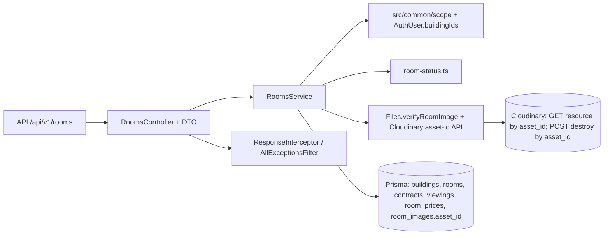

# P2-4 · Backend phòng và ảnh

## 1. Mục tiêu và phạm vi

- Task ổn định: `BE-P2-17..21`. Spec: `API-01..04`, `API-06..08`, `G-01..08`, `SCOPE-01..02`, `ROOM-01..04`, `ROOM-06..07`, `ROOM-09`, `BLD-07`, `PRC-07`, `FILE-01..02`, `DB-B6`, `CON-13`; phần trạng thái phòng của spec 11. `ROOM-05` chỉ được bảo toàn qua trường dữ liệu và helper có sẵn; API công khai là P2-6. Lượt sửa reviewer 04/11/2026 bổ sung CP-9..12, không làm lại CP-1..8 đã PASS.
- Bao gồm: REST staff `/rooms`, bật/tắt bảo trì, khóa/mở khóa, lưới tầng, ảnh và thứ tự ảnh; tích hợp `RoomsModule` vào app; sửa `room_images.asset_id` trong schema và migration, helper FILE-02 để xác minh/xóa theo `asset_id`. Không sửa giá phòng, đề xuất giá, listing công khai, hợp đồng, frontend, `REVIEW.md` hoặc file chính. Thay đổi chữ của `FILE-02` trong `docs/spec/01-architecture.md` và `ROOM-07` trong spec 11 phải có bản nháp riêng thuộc `Artifacts/` do phiên chính chuẩn bị/duyệt; draft BE này không chứa file spec.
- Giữ `rooms.price` chỉ đọc; tiền nguyên đồng. Ngày hiệu lực của đề xuất dùng `todayHanoi()` từ `src/common/date/today.ts`, JSON `YYYY-MM-DD` để `expired = effectiveFrom < today` kể cả ranh giới tháng theo `Asia/Ho_Chi_Minh`.

## 2. Kiến trúc và hợp đồng

| Đích trong `Source/backend/` | Bản nháp trong thư mục này | Mục đích / chủ sở hữu |
|---|---|---|
| `src/modules/rooms/rooms.module.ts` | `src/modules/rooms/rooms.module.ts` | Coder: module, controller/service providers |
| `src/modules/rooms/rooms.controller.ts` | `src/modules/rooms/rooms.controller.ts` | Coder: routes, `@Roles('BOSS','MANAGER')`, DTO |
| `src/modules/rooms/rooms.service.ts` | `src/modules/rooms/rooms.service.ts` | Coder: phạm vi, transaction, truy vấn lưới, ảnh |
| `src/modules/rooms/room-status.ts` | `src/modules/rooms/room-status.ts` | Coder: trạng thái suy ra, không ghi DB |
| `src/modules/rooms/rooms.types.ts` | `src/modules/rooms/rooms.types.ts` | Coder: response types |
| `src/modules/rooms/dto/rooms.dto.ts` | `src/modules/rooms/dto/rooms.dto.ts` | Coder: validate request/query/params |
| `src/app.module.ts` | `src/app.module.ts` | Coder: thêm `RoomsModule`, giữ mọi imports hiện có; file đang tồn tại, dùng `Gốc` của REVIEW |
| `src/modules/files/files.service.ts`, `src/modules/files/cloudinary.ts` | cùng đường dẫn dưới draft `src/` | Coder: `verifyRoomImage` tra metadata theo asset ID, helper xóa theo ID bất biến; không sửa helper ký FILE-01 ngoài việc tương thích |
| `prisma/schema.prisma` | `prisma/schema.prisma` | Coder: thêm `RoomImage.assetId` ánh xạ `room_images.asset_id` và unique asset |
| `prisma/migrations/20261103000000_room_image_asset_id/migration.sql` | cùng đường dẫn dưới draft `prisma/` | Coder: migration thêm cột/unique, kiểm và dừng an toàn nếu đã có row thiếu asset ID; không xóa dữ liệu |
| Không chép vào main | `ref/tsconfig.preview.json`, `ref/vitest*.config.ts`, `ref/generate-preview-client.mjs`, `ref/schema.preview.prisma`, `ref/generated/`, `ref/schema.sql` nếu cần | Coder: glue để generate/typecheck/run **mã draft** và kiểm DB; toàn bộ `ref/` bị `apply-draft` loại trừ |
| `src/modules/rooms/*.spec.ts`, `src/modules/rooms/dto/*.spec.ts` | đường dẫn tương ứng dưới draft `src/` | Tester: assertions/fixtures độc lập theo mã spec; `rooms.schema.spec.ts` sau sửa chỉ import mã/dependency áp dụng được vào main |
| `src/modules/files/*.spec.ts` | đường dẫn tương ứng dưới draft `src/` | Tester: giữ cả FILE-01 upload signature/tham số và FILE-02 metadata/xóa asset ID; không sửa implementation |
| Không chép vào main | `ref/rooms.migration.preview.spec.ts`, fixture PGlite dưới `ref/` | Tester: assertions migration có phụ thuộc PGlite/client preview; `ref/` bị loại khi apply |

**DB:** `buildings(id,is_active,manager_id)`; `rooms(id,building_id,code,floor,area_m2,price,max_occupants,furniture,description,under_maintenance,is_active,created_at,updated_at)` với unique `(building_id,code)`, `area_m2 > 0`, `max_occupants >= 1`; `contracts(id,room_id,status)` và `occupants(contract_id,move_in_date,move_out_date)` là nguồn kiểm giới hạn `DB-B6/CON-13` khi PATCH `maxOccupants`, cùng transaction khóa dòng phòng; chỉ `HOLD|ACTIVE` chặn chuyển trạng thái; `viewings(room_id,status)` đếm `NEW|CONFIRMED`; `room_prices(room_id,status,effective_from)` cho PENDING và `expired`; `room_images(id,room_id,url,public_id,asset_id,sort_order)` tối đa 10 theo BE. `asset_id TEXT NOT NULL UNIQUE` ở DB và `assetId String @unique @map("asset_id")` ở Prisma; không thêm cột trạng thái phòng. Migration chỉ áp dụng khi `room_images` chưa có row; nếu có, dừng với thông báo cần kế hoạch backfill từ Cloudinary theo từng ảnh và chủ dự án xử lý, tuyệt đối không gán ID giả hay xóa row.

**Route và DTO** (mọi path có prefix `/api/v1`; success qua interceptor `{data}` hoặc `{data,meta}`; lỗi `{error:{code,message,fields?}}`):

| Route | Request | `data` / `meta` |
|---|---|---|
| `GET /rooms` | `RoomsQueryDto extends PaginationQuery`: `buildingId?: positive Int`, `includeInactive?: boolean`, `sort?: 'code'|'-code'|'floor'|'-floor'`; mặc định `page=1,limit=20,sort='floor'` | `RoomGridItem[]`, `meta={page,limit,total}`. `RoomGridItem={id,buildingId,code,floor,areaM2,price,maxOccupants,isActive,underMaintenance,status,pendingProposal,imageCount}`. `price: number|null` nguyên đồng; `areaM2:number`; `status` là đúng nhãn Việt của bảng trạng thái; `pendingProposal:null|{id,effectiveFrom,expired}`. Sắp theo `floor`, rồi `code`, rồi `id` để phân trang ổn định. |
| `POST /rooms` | `CreateRoomDto={buildingId:positive Int,code:string(1..10),floor:Int>=1,areaM2:positive decimal(5,1),maxOccupants?:Int>=1,furniture?:string[],description?:string|null}`. Không nhận `price`, `isActive`, `underMaintenance` | `RoomView={id,buildingId,code,floor,areaM2,price:null,maxOccupants,furniture,description,underMaintenance:false,isActive:true,status:'Trống',images:[]}`. |
| `PATCH /rooms/:id` | `RoomIdParamsDto={id:positive Int}`; `UpdateRoomDto` cho phép `code,floor,areaM2,maxOccupants,furniture,description,underMaintenance,isActive` với cùng kiểu; không nhận `price`/`buildingId`. Chỉ khi **bật** bảo trì hoặc **khóa** mới trả cảnh báo lịch hẹn. | `RoomView` như POST, cộng `pendingViewingCount:number` khi bật bảo trì/khóa; ảnh theo `sortOrder,id`. `status` từ helper; không ghi trạng thái. |
| `POST /rooms/:id/images` | `AddRoomImageDto={assetId:nonempty string,publicId:string,version:positive Int,format:'jpg'|'png'|'webp'}` lấy từ kết quả upload Cloudinary; từ chối `url` do client | `RoomImageView={id,roomId,publicId,url,sortOrder}`; URL do BE dựng, `assetId` chỉ lưu nội bộ để xóa, không cần lộ trong response. |
| `PATCH /rooms/:id/images/order` | `OrderRoomImagesDto={imageIds:positive Int[]}`; đúng tập ID hiện tại của phòng, không trùng; tối đa 10 | `RoomImageView[]` sau khi sắp xếp `sortOrder` 0..n−1 trong một transaction. |
| `DELETE /rooms/:id/images/:imageId` | hai ID dương | `{data:null}`; xóa row trước, gọi Cloudinary destroy sau; lỗi destroy chỉ log. |

`RoomsController.list(user:AuthUser,query:RoomsQueryDto):Promise<Paginated<RoomGridItem>>`; `create(user,dto):Promise<RoomView>`; `update(user,id,dto):Promise<RoomView>`; `addImage(user,roomId,dto):Promise<RoomImageView>`; `reorderImages(user,roomId,dto):Promise<RoomImageView[]>`; `deleteImage(user,roomId,imageId):Promise<void>`. Service có cùng phương thức. `verifyRoomImage(db,roomId,{assetId,publicId,version,format},env?):Promise<{assetId,publicId,url}>` kiểm folder cục bộ và gọi Cloudinary Admin `GET /resources/:asset_id` bằng credentials server, đối chiếu chính xác `asset_id`, `public_id`, `version`, `format`, `resource_type='image'`, `type='upload'`, sau đó BE dựng URL. `destroyRoomImageByAssetId(assetId,env?):Promise<void>` dùng Cloudinary Upload API `POST /image/destroy` với tham số ký `asset_id` (không gửi `public_id`). `deriveRoomStatus({underMaintenance,contracts}): 'Đang thuê'|'Đã cọc'|'Bảo trì'|'Trống'`, ưu tiên ACTIVE → HOLD → bảo trì → trống. Không truyền `status` từ client. Nguồn hợp đồng Cloudinary: [Upload API](https://cloudinary.com/documentation/image_upload_api_reference), [Admin API](https://cloudinary.com/documentation/admin_api).

**Phạm vi và lỗi:** `@Roles` chặn TENANT/GUEST (`FORBIDDEN` 403, thiếu token `UNAUTHENTICATED` 401). Danh sách không `buildingId` lọc các tòa active trong `AuthUser.buildingIds`; Manager yêu cầu `buildingId` ngoài phạm vi hoặc ID phòng/ảnh thuộc tòa khác → `OUT_OF_SCOPE` 403; Boss thấy tất cả, mặc định ẩn phòng/tòa khóa, `includeInactive=true` hiện phòng khóa trong tòa active và tòa khóa cho Boss; Manager không thấy tòa khóa theo `SCOPE-02`/`BLD-07`. ID không tồn tại → `NOT_FOUND` 404. Tạo trong tòa khóa, bật bảo trì/khóa khi có HOLD/ACTIVE, cập nhật trạng thái tranh chấp, hoặc thêm ảnh thứ 11 → `CONFLICT_STATE` 409. Trùng `(buildingId,code)` kể cả phòng khóa → `VALIDATION_FAILED` 400, `fields.code='Mã phòng đã có trong tòa (kể cả phòng đã khóa)'`; input sai, `price`/URL/foreign fields, `publicId` sai thư mục/định dạng, Cloudinary không có asset ID hoặc metadata không khớp → `VALIDATION_FAILED` 400 với field tương ứng. Một `assetId` đã gắn ở bất kỳ phòng nào → 400 `VALIDATION_FAILED`, `fields.assetId`. Thiếu Cloudinary cấu hình khi xác minh/gắn ảnh → `UPLOAD_NOT_CONFIGURED` 503; Cloudinary tra cứu lỗi mạng/5xx → `INTERNAL_ERROR` 500, không gắn row; không lộ credential/DB error. Xóa Cloudinary thất bại/timeout chỉ log, trả thành công theo `ROOM-07`.

**Tính nhất quán:** create/patch kiểm tòa/phạm vi phía BE. Patch chuyển `isActive` hoặc `underMaintenance` chạy transaction, khóa dòng phòng và kiểm hợp đồng trước khi update, để tránh hai request đổi trạng thái cùng lúc; không xóa lịch hẹn. Thêm/reorder/delete ảnh khóa dòng phòng cùng transaction để giới hạn 10 và thứ tự ổn định, không dựa vào count rồi insert không khóa; unique DB trên `asset_id` chặn cùng asset gắn ở hai phòng. Xóa row trong transaction và commit trước khi gọi Cloudinary destroy theo `assetId` của row vừa xóa; không giữ khóa DB trong lúc chờ mạng. Nếu destroy cũ trả muộn sau khi client gắn asset mới có cùng `publicId` nhưng `assetId` khác, chỉ asset cũ bị xóa. `room.findMany` một lần/trang với relation count/select theo lô và `room.count` cho `meta`; không truy vấn theo từng phòng. `expired` lấy mốc Hà Nội tại đầu request, so sánh ngày thuần.

## 3. Câu hỏi bỏ ngỏ và giả định

Chủ dự án xác nhận 03/11/2026: tầng hầm gọi “G” nhưng không tạo phòng ở tầng G; API tạo/sửa `floor` chỉ nhận số nguyên từ 1, giữ cột `rooms.floor Int`. Ảnh thứ 11 trả HTTP 409 `CONFLICT_STATE`. Q-P24-9 chọn A: xác minh và lưu Cloudinary `asset_id` bất biến, xóa bằng ID đó. Nếu kiểm tra dữ liệu thật thấy `room_images` đã có row trước migration, CP-5 dừng; báo chủ dự án chọn (A) backfill ID thật từ Cloudinary theo từng row rồi migrate, (B) hoãn migration để xử lý dữ liệu ngoài luồng; không tự xóa hay cấp ID giả.

Không còn câu hỏi chặn CP-11. Chủ dự án trả lời 04/11/2026: **Q-P24-11 = B** — người đang ở là occupant của hợp đồng `ACTIVE`, có `move_in_date <= today` và `move_out_date IS NULL OR move_out_date >= today`, với `today` là ngày nghiệp vụ `Asia/Ho_Chi_Minh`; ngày dọn đi vẫn tính người ở hết ngày. **Q-P24-12 = A** — PATCH `maxOccupants` thấp hơn số người đang ở trả HTTP 409 `CONFLICT_STATE`. Hai quyết định này bổ sung hợp đồng CP-11, không phải `[ASSUMPTION]`.

`[ASSUMPTION]` kỹ thuật, không thay quyết định nghiệp vụ: A-P2-4-1: `code` giữ nguyên chữ nhập (spec không yêu cầu viết hoa mã phòng), độ dài 1..10 theo schema, không tự trim; A-P2-4-2: `areaM2` truyền JSON number với 1 chữ số thập phân, phản hồi number; A-P2-4-3: PATCH không có trường nào là no-op; A-P2-4-4: thứ tự ảnh nhận toàn bộ `imageIds` và đánh số từ 0; A-P2-4-6: lỗi trùng mã phòng dùng `400 VALIDATION_FAILED` với `fields.code`; A-P2-4-7: `assetId` lấy từ upload response do FE gửi, BE không trả ID này trong response ảnh; A-P2-4-8: Cloudinary metadata lookup 5xx/timeout dùng `500 INTERNAL_ERROR`, lookup 404/mismatch dùng `400 VALIDATION_FAILED`; A-P2-4-9: migration yêu cầu bảng `room_images` rỗng vì chưa có API ảnh trên main, nếu dữ liệu thực khác thì dừng để chủ dự án chọn backfill. `[ASSUMPTION]` có sẵn A2-3 của `PaginationQuery`: chữ thông báo validation trang/limit; A2-8 của `FILE-01`: incoming image giới hạn cạnh dài 1920 px. Q-01/Q-02/Q-03 của overview thuộc giai đoạn hợp đồng/đơn giá/webhook, không chặn P2-4.

## 4. Checkpoints, kiểm chứng và quyền sở hữu

Mỗi CP: **coder** chỉ sửa implementation/glue liệt kê; **tester** chỉ thêm/sửa `*.spec.ts` trong draft và fixtures test trong `ref/`. Chạy test ngay trên draft; lỗi ở CP nào sửa đúng CP đó.

### CP-1 · BE-P2-17 · CRUD và scope

- Coder: `src/modules/rooms/{rooms.module,rooms.controller,rooms.service,rooms.types}.ts`, `src/modules/rooms/dto/rooms.dto.ts`, `src/app.module.ts`, glue `ref/` nếu cần. Tester: `src/modules/rooms/{rooms,rooms.http}.spec.ts`, `src/modules/rooms/dto/rooms.dto.spec.ts`.
- Done when: từ `Source/backend`, `npx vitest run --config artifact_BE/2026-11-03-BE-P2-17-21/ref/vitest.preview.config.ts artifact_BE/2026-11-03-BE-P2-17-21/src/modules/rooms` PASS; query POST/PATCH trong test không bao giờ chứa `price`; lỗi scope và trùng mã có status/body đúng. Chưa tính phần status/lưới chi tiết cho đến CP-3/4.
- Kịch bản: `ROOM-01` Boss tạo/phòng Manager tạo ở tòa mình; `SCOPE-02` Manager A tạo/sửa phòng tòa B → 403 `OUT_OF_SCOPE`, Tenant → 403; `ROOM-02` POST/PATCH `price` → 400, phòng mới `price=null`; `ROOM-06` trùng mã của phòng active/locked → 400 đúng chữ, tòa khóa → 409; `ROOM-01` furniture `[]`, mảng chuỗi, phần tử sai kiểu → 400; area 0/9999.9/10000, maxOccupants 0/1, code 0/10/11 ký tự, ID 0/2147483647/2147483648; `floor=-1`, `0` hoặc `"G"` → 400 `VALIDATION_FAILED`, `floor=1` hợp lệ. `G-01` giá trong response là số nguyên hoặc null, không tính giá ở FE.

### CP-2 · BE-P2-18 · Bảo trì và khóa

- Coder: `src/modules/rooms/rooms.service.ts`, `src/modules/rooms/dto/rooms.dto.ts`, `src/modules/rooms/rooms.types.ts`. Tester: `src/modules/rooms/rooms.service.spec.ts`, `src/modules/rooms/rooms.http.spec.ts`.
- Done when: lệnh Vitest draft trên PASS; lock transaction và kiểm HOLD/ACTIVE chứng minh bằng mock transaction và kịch bản cạnh tranh; lịch hẹn không bị xóa.
- Kịch bản: `ROOM-03` bật/tắt bảo trì phòng trống được; `ROOM-03/04` CG01/203 ACTIVE và HOLD đều → 409 `CONFLICT_STATE`, không ghi thay đổi; `ROOM-04` khóa/mở khóa phòng trống bằng `isActive`, không hard-delete; `ROOM-09` NEW+CONFIRMED đếm N, LOST/CANCELLED không đếm, vẫn bật/khóa thành công; `SCOPE-02` tòa khác → 403; đồng thời hai request thay trạng thái → một kết quả hợp lệ hoặc 409, không vượt kiểm tra hợp đồng.

### CP-3 · BE-P2-19 · Trạng thái suy ra

- Coder: `src/modules/rooms/room-status.ts`, tích hợp `rooms.service.ts`/`rooms.types.ts`. Tester: `src/modules/rooms/room-status.spec.ts`.
- Done when: Vitest draft trên PASS, không có field status trong Prisma write/schema.
- Kịch bản: `G-08` ACTIVE+HOLD+maintenance → 'Đang thuê'; HOLD+maintenance → 'Đã cọc'; maintenance duy nhất → 'Bảo trì'; không điều kiện → 'Trống'; `ROOM-04` phòng khóa vẫn trả trạng thái suy ra khi được phép xem; không có status truyền từ request.

### CP-4 · BE-P2-20 · Lưới tầng

- Coder: `src/modules/rooms/{rooms.service,rooms.types,rooms.controller}.ts`, `src/modules/rooms/dto/rooms.dto.ts`. Tester: `src/modules/rooms/{rooms.service,rooms.http}.spec.ts`, `dto/rooms.dto.spec.ts`.
- Done when: Vitest draft trên PASS; spy DB xác nhận 1 `room.findMany`/trang, 1 `room.count`, số truy vấn không tăng theo số phòng; `meta` chuẩn.
- Kịch bản: `API-02` trang rỗng, trang 1/limit 1 và limit 100, limit 0/101 hoặc page 0 → 400; `BLD-07` mặc định ẩn phòng/tòa khóa, Boss `includeInactive=true` thấy cả hai, Manager không thấy tòa khóa nhưng thấy phòng khóa thuộc tòa active; `SCOPE-02` Manager A lọc tòa B → 403, không truyền `buildingId` chỉ thấy tòa mình; `PRC-07` PENDING hôm qua → `expired=true`, hôm nay/cuối tháng theo Hà Nội → false, APPROVED không xuất hiện ở `pendingProposal`; `ROOM-01` đủ floor/code/area/price/status/imageCount; `G-01` price nguyên hoặc null.

### CP-5 · BE-P2-21 · Schema và migration asset ID

- Coder: `prisma/schema.prisma`, `prisma/migrations/20261103000000_room_image_asset_id/migration.sql`, `ref/generate-preview-client.mjs` và cấu hình preview Prisma dưới `ref/`. Tester: `src/modules/rooms/rooms.schema.spec.ts` và fixture DB test-only dưới `ref/` nếu cần. Coder không sửa `prisma/constraints.sql` nếu không đổi ràng buộc cũ.
- Done when: từ `Source/backend`, `npx prisma validate --schema artifact_BE/2026-11-03-BE-P2-17-21/prisma/schema.prisma` PASS; generator preview ghi **chỉ** `ref/generated/`, `npx vitest run --config artifact_BE/2026-11-03-BE-P2-17-21/ref/vitest.preview.config.ts artifact_BE/2026-11-03-BE-P2-17-21/src/modules/rooms/rooms.schema.spec.ts` PASS. Kiểm `node prisma/check-constraints.mjs artifact_BE/2026-11-03-BE-P2-17-21/ref artifact_BE/2026-11-03-BE-P2-17-21/ref` phải in `50/50` sau khi coder sinh `ref/schema.sql` từ schema draft bằng `prisma migrate diff --from-empty --to-schema-datamodel ... --script -o ...` và đặt `constraints.sql` hiện hành trong `ref/` bằng preview glue chỉ đọc nguồn; không chạy trên schema main. Chạy SQL migration với PGlite từ baseline có row và không row: rỗng áp dụng được, có row thiếu ID phải dừng nguyên vẹn.
- Kịch bản: `ROOM-07/DB-02/DB-07` `asset_id` là `NOT NULL`, unique và ánh xạ `assetId`; một asset không gắn hai phòng; migration từ baseline rỗng giữ 50/50 ràng buộc cũ; baseline có ảnh cũ không bị xóa/gán ID giả. `G-01/G-02` schema này không thay cột tiền hoặc ngày.

### CP-6 · BE-P2-21 · FILE-02 xác minh asset và xóa theo ID

- Coder: `src/modules/files/files.service.ts`, `src/modules/files/cloudinary.ts`, `ref/vitest.preview.config.ts` và `ref/vitest.full-preview.config.ts` nếu resolver cần overlay file chính; tester: `src/modules/files/{files.service,cloudinary}.spec.ts`, fixture chỉ trong `ref/`.
- Done when: từ `Source/backend`, `npx vitest run --config artifact_BE/2026-11-03-BE-P2-17-21/ref/vitest.preview.config.ts artifact_BE/2026-11-03-BE-P2-17-21/src/modules/files` PASS, gọi giả lập Cloudinary Admin/Upload API đúng method, endpoint, auth/signature và không dùng `public_id` trong destroy.
- Kịch bản: `FILE-02/ROOM-07` asset ID thật và metadata khớp folder phòng, `publicId`, `version`, `format`, `resource_type=image`, `type=upload` → trả ID và URL do BE dựng; ID không tồn tại hoặc bất cứ trường nào lệch → 400 `VALIDATION_FAILED` không gắn row; thiếu `assetId`, URL do client, `../`, gif/svg, version 0 → 400; thiếu `CLOUDINARY_URL` → 503 `UPLOAD_NOT_CONFIGURED`, tra cứu 5xx/timeout → 500 `INTERNAL_ERROR` không lộ secret. `FILE-01/SCOPE-02` Manager xin chữ ký tòa khác vẫn 403 `OUT_OF_SCOPE`.

### CP-7 · BE-P2-21 · Gắn, sắp xếp, xóa ảnh an toàn race

- Coder: `src/modules/rooms/{rooms.service,rooms.controller,rooms.types}.ts`, `src/modules/rooms/dto/rooms.dto.ts`; tester: `src/modules/rooms/{rooms.service,rooms.http,rooms.images}.spec.ts`, `src/modules/rooms/dto/rooms.dto.spec.ts`, fixture test-only `ref/`.
- Done when: từ `Source/backend`, `npx vitest run --config artifact_BE/2026-11-03-BE-P2-17-21/ref/vitest.preview.config.ts artifact_BE/2026-11-03-BE-P2-17-21/src/modules/rooms` PASS; race test giả lập delete timeout rồi Cloudinary hoàn tất muộn vẫn giữ asset mới cùng `publicId`.
- Kịch bản: `ROOM-07/FILE-02` ảnh 1..10 hợp lệ, lưu `assetId` thật, response không lộ credential; ảnh thứ 11 → 409 `CONFLICT_STATE`; duplicate `publicId` trong cùng phòng, duplicate `assetId` ở phòng khác → 400 `VALIDATION_FAILED`; 0 ảnh reorder `[]`, reorder sai tập/trùng/thiếu ID → 400; xóa row commit rồi destroy bằng ID cũ, lỗi/timeout destroy log và request vẫn thành công; thêm lại cùng `publicId` với asset ID mới trong khi destroy cũ chậm hoặc hoàn tất sau timeout → chỉ ID cũ mất, row và Cloudinary asset mới còn; `SCOPE-02` Manager B thêm/xóa/sắp ảnh Manager A → 403; `ROOM-09` thao tác ảnh không đổi lịch hẹn/trạng thái.

### CP-8 · BE-P2-21 · Kiểm toàn draft

- Coder: chỉ `ref/` preview glue cần thiết để dùng generated Prisma client draft và resolver ưu tiên draft `src/modules/files`, `src/modules/rooms`, rồi fallback main; tester: chỉ `*.spec.ts` trong draft và fixture `ref/`, không sửa implementation.
- Done when: từ `Source/backend`, `npx vitest run --config artifact_BE/2026-11-03-BE-P2-17-21/ref/vitest.full-preview.config.ts` PASS trên cả test main và draft với imports overlay; `npx tsc -p artifact_BE/2026-11-03-BE-P2-17-21/ref/tsconfig.preview.json --noEmit` PASS dùng Prisma client sinh từ schema draft; `npx oxlint --type-aware artifact_BE/2026-11-03-BE-P2-17-21/src` PASS; `node prisma/check-constraints.mjs artifact_BE/2026-11-03-BE-P2-17-21/ref artifact_BE/2026-11-03-BE-P2-17-21/ref` in `50/50`. `npm run lint/test/build` trên **main** chỉ là regression, không chứng minh draft; `npm run test:e2e` chỉ khi DB dev được cấu hình an toàn theo D2-14, nếu thiếu `DATABASE_URL` ghi **chưa chạy**, không gọi PASS.
- Kịch bản: `FILE-02/ROOM-07` full preview bắt import file helper draft trong test main/draft, không fallback helper cũ; `ROOM-01..04/ROOM-06..07/ROOM-09/BLD-07/PRC-07/SCOPE-02` các luồng CP-1..7 vẫn qua; `G-01/G-02` tiền số nguyên và mốc hôm nay/cuối tháng theo `Asia/Ho_Chi_Minh` không đổi; `DB-07` 50/50 sau schema draft.

**Preview draft:** coder chỉnh `ref/tsconfig.preview.json`, `ref/vitest.preview.config.ts`, `ref/vitest.full-preview.config.ts` để ưu tiên mọi file draft (kể cả `files.service.ts`) và fallback main cho import còn thiếu; kiểm test main thật dùng helper draft. Vì `@prisma/client` main chưa có `assetId`, coder tạo `ref/generate-preview-client.mjs` đọc schema draft, tạo schema preview trong `ref/` với generator output `ref/generated/`, rồi chạy Prisma generate vào `ref/`; preview TypeScript/Vitest alias `@prisma/client` sang client này. Không generate vào `node_modules` hay main. SQL phục vụ check đặt `ref/schema.sql`, `ref/constraints.sql` dưới vùng bị loại khi apply; `ref/` và `preview.html` không được chép vào main, migration và schema thật trong draft thì có. Không sao chép mã draft vào main, không auto-fix hoặc ghi DB dev ngoài e2e được phép. Phiên chính theo dõi bản nháp sửa spec `FILE-02/ROOM-07` tương ứng với quyết định Q-P24-9 để trình chủ dự án cùng draft BE; quyết định đã đủ để coder/tester tiếp tục.

### Lượt sửa reviewer 04/11/2026 · thứ tự bổ sung

CP-1..8 và kết quả cũ là lịch sử kiểm tra trước review; gate cuối phải chạy lại sau CP-9..11. Đặc biệt, Done when CP-5 về PGlite được CP-9 tách thành test chỉ trong `ref/`, còn `rooms.schema.spec.ts` được áp dụng vào main; full preview CP-8 được CP-10 sửa để test draft có cả FILE-01 và FILE-02. Main `files.service.spec.ts` cũ có assertions FILE-02 theo hợp đồng trước Q-P24-9 nên vẫn được exclude trong preview overlay, nhưng tất cả assertions FILE-01 của nó phải có trong test draft. Không đưa đường dẫn `ref/` vào bất kỳ `*.spec.ts` nào sẽ được chép sang main.

### CP-9 · BE-P2-21 · Tách test migration khỏi test áp dụng

- Coder: chỉ `ref/vitest.preview.config.ts` hoặc `ref/vitest.migration.config.ts` (glue chọn test trong `ref/`, alias client draft), và `ref/tsconfig.preview.json` nếu cần để typecheck test preview; không sửa schema/migration đã qua CP-5. Tester: `src/modules/rooms/rooms.schema.spec.ts` và `ref/rooms.migration.preview.spec.ts` cùng fixture PGlite test-only dưới `ref/`. Test migration hiện tại được chuyển về `ref/` bằng file editing tool; test áp dụng vẫn kiểm Prisma DMMF qua `@prisma/client` và đường dẫn migration tương đối tới `prisma/`, không import `ref/`, PGlite hoặc client generate preview bằng đường dẫn cứng.
- Done when: từ `Source/backend`, `npx vitest run --config artifact_BE/2026-11-03-BE-P2-17-21/ref/vitest.migration.config.ts artifact_BE/2026-11-03-BE-P2-17-21/ref/rooms.migration.preview.spec.ts` PASS (hoặc dùng preview config nếu include `ref/`); `npx vitest run --config artifact_BE/2026-11-03-BE-P2-17-21/ref/vitest.preview.config.ts artifact_BE/2026-11-03-BE-P2-17-21/src/modules/rooms/rooms.schema.spec.ts` PASS. Rà soát import trong test sẽ áp dụng: chỉ dependency tồn tại sau apply; chạy lại test đó trên main sau khi owner duyệt/apply và generate client theo quy trình app. Không ghi DB dev.
- Kịch bản: `ROOM-07/DB-02/DB-07` test áp dụng xác nhận `RoomImage.assetId` bắt buộc, unique, ánh xạ `room_images.asset_id`; `G-01/G-02` tiền vẫn `Int`, ngày nghiệp vụ vẫn `@db.Date`. `ROOM-07/DB-07` test `ref/` dùng PGlite: bảng cũ rỗng migrate thành công, asset trùng hoặc NULL bị chặn; có row ảnh cũ thì migration từ chối và giữ nguyên row/schema, không tạo ID giả. Schema draft/checker vẫn `50/50`.

### CP-10 · BE-P2-21 · Khôi phục kiểm thử FILE-01 cùng FILE-02

- Coder: chỉ `ref/vitest.full-preview.config.ts` và preview resolver/config dưới `ref/` nếu cần để thu đủ test draft, không sửa helper FILE-01 hay code FILE-02 nếu không có FAIL thực. Tester: `src/modules/files/files.service.spec.ts`, `src/modules/files/cloudinary.spec.ts`; tái lập assertions FILE-01 đã có ở main trong hai file draft, giữ assertions FILE-02 mới độc lập. Không import test main bằng đường dẫn draft/ref từ file test áp dụng.
- Done when: từ `Source/backend`, `npx vitest run --config artifact_BE/2026-11-03-BE-P2-17-21/ref/vitest.preview.config.ts artifact_BE/2026-11-03-BE-P2-17-21/src/modules/files` PASS; full preview PASS với test draft chứa cả FILE-01 và FILE-02, main test cũ vẫn exclude chỉ để tránh hợp đồng FILE-02 cũ mâu thuẫn. Sau apply, `npm run test` phải chạy được hai file draft đã áp dụng mà không có `ref/`.
- Kịch bản: `FILE-01/SCOPE-02` `signRoomImageUpload` trả folder `rooms/<buildingId>/<roomId>`, `allowed_formats=jpg,png,webp`, transformation giới hạn 1920 px, timestamp/signature và upload URL đúng; Boss/phòng trong phạm vi thành công, Manager ngoài phạm vi → 403 `OUT_OF_SCOPE`, phòng không có/khóa → 404, thiếu cấu hình → 503, không lộ `apiSecret`. `FILE-01` kiểm vector chữ ký Cloudinary, thứ tự tham số, tham số bị loại, URL cấu hình sai, constants. `FILE-02/ROOM-07` xác minh `assetId` và metadata, URL do BE dựng; ID/metadata sai → 400, lỗi mạng → 500, thiếu cấu hình → 503; destroy gửi `asset_id` và chữ ký, không gửi `public_id`.

### CP-11 · BE-P2-17 · Chặn giảm sức chứa dưới số người đang ở

- Coder: `src/modules/rooms/rooms.service.ts` trong draft, giữ nguyên `PATCH /api/v1/rooms/:id`, `UpdateRoomDto.maxOccupants?: Int >= 1`, response `RoomView` và guard scope cũ. Khi `maxOccupants` được gửi để giảm, vào transaction, khóa row phòng, đếm occupants có `contract.roomId=id`, `contract.status='ACTIVE'`, `moveInDate <= todayHanoi()` và `(moveOutDate=null OR moveOutDate >= todayHanoi())` theo Q-P24-11, rồi mới cập nhật. Ngày nghiệp vụ là `@db.Date` theo `Asia/Ho_Chi_Minh`; cùng đường transaction cho PATCH có/không có `isActive` hoặc `underMaintenance`. Nếu số người vượt sức chứa mới, rollback và trả HTTP 409 `CONFLICT_STATE` theo Q-P24-12, không đổi phòng. Không chuyển tính toán sang FE/DB constraint. Tester: `src/modules/rooms/rooms.service.spec.ts`, `src/modules/rooms/rooms.http.spec.ts` và fixture test-only `ref/` nếu cần.
- Done when: từ `Source/backend`, `npx vitest run --config artifact_BE/2026-11-03-BE-P2-17-21/ref/vitest.preview.config.ts artifact_BE/2026-11-03-BE-P2-17-21/src/modules/rooms` PASS; HTTP PATCH thực đi qua controller/ValidationPipe/exception filter trả `{error:{code:'CONFLICT_STATE',message}}` với status 409, không ghi khi giảm thấp hơn số đang ở. Test giao tranh xác nhận khóa row và đếm trong cùng transaction, không lọt qua nhánh PATCH chỉ đổi `maxOccupants`.
- Kịch bản: `DB-B6/CON-13/ROOM-01` 0 người giảm về 1 được, 2 người giữ 2 hoặc tăng 3 được, giảm 1 từ 2 người → 409 `CONFLICT_STATE`; `CG01/203` từ seed có ACTIVE contract và 2 occupants, giảm 2→1 → 409 trong HTTP/test DB seed nếu môi trường dev an toàn sẵn có. Occupant của HOLD/ENDED, người có `moveInDate > today`, hoặc `moveOutDate < today` không tính; `moveInDate=today` và `moveOutDate=today` vẫn tính. Test ngày cuối tháng/đầu tháng theo `Asia/Ho_Chi_Minh`, kể cả UTC còn ngày cũ khi Hà Nội đã sang ngày mới. `SCOPE-02/API-04` Manager ngoài tòa → 403 `OUT_OF_SCOPE` trước update; request sai `maxOccupants=0`/quá Prisma Int → 400 `VALIDATION_FAILED`; `ROOM-03/04` chuyển trạng thái với HOLD/ACTIVE vẫn 409, không phá hành vi cũ; hai PATCH đồng thời không vượt `DB-B6`.

### CP-12 · BE-P2-17/21 · Gate toàn draft sau sửa

- Coder: chỉ preview glue dưới `ref/` khi gate chỉ ra lỗi resolver/typecheck; tester: chỉ `*.spec.ts` trong draft và test-only fixtures `ref/`. Chạy lệnh trong CP-9..11, full preview `npx vitest run --config artifact_BE/2026-11-03-BE-P2-17-21/ref/vitest.full-preview.config.ts`, `npx tsc -p artifact_BE/2026-11-03-BE-P2-17-21/ref/tsconfig.preview.json --noEmit`, `npx oxlint --type-aware artifact_BE/2026-11-03-BE-P2-17-21/src`, `npx prisma validate --schema artifact_BE/2026-11-03-BE-P2-17-21/prisma/schema.prisma`, `node prisma/check-constraints.mjs artifact_BE/2026-11-03-BE-P2-17-21/ref artifact_BE/2026-11-03-BE-P2-17-21/ref` → lần lượt PASS/PASS/PASS/PASS/`50/50`. Prisma validate dùng biến URL giả chỉ để parse, không kết nối DB. Nếu checker hay test tạo output, chỉ ghi dưới draft `ref/`. App main `npm run test/lint/build` chỉ là regression và không thay gate draft; e2e DB thật chỉ chạy nếu có môi trường dev an toàn theo D2-14, nếu không ghi chưa chạy.
- Kịch bản: `DB-B6/CON-13` check sức chứa và lỗi HTTP; `FILE-01/FILE-02` test ký upload, xác minh/xóa asset đều có trong full preview và chạy sau apply; `ROOM-07/DB-07` migration PGlite chạy riêng trong `ref/`, còn `rooms.schema.spec.ts` không phụ thuộc `ref/`; `SCOPE-02/BLD-07/PRC-07/G-01/G-02` regression các luồng phạm vi, trạng thái, integer money và ranh giới ngày/tháng Hà Nội. Coder/tester báo số suite/assertion thực, không suy từ gate CP-8 cũ.
