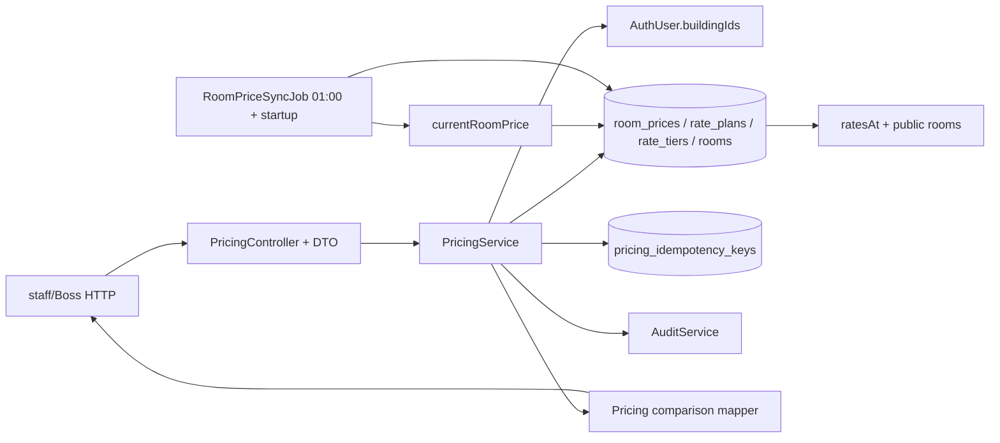

# P2-5 · Backend pricing (BE-P2-22..28)

## 1. Mục tiêu và phạm vi

- Tạo API đề xuất, duyệt/từ chối, danh sách giá phòng và bảng giá; đồng bộ `rooms.price` theo ngày Hà Nội. Task ổn định: `BE-P2-22`..`BE-P2-28`; spec: `PRC-01`..`PRC-12`, `RATE-01`..`RATE-06`, `SVC-04`, `AUD-01`, `API-01`..`API-08`, `G-01`..`G-10`, `D-08`..`D-09`.
- Trong phạm vi: `room_prices`, `rate_plans`, `rate_tiers`, audit, API staff/Boss và `RoomPriceSyncJob`; nối `PricingModule` vào app. Giữ hợp đồng `ratesAt`/`currentRoomPrice`, room/public hiện có của P2-4.
- Trong phạm vi theo quyết định Q-P5-4: kho `Idempotency-Key` bền vững 24 giờ cho cả sáu POST propose/approve/reject; schema, migration và DB check tương ứng ở **draft**.
- Trong phạm vi theo quyết định Q-P5-5 A: sửa nhánh **mở khóa** của `RoomsService.update` và `BuildingsService.update` để đồng bộ `rooms.price` trong cùng transaction mở khóa; hai file này vào draft dạng **mirror toàn file** (bắt đầu từ nội dung main ở `2fa7acb`, chỉ thêm lời gọi helper).
- Ngoài phạm vi theo quyết định Q-P5-9 A: **`ServicesService` không đổi** (không mirror, không chạm `PATCH /services`); bước approve plan `SERVICE` không kiểm `services.is_active`.
- Ngoài phạm vi: **`PRC-11` ("Giá chờ duyệt" trên "Việc hôm nay" của Boss) thuộc `BE-P2-33` — `GET /dashboard` ở module `notifications` (`dashboard.controller.ts`), feature P2-6, theo `docs/spec/19-notifications.md` NOTI-06 ghi chú Phase 2. P2-5 không có deliverable nào cho PRC-11 và không test PRC-11 ở CP-6/CP-7**; P2-5 chỉ cung cấp dữ liệu nền (`room_prices.status`, expiry dẫn xuất theo `PRC-10`) mà BE-P2-33 sẽ đếm.
- Ngoài phạm vi: FE P2-8, tính hóa đơn Phase 4, đổi seed, dọn lịch sử, e2e DB thật trước khi áp dụng draft. Q-01 (thuê chồng), Q-02 (bậc điện thực), Q-03 (webhook) trong overview không chặn P2-5; seed hiện hành dùng cho kiểm thử.

## 2. Kiến trúc và hợp đồng

Thư mục nháp dưới đây là `Source/backend/artifact_BE/2026-11-04-BE-P2-22-28/`; mọi file áp dụng phản chiếu từ gốc `Source/backend/`. Coder sở hữu implementation và preview glue; tester sở hữu `*.spec.ts`, fixture và assertion ở `ref/`. `PLAN.md`, `REVIEW.md`, `ref/` không được áp dụng.

| Đích `Source/backend/…` | Bản nháp `…/` | Vai trò |
|---|---|---|
| `src/modules/pricing/pricing.module.ts` | `src/modules/pricing/pricing.module.ts` | Ghép controller/service, Prisma/Audit, export nếu cần |
| `src/modules/pricing/pricing.controller.ts` | `src/modules/pricing/pricing.controller.ts` | Routes, `@Roles`, `@CurrentUser`, `@Ip` |
| `src/modules/pricing/pricing.service.ts` | `src/modules/pricing/pricing.service.ts` | Giao dịch, scope, audit, các list |
| `src/modules/pricing/pricing.types.ts` | `src/modules/pricing/pricing.types.ts` | Response/list/comparison types |
| `src/modules/pricing/dto/pricing.dto.ts` | `src/modules/pricing/dto/pricing.dto.ts` | Create/query/id/reject validation |
| `src/modules/pricing/price-comparison.ts` | `src/modules/pricing/price-comparison.ts` | Old→new, phần trăm số nguyên với làm tròn 1 chữ số |
| `src/modules/pricing/room-price-sync.ts` | `src/modules/pricing/room-price-sync.ts` | Helper thuần dùng chung cho job và nhánh mở khóa |
| `src/jobs/room-price-sync.job.ts` | `src/jobs/room-price-sync.job.ts` | 01:00 Hà Nội, startup, `roomIds`, log summary (gọi helper) |
| `src/modules/rooms/rooms.service.ts` | `src/modules/rooms/rooms.service.ts` | Mirror toàn file: nhánh mở khóa phòng gọi helper trong cùng transaction |
| `src/modules/buildings/buildings.service.ts` | `src/modules/buildings/buildings.service.ts` | Mirror toàn file: nhánh mở khóa tòa gọi helper cho mọi phòng của tòa |
| `src/app.module.ts` | `src/app.module.ts` | Nhập `PricingModule`, đăng ký schedule chỉ ngoài test |
| `src/modules/pricing/pricing-idempotency.ts` | `src/modules/pricing/pricing-idempotency.ts` | Ghi/replay `Idempotency-Key` trong transaction và 24 giờ |
| `prisma/schema.prisma` | `prisma/schema.prisma` | Model `PricingIdempotencyKey` bổ sung |
| `prisma/migrations/20261104000000_pricing_idempotency/migration.sql` | đường phản chiếu tương ứng | Migration bảng/index idempotency |
| `prisma/check-constraints.mjs` | `prisma/check-constraints.mjs` | Thêm scenario unique/expiry idempotency; giữ 50/50 hiện có. **Chỉ viết scenario, chưa chạy ở CP-1**; việc chạy hoãn tới CP-7 (xem CP-7) |
| `src/modules/pricing/*.spec.ts`, `src/jobs/*.spec.ts` | đường phản chiếu tương ứng | Tester: unit/HTTP/job tests theo spec ID |
| không áp dụng | `ref/vitest.preview.config.ts`, `ref/tsconfig.preview.json`, `ref/*` | Coder: resolver preview + TS rootDirs; tester: fixture/test-only data; không sao chép ra main |

DB hiện có: `room_prices(id,room_id,price,effective_from,status,reason,proposed_by_id,reviewed_by_id,reviewed_at,review_note,created_at)`; `rate_plans(id,building_id,kind,service_id,effective_from,status,reason,proposed_by_id,reviewed_by_id,reviewed_at,review_note,created_at)`; `rate_tiers(id,rate_plan_id,tier_no,up_to,unit_price)`; `rooms(id,building_id,price,is_active)`; `buildings(id,manager_id,water_mode,is_active)`; `services(id,building_id,is_active)`; `audit_logs(actor_id,action,entity,entity_id,before,after,ip)`. Giữ `room_prices_one_pending`, `rate_plans_one_pending`, `rate_plans_one_per_day`. Bổ sung `pricing_idempotency_keys(id Int PK, actor_id Int FK users, key String, route String, request_hash String, status_code Int, response_json Json, created_at timestamptz, expires_at timestamptz)`; unique scope theo Q-P5-6, không chứa secret. Giá và `unitPrice` là Int đồng; `effectiveFrom` là `@db.Date` nhận/trả `YYYY-MM-DD`; `reviewedAt` là timestamptz ISO.

### Routes và DTO

Tất cả đường dẫn dưới `/api/v1`; success `{"data":…}` qua interceptor, list `{"data":[…],"meta":{"page":1,"limit":20,"total":N}}`. `page=1`, `limit=20` mặc định, `limit≤100`; `sort=-createdAt` theo API-02. Cả sáu POST chấp nhận `Idempotency-Key`; khi không có key, route vẫn hoạt động theo chữ “accept” của API-05. Theo **Q-P5-6 B**: khóa duy nhất là `(actor_id, route, key)` — unique index `pricing_idempotency_keys_actor_route_key_key` trên ba cột đó; `route` là method + path mẫu (ví dụ `POST /room-prices/:id/approve`), không chứa id thật. Cùng `(actorId, route, key)` và `request_hash` giống nhau trong 24 giờ → trả lại `status_code` + `response_json` của lần đầu, không lặp side effect; `request_hash` khác → **409 `CONFLICT_STATE`**; cùng key ở route khác hoặc actor khác là bản ghi độc lập (không bao giờ trả response của người dùng khác). `request_hash` là SHA-256 của body đã chuẩn hóa + path params; bản ghi quá 24 giờ (`expires_at < now`) coi như không tồn tại và được ghi đè/xóa lười trong cùng transaction. **[ASSUMPTION P5-2]** `Idempotency-Key` hợp lệ khi dài 1..255 ký tự; key rỗng hoặc dài hơn 255 → **400 `VALIDATION_FAILED`** (spec không ấn định độ dài; giới hạn này đang có trong `src/modules/pricing/pricing-idempotency.ts` của draft và khớp cột `key` trong schema).

| Method/path | Role/input | Output / lỗi chính |
|---|---|---|
| `GET /room-prices?roomId&buildingId&status&page&limit&sort` | BOSS/MANAGER; `roomId`, `buildingId` Int dương; `status` `PENDING|APPROVED|REJECTED|SUPERSEDED` | `Paginated<RoomPriceView>`; `expired` dẫn xuất; manager chỉ tòa được giao; `OUT_OF_SCOPE` 403 |
| `POST /room-prices` | BOSS/MANAGER; `{roomId:Int,price:Int>0,effectiveFrom:YYYY-MM-DD,reason?:string}` | `RoomPriceView`; date quá khứ 400 `VALIDATION_FAILED`; Boss APPROVED ngay (hợp đồng cuối, hiện thực ở **CP-4/PRC-04**; CP-1..3 là shortcut PENDING), manager PENDING; target 404 `NOT_FOUND` hoặc 403 `OUT_OF_SCOPE`; manager + phòng/tòa khóa → 403 `OUT_OF_SCOPE` (Q-P5-7) |
| `POST /room-prices/:id/approve` | BOSS; `id` Int dương, body rỗng | `RoomPriceView`; quá hạn 409 `PRICE_PROPOSAL_EXPIRED`; status khác PENDING 409 `CONFLICT_STATE` |
| `POST /room-prices/:id/reject` | BOSS; `{reviewNote:string}` không rỗng | `RoomPriceView`; thiếu note 400 `VALIDATION_FAILED`; status khác PENDING 409 `CONFLICT_STATE` |
| `GET /rate-plans?buildingId&kind&status&page&limit&sort` | BOSS/MANAGER; `kind=ELECTRIC|WATER|SERVICE` | `Paginated<RatePlanView>`; manager scope, `expired` dẫn xuất |
| `POST /rate-plans` | BOSS/MANAGER; `{buildingId:Int,kind:RateKind,serviceId?:Int,effectiveFrom:YYYY-MM-DD,reason?:string,tiers:[{tierNo:Int,upTo:Int|null,unitPrice:Int}]}` | `RatePlanView`; `serviceId` iff SERVICE; `serviceId` không tồn tại **hoặc** thuộc tòa khác **hoặc** đã khóa → **400 `VALIDATION_FAILED`** field `serviceId` (một nhánh duy nhất, **Q-P5-8 A** + SVC-04); tier/date sai 400 `VALIDATION_FAILED` |
| `POST /rate-plans/:id/approve` | BOSS; body rỗng | `RatePlanView`; như room approval, gồm `rate_plans_one_per_day` |
| `POST /rate-plans/:id/reject` | BOSS; `{reviewNote:string}` | `RatePlanView`; như room reject |

`RoomPriceView = {id,roomId,buildingId,price,effectiveFrom,status,reason,proposedById,reviewedById,reviewedAt,reviewNote,createdAt,expired,comparison}`. `RatePlanView = {id,buildingId,kind,serviceId,effectiveFrom,status,reason,proposedById,reviewedById,reviewedAt,reviewNote,createdAt,expired,tiers,comparison}`; `tiers` tăng `tierNo`. `comparison` dùng old approved rate/price đang hiệu lực tại ngày tham chiếu của đề xuất, gồm `{oldValue,newValue,changePercent}` cho room/water/service hoặc `{oldTiers,newTiers,tierChanges}` cho electric; `oldValue=null` hay `oldTiers=null` có `label="Giá mới"`, không %. Nếu số bậc khác nhau, hai bảng và `tierChanges=null`. [ASSUMPTION P5-1] Đây là cấu trúc DTO đề xuất vì spec chỉ cố định nội dung; FE P2-8 sẽ dùng đúng hợp đồng đã duyệt. `changePercent` là số thập phân 1 chữ số trong response, tính bằng số nguyên/tỉ lệ chính xác trong BE; không dùng float cho tiền.

Chữ ký dự kiến: `PricingService.proposeRoomPrice(user:AuthUser,dto:CreateRoomPriceDto,ip?:string):Promise<RoomPriceView>`; `proposeRatePlan(user,dto,ip?)`; `approveRoomPrice(user,id,ip?)`; `rejectRoomPrice(user,id,dto,ip?)`; cặp tương ứng cho rate plan; `listRoomPrices(user,query):Promise<Paginated<RoomPriceView>>`; `listRatePlans(user,query):Promise<Paginated<RatePlanView>>`. `RoomPriceSyncJob.sync(roomIds?:readonly number[]):Promise<{scanned:number;updated:number;unchanged:number;withoutApprovedPrice:number}>`. API không mở route chạy job; test gọi trực tiếp. Toàn bộ transaction thay đổi proposal/status, room price và audit là một giao dịch; khóa cùng entity để tuần tự hóa 2 proposal/approve; conditional `updateMany({where:{id,status:'PENDING'}})` 0 hàng → `CONFLICT_STATE`; không lộ lỗi DB thô.

Mã lỗi chuẩn: 400 `VALIDATION_FAILED` cho DTO/tiers/date và mọi lỗi `serviceId` (không tồn tại / tòa khác / đã khóa, Q-P5-8 A); 401 `UNAUTHENTICATED`; 403 `FORBIDDEN` role hoặc `OUT_OF_SCOPE` building; 404 `NOT_FOUND`; 409 `CONFLICT_STATE` hoặc `PRICE_PROPOSAL_EXPIRED`. Error body theo API-03. Audit `price.propose`, `price.approve`, `price.reject` với before/after và IP; khi Boss tự đề xuất, audit `price.propose` và `price.approve` trong cùng transaction, `reviewedById=proposedById`. PRC-08 thay thế giá tương lai trong cùng transaction trước khi ghi APPROVED mới. `rooms.price` chỉ đổi khi đề xuất được Boss duyệt và ngày đã đến; D-08 không sửa rent hợp đồng cũ.

**Target đang khóa (Q-P5-7 "Chỉ Boss").** Khi phòng (`rooms.is_active=false`) hoặc tòa của phòng (`buildings.is_active=false`) đang khóa: **Boss** vẫn lưu được đề xuất, **manager** nhận **403 `OUT_OF_SCOPE`** ở cả `POST /room-prices` và `POST /rate-plans`. Trạng thái đề xuất của Boss: `APPROVED` ngay theo hợp đồng cuối, nhưng ở **CP-1..CP-3 là `PENDING`** (shortcut, xem CP-1) và **không** chạm `rooms.price` trong cả hai trường hợp. Giữ nguyên `SCOPE-02` và helper scope hiện có — **không** sửa `allowedBuildingIds`; kiểm tra khóa là một bước riêng trong `PricingService` sau khi scope pass, chỉ áp dụng cho role `MANAGER`.

**`serviceId` của plan SERVICE — đã chốt Q-P5-8 A (chủ dự án 04/11/2026).** Ba trường hợp đi về **một nhánh duy nhất**: `serviceId` **không tồn tại**, **thuộc tòa khác**, hoặc **đã khóa** (`is_active=false`) → **400 `VALIDATION_FAILED`** với field `serviceId`. Lý do: không lộ sự tồn tại của service thuộc tòa khác, FE P2-8 chỉ xử lý một nhánh. Trường hợp "đã khóa" khớp `SVC-04`; hai trường hợp còn lại là quyết định của chủ dự án (spec im lặng), **không** phải `[ASSUMPTION]`. Lưu ý: quy tắc này **chỉ** áp dụng cho `serviceId`; `buildingId` ngoài scope manager vẫn là 403 `OUT_OF_SCOPE` theo `SCOPE-02`/API-08. Kiểm tra `serviceId` chạy sau bước scope `buildingId`.

**Duyệt plan SERVICE khi dịch vụ đã khóa — đã chốt Q-P5-9 A (chủ dự án 04/11/2026).** `POST /rate-plans/:id/approve` **không** kiểm `services.is_active`: plan `SERVICE` ở `PENDING` mà dịch vụ bị khóa sau đó vẫn được Boss duyệt thành `APPROVED`, audit `price.approve` bình thường, không lỗi, không nhánh mới. Không tự chuyển `REJECTED`/`SUPERSEDED`. Dịch vụ khóa vẫn bị `SVC-04` ẩn công khai và ngoài `ROOM-08`, nên giá mới không ảnh hưởng người thuê cho tới khi mở khóa. `SVC-04`/`RATE-01` chỉ chặn ở bước **tạo mới** plan (Q-P5-8 A). **`ServicesService` không đổi** — không đưa file đó vào draft, không chạm `PATCH /services`.

**Tiers: thứ tự và bậc đầu (hỏi từ coder CP-2).** Spec quyết rõ ở **`RATE-02`**: "Tiers: `tier_no` 1..n, `up_to` **strictly increasing**, last tier `up_to = null`, `unit_price ≥ 0`. WATER and SERVICE plans have exactly 1 tier with `up_to = null`." DB safety net `rate_tiers_values` (`constraints.sql`): `CHECK (tier_no >= 1 AND unit_price >= 0 AND (up_to IS NULL OR up_to > 0))`. Suy ra, BE validate (không chờ DB): mỗi `tierNo` là 1..n đúng một lần, `upTo` tăng nghiêm theo `tierNo`, bậc cuối `upTo = null`, mọi `upTo` không null **> 0** (nên bậc đầu cũng > 0), `unitPrice` Int ≥ 0; WATER/SERVICE đúng 1 bậc `upTo = null`. Sai bất kỳ điều kiện nào → 400 `VALIDATION_FAILED`. Về việc **tự sắp xếp mảng gửi lên**: spec im lặng, nhưng đây không phải luật nghiệp vụ mà là hình thức input — **BE không bao giờ sắp xếp lại ngầm** (sắp xếp ngầm có thể đổi mức giá mà người dùng không thấy): yêu cầu `tiers[i].tierNo === i + 1`, sai → 400 `VALIDATION_FAILED` kèm field `tiers`. `tiers` trong response luôn tăng `tierNo`. **[ASSUMPTION P5-3]** (hình thức, không phải nghiệp vụ): mảng phải gửi đúng thứ tự `tierNo`; ghi lại trong `REVIEW.md`.

**Thứ tự lỗi = hành vi chuẩn NestJS** (quyết định 04/11/2026), không đảo thứ tự cho vừa test: guard auth 401 → guard role 403 `FORBIDDEN` → **`ValidationPipe` 400 `VALIDATION_FAILED`** cho mọi lỗi hình thức của DTO (kiểu, `price` không nguyên/≤0, `effectiveFrom` sai định dạng, `tiers` sai, `reviewNote` rỗng, `Idempotency-Key` sai độ dài) → handler/service: 404 `NOT_FOUND` target không tồn tại → 403 `OUT_OF_SCOPE` (ngoài tòa hoặc target khóa với manager) → **kiểm tra ngày nghiệp vụ ở service sau bước scope** (`effectiveFrom` quá khứ → 400 `VALIDATION_FAILED`) → 409 `CONFLICT_STATE`/`PRICE_PROPOSAL_EXPIRED`. Nghĩa là 400 hình thức đứng **trước** 403/404, còn 400 "ngày quá khứ" đứng **sau** 403/404; tester kiểm đúng thứ tự này.

**Hợp đồng đồng bộ giá khi mở khóa (Q-P5-5 A).** Helper dùng chung: `syncRoomPrices(tx: Prisma.TransactionClient, roomIds?: readonly number[], today?: string): Promise<{scanned:number;updated:number;unchanged:number;withoutApprovedPrice:number}>` trong `src/modules/pricing/room-price-sync.ts`; không phụ thuộc DI, nhận client transaction nên gọi được từ job và từ service khác. Quy tắc chọn giá giống PRC-06: `room_prices` `status='APPROVED'`, `effective_from ≤ today` (Hà Nội), lấy `effective_from` lớn nhất, cùng ngày thì `reviewed_at` mới hơn thắng; không có bản APPROVED nào → **không ghi**, không bao giờ ghi `null`; giá bằng nhau → không update. Helper **bỏ qua** phòng đang khóa (`rooms.is_active=false`) hoặc thuộc tòa đang khóa (`buildings.is_active=false`), nên job 01:00/startup giữ nguyên `rooms.price` của phòng/tòa khóa.
- `RoomsService.update`: khi `dto.isActive === true && current.isActive === false` (mở khóa phòng), sau khi update room thành công, gọi `syncRoomPrices(tx, [id])` **trong cùng `$transaction`** đang có; chỉ chạy nếu tòa của phòng cũng đang active.
- `BuildingsService.update`: khi `statusChanged && finalIsActive === true` (mở khóa tòa), sau khi update building, gọi `syncRoomPrices(tx, <id mọi phòng active của tòa>)` trong cùng transaction.
- Duyệt (`approve`, CP-3 trở đi) khi phòng/tòa khóa: proposal vẫn thành `APPROVED`, audit bình thường, **không** chạm `rooms.price`; giá công khai giữ nguyên tới khi mở khóa (G-06). Không thêm route, không thêm cột trạng thái mới.

## 3. Câu hỏi bỏ ngỏ và giả định

**Không còn câu hỏi nghiệp vụ bỏ ngỏ.** Q-P5-9 đã được chủ dự án chốt ngày 04/11/2026 (xem dưới); mọi Q-P5-1..9 đều có đáp án, coder/tester không còn nhánh phải chờ.

Các quyết định đã có. Chủ dự án đã quyết định ngày 04/11/2026 (ghi trong `docs/phase-2-rooms/feature_p2-5-backend-pricing.md`, mục "Questions for the owner"):

- **Q-P5-1 A** — thay thế plan/price APPROVED cùng ngày hôm nay trước khi ghi bản mới (CP-3/4).
- **Q-P5-2 A** — giá cũ 0 hiển thị `0 → giá mới`, `changePercent=null` (CP-6).
- **Q-P5-3 B** — phòng/tòa khóa vẫn cho lưu đề xuất, chỉ áp dụng sau mở khóa (CP-1/2); phạm vi vai trò do Q-P5-7 giới hạn.
- **Quyết định 04/11/2026 về trình tự build** — CP-1 chỉ lưu đề xuất ở trạng thái `PENDING` cho mọi role (kể cả Boss) và **không** đổi `rooms.price`; nhánh Boss → `APPROVED` ngay + cập nhật `rooms.price` thuộc **CP-4 (PRC-04)** và sẽ thay shortcut đó. Tester CP-1 kỳ vọng `PENDING`.
- **Không phải câu hỏi — spec đã trả lời (04/11/2026)** — `PRC-11` thuộc `BE-P2-33` (`GET /dashboard`, module `notifications`, `dashboard.controller.ts`), feature P2-6, **ngoài P2-5**. Nguyên văn `docs/spec/19-notifications.md` dòng 25 (ghi chú của `NOTI-06`): "Phase 2 implements only two groups (owner 01/11/2026): "Lịch hẹn mới" (VIEW-07) for everyone and "Giá chờ duyệt" (PRC-11) for Boss. … The endpoint lives in the `notifications` module (`dashboard.controller.ts`)." Khớp `docs/phase-2-rooms/feature_p2-6-backend-public-viewings.md` task `BE-P2-33`. Vì vậy **CP-6 đã bỏ kịch bản `[PRC-11]`** và CP-7 loại `PRC-11` khỏi dải `PRC-01..12`. Định nghĩa nghiệp vụ ở `docs/spec/12-pricing.md` dòng 29 ("counts only PENDING items that are not expired") vẫn áp dụng, nhưng do BE-P2-33 hiện thực và test.
- **Quyết định 04/11/2026 về thứ tự lỗi** — giữ hành vi chuẩn Nest (chi tiết ở §2 "Thứ tự lỗi").
- **Quyết định 04/11/2026 về migration** — `20261104000000_pricing_idempotency` giữ nguyên nội dung hiện tại, **không** thêm `IF NOT EXISTS`; chạy một lần, do chủ dự án kích hoạt.
- **Quyết định 04/11/2026 về `check-constraints.mjs`** — không chạy ở CP-1; hoãn tới CP-7 và cần chủ dự án duyệt việc cài `pglite --no-save` trong thư mục tạm trước khi chạy.
- **Q-P5-7 "Chỉ Boss"** (04/11/2026) — chỉ Boss được lưu đề xuất cho phòng/tòa đang khóa; manager nhận 403 `OUT_OF_SCOPE`. Giữ `SCOPE-02`, không sửa `allowedBuildingIds`. Chi tiết ở §2 "Target đang khóa"; test ở CP-1/2.
- **Q-P5-4 A** — cả sáu POST propose/approve/reject nhận `Idempotency-Key` 24 giờ; schema + migration + DB check trong draft (CP-1..4).
- **Q-P5-5 A** — duyệt thành `APPROVED`; khi phòng/tòa đang khóa thì giữ `rooms.price`; cập nhật `rooms.price` đồng bộ trong transaction mở khóa phòng/tòa. Hợp đồng chi tiết và danh sách file mirror ở §2 "Hợp đồng đồng bộ giá khi mở khóa" và CP-5.
- **Q-P5-8 A** (04/11/2026, **đã chốt — không còn là câu hỏi mở**) — `serviceId` không tồn tại / thuộc tòa khác / đã khóa đều trả **400 `VALIDATION_FAILED`** field `serviceId`, một nhánh duy nhất, không lộ service của tòa khác. Đây là **quyết định của chủ dự án**, không phải `[ASSUMPTION]`. Chi tiết ở §2 ("`serviceId` của plan SERVICE" và bảng route `POST /rate-plans`); test ở CP-2 và CP-7.
- **Q-P5-9 A** (04/11/2026, **đã chốt — không còn là câu hỏi mở**) — Boss duyệt bảng giá `SERVICE` đang `PENDING` khi dịch vụ đã khóa (`services.is_active = false`) → **duyệt bình thường, `APPROVED`**. Bước approve **không** kiểm `services.is_active`: không có nhánh lỗi mới, không tự `REJECTED`/`SUPERSEDED`, không thêm route/cột. `SVC-04` vẫn chỉ chặn ở bước **tạo mới** plan (Q-P5-8 A). `ServicesService` **không đổi** (không mirror file đó vào draft). Đây là **quyết định của chủ dự án**, không phải `[ASSUMPTION]`. Chi tiết ở §2 "Duyệt plan SERVICE khi dịch vụ đã khóa"; test ở CP-3.
- **Q-P5-6 B** — khóa idempotency theo `(actorId, route, key)`; cùng key + payload khác → 409 `CONFLICT_STATE`; cùng payload → trả lại response đầu tiên. Chi tiết ở §2 "Routes và DTO".

Không có `[ASSUMPTION]` nghiệp vụ nào trong plan. `[ASSUMPTION P5-1]` (cấu trúc response), `[ASSUMPTION P5-2]` (`Idempotency-Key` dài 1..255 ký tự, sai → 400 `VALIDATION_FAILED`) và `[ASSUMPTION P5-3]` là giả định kỹ thuật ở §2 và phải được nêu lại trong `REVIEW.md` cùng báo cáo cuối. **`[ASSUMPTION P5-3]` — chủ dự án đã chấp nhận ngày 04/11/2026, giữ nguyên:** BE kiểm `tiers[i].tierNo === i + 1` theo đúng thứ tự mảng gửi lên, **không** tự sắp xếp; sai thứ tự → **400 `VALIDATION_FAILED`** field `tiers`. Vẫn là `[ASSUMPTION]` nên phải liệt kê trong báo cáo cuối của CP-7. wording lỗi validation không được spec ấn định sẽ theo convention tiếng Việt hiện có. Các assumption sẵn có A-01..A-07 ở overview không được dùng để ra quyết định P2-5. Coder có thể bắt đầu CP-1.

## 4. Checkpoints và kiểm tra

Mỗi CP sau có **một** coder call rồi tester độc lập từ spec/PLAN; tester chỉ viết test/fixture trong draft. Kiểm thử unit bằng `cd Source/backend; npx vitest run --config artifact_BE/2026-11-04-BE-P2-22-28/ref/vitest.preview.config.ts` với test tên chứa ID spec. Preview resolver ưu tiên file draft phản chiếu, fallback file main cho import tương đối, kể cả import `.js` trong TS; app/main test vẫn giữ import main. `ref/tsconfig.preview.json` dùng `rootDirs` cho draft `src` + main `src`, `include` draft và dependencies, `noEmit=true`, `incremental=false`. Coder sở hữu hai config preview và phải chứng minh test import draft implementation. `npm run test`, `npm run lint`, `npm run build` thường **không đủ** vì build chỉ main và lint chỉ `src/ test/ scripts/`; chạy thêm `npx tsc -p artifact_BE/2026-11-04-BE-P2-22-28/ref/tsconfig.preview.json --noEmit --incremental false` và `npx oxlint --type-aware --ignore-pattern "**/ref/generated/**" artifact_BE/2026-11-04-BE-P2-22-28/src artifact_BE/2026-11-04-BE-P2-22-28/ref` từ backend, không output/autofix. Lệnh lint **không quét** `ref/generated/` (output sinh tự động: Prisma client preview, build tạm, snapshot) — mọi file sinh tự động phải nằm dưới `ref/generated/`. `ref/` nói chung không được áp dụng (`apply-draft.mjs` bỏ qua), nên lỗi lint ở đó không chặn apply nhưng vẫn phải sạch cho test/fixture do tester viết. `vitest.config.e2e.ts` loại toàn bộ draft: e2e DB thật chạy trên main **sau duyệt/áp dụng**; trong draft phải có HTTP/transaction integration với fake Prisma sát DB, cùng kiểm tra full preview. Nếu cần sửa config main để test draft, đưa bản mirror vào draft để owner duyệt; không sửa main trực tiếp.

### CP-1 · BE-P2-22 · PRC-01/02, AUD-01

- Coder: `src/modules/pricing/{pricing.module.ts,pricing.controller.ts,pricing.service.ts,pricing.types.ts,dto/pricing.dto.ts,pricing-idempotency.ts}`, `prisma/schema.prisma`, `prisma/migrations/20261104000000_pricing_idempotency/migration.sql`, `prisma/check-constraints.mjs`, `src/app.module.ts`, `ref/vitest.preview.config.ts`, `ref/tsconfig.preview.json`. Tester: `src/modules/pricing/pricing.room-proposal.spec.ts`, `src/modules/pricing/pricing-idempotency.spec.ts` và fixture `ref/`.
- **Shortcut CP-1 (quyết định chủ dự án 04/11/2026):** mọi đề xuất lưu ở trạng thái **`PENDING`**, kể cả khi actor là **Boss**, và `rooms.price` **không bao giờ** đổi ở CP-1. Code phải mang comment `shortcut: Boss cũng ra PENDING ở CP-1, thay bằng nhánh APPROVED ngay + cập nhật rooms.price ở CP-4 (PRC-04)`. **Tester CP-1 kỳ vọng `PENDING`, không `APPROVED`**, và không kiểm `rooms.price`.
- **Thứ tự lỗi**: theo hành vi chuẩn Nest ở §2 — 400 hình thức (DTO) trước 403/404; "ngày quá khứ" kiểm ở service sau bước scope. Tester không đòi thứ tự khác.
- **Migration**: `20261104000000_pricing_idempotency` giữ nguyên, **không** thêm `IF NOT EXISTS`, không chạy ở CP-1.
- Done when: preview Vitest CP-1 + draft typecheck/oxlint pass; 2 đề xuất liên tiếp đúng 1 PENDING, cũ SUPERSEDED; audit cùng transaction, `rooms.price` không đổi với mọi role. **`prisma/check-constraints.mjs` không chạy ở CP-1** — CP-1 chỉ thêm scenario idempotency vào file mirror; việc chạy hoãn tới CP-7.
- Kịch bản: `[PRC-01]` hôm nay/mai hợp lệ → `PENDING`; hôm qua, 29/02 sai, giá 0/âm/fraction/>Int32 trả `VALIDATION_FAILED`; `[PRC-02]` 2 proposal nhanh/kịch bản đồng thời chỉ một PENDING; `[PRC-04]` nhánh Boss `APPROVED` + `rooms.price` dành **CP-4**, ở CP-1 Boss ra `PENDING`; `[API-07/08,SCOPE-02]` manager khác tòa 403, tenant 403, thiếu auth 401; thứ tự lỗi: body sai kiểu + sai role → 403 (guard chạy trước pipe), body sai kiểu + roomId không tồn tại → 400, `effectiveFrom` quá khứ + ngoài scope → 403; `[AUD-01]` rollback audit khi transaction lỗi; `[G-01/G-02]` giá Int đồng, ranh giới 23:59→00:00 Hà Nội, cuối tháng; `[API-05,Q-P5-6]` không key → chạy bình thường; key rỗng hoặc >255 ký tự → 400 `VALIDATION_FAILED` (`[ASSUMPTION P5-2]`); cùng `(actor,route,key)` + payload giống → trả response đầu, chỉ 1 bản ghi `room_prices`; payload khác → 409 `CONFLICT_STATE`; cùng key khác route → hai lần thực thi độc lập; cùng key khác actor → không lộ response của actor khác; bản ghi quá 24 giờ → thực thi lại; `[PRC-01,Q-P5-3,Q-P5-7]` phòng khóa và tòa khóa: **Boss** lưu được đề xuất (`PENDING` ở CP-1, `rooms.price` **không** đổi), **manager** nhận 403 `OUT_OF_SCOPE` cho cả hai trường hợp và không ghi bản ghi `room_prices` nào; manager với phòng active trong tòa active vẫn lưu được PENDING bình thường.

### CP-2 · BE-P2-23 · RATE-01/02/03, SVC-04

- Coder: `src/modules/pricing/{pricing.service.ts,pricing.controller.ts,pricing.types.ts,dto/pricing.dto.ts}`. Tester: `src/modules/pricing/pricing.rate-proposal.spec.ts` và fixture `ref/`.
- Done when: preview Vitest CP-2 + draft typecheck/oxlint pass; mọi luật RATE-02 và locked service được chứng minh. Luật tiers và `serviceId` lấy đúng theo §2 ("Tiers: thứ tự và bậc đầu", "`serviceId` của plan SERVICE").
- Kịch bản: `[RATE-01]` ELECTRIC nhiều bậc, WATER PER_M3/PER_PERSON, SERVICE cùng tòa và `serviceId` iff kind (thiếu `serviceId` khi kind=SERVICE, có `serviceId` khi kind=ELECTRIC/WATER → 400 `VALIDATION_FAILED`); `[RATE-02]` tierNo 1..n đúng thứ tự mảng (`tiers[i].tierNo === i+1`; mảng xáo trộn, trùng tierNo, bắt đầu từ 0 hoặc 2, nhảy bậc → 400, BE **không** tự sắp xếp — `[ASSUMPTION P5-3]`), upTo tăng nghiêm, **bậc đầu `upTo > 0`; `upTo = 0` hoặc âm → 400** (khớp CHECK `rate_tiers_values`), last null, bậc giữa null → 400, unitPrice 0 hợp lệ / âm / fraction không hợp lệ, empty tiers sai, WATER/SERVICE đúng 1 tier null (2 tier → 400), max Int32; `[SVC-04,Q-P5-8]` cả **ba** trường hợp `serviceId` phải trả **400 `VALIDATION_FAILED`** field `serviceId` và tester kiểm đủ ba: service `is_active=false`; `serviceId` không tồn tại; `serviceId` thuộc tòa khác (kể cả khi actor là Boss, tức không có lỗi scope) — không được là 404 `NOT_FOUND` hay 403 `OUT_OF_SCOPE`; đồng thời `buildingId` ngoài scope manager vẫn 403 `OUT_OF_SCOPE`; `[RATE-01,PRC-02]` plan cũ PENDING → SUPERSEDED trong transaction; `[API-08]` manager ngoài tòa 403; `[Q-P5-7]` tòa khóa: Boss lưu được plan (`PENDING`, shortcut CP-1 còn hiệu lực tới CP-4), manager 403 `OUT_OF_SCOPE`; `[G-02]` ngày Hà Nội/cuối tháng, quá khứ từ chối.

### CP-3 · BE-P2-24 · PRC-03/07/09, RATE-05, AUD-01

- Coder: `src/modules/pricing/{pricing.service.ts,pricing.controller.ts,dto/pricing.dto.ts,pricing.types.ts}`. Tester: `src/modules/pricing/pricing.review.spec.ts`.
- Done when: preview Vitest CP-3 + draft typecheck/oxlint pass; double approve → `CONFLICT_STATE`, yesterday → `PRICE_PROPOSAL_EXPIRED`, reject no note → `VALIDATION_FAILED`; approve plan `SERVICE` **không** truy vấn/kiểm `services.is_active` (Q-P5-9 A).
- Kịch bản: `[PRC-03]` duyệt room price hôm nay cập nhật `rooms.price` trong transaction, tương lai giữ nguyên; reject ghi note; `[PRC-07,RATE-05]` proposal quá hạn hiện expired, approve 409, reject được; `[PRC-09]` 2 clicks/2 tabs/approved rồi reject 409; `[AUD-01]` log đúng action và rollback; `[API-07]` chỉ Boss được duyệt, manager/tenant 403; `[D-08]` contract rent không đổi; `[G-02]` giao ngày cuối tháng Hà Nội; `[Q-P5-5,G-06]` duyệt giá hôm nay cho **phòng đang khóa** và cho **phòng thuộc tòa đang khóa**: proposal `APPROVED`, `rooms.price` giữ nguyên, audit vẫn ghi (phần cập nhật khi mở khóa kiểm ở CP-5); `[Q-P5-6]` approve/reject với `Idempotency-Key` lặp lại không duyệt hai lần; **`[Q-P5-9,SVC-04]` (bắt buộc)** plan `SERVICE` ở `PENDING`, sau đó dịch vụ bị khóa (`services.is_active=false`) → Boss duyệt → **`APPROVED`, không lỗi**, audit `price.approve` ghi bình thường, `reviewedById`/`reviewedAt` được set; không có 400/409 nào, status không tự thành `REJECTED`/`SUPERSEDED`; thêm case đối chứng dịch vụ còn active → cũng `APPROVED` (hai case cho cùng kết quả); reject plan đó vẫn hoạt động bình thường.

### CP-4 · BE-P2-25 · PRC-04/08, RATE-01

- Coder: `src/modules/pricing/pricing.service.ts`. Tester: `src/modules/pricing/pricing.supersede.spec.ts`.
- **CP-4 thay shortcut của CP-1**: bỏ comment `shortcut:` và hiện thực nhánh Boss → `APPROVED` ngay (tự review, `reviewedById=proposedById`) kèm cập nhật `rooms.price` khi `effectiveFrom ≤ hôm nay` và phòng/tòa không khóa. Test CP-1/CP-2 nào kỳ vọng Boss ra `PENDING` phải được tester **cập nhật trong CP-4** sang `APPROVED`.
- Done when: preview Vitest CP-4 + draft typecheck/oxlint pass; cả 2 ví dụ PRC-08 chạy cho price và plan, không chạm `rate_plans_one_per_day`; toàn bộ spec CP-1..CP-3 vẫn xanh sau khi cập nhật kỳ vọng Boss.
- Kịch bản: `[PRC-04]` Boss đề xuất APPROVED tức thì, tự review, pending cũ SUPERSEDED, room price hôm nay được cập nhật; `[PRC-08]` A 15/11 rồi B 10/11 → A SUPERSEDED; A 15/11 rồi B 20/11 → cả hai APPROVED; kiểm trên room và plan; cùng ngày tương lai, same-day today theo Q-P5-1; `[AUD-01]` supersede/boss approve có audit, rollback trọn giao dịch; `[G-01]` không float money. **`[Q-P5-9 A,Q-P5-8 A]`**: Boss tự đề xuất (`PRC-04`) plan `SERVICE` cho service **đã khóa** vẫn bị `SVC-04` chặn ngay ở bước propose (400 `VALIDATION_FAILED` field `serviceId`) — không đổi; còn plan `PENDING` tạo trước khi khóa thì **duyệt bình thường → `APPROVED`** (hành vi CP-3, CP-4 **không** thêm nhánh lỗi và không kiểm `services.is_active` ở approve).

### CP-5 · BE-P2-26 · PRC-06, Q-P5-5

- Coder: `src/modules/pricing/room-price-sync.ts` (helper dùng chung), `src/jobs/room-price-sync.job.ts`, `src/app.module.ts`, phần wiring cần thiết của `src/modules/pricing/pricing.module.ts`, và **mirror toàn file** `src/modules/rooms/rooms.service.ts` + `src/modules/buildings/buildings.service.ts` (copy nội dung main ở `2fa7acb`, chỉ chèn lời gọi `syncRoomPrices` vào nhánh mở khóa đã có; không đổi chữ ký public, không đổi validation/khóa hiện có, không đổi `rooms.module.ts`/`buildings.module.ts` vì helper là hàm thuần nhận `tx`). Tester: `src/jobs/room-price-sync.job.spec.ts`, `src/modules/rooms/rooms.unlock-price.spec.ts`, `src/modules/buildings/buildings.unlock-price.spec.ts`.
- Done when: preview Vitest CP-5 + draft typecheck/oxlint pass; 01:00 Hà Nội + startup được đăng ký, ScheduleModule tắt trong test; chạy lại không ghi, không bao giờ ghi null; mở khóa phòng/tòa đặt `rooms.price` đúng trong **cùng** transaction (rollback transaction → giá không đổi); test rooms/buildings **hiện có** trên main (`rooms.*.spec.ts`, `buildings.*.spec.ts`, `services.http.spec.ts`) vẫn xanh với bản mirror.
- Kịch bản: `[PRC-06]` greatest effectiveFrom≤today, same date later reviewedAt thắng; future không áp dụng, no approved không ghi null, giá bằng nhau không update; `roomIds` chỉ đổi mục tiêu; startup sau khi bỏ lỡ 01:00 cập nhật; chạy 2 lần idempotent, log summary một dòng; phòng khóa hoặc tòa khóa bị helper bỏ qua nên job không đổi giá; `[G-02]` cuối tháng, ngày Hà Nội quanh UTC 17:00; `[PRC-05,D-08]` contract rent cũ không bị sửa; `[Q-P5-5]` mở khóa phòng có 1 proposal APPROVED hiệu lực → `rooms.price` = giá mới; mở khóa phòng không có proposal APPROVED → giá cũ giữ nguyên, không null; mở khóa phòng có proposal APPROVED ngày tương lai → chưa áp dụng; mở khóa tòa cập nhật mọi phòng active của tòa, không chạm phòng vẫn khóa và không chạm tòa khác; mở khóa phòng khi tòa còn khóa → chưa áp dụng (tới khi mở khóa tòa); update không đổi `isActive` (đổi `code`/`description`) → không gọi sync; khóa phòng (`isActive:false`) → không gọi sync; `[AUD-01]` audit của mở khóa giữ nguyên hành vi cũ, không thêm action mới; `[SCOPE-02]` manager ngoài tòa vẫn 403 trước khi sync chạy.

### CP-6 · BE-P2-27 · PRC-10/12

- Coder: `src/modules/pricing/{pricing.service.ts,pricing.controller.ts,pricing.types.ts,dto/pricing.dto.ts,price-comparison.ts}`. Tester: `src/modules/pricing/pricing.list.spec.ts`, `src/modules/pricing/price-comparison.spec.ts`.
- Ghi chú cho coder: `ratePlanComparison` phải không crash khi `tiers` rỗng — trả `comparison: null` (hoặc tương đương) khi không đủ dữ liệu, giữ nguyên chữ ký.
- Done when: preview Vitest CP-6 + draft typecheck/oxlint pass; mọi case PRC-12 đúng, danh sách staff/Boss trả đủ dữ liệu trang "Duyệt giá". **`PRC-11` không thuộc CP-6** (xem §1: thuộc `BE-P2-33`, module `notifications`), không có deliverable và không có kịch bản test ở đây.
- Kịch bản: `[PRC-10]` PENDING/APPROVED/REJECTED/SUPERSEDED + expired dẫn xuất; `[PRC-12]` room/water/service old→new % một chữ số, electric cùng số bậc per-tier %, khác số bậc hai bảng không %, không old → "Giá mới", old=0 theo Q-P5-2, negative % và rounding boundary; `[API-02/08]` page/limit 1/100, empty list, scope manager/Boss, filter roomId/buildingId/kind/status; `[PUB-04]` public endpoint cũ không lộ proposal/reviewNote.

### CP-7 · BE-P2-28 · full gate và bàn giao

- Coder: chỉ sửa lỗi implementation của file thuộc CP-1..6 nếu tester FAIL; không viết test. Tester: bổ sung `src/modules/pricing/pricing.http.spec.ts` (draft HTTP/fake Prisma) và chạy full preview + draft `tsc --noEmit` + draft `oxlint`, `npm run test`, `npm run lint`, `npm run build` trên main để bắt hồi quy, báo rõ main build không bao phủ draft. Không chạy `npm run test:e2e` với DB thật trong draft vì config loại draft; sau owner duyệt/applied, main session chạy `npm run test:e2e` và e2e manager propose → public price unchanged → Boss approves → job `roomIds` → public price changed. Nếu cần thêm e2e main, coder/tester chuẩn bị file mirror draft `test/pricing.e2e-spec.ts` theo phân quyền, kiểm thử bằng preview HTTP không DB thật trước apply.
- Done when: toàn bộ test preview pass, typecheck/lint draft pass, main unit/lint/build pass, danh sách kết quả và mọi `[ASSUMPTION]` được ghi cho REVIEW; sau apply, e2e thật pass và chỉ lúc đó BE-P2-28 được đánh `[x]` trên feature. Riêng với hai file mirror của CP-5, REVIEW phải nêu rõ `rooms.service.ts`/`buildings.service.ts` sẽ **ghi đè** file main và chỉ khác main ở nhánh mở khóa (kèm diff ngắn), và test rooms/buildings/services hiện có trên main đã chạy lại xanh.
- Bàn giao cho `REVIEW.md` (chủ dự án duyệt trước khi apply), phải ghi đủ:
  1. **Gốc = commit hiện tại** (`2fa7acb`) cho mọi file mirror toàn file: `prisma/schema.prisma`, `src/app.module.ts`, `src/modules/rooms/rooms.service.ts`, `src/modules/buildings/buildings.service.ts` — bản nháp bắt đầu từ nội dung main ở commit đó và chỉ khác ở phần nêu trong PLAN; nếu main đổi sau `2fa7acb`, phải mirror lại trước apply.
  2. **Sau khi apply phải chạy `npx prisma generate`** (schema thêm model `PricingIdempotencyKey`) rồi `npm run test` / `npm run build`, trước khi chạy migration.
  3. **Migration** `20261104000000_pricing_idempotency` giữ nguyên theo quyết định 04/11/2026: **không** `IF NOT EXISTS`, vì Prisma chạy mỗi migration đúng một lần theo `_prisma_migrations`. Việc chạy migration trên DB dev **do chủ dự án duyệt và kích hoạt**, không phải agent.
  5. **`prisma/check-constraints.mjs`**: nêu rõ đã chạy hay chưa. Lệnh chạy cần `pglite`; cài `pglite --no-save` trong **thư mục tạm** là việc **phải xin chủ dự án duyệt trước**. Nếu chưa được duyệt hoặc chưa có `pglite`, CP-7 chỉ ghi scenario idempotency vào file mirror và báo **"chưa chạy"** — không coi là FAIL, không tự cài gói.
  4. Danh sách lệnh đã chạy kèm kết quả, và ghi chú lint draft bỏ qua `ref/generated/`, `ref/` không được apply.
- Kịch bản: `[PRC-01..10,PRC-12,RATE-01..06,SVC-04,AUD-01]` (**không có `PRC-11`** — thuộc `BE-P2-33`, xem §1) luồng HTTP manager→Boss→job, role/scope, stale state, invalid body, số nguyên, ngày cuối tháng; `[API-03/04]` error code/status/body đúng, không lộ DB error; `[SVC-04,Q-P5-8]` qua HTTP: `POST /rate-plans` với `serviceId` không tồn tại / tòa khác / đã khóa đều trả **400** body `VALIDATION_FAILED` field `serviceId`, ba response giống nhau về code (không phân biệt được service tòa khác có tồn tại hay không); `[Q-P5-9 A]` qua HTTP: plan `SERVICE` `PENDING` + service đã khóa → `POST /rate-plans/:id/approve` trả **200** `APPROVED`, không lỗi; `ServicesService`/`PATCH /services` không đổi hành vi (test services hiện có vẫn xanh); `[G-06,D-08]` giá public không đổi trước duyệt và rent hợp đồng cũ không đổi; `[RATE-06]` public rates chỉ thay khi effectiveFrom đến.
