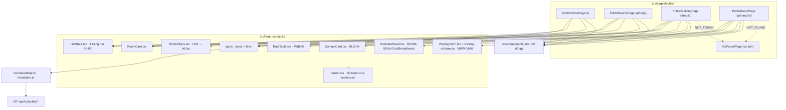

# PLAN · P2-9 · Frontend trang công khai và form đặt lịch xem (FE-P2-14..18)

Bản nháp: `Source/frontend/artifact_FE/2026-11-05-FE-P2-14-18/` · Gốc: file chính **hiện tại** (P2-8a đã chép vào main, chưa commit; HEAD 8bec6ab chỉ để tham khảo).
Mọi đường dẫn "Bản nháp" dưới đây là tương đối trong thư mục nháp và mirror `Source/frontend/`.
**Cập nhật 05/11/2026:** chủ dự án đã trả lời 5 câu hỏi mở (D-1..D-5) và 3 câu về câu chữ trang chủ sau vòng 1 của CP-2 (Q-6 giữ "{n} phòng trống", Q-7 khôi phục nguyên văn mockup, Q-8 tên khối + tiêu đề; `alt` hero "Ảnh minh họa" của [A-6] được chấp nhận) → gộp hết vào **D-4**. **Cập nhật 05/11/2026 (sau CP-3):** PLAN đã được chỉnh theo mã nháp thực tế của CP-3 (tách `room-filters.ts`, chữ mới của bộ lọc, biên INT32, tên tòa, quy ước URL, phường theo quận, phân trang) — xem CP-3 và §3. **Cập nhật 05/11/2026 (trước CP-4):** chủ dự án đã chốt **(a)** cho cả 7 câu hỏi câu chữ của CP-4 (Q-9…Q-15) → gộp vào **D-6**, kèm bảng chữ UI mới của CP-4 ở §3. **Không còn câu hỏi nghiệp vụ bỏ ngỏ**; chỉ còn 3 mục câu chữ `[CHƯA CÓ NGUỒN]` ở §3 (dòng "Trang x/y", `aria-label` của `<nav>` phân trang, `aria-label`/nhãn sắp xếp của khối kết quả) để chủ dự án quyết khi duyệt — **không chặn** checkpoint nào.

**Phân vai bắt buộc (mọi checkpoint, không ngoại lệ):** coder chỉ viết phần nguồn (`src/`) và `ref/` + `preview.html`. **Tester viết toàn bộ thư mục `tests/`** — test mới, 18 file test cũ mirror, và cả hai file harness `tests/draft-root.mjs`, `tests/p2/public-dom.mjs`. Coder **không** tạo, không sửa, không chép bất kỳ file nào trong `tests/`. Guard giữ nguyên.

**Đã có trong nháp (coder đã làm xong, không làm lại):** `src/features/public/api.ts`, `ListState.tsx`, `RoomCard.tsx`, `public.css`; `ref/tsconfig.preview.json`, `ref/vite.preview.config.ts`, `ref/preview-entry.tsx`; `preview.html`. **Chưa có:** `tests/draft-root.mjs`, `tests/p2/public-dom.mjs` (tester làm ở CP-1).

## 1 · Mục tiêu và phạm vi

Trong phạm vi (task FE-P2-14..18, spec `PUB-01..04`, `ROOM-05`, `ROOM-08`, `BLD-04`, `VIEW-01/02/08/11/12`, `UI-01..09`, `KIT-01..08`):

- `/` trang chủ: 6 phòng nổi bật (`/public/featured-rooms`), quận kèm số phòng (`/public/locations`), ô tìm nhanh bằng kit `RoomSearch`; thêm mục menu "Tìm phòng" → `/phong` vào `PublicLayout` (D-5).
- `/phong`: lọc quận / phường / khoảng giá / sắp xếp, **giữ nguyên trong query URL** cả hai chiều (FE-P2-15); `buildingId` chỉ đi theo URL, không có select tòa (D-1).
- `/toa/:id`, `/phong/:id`: ảnh có `alt` hoặc "Chưa có ảnh", giá, nội thất, cọc, `monthlyEstimate` + dòng "chưa gồm" lấy từ API (UI-06), đơn giá hôm nay và sắp tới (PUB-03), liên hệ (BLD-04); phòng/tòa không public → trang 404 (PUB-02).
- Form đặt lịch xem trên `/phong/:id`: 3 khung giờ, ngày hôm nay..+30, khung giờ hôm nay đã bắt đầu bị vô hiệu, honeypot `website` ẩn, zod soi theo DTO của BE, hiển thị lỗi 409 `ROOM_NOT_AVAILABLE` / 429 / `VALIDATION_FAILED` theo UI-05, màn hình thành công **luôn giống nhau** (VIEW-12).
- Cập nhật các test cũ bị trang thật làm lệch kỳ vọng (mục 5) và chạy `npm run lint`, `npm run build`, `npm run test:components`.

Ngoài phạm vi: `src/app/routes.tsx`, `package.json`, `src/components/` (kit) — P2-8a đã dựng, không sửa (README P2 mục "Ràng buộc"). Không thêm mảnh kit mới, không thêm thư viện. Không tính tiền ở FE. Không sửa backend (D-1). Trang quản lý (P2-8b) không thuộc phần này.

**Ngoại lệ được chủ dự án cho phép (05/11/2026):** sửa `src/layouts/PublicLayout.tsx` và 2 test `FE-LOGIN-10` trong `tests/auth-login-flow.test.mjs`, dù hai file này không nằm trong danh sách placeholder của P2-8a. Cả hai mirror từ **bản main hiện tại** (P2-8a đã chép vào main, chưa commit).

## 2 · Kiến trúc



Nguyên tắc: trang chỉ lắp ghép; mọi lệnh gọi API, kiểu dữ liệu và văn bản dùng chung nằm ở `features/public/`. Server state bằng TanStack Query (`AppProviders` đã có), form bằng react-hook-form + zod, lỗi bằng `shared/form-errors.ts` + `FormError`, tiền bằng `formatMoney`, ngày bằng `formatDate` (UI-01, UI-09).

### 2.1 · File thêm / sửa

| Bản nháp (mirror `Source/frontend/`) | Đích | Thêm/Sửa | Mục đích |
|---|---|---|---|
| `src/features/public/api.ts` | như bản nháp | Thêm | Kiểu + hàm gọi `/public/*` (hợp đồng ở 2.2) |
| `src/features/public/public.css` | ” | Thêm | Bố cục 4 trang công khai, chỉ dùng biến của `rooms.css` |
| `src/features/public/ListState.tsx` | ” | Thêm | 4 trạng thái UI-03 dùng chung |
| `src/features/public/RoomCard.tsx` | ” | Thêm | Thẻ phòng (ảnh/alt/"Chưa có ảnh", giá, link) |
| `src/features/public/room-filters.ts` | ” | Thêm | **Logic bộ lọc thuần (không JSX)**: `parseFilters`, `filtersToParams`, `filtersToQuery`, `validFilters`, `filterSchema`, type `PublicFilters` / `FilterFormValues`. Tách khỏi `RoomFilters.tsx` vì `react-refresh/only-export-components` không cho một file `.tsx` export cả component lẫn hàm thường (CP-3, coder đã làm) |
| `src/features/public/RoomFilters.tsx` | ” | Thêm | Chỉ component bộ lọc `/phong` (không có select tòa — D-1); re-export **duy nhất** `export type { PublicFilters } from './room-filters'`. Mọi hàm nằm ở `room-filters.ts` |
| `src/features/public/RateTable.tsx` | ” | Thêm | Đơn giá hôm nay + dòng "Từ dd/mm/yyyy: …" (PUB-03) |
| `src/features/public/EstimatePanel.tsx` | ” | Thêm | `CostBreakdown` + `missing` + `meteredNote` + cọc |
| `src/features/public/ContactCard.tsx` | ” | Thêm | Liên hệ BLD-04 (`tel:`, Zalo, Facebook) |
| `src/features/public/ViewingForm.tsx` | ” | Thêm | Form VIEW-01/02/08/12 |
| `src/features/public/viewing-schema.ts` | ” | Thêm | zod soi `PublicViewingDto` |
| `src/pages/public/PublicHomePage.tsx` | ” | Thêm | Trang chủ (FE-P2-14) |
| `src/layouts/PublicLayout.tsx` | ” | Sửa | D-5: thêm `{ label: 'Tìm phòng', href: '/phong' }` **trước** mục đăng nhập trong **cả hai** nhánh đã sẵn sàng; nhánh `status === 'loading'` vẫn trả `[]` (giữ assert "không có mục menu khi đang tải" của test cũ) |
| `src/pages/public/PlaceholderPage.tsx` | ” | Sửa | Chỉ còn bọc `PublicHomePage` (giữ `routes.tsx` nguyên — [A-2]) |
| `src/pages/public/PublicRoomsPage.tsx` | ” | Sửa | Trang tìm phòng thật (FE-P2-15) |
| `src/pages/public/PublicBuildingPage.tsx` | ” | Sửa | Chi tiết tòa (FE-P2-16) |
| `src/pages/public/PublicRoomPage.tsx` | ” | Sửa | Chi tiết phòng + form (FE-P2-16/17) |
| `tests/draft-root.mjs` | ” | Thêm (**tester**) | Tìm gốc nháp / gốc main bằng cách đi lên từ `import.meta.url` + `draftFirst()`; dùng bởi **mọi** test mới và mọi test cũ được mirror. Không phải `*.test.mjs` |
| `tests/p2/public-dom.mjs` | ” | Thêm (**tester**) | Harness dùng chung (DOM giả, fake fetch), lấy gốc từ `tests/draft-root.mjs` — **không** phải `*.test.mjs` nên không bị `test:components` chạy riêng |
| 14 file test cũ còn lại trong `tests/` và `tests/p2/` | ” | Mirror | Chép **y nguyên** từ main hiện tại, chỉ đổi phần tìm gốc sang `tests/draft-root.mjs` nếu file đó giải quyết đường dẫn `src/`; để `node --test <nháp>/tests` chạy đúng trạng thái "đã áp dụng" (CP-6 mục 1) |
| `tests/p2/fe-p2-14-home.test.mjs` | ” | Thêm | Test CP-2 |
| `tests/p2/fe-p2-15-search.test.mjs` | ” | Thêm | Test CP-3 |
| `tests/p2/fe-p2-16-detail.test.mjs` | ” | Thêm | Test CP-4 |
| `tests/p2/fe-p2-17-viewing-form.test.mjs` | ” | Thêm | Test CP-5 |
| `tests/p2/cp1-routes.test.mjs` | ” | Sửa | Bỏ 3 trang công khai khỏi mục "chỉ Đang làm" |
| `tests/auth-guards.test.mjs` | ” | Sửa | Kỳ vọng mới cho `PlaceholderPage` |
| `tests/auth-login-flow.test.mjs` | ” | Sửa | Fake fetch trả `/public/locations\|featured-rooms\|rooms`; kỳ vọng mới cho `/`, `/phong` và cho menu `PublicLayout` (D-5) |
| `ref/tsconfig.preview.json`, `ref/vite.preview.config.ts`, `ref/preview-entry.tsx` | Không áp dụng | Thêm (chép từ `artifact_FE/approved/2026-11-04-FE-P2-01-08/ref/`) | Kiểm type bản nháp + xem thật trên trình duyệt (360 px, đặt lịch thật) |

Mọi dòng `tests/…` trong bảng trên (harness, 18 file mirror, 4 file test mới, 3 file test cũ phải sửa) **do tester viết**; coder bỏ qua hết. Không xóa file nào. Không sửa `routes.tsx`, `package.json`, `src/components/`, `src/shared/`. Mọi file "Sửa" phải được **chép lại từ bản main hiện tại** rồi sửa trong nháp (không chép từ `approved/` cũ, không từ HEAD).

### 2.2 · Hợp đồng với backend (đọc từ mã BE, không đoán)

Vỏ phản hồi: `{ data }`, danh sách thêm `{ meta: { page, limit, total } }` → dùng `apiRequest` / `apiRequestPage` / `listPath` của `src/shared/api.ts`.

| Method | Path | Query / Body | Trả về |
|---|---|---|---|
| GET | `/public/locations` | – | `PublicLocation[]` = `{ district: string; roomCount: number; wards: { ward: string; roomCount: number }[] }[]` (quận A→Z, phường A→Z) |
| GET | `/public/rooms` | `district?`, `ward?`, `buildingId?`, `minPrice?`, `maxPrice?`, `sort?: 'price' \| '-price' \| 'newest'`, `page?`, `limit?` (≤100) | `PublicRoomListItem[]` + `meta` |
| GET | `/public/featured-rooms` | – | `PublicRoomListItem[]` (tối đa 6, **không có** `meta`) |
| GET | `/public/rooms/:id` | – | `PublicRoomDetail`; không public → 404 `NOT_FOUND` |
| GET | `/public/buildings/:id` | – | `PublicBuildingDetail`; không public → 404 `NOT_FOUND` |
| POST | `/public/viewings` | `{ roomId: number; guestName: string; guestPhone: string; visitDate: 'YYYY-MM-DD'; timeSlot: 'MORNING'\|'AFTERNOON'\|'EVENING'; note?: string; website?: string }` | `{ received: true }` (giống nhau cho bản thật và honeypot, VIEW-12) |

Kiểu dữ liệu sao đúng theo `Source/backend/src/modules/rooms/public.types.ts` (chép nguyên tên trường sang `features/public/api.ts`, đổi sang quy ước FE: `interface` export):
`PublicRoomListItem { id, code, floor, areaM2, price, maxOccupants, buildingId, buildingCode, buildingName, district, ward, imageUrl: string | null }`;
`PublicRateTier { tierNo, upTo: number | null, unitPrice }`;
`PublicRateView { kind: 'ELECTRIC'|'WATER'|'SERVICE', serviceId: number | null, serviceName: string | null, unit: 'ROOM'|'PERSON'|'VEHICLE'|null, effectiveFrom: string, tiers: PublicRateTier[] }`;
`PublicRates { electric: PublicRateView | null; water: PublicRateView | null; services: PublicRateView[] }`;
`PublicEstimate { items: { label: string; amount: number }[]; missing: string[]; meteredNote: string }`;
`PublicBuildingSummary { id, code, name, address, district, ward, waterMode: 'PER_M3'|'PER_PERSON', amenities: string[], description: string | null }`;
`PublicRoomDetail { id, code, floor, areaM2, maxOccupants, furniture: string[], description, price, deposit, monthlyEstimate, estimate, images: { id, url, sortOrder }[], building, rates, upcomingRates, contact: { phone, zaloUrl, facebookUrl } | null }`;
`PublicBuildingDetail extends PublicBuildingSummary { contact, rates, upcomingRates, rooms: PublicRoomListItem[] }`.

Lỗi (mã + câu đã có tiếng Việt ở `src/common/errors/error-code.ts`, FE chỉ hiển thị `error.message`, UI-05):
`404 NOT_FOUND`; `409 ROOM_NOT_AVAILABLE` "Phòng không còn trống"; `429 TOO_MANY_REQUESTS` "Bạn thao tác quá nhiều lần, vui lòng thử lại sau"; `400 VALIDATION_FAILED` + `fields.visitDate` "Ngày xem phải từ hôm nay đến 30 ngày tới" / `fields.timeSlot` "Khung giờ này hôm nay đã bắt đầu, vui lòng chọn khung giờ khác". FE **không** tự viết lại các câu này.

### 2.3 · Hợp đồng nội bộ (chữ ký, không thân hàm)

```ts
// features/public/api.ts
export function listPublicLocations(): Promise<PublicLocation[]>
export function listPublicRooms(query: PublicRoomsQuery): Promise<ListPage<PublicRoomListItem>>
export function listFeaturedRooms(): Promise<PublicRoomListItem[]>
export function getPublicRoom(id: number): Promise<PublicRoomDetail>
export function getPublicBuilding(id: number): Promise<PublicBuildingDetail>
export function createPublicViewing(input: PublicViewingInput): Promise<{ received: true }>
export interface PublicRoomsQuery { district?: string; ward?: string; buildingId?: number; minPrice?: number; maxPrice?: number; sort?: PublicRoomSort; page?: number; limit?: number }
export type PublicRoomSort = 'price' | '-price' | 'newest'
export const publicQueryKeys: { locations: ['public','locations']; featured: ['public','featured']; rooms: (q: PublicRoomsQuery) => unknown[]; room: (id: number) => unknown[]; building: (id: number) => unknown[] }

// features/public/ListState.tsx — UI-03 cho cả 4 trang
export function ListState(props: { status: 'pending' | 'error' | 'success'; error: unknown; isEmpty: boolean; loadingLabel: string; emptyTitle: string; emptyHint?: ReactNode; onRetry: () => void; children: ReactNode }): ReactElement | null

// features/public/RoomCard.tsx
export function RoomCard(props: { room: PublicRoomListItem }): ReactElement

// features/public/room-filters.ts  — logic thuần, không JSX (tester import **từ file này**)
export interface PublicFilters { district: string; ward: string; buildingId: string; minPrice: string; maxPrice: string; sort: PublicRoomSort }
export const filterSchema: z.ZodObject<{ district; ward; minPrice; maxPrice; sort }>  // zod; minPrice/maxPrice là string, refine theo INT32
export type FilterFormValues = z.infer<typeof filterSchema>
export function parseFilters(params: URLSearchParams): PublicFilters      // URL → form
export function filtersToParams(values: PublicFilters): URLSearchParams   // form → URL, bỏ ô trống và bỏ sort mặc định
export function filtersToQuery(values: PublicFilters): PublicRoomsQuery   // form → query API (số hóa, bỏ undefined)
export function validFilters(values: PublicFilters): boolean             // false → trang không gọi API

// features/public/RoomFilters.tsx — chỉ component + re-export type
export type { PublicFilters } from './room-filters'
export function RoomFilters(props: { locations: PublicLocation[]; values: PublicFilters; onChange: (next: PublicFilters) => void; onReset: () => void }): ReactElement

// features/public/RateTable.tsx
export function RateTable(props: { rates: PublicRates; upcomingRates: PublicRateView[]; waterMode: PublicBuildingSummary['waterMode'] }): ReactElement

// features/public/EstimatePanel.tsx
export function EstimatePanel(props: { monthlyEstimate: number; deposit: number; estimate: PublicEstimate }): ReactElement

// features/public/ContactCard.tsx
export function ContactCard(props: { contact: PublicRoomDetail['contact'] }): ReactElement | null

// features/public/viewing-schema.ts  (soi PublicViewingDto; message y như BE)
export const viewingFormSchema: z.ZodType<{ guestName: string; guestPhone: string; visitDate: string; timeSlot: TimeSlot; note: string; website: string }>
export type ViewingFormValues = z.infer<typeof viewingFormSchema>
export type TimeSlot = 'MORNING' | 'AFTERNOON' | 'EVENING'
export const timeSlotLabels: Record<TimeSlot, string>  // 'Sáng (8:00–11:00)' | 'Chiều (14:00–17:00)' | 'Tối (18:00–20:00)'
export const slotStartHour: Record<TimeSlot, number>   // 8 | 14 | 18 — chỉ để vô hiệu nút, không tính nghiệp vụ
export function hanoiToday(now?: Date): string         // 'YYYY-MM-DD' theo Asia/Ho_Chi_Minh
export function maxVisitDate(now?: Date): string       // hôm nay + 30
export function startedSlots(visitDate: string, now?: Date): TimeSlot[]

// features/public/ViewingForm.tsx
export function ViewingForm(props: { roomId: number }): ReactElement
```

Quy ước bắt buộc cho coder:

- Tiền: chỉ `formatMoney` (số nguyên đồng); ngày hiển thị `formatDate`; ngày gửi API `YYYY-MM-DD`.
- `monthlyEstimate`, `deposit`, `estimate.items`, `estimate.missing`, `estimate.meteredNote` chỉ **hiển thị** (UI-06) — tuyệt đối không cộng/trừ ở FE, kể cả tổng kiểm tra.
- Ảnh: `images[]` sắp theo `sortOrder` do BE trả; `alt` = `Phòng {code} – {buildingName}, ảnh {n}/{tổng}`; rỗng → khối "Chưa có ảnh" (không `` giả).
- `imageUrl === null` ở thẻ phòng → "Chưa có ảnh".
- Lỗi 404 từ `/public/rooms/:id` hoặc `/public/buildings/:id` → render component `NotFoundPage` đang có (không thêm chữ mới); `useQuery` của hai trang chi tiết đặt `retry: false` để 404 không bị thử lại 3 lần. `:id` không phải số nguyên dương → **không gọi API**, render `NotFoundPage` ngay.
- Trang chi tiết (CP-4): giá in **không** kèm `/ tháng` (D-6.4); nhãn đơn giá theo **D-6.1/D-6.2**; mô tả + tiện ích in nguyên văn API không nhãn (D-6.5); ước tính dùng kit `CostBreakdown` với chữ cố định của kit (D-6.6); `loadingLabel` = `Đang tải danh sách phòng` (D-6.7).
- Mọi `<select>`/`<input>` có `<label>`; nút là `<button type=...>` (UI-08).
- `public.css` chỉ dùng biến/token của `rooms.css` trong `.rooms-theme`; mobile-first, không cuộn ngang ở 360 px.

## 3 · Quyết định của chủ dự án (05/11/2026) — không còn câu hỏi bỏ ngỏ

Năm câu hỏi của bản kế hoạch đầu đã được chủ dự án chốt. Đây là **quyết định**, không phải `[ASSUMPTION]`; coder và tester làm đúng theo, không bàn lại.

- **D-1 (Q-1 = a) · `/phong` không có select "Tòa nhà".** `buildingId` chỉ đến từ liên kết "Xem phòng trống của tòa này" ở `/toa/:id`, vẫn được **giữ trong URL**, gửi lên API, hiện nhãn tên tòa và nút **"Bỏ lọc tòa"**. **Không sửa backend** (không thêm danh sách tòa vào `/public/locations`).
- **D-2 (Q-2 = a) · Thang giá của kit `RoomSearch` ở trang chủ** — đúng 5 mục, theo thứ tự:
  `Đến 2.000.000 đ` · `Đến 3.000.000 đ` · `Đến 4.000.000 đ` · `Đến 5.000.000 đ` · `Trên 5.000.000 đ`.
  `RoomSearch` chỉ trả một chuỗi `maxPrice`, nên dùng `value` = `'2000000' | '3000000' | '4000000' | '5000000' | '5000000+'`; trang chủ đổi `'5000000+'` thành `minPrice=5000000` (không có `maxPrice`), các giá trị khác thành `maxPrice=<value>` khi điều hướng sang `/phong` ([A-8]).
- **D-3 (Q-3 = a) · Màn hình thành công sau khi gửi lịch hẹn** — đúng hai câu, **không** nêu lại ngày/giờ, không nêu id:
  "Đã nhận yêu cầu xem phòng. Quản lý sẽ gọi lại để xác nhận lịch hẹn." + dòng nhỏ "Gửi yêu cầu chưa giữ chỗ phòng."
  Giống **y hệt** cho bản thật và cho honeypot (VIEW-12).
- **D-4 (Q-4 = a, bổ sung Q-6/Q-7/Q-8 ngày 05/11/2026) · Dùng nguyên văn chữ của mockup P2-7 đã duyệt** (`artifact_FE/2026-11-02-phase2-mockup/sample.tsx`, hàm `Home`, đã duyệt 03/11/2026). Bản CP-2 đầu của coder đã **bỏ bớt** nhiều chữ tiếp thị; chủ dự án yêu cầu **khôi phục nguyên văn**. Danh sách đầy đủ của trang chủ `/`:

  | Vị trí | Chữ (nguyên văn, không sửa dấu, không viết lại) |
  |---|---|
  | Hero · eyebrow | `Một nhịp sống riêng · Hà Nội` |
  | Hero · `h1` | `Chọn chỗ ở.` + `<br/>` + `<em>Bắt đầu an yên.</em>` |
  | Hero · đoạn mô tả, **2 dòng** | `Phòng thuê theo tháng, chi phí rõ ràng.` + `<br/>` + `Tìm một không gian vừa với cuộc sống của bạn.` |
  | Hero · liên kết sang `/phong` | `Khám phá phòng trống` (kèm `<span aria-hidden="true">↗</span>`) |
  | Hero · ảnh `alt` | `Ảnh minh họa` ([A-6] được chấp nhận 05/11/2026; **không** đổi sang câu dài của mockup) |
  | Khối phòng nổi bật · tên khối | `Phòng nổi bật` (Q-8) |
  | Khối phòng nổi bật · eyebrow | `Những lựa chọn mới` (Q-7) |
  | Khối phòng nổi bật · mô tả kèm | `Những phòng trống có giá vừa được duyệt gần đây.` (Q-7, prop `description` của `SectionHeading`) |
  | Khối phòng nổi bật · tiêu đề | `Một nơi để ` + `<em>thuộc về.</em>` (Q-8) |
  | Khối phòng nổi bật · liên kết | `Xem tất cả phòng trống` (giữ như bản coder; mockup ghi "Xem tất cả phòng ↗", chủ dự án không yêu cầu đổi) |
  | Khối quận · tên khối | `Khu vực` (Q-8) |
  | Khối quận · eyebrow | `Gần hơn với nhịp sống của bạn` (Q-7) |
  | Khối quận · tiêu đề | `Bạn muốn ở ` + `<em>khu vực nào?</em>` (Q-8) |
  | Thẻ quận · số phòng | `{roomCount} phòng trống` — **giữ** (Q-6, đúng mockup); `roomCount` in nguyên số của API, không pad `01`/`02` như mockup demo |

  **[GHI CHÚ Q-7/Q-8]** `SectionHeading` của kit chỉ có **một** chỗ eyebrow, nên hai câu đã chốt cho cùng một khối được xếp: eyebrow hiện ra = câu mockup của Q-7 (`Những lựa chọn mới` / `Gần hơn với nhịp sống của bạn`); tên khối của Q-8 (`Phòng nổi bật` / `Khu vực`) đặt vào `aria-label` của `<section>` — cả hai câu đều xuất hiện, không bỏ câu nào, không tự viết câu mới. Nếu chủ dự án muốn đảo lại (eyebrow = `Phòng nổi bật` / `Khu vực`) thì chỉ cần nói một câu khi duyệt; coder đổi 4 chuỗi, tester đổi 4 assert.

  Coder **không** tự đặt thêm câu nào ngoài mục "Chữ giao diện tiếng Việt mới" bên dưới; thiếu chữ cho một khối thì dừng và hỏi.
- **D-5 (Q-5 = a) · `PublicLayout` có mục menu "Tìm phòng" → `/phong`**, đứng **trước** mục "Đăng nhập" / "Trang của tôi"; khi `status === 'loading'` menu vẫn rỗng. Được phép sửa `src/layouts/PublicLayout.tsx` và 2 test `FE-LOGIN-10` trong `tests/auth-login-flow.test.mjs` (cả hai mirror từ bản main hiện tại) trong nháp.
- **D-6 (Q-9…Q-15 = a, chốt 05/11/2026) · Câu chữ trang chi tiết `/toa/:id` và `/phong/:id`.** Bảy câu hỏi của CP-4 đã được chủ dự án duyệt **phương án (a)**; coder và tester làm đúng theo, không bàn lại:
  - **D-6.1 (Q-9) · Nhãn đơn giá lấy nguyên văn mockup P2-7**, khối `RateTable` ở `artifact_FE/2026-11-02-phase2-mockup/sample.tsx:88-91`. Không tự viết nhãn mới. Cụ thể:
    - Tiêu đề khối: `Đơn giá rõ ràng` + chữ phụ `Đang áp dụng` (mockup dòng 88; thay cho câu "Đơn giá đang áp dụng" ghi trong danh sách chữ chức năng cũ — dùng chữ mockup).
    - Điện theo bậc, mỗi bậc một dòng `<dt>`: bậc đầu `Điện · 0–{upTo} kWh`, bậc giữa `Điện · {upTo trước + 1}–{upTo} kWh`, bậc cuối (`upTo === null`) `Điện · từ {upTo trước + 1} kWh` (chữ `từ` **viết thường**, đúng mockup dòng 89). Giá: `{formatMoney(unitPrice)} / kWh`.
    - Nước: `<dt>` = `Nước`; giá = `{formatMoney(unitPrice)} / m³` khi `waterMode === 'PER_M3'`, `{formatMoney(unitPrice)} / người / kỳ` khi `PER_PERSON` (mockup dòng 90).
    - Dịch vụ: `<dt>` = `serviceName` của API (nguyên văn, ví dụ `Wifi`, `Rác`, `Gửi xe máy`); đơn vị theo `unit`: `ROOM` → `/ phòng / kỳ`, `PERSON` → `/ người / kỳ`, `VEHICLE` → `/ xe / kỳ` (mockup dòng 90). `unit === null` → chỉ in tiền, không thêm đuôi.
    - Dấu `–` ở khoảng bậc là **en dash** như mockup, không phải `-`.
  - **D-6.2 (Q-10) · Dòng đơn giá sắp tới**: `Từ {dd/mm/yyyy}: {nhãn} {giá}` theo mẫu mockup dòng 91 (`Từ 15/11/2026: Wifi 120.000 đ / phòng / kỳ.`) — một dòng cho mỗi phần tử `upcomingRates`, nhãn và giá dùng đúng quy tắc D-6.1, kết câu bằng dấu `.`. Ngày qua `formatDate(effectiveFrom)`.
  - **D-6.3 (Q-11) · Khối phòng trống của tòa ở `/toa/:id` có tiêu đề `Còn trống tại tòa`** (nguyên văn mockup dòng 117); đặt làm tiêu đề khối (`<h2>` hoặc `eyebrow` của `SectionHeading`) **và** `aria-label` của `<section>` để tester tìm được. Không thêm câu `Chọn một căn phòng.` của mockup (không được duyệt).
  - **D-6.4 (Q-12) · Giá ở trang chi tiết in KHÔNG kèm `/ tháng`** — chỉ `2.300.000 đ`, nhất quán với thẻ phòng (quyết định CP-1). Chữ `/ tháng` chỉ còn ở nhãn bộ lọc và ở câu `Ước tính chi phí / tháng`.
  - **D-6.5 (Q-13) · Mô tả phòng, mô tả tòa và tiện ích tòa hiện nguyên văn API, không thêm nhãn**: `room.description`, `building.description` in thành đoạn văn; `building.amenities[]` in thành danh sách thẻ. Không thêm chữ `Mô tả` / `Tiện ích` / câu tiếp thị nào. `description === null` hoặc `amenities` rỗng → bỏ hẳn khối đó (không in dòng trống).
  - **D-6.6 (Q-14) · Dùng kit `CostBreakdown` với chữ cố định của nó**: `Chi phí minh bạch`, `Một tháng, an tâm ở lại.`, `Tổng chi phí` (`src/components/CostBreakdown.tsx:4`). Đây là chữ của kit, không sửa kit, không bọc lại để che chữ. `items` = `estimate.items`, `total` = `monthlyEstimate`, `note` = `estimate.meteredNote` (nguyên văn API). Eyebrow `Ước tính chi phí / tháng` giữ ở ngoài khối như mockup dòng 142.
  - **D-6.7 (Q-15) · Trạng thái tải trang chi tiết dùng lại `Đang tải danh sách phòng`** (chữ đã có của `ListState`, `loadingLabel`); không thêm câu tải mới cho `/toa/:id` và `/phong/:id`.

### [ASSUMPTION] kỹ thuật (tự quyết, phải nêu lại trong báo cáo)

- **A-1** Thư mục `src/features/public/` là nơi đặt mọi mã công khai, **kể cả form đặt lịch**, thay vì `src/features/viewings/` — P2-8b chạy song song sẽ tạo `features/viewings/` cho trang quản lý; dùng chung thư mục/`api.ts` sẽ đụng file khi áp dụng.
- **A-2** Trang chủ nằm ở file mới `src/pages/public/PublicHomePage.tsx`; `PlaceholderPage.tsx` chỉ còn `return <PublicHomePage />` để **không** phải sửa `routes.tsx` (ràng buộc README P2). Khi nào được phép sửa `routes.tsx` (ví dụ P2-10) thì bỏ lớp bọc này.
- **A-3** Tên test mới theo task ID (`fe-p2-1x-*.test.mjs`) chứ không theo `cpN-*` để không đụng tên với P2-8b; glob `tests/p2/*.test.mjs` trong `package.json` tự nhận.
- **A-4** `/phong` dùng `limit=20` (mặc định của `listPath`) với phân trang "Trang trước / Trang sau" như `RoomGrid` của P2-8a.
- **A-5** Vô hiệu khung giờ đã bắt đầu tính ở FE bằng giờ Hà Nội (lệch múi giờ +07:00 cố định) chỉ để **khóa nút**; quyết định đúng/sai vẫn là của BE (VIEW-08) và lỗi của BE được hiển thị nguyên văn.
- **A-6** Ảnh minh họa `/images/rooms-hanoi-exterior.webp` dùng cho khối đầu trang chủ / chi tiết tòa khi BE không trả ảnh, luôn kèm `alt` có chữ "ảnh minh họa", theo mockup đã duyệt.
- **A-7** `sort` mặc định `price` (PUB-01); `/phong` chỉ cho 2 lựa chọn "Giá tăng dần" (`price`) và "Mới nhất" (`newest`) như mockup; `-price` có ở BE nhưng không bày ra.
- **A-8** Cách mã hóa mục "Trên 5.000.000 đ" của D-2: `value='5000000+'` → `/phong?minPrice=5000000`. Thuần kỹ thuật (kit chỉ trả một chuỗi `maxPrice`), không đổi ý nghĩa thang giá chủ dự án đã chốt.

### Chữ giao diện tiếng Việt mới (đầy đủ — chủ dự án đọc lại khi duyệt, D-4)

**Chữ tiếp thị trang chủ `/` — nguyên văn mockup P2-7, bắt buộc có đủ (D-4, Q-6/Q-7/Q-8):**

1. "Một nhịp sống riêng · Hà Nội"
2. "Chọn chỗ ở." / "Bắt đầu an yên."
3. "Phòng thuê theo tháng, chi phí rõ ràng."
4. "Tìm một không gian vừa với cuộc sống của bạn."
5. "Khám phá phòng trống"
6. "Ảnh minh họa" (alt ảnh hero, [A-6])
7. "Phòng nổi bật" (tên khối phòng nổi bật)
8. "Những lựa chọn mới"
9. "Những phòng trống có giá vừa được duyệt gần đây."
10. "Một nơi để thuộc về."
11. "Xem tất cả phòng trống"
12. "Khu vực" (tên khối quận)
13. "Gần hơn với nhịp sống của bạn"
14. "Bạn muốn ở khu vực nào?"
15. "{n} phòng trống" (thẻ quận)

**Chữ tiếp thị các trang khác (mockup P2-7):** "Đơn giá rõ ràng" · "Ước tính chi phí / tháng". Coder **không** thêm câu tiếp thị nào khác; thiếu chữ cho một khối thì dừng và hỏi.

**Menu (D-5):** "Tìm phòng".
**Thang giá trang chủ (D-2):** "Đến 2.000.000 đ" / "Đến 3.000.000 đ" / "Đến 4.000.000 đ" / "Đến 5.000.000 đ" / "Trên 5.000.000 đ" (nhãn của kit "Ngân sách / tháng", "Tất cả mức giá" đã có trong kit, không mới).
**Màn hình thành công (D-3):** "Đã nhận yêu cầu xem phòng. Quản lý sẽ gọi lại để xác nhận lịch hẹn." · "Gửi yêu cầu chưa giữ chỗ phòng."
**Bộ lọc tòa (D-1):** "Đang lọc theo tòa {buildingName}" · "Bỏ lọc tòa".

**Chữ mới xuất hiện ở CP-3 `/phong` (đối chiếu mã nháp 05/11/2026 — chủ dự án đọc lại khi duyệt):**

| Chữ (nguyên văn) | Vị trí | Nguồn |
|---|---|---|
| `Giá tối thiểu không hợp lệ` | lỗi dưới ô "Giá từ (đ/tháng)" | **BE** `Source/backend/src/modules/rooms/dto/public-rooms.dto.ts:34-36` — chép nguyên văn, FE không tự viết (UI-05) |
| `Giá tối đa không hợp lệ` | lỗi dưới ô "Giá đến (đ/tháng)" | **BE** cùng file, dòng 41-43 |
| `Tất cả quận` | `<option value="">` của ô Quận | **Mockup P2-7** `artifact_FE/2026-11-02-phase2-mockup/sample.tsx:107` |
| `Tất cả phường` | `<option value="">` của ô Phường | **Mockup P2-7** `sample.tsx:108` |
| `Không giới hạn` | `placeholder` của cả hai ô giá | **Mockup P2-7** `sample.tsx:110` |
| `Đang lọc theo tòa {buildingName}` | dòng nhãn khi URL có `buildingId` | **PLAN D-1 / §3** (đã chốt) |
| `Bỏ lọc tòa` | nút cạnh dòng trên | **PLAN D-1 / §3** (đã chốt) |

Sáu chữ chức năng khác của `/phong` (`Quận`, `Phường`, `Giá từ (đ/tháng)`, `Giá đến (đ/tháng)`, `Sắp xếp`, `Giá tăng dần`, `Mới nhất`, `Áp dụng bộ lọc`, `Xóa bộ lọc`, `Trang trước`, `Trang sau`, `{n} phòng phù hợp`, `Chưa có phòng phù hợp với bộ lọc`, `Đang tải danh sách phòng`, `Thử lại`, `Tìm phòng`) đã có trong danh sách "Chữ chức năng" bên dưới — không mới.

**Chữ mới của CP-4 `/toa/:id` + `/phong/:id` (D-6 — chủ dự án đã duyệt (a) ngày 05/11/2026, đọc lại khi duyệt bản nháp):**

| Chữ (nguyên văn) | Vị trí | Nguồn |
|---|---|---|
| `Đơn giá rõ ràng` | tiêu đề khối đơn giá (`RateTable`) | mockup `sample.tsx:88` |
| `Đang áp dụng` | chữ phụ cạnh tiêu đề khối đơn giá | mockup `sample.tsx:88` |
| `Điện · 0–{upTo} kWh` | `<dt>` bậc điện đầu | mockup `sample.tsx:89` |
| `Điện · {trước+1}–{upTo} kWh` | `<dt>` bậc điện giữa | mockup `sample.tsx:89` |
| `Điện · từ {trước+1} kWh` | `<dt>` bậc điện cuối (`upTo = null`) | mockup `sample.tsx:89` |
| `/ kWh` | đuôi đơn vị giá điện | mockup `sample.tsx:89` |
| `Nước` | `<dt>` dòng nước | mockup `sample.tsx:90` |
| `/ m³` | đuôi giá nước khi `waterMode = PER_M3` | mockup `sample.tsx:90` |
| `/ người / kỳ` | giá nước `PER_PERSON` và dịch vụ `unit = PERSON` | mockup `sample.tsx:90` |
| `/ phòng / kỳ` | dịch vụ `unit = ROOM` | mockup `sample.tsx:90` |
| `/ xe / kỳ` | dịch vụ `unit = VEHICLE` | mockup `sample.tsx:90` |
| `Từ {dd/mm/yyyy}: {nhãn} {giá}.` | dòng đơn giá sắp tới (mỗi `upcomingRates`) | mockup `sample.tsx:91` + **chủ dự án duyệt** (Q-10) |
| `Còn trống tại tòa` | tiêu đề + `aria-label` khối phòng trống ở `/toa/:id` | mockup `sample.tsx:117` + **chủ dự án duyệt** (Q-11) |
| `Chi phí minh bạch` · `Một tháng, an tâm ở lại.` · `Tổng chi phí` | chữ cố định **của kit** `CostBreakdown` | `src/components/CostBreakdown.tsx:4` + **chủ dự án duyệt** (Q-14) |
| `Ước tính chi phí / tháng` | eyebrow trên khối `CostBreakdown` | mockup `sample.tsx:142` (đã có ở danh sách D-4) |

Không có chữ mới nào khác ở CP-4: giá in **không** kèm `/ tháng` (Q-12), mô tả phòng/tòa và tiện ích in **nguyên văn API không nhãn** (Q-13), trạng thái tải dùng lại `Đang tải danh sách phòng` (Q-15), các câu `Diện tích` / `Số người tối đa` / `Thời hạn tối thiểu 3 tháng` / `Tiền cọc · 1 tháng` / `Nội thất` / `Chưa có ảnh` / `Thử lại` / `Liên hệ` / `Nhắn Zalo` / `Facebook` / `Xem phòng trống của tòa này` đã có trong "Chữ chức năng". Câu `Đơn giá đang áp dụng` trong danh sách chữ chức năng cũ **bị thay** bằng `Đơn giá rõ ràng` + `Đang áp dụng` của mockup (D-6.1).

**Chữ đã bỏ ở CP-3 (quyết định đã áp dụng, không thêm chữ mới nên không cần chủ dự án duyệt lại; nêu ra để minh bạch):**
- Không có dòng `Trang x/y` giữa hai nút phân trang. `[CHƯA CÓ NGUỒN]` — mockup P2-7 **không có khối phân trang nào** cho `/phong`, PLAN cũng chỉ chốt hai nút ở [A-4], nên câu này chưa từng có nguồn. Chủ dự án quyết: giữ như hiện tại (chỉ 2 nút) hay thêm dòng chỉ số trang.
- `<nav className="public-pager">` **không** có `aria-label`. `[CHƯA CÓ NGUỒN]` — không có trong mockup (mockup chỉ đặt `aria-label="Kết quả tìm phòng"` cho `<section>` kết quả, `sample.tsx:112`) và không có trong PLAN. Chủ dự án quyết: để trống hay thêm nhãn (ví dụ `Phân trang kết quả`). Tester **không** assert `aria-label` của pager cho tới khi có quyết định.
- Khối kết quả của nháp **không** có `aria-label="Kết quả tìm phòng"` và **không** có nhãn sắp xếp phụ cạnh `{n} phòng phù hợp` như mockup `sample.tsx:112`. Cùng dạng `[CHƯA CÓ NGUỒN]`/bỏ bớt mockup; chủ dự án quyết khi duyệt.

**Lựa chọn của coder ở CP-1 (được chấp nhận, chủ dự án đọc lại khi duyệt):**
- `alt` của ảnh **thẻ phòng** = "Phòng {code} – {buildingName}" (ngắn hơn `alt` của thư viện ảnh ở trang chi tiết, vẫn là `Phòng {code} – {buildingName}, ảnh {n}/{tổng}`).
- Giá trên thẻ phòng in **không** kèm "/ tháng": chỉ "2.300.000 đ" (chữ "/ tháng" chỉ xuất hiện ở nhãn bộ lọc và khối ước tính).
- Diện tích hiển thị qua `toLocaleString('vi-VN')`, ví dụ "18 m²" / "18,5 m²".

**Chữ chức năng:** "Chưa có ảnh" · "Đang tải danh sách phòng" · "Chưa có phòng trống nào" · "Chưa có phòng phù hợp với bộ lọc" · "Thử lại" · "Xóa bộ lọc" · "Áp dụng bộ lọc" · "Trang trước" / "Trang sau" · "Quận" / "Phường" / "Giá từ (đ/tháng)" / "Giá đến (đ/tháng)" / "Sắp xếp" · "Giá tăng dần" / "Mới nhất" · "{n} phòng phù hợp" · "Diện tích" / "Số người tối đa" / "Thời hạn tối thiểu 3 tháng" / "Tiền cọc · 1 tháng" · "Nội thất" · "Đơn giá đang áp dụng" · "Từ dd/mm/yyyy: …" · "Ước tính chi phí / tháng" · "Liên hệ" / "Nhắn Zalo" / "Facebook" · "Xem phòng trống của tòa này" · form: "Họ và tên" / "Số điện thoại" / "Ngày muốn xem" / "Chọn trong 30 ngày tới, theo giờ Hà Nội" / "Khung giờ" / "Sáng (8:00–11:00)" / "Chiều (14:00–17:00)" / "Tối (18:00–20:00)" / "Đã bắt đầu" / "Lời nhắn (không bắt buộc)" / "Gửi yêu cầu xem phòng" / "Đang gửi…" + câu chốt ở Q-3. Các câu lỗi **không** mới: lấy nguyên `error.message` của BE.

## 4 · Checkpoints

Lệnh dưới đây chạy từ `Source/frontend`. `DRAFT = artifact_FE/2026-11-05-FE-P2-14-18`.

### CP-1 · Nền: API, trạng thái danh sách, thẻ phòng, CSS, harness test (FE-P2-14 phần nền)

**Coder** — files: `src/features/public/api.ts`, `ListState.tsx`, `RoomCard.tsx`, `public.css`; `ref/tsconfig.preview.json`, `ref/vite.preview.config.ts`, `ref/preview-entry.tsx` (chép từ `artifact_FE/approved/2026-11-04-FE-P2-01-08/ref/`, chỉ sửa đường dẫn `include`). **Tất cả đã xong** (xem "Đã có trong nháp" ở đầu kế hoạch) → coder không còn việc nào ở CP-1, kể cả `tests/`.

**Tester** — files: `tests/draft-root.mjs`, `tests/p2/public-dom.mjs`.
Spec: PUB-01..04, UI-01/03/08, KIT-01..08.

`tests/draft-root.mjs` (bắt buộc, là bài học P2-8a) — **một** nơi duy nhất biết đường dẫn:

- Tìm gốc bằng cách **đi lên từ `import.meta.url`**: `draftRoot` = thư mục tổ tiên gần nhất có `src/`; `mainRoot` = thư mục tổ tiên gần nhất có `src/components/index.ts`. **Không** dùng `resolve(here, '..', '..')` hay bất kỳ số bậc cố định nào → file chạy y nguyên ở `artifact_FE/<draft>/tests/…` và ở `Source/frontend/tests/…` (sau khi áp dụng, hai gốc trùng nhau).
- Xuất: `draftRoot`, `mainRoot`, `draftFirst(relPath)` → đường dẫn tuyệt đối: có trong nháp thì lấy nháp, không thì lấy main; `loadModule(absPath)`.
- `tests/p2/public-dom.mjs` chỉ bổ sung DOM giả + `mount/dispatch/fill/find/until` như `tests/p2/cp7-rooms.test.mjs`, `fakeFetch(rules)`, `ok/fail/pageMeta`; phần đường dẫn import lại từ `draft-root.mjs`.

Done when:

1. `npx tsc -p $DRAFT/ref/tsconfig.preview.json --noEmit` → exit 0 (phần nguồn, coder).
2. `npm run lint` → exit 0 (phần nguồn, coder).
3. **Tester kiểm:** `node -e "import('file://.../tests/draft-root.mjs').then(m=>console.log(m.draftRoot,m.mainRoot))"` (hoặc một test nhỏ dùng harness) in ra đúng 2 thư mục: gốc nháp `…/2026-11-05-FE-P2-14-18`, gốc main `…/Source/frontend`.

### CP-2 · `/` trang chủ (FE-P2-14)

Files: `src/pages/public/PublicHomePage.tsx`, `src/pages/public/PlaceholderPage.tsx` (bọc), `src/layouts/PublicLayout.tsx` (D-5), `src/features/public/public.css` (bổ sung), `tests/p2/fe-p2-14-home.test.mjs`, `tests/auth-login-flow.test.mjs` (mirror từ main hiện tại + sửa, xem bảng ở CP-6).
Spec: PUB-01 (`/public/featured-rooms`), BLD-05 + ROOM-05 (`/public/locations`), UI-01/03/08; quyết định D-2, D-4, D-5.

Vì `/` và menu đổi ngay ở checkpoint này, `tests/auth-login-flow.test.mjs` được chép vào nháp và sửa **tại CP-2** (loader, fake fetch `/public/*`, chữ `/`, 2 test `FE-LOGIN-10`) — không để dồn sang CP-6.

**Việc còn phải chỉnh cho coder (vòng 2 của CP-2, chỉ về câu chữ — logic đã đúng, không làm lại):**

- `src/pages/public/PublicHomePage.tsx` — khôi phục 15 chuỗi ở bảng D-4:
  1. Hero: thêm `<p className="rooms-eyebrow">Một nhịp sống riêng · Hà Nội</p>` **trên** `h1`; `h1` giữ nguyên.
  2. Hero: đoạn mô tả thành 2 dòng — `Phòng thuê theo tháng, chi phí rõ ràng.<br />Tìm một không gian vừa với cuộc sống của bạn.`
  3. Hero: thêm `<Link to="/phong">Khám phá phòng trống <span aria-hidden="true">↗</span></Link>` (dùng `Link` của react-router, **không** `<a href>`, để không tải lại app).
  4. Hero: giữ `alt="Ảnh minh họa"` như hiện tại.
  5. Khối phòng nổi bật: `<section className="public-section" aria-label="Phòng nổi bật">` và `<SectionHeading eyebrow="Những lựa chọn mới" description="Những phòng trống có giá vừa được duyệt gần đây.">Một nơi để <em>thuộc về.</em></SectionHeading>`.
  6. Khối quận: `<section className="public-section" aria-label="Khu vực">` và `<SectionHeading eyebrow="Gần hơn với nhịp sống của bạn">Bạn muốn ở <em>khu vực nào?</em></SectionHeading>`.
  7. Thẻ quận: giữ `{item.roomCount} phòng trống` và **xóa dòng comment `shortcut:`** ở trên nó (câu hỏi đã được chủ dự án chốt ở Q-6, không còn là shortcut).
  8. `public.css`: bổ sung lớp cho eyebrow hero / mô tả 2 dòng / liên kết hero nếu cần, chỉ bằng token của `rooms.css`; không thêm palette mới.
- `src/pages/public/PlaceholderPage.tsx` — **không cần sửa gì thêm** (vẫn chỉ bọc `PublicHomePage`, [A-2]); chỉ sửa nếu lớp bọc làm mất `aria-label`/cấu trúc `<section>` mới.
- Không đổi: `budgets`, `roomsSearch`, hai `useQuery`, `ListState`, `RoomCard`, `PublicLayout` (D-5 đã làm xong).

Done when:

1. `node --test $DRAFT/tests/p2/fe-p2-14-home.test.mjs` → 0 fail.
2. `node --test $DRAFT/tests/auth-login-flow.test.mjs` → 0 fail (toàn bộ file, không skip).

Kịch bản test (tester):

| # | Tình huống | Spec | Kỳ vọng |
|---|---|---|---|
| 1 | Có dữ liệu: 6 phòng nổi bật, 3 quận | PUB-01, UI-01 | đúng 6 thẻ theo thứ tự API trả; mỗi quận hiện tên + `roomCount`; tiền dạng `2.300.000 đ` |
| 2 | Đang tải | UI-03 | nhãn "Đang tải danh sách phòng" (`role="status"`), không có thẻ phòng |
| 3 | Rỗng (`[]` + `locations: []`) | UI-03 | "Chưa có phòng trống nào" + liên kết sang `/phong`; không có `role="alert"` |
| 4 | Lỗi 500 | UI-03, UI-05 | hiện `error.message` của API trong `role="alert"` + nút "Thử lại"; bấm → gọi lại API, hiện dữ liệu |
| 5 | Phòng không ảnh (`imageUrl: null`) | UI-08 | hiện "Chưa có ảnh", không có `` cho thẻ đó; thẻ có ảnh thì `` có `alt` khác rỗng |
| 6 | Bấm quận "Cầu Giấy" | FE-P2-15 | điều hướng sang `/phong` với đúng một tham số `district=Cầu Giấy` (đã encode), không query rác |
| 7 | Ô ngân sách của `RoomSearch` | D-2 | đúng 5 `<option>` ngoài "Tất cả mức giá", nhãn và thứ tự y như D-2 |
| 8 | Gửi `RoomSearch`: quận + "Đến 3.000.000 đ" | D-2 | `/phong?district=…&maxPrice=3000000` |
| 9 | Gửi `RoomSearch`: "Trên 5.000.000 đ" | D-2, A-8 | `/phong?minPrice=5000000`, **không** có `maxPrice` |
| 10 | Gửi `RoomSearch` để trống cả hai ô | D-2 | `/phong` không query |
| 11 | Menu `PublicLayout` (khách, tenant, manager, boss) | D-5, FE-P2-14 | `['Tìm phòng','/phong']` đứng trước mục đăng nhập/"Trang của tôi"; khi đang tải menu rỗng; bấm "Tìm phòng" sang `/phong` **không** tải lại app (không có refresh thứ hai) |
| 12 | **Chữ hero** (trạng thái có dữ liệu) | D-4 | text của trang chứa **đúng từng chuỗi**: `Một nhịp sống riêng · Hà Nội`, `Chọn chỗ ở.`, `Bắt đầu an yên.`, `Phòng thuê theo tháng, chi phí rõ ràng.`, `Tìm một không gian vừa với cuộc sống của bạn.`, `Khám phá phòng trống` |
| 13 | Liên kết "Khám phá phòng trống" | D-4, FE-P2-15 | là `<a href="/phong">` do `Link` sinh ra; bấm → sang `/phong`, **không** refresh app lần hai |
| 14 | Ảnh hero | A-6, UI-08 | đúng một `` hero với `alt="Ảnh minh họa"` (khác rỗng) |
| 15 | **Chữ khối phòng nổi bật** | D-4 (Q-7/Q-8) | có `Những lựa chọn mới`, `Những phòng trống có giá vừa được duyệt gần đây.`, `Một nơi để thuộc về.` (nối text của `h2` + `em`), `Xem tất cả phòng trống`; `<section>` của khối có `aria-label="Phòng nổi bật"` |
| 16 | **Chữ khối quận** | D-4 (Q-7/Q-8) | có `Gần hơn với nhịp sống của bạn`, `Bạn muốn ở khu vực nào?`; `<section>` của khối có `aria-label="Khu vực"` |
| 17 | Số phòng trên thẻ quận | D-4 (Q-6) | `roomCount = 5` → thẻ hiện đúng `5 phòng trống`; `roomCount = 0` → `0 phòng trống` (không ẩn, không pad `05`) |
| 18 | Không có chữ lạ | D-4 | trang **không** chứa chuỗi `Đang làm`, `Trang đang được xây dựng`, và không có câu tiếp thị nào ngoài 15 chuỗi ở mục §3 (kiểm bằng danh sách phủ định của các câu đã bị bỏ trước đó) |
| 19 | 360 px | UI-07/UI-08 | không cuộn ngang (kiểm tay trên preview, ghi vào REVIEW.md) |

### CP-3 · `/phong` tìm phòng, bộ lọc trong URL (FE-P2-15)

Files: `src/pages/public/PublicRoomsPage.tsx`, `src/features/public/room-filters.ts` (**mới**, logic), `src/features/public/RoomFilters.tsx` (component), `public.css` (bổ sung), `tests/p2/fe-p2-15-search.test.mjs`.
Spec: PUB-01, ROOM-05, UI-01/03/05/08; quyết định D-1 (không có select tòa, không sửa BE).

**Trạng thái 05/11/2026: coder đã làm xong CP-3.** Bảy điểm dưới đây là mã nháp **thực tế** (đã đối chiếu); PLAN này là nguồn duy nhất cho tester, không phải bản kế hoạch cũ:

1. **Tách file.** Tester import `parseFilters`, `filtersToParams`, `filtersToQuery`, `validFilters`, `filterSchema` và type `PublicFilters` từ `src/features/public/room-filters.ts`. `RoomFilters.tsx` **chỉ** export component `RoomFilters` + re-export type `PublicFilters`; import hàm từ đó sẽ `undefined`. Chữ ký giữ y như §2.3.
2. **Lỗi giá = nguyên văn BE.** `minPrice`/`maxPrice` hợp lệ khi rỗng hoặc `/^\d+$/` và `≤ 2147483647`; sai thì hiện `Giá tối thiểu không hợp lệ` / `Giá tối đa không hợp lệ` dưới ô (prop `error` của `TextField`) và **không** gọi API (`enabled: validFilters(values)`). Lỗi hiện **ngay khi mở URL** (form `trigger()` sau mỗi lần URL đổi), không cần bấm "Áp dụng".
3. **Biên INT32.** `2147483647` hợp lệ → vẫn gọi API. `2147483648` → lỗi dưới ô, không gọi API. Tester dùng `2147483648` cho ca lỗi.
4. **Tên tòa.** Có `buildingId` → gọi thêm `GET /public/buildings/:id` (query key `publicQueryKeys.building(id)`). Dòng `Đang lọc theo tòa {name}` chỉ render **khi query đó đã tải xong** (`building.data` có); tòa 404 → không có dòng tên, nhưng nút `Bỏ lọc tòa` **vẫn hiện**. `buildingId` không phải số nguyên dương thì `parseFilters` bỏ luôn (không có ô nào để báo lỗi).
5. **URL.** `filtersToParams` bỏ ô trống **và bỏ `sort=price`** (mặc định không ghi vào URL; `sort=newest` thì ghi). Đổi bộ lọc → `page` bị bỏ khỏi URL (về trang 1). `page` không phải số nguyên ≥ 1 → coi là 1. Phường/quận lạ trong URL vẫn giữ nguyên chuỗi và vẫn gửi lên BE (BE trả rỗng); chỉ **giá sai** mới chặn gọi API.
6. **Phường theo quận.** Danh sách phường = phường của quận đang chọn; **chưa chọn quận** → liệt kê mọi phường của mọi quận, bỏ trùng (`new Set`), theo thứ tự API trả. Đổi quận → `ward` bị đặt lại `''`.
7. **Phân trang.** Hai nút `Trang trước` / `Trang sau` (A-4, `limit=20`), `disabled` ở hai biên; khối `<nav>` chỉ hiện khi `page > 1` hoặc `total > limit`. **Không** có dòng `Trang x/y`, **không** có `aria-label` trên `<nav>` (xem mục `[CHƯA CÓ NGUỒN]` ở §3) — tester không assert hai thứ này.

Done when: `node --test $DRAFT/tests/p2/fe-p2-15-search.test.mjs` → 0 fail.

Kịch bản test (import logic từ `room-filters.ts`, component từ `RoomFilters.tsx`):

| # | Tình huống | Spec | Kỳ vọng |
|---|---|---|---|
| 1 | Mở `/phong?district=Cầu Giấy&ward=Dịch Vọng&minPrice=2000000&maxPrice=3000000&sort=newest` | FE-P2-15 | các ô form mang đúng giá trị đó; request gửi `district`, `ward`, `minPrice`, `maxPrice`, `sort=newest`, `page=1`, `limit=20` |
| 2 | Đổi ô trên form rồi "Áp dụng bộ lọc" | FE-P2-15 | URL đổi theo (chỉ tham số có giá trị), request mới khớp URL; `page` **bị bỏ khỏi URL** → `page=1` trong request |
| 3 | "Xóa bộ lọc" | FE-P2-15 | URL còn `/phong` (query rỗng), request không còn tham số lọc, `sort=price`, `page=1` |
| 4 | **Biên INT32**: `minPrice=0`; `maxPrice=0`; `minPrice=2147483647`; `minPrice=2147483648`; `minPrice=abc` | DTO BE, UI-05 | `0` **vẫn được gửi** (không bị coi là rỗng); `2147483647` hợp lệ → vẫn gọi API; `2147483648` và `abc` → `Giá tối thiểu không hợp lệ` dưới ô "Giá từ (đ/tháng)" **ngay khi mở URL** và **không có request nào** tới `/public/rooms`; ô `maxPrice` sai → `Giá tối đa không hợp lệ` |
| 5 | `minPrice > maxPrice` | UI-05 | vẫn gọi API (FE không tự phán business); BE trả rỗng → trạng thái rỗng kèm nút "Xóa bộ lọc" |
| 6 | Query rác `?sort=abc&page=0` (và `page=-1`, `page=1.5`, `page=xyz`) | UI-05, API-02 | không trắng trang: `sort=price`, `page=1` trong request; ô "Sắp xếp" hiện "Giá tăng dần"; URL giữ nguyên cho tới khi người dùng bấm "Áp dụng" |
| 6b | `sort` trong URL | A-7, FE-P2-15 | mặc định `price` **không** ghi vào URL (`filtersToParams` bỏ nó); chọn "Mới nhất" → URL có `sort=newest`; chọn lại "Giá tăng dần" → URL mất `sort` |
| 7 | 4 trạng thái danh sách | UI-03 | như CP-2 #2..#4, bản rỗng là "Chưa có phòng phù hợp với bộ lọc" |
| 8 | `total=22`, `limit=20` | A-4 | có "Trang sau", bấm → `page=2` trong request **và** trong URL (các lọc khác giữ nguyên); ở trang 2 "Trang trước" bật, "Trang sau" `disabled`; `total=5` và `page=1` → **không** có khối `<nav>` phân trang. Không assert dòng "Trang x/y" hay `aria-label` của `<nav>` (§3 `[CHƯA CÓ NGUỒN]`) |
| 9 | `buildingId=3` trong URL, `/public/buildings/3` trả `name = 'An Lâm 1'` | D-1 | gửi `buildingId=3` lên `/public/rooms`; **có** gọi `/public/buildings/3`; sau khi tải xong hiện `Đang lọc theo tòa An Lâm 1` + nút `Bỏ lọc tòa`; bấm nút → URL mất `buildingId`, các lọc khác còn nguyên, request mới không còn `buildingId` |
| 9b | `buildingId=3` nhưng `/public/buildings/3` còn đang tải / trả 404 | D-1, PUB-02 | **không** có dòng `Đang lọc theo tòa …` (không hiện tên rỗng, không `role="alert"` cho việc này); nút `Bỏ lọc tòa` vẫn hiện; danh sách phòng vẫn chạy bình thường |
| 9c | `buildingId=0` / `buildingId=abc` trong URL | D-1 | `parseFilters` bỏ `buildingId` → **không** gọi `/public/buildings/*`, request `/public/rooms` không có `buildingId`, không có dòng tên tòa và không có nút `Bỏ lọc tòa` |
| 10 | Không có `<select name="buildingId">` trên trang | D-1 | 0 phần tử; không gọi endpoint nào để **liệt kê** tòa (chỉ `/public/buildings/:id` của ca #9) |
| 11 | `minPrice=5000000` không kèm `maxPrice` (đường từ trang chủ, D-2) | A-8 | ô "Giá từ" mang `5000000`, "Giá đến" rỗng, request chỉ có `minPrice` |
| 12 | **Ô Phường theo quận**: `locations` = Cầu Giấy [Dịch Vọng, Nghĩa Đô] + Đống Đa [Nghĩa Đô, Khương Thượng] | ROOM-05 | chưa chọn quận → `<option>` = `Tất cả phường` + `Dịch Vọng, Nghĩa Đô, Khương Thượng` (**bỏ trùng**, thứ tự API); chọn `Cầu Giấy` → chỉ `Dịch Vọng, Nghĩa Đô`; ô Quận có `Tất cả quận` + đúng 2 quận |
| 13 | Đổi quận khi đã chọn phường | ROOM-05 | `ward` bị xóa về rỗng; sau "Áp dụng bộ lọc" URL **không** còn `ward` |
| 14 | Chữ của bộ lọc | §3 (mockup P2-7 + BE) | trang chứa đúng `Tất cả quận`, `Tất cả phường`; cả hai ô giá có `placeholder="Không giới hạn"`; mọi `<select>`/`<input>` có `<label>` (UI-08) |
| 15 | Hàm thuần `room-filters.ts` (không cần DOM) | FE-P2-15 | `parseFilters(new URLSearchParams('sort=abc&buildingId=0'))` → `sort: 'price'`, `buildingId: ''`; `filtersToParams` bỏ ô trống và `sort=price`; `filtersToQuery` giữ `0`, bỏ `''` thành `undefined`; `validFilters` `false` với `minPrice='2147483648'`, `true` với `'2147483647'` và `''` |

### CP-4 · `/toa/:id` và `/phong/:id` (FE-P2-16)

Files: `src/pages/public/PublicBuildingPage.tsx`, `src/pages/public/PublicRoomPage.tsx`, `src/features/public/RateTable.tsx`, `EstimatePanel.tsx`, `ContactCard.tsx`, `public.css` (bổ sung), `tests/p2/fe-p2-16-detail.test.mjs`.
Spec: ROOM-05/07/08, PUB-02/03/04, BLD-04, UI-01/03/06/07/08; quyết định D-1 (liên kết "Xem phòng trống của tòa này" → `/phong?buildingId=:id`), D-4 (chữ mockup), **D-6 (toàn bộ câu chữ của CP-4 — đọc kỹ trước khi viết mã)**.

**Chốt cho coder CP-4 (D-6, chủ dự án duyệt 05/11/2026 — không tự viết câu nào ngoài bảng "Chữ mới của CP-4" ở §3):**

1. `RateTable.tsx` — tiêu đề `Đơn giá rõ ràng` + chữ phụ `Đang áp dụng`; nhãn bậc điện `Điện · 0–{upTo} kWh` / `Điện · {trước+1}–{upTo} kWh` / `Điện · từ {trước+1} kWh` (en dash, `từ` viết thường), giá `… / kWh`; `Nước` với `/ m³` hoặc `/ người / kỳ` theo `waterMode`; dịch vụ dùng `serviceName` của API + đuôi `/ phòng / kỳ` · `/ người / kỳ` · `/ xe / kỳ` theo `unit` (`null` → không đuôi). `rates.electric === null` / `services: []` → bỏ dòng tương ứng, không in `0 đ` (D-6.1).
2. `RateTable.tsx` — mỗi phần tử `upcomingRates` thành một dòng `Từ {formatDate(effectiveFrom)}: {nhãn} {giá}.` dùng đúng nhãn/đơn vị của mục 1 (D-6.2).
3. `PublicBuildingPage.tsx` — khối danh sách phòng của tòa: `<section aria-label="Còn trống tại tòa">` + tiêu đề `Còn trống tại tòa`; không thêm câu `Chọn một căn phòng.` (D-6.3). Khối này cũng là nơi đặt liên kết `Xem phòng trống của tòa này` → `/phong?buildingId=:id` (D-1).
4. Cả hai trang — giá in **không** `/ tháng`, chỉ `formatMoney(price)` (D-6.4).
5. Cả hai trang — `room.description` / `building.description` in nguyên văn thành `<p>`, `building.amenities[]` thành danh sách thẻ; **không** thêm nhãn `Mô tả` / `Tiện ích`; `null` hoặc rỗng → không render khối (D-6.5).
6. `EstimatePanel.tsx` — dùng kit `CostBreakdown` (`items = estimate.items`, `total = monthlyEstimate`, `note = estimate.meteredNote`), giữ nguyên chữ của kit; eyebrow ngoài khối `Ước tính chi phí / tháng`; `estimate.missing` in thành dòng riêng nguyên văn; cọc in qua `Tiền cọc · 1 tháng`. **Không** cộng/trừ bất kỳ số nào ở FE (UI-06, D-6.6).
7. Hai `useQuery` chi tiết: `loadingLabel="Đang tải danh sách phòng"` (D-6.7), `retry: false`; `:id` không phải số nguyên dương → `NotFoundPage` mà **không** gọi API; lỗi 404 → `NotFoundPage`.

Done when: `node --test $DRAFT/tests/p2/fe-p2-16-detail.test.mjs` → 0 fail.

Kịch bản test:

| # | Tình huống | Spec | Kỳ vọng |
|---|---|---|---|
| 1 | Phòng đủ dữ liệu (3 ảnh, nội thất, `deposit`, `monthlyEstimate`) | ROOM-08 | hiện giá, "Tiền cọc · 1 tháng" = `deposit` của API, "Thời hạn tối thiểu 3 tháng", từng dòng `estimate.items` và **tổng = `monthlyEstimate` đúng số API trả** (không cộng lại ở FE) |
| 2 | `estimate.missing` có 1 phần tử | ROOM-08, SVC-04 | hiện nguyên văn dòng "chưa gồm: …" |
| 3 | `estimate.meteredNote` | ROOM-08 | hiện nguyên văn "chưa gồm điện, nước – tính theo đồng hồ của phòng" |
| 4 | `images: []` | ROOM-07, UI-08 | khối "Chưa có ảnh", không `` phòng |
| 5 | `images` 3 ảnh | UI-08 | đủ 3 `` theo `sortOrder`, mỗi ảnh `alt` khác rỗng chứa mã phòng |
| 6 | `rates.electric` 3 bậc (`upTo` 50, 100, `null`) + nước `PER_M3` | PUB-03, D-6.1 | `<dt>` **đúng từng chuỗi**: `Điện · 0–50 kWh`, `Điện · 51–100 kWh`, `Điện · từ 101 kWh` (en dash, `từ` thường) và `Nước`; giá điện kết thúc bằng `/ kWh`, nước bằng `/ m³`; khối có tiêu đề `Đơn giá rõ ràng` và chữ `Đang áp dụng` |
| 6b | Điện **1 bậc** (`upTo = null`) | PUB-03, D-6.1 | đúng một dòng `Điện · từ 1 kWh`; không có dòng `0–null` hay `NaN` |
| 7 | `waterMode = PER_PERSON` | SVC-03, D-6.1 | dòng `Nước` kết thúc bằng `/ người / kỳ`, **không** chứa `/ m³` |
| 7b | `services` có `unit` = `ROOM`, `PERSON`, `VEHICLE`, `null` (ví dụ `Wifi`, `Rác`, `Gửi xe máy`, dịch vụ không đơn vị) | SVC-03, D-6.1 | `<dt>` = đúng `serviceName` của API; đuôi lần lượt `/ phòng / kỳ`, `/ người / kỳ`, `/ xe / kỳ`; dịch vụ `unit = null` chỉ có tiền, không có đuôi `/ …` |
| 8 | `upcomingRates` 1 dòng: dịch vụ `Wifi`, `unit = ROOM`, `unitPrice = 120000`, `effectiveFrom = 2026-11-15` | PUB-03, D-6.2 | trang chứa **đúng** `Từ 15/11/2026: Wifi 120.000 đ / phòng / kỳ.`; `upcomingRates: []` → không có chuỗi `Từ ` nào trong khối đơn giá |
| 9 | `rates.electric = null`, `services: []` | UI-03, D-6.1 | không vỡ trang, không có dòng điện/dịch vụ, trang **không** chứa `0 đ` |
| 10 | `contact = null` | BLD-04 | không hiện khối liên hệ, không hiện số rỗng |
| 11 | `contact` có `phone`, `zaloUrl = null` | BLD-04 | có `tel:0900000001`, không có liên kết Zalo |
| 12 | API 404 cho `/phong/999` và `/toa/999` | PUB-02 | render **component `NotFoundPage`** (chữ "Không tìm thấy trang" + liên kết "Về trang chủ" → `/`), URL giữ nguyên, không lộ gợi ý phòng tồn tại; **chỉ đúng 1 request** tới endpoint đó (`retry: false`, không 3 lần thử) |
| 12b | `/phong/abc`, `/phong/0`, `/phong/-1`, `/phong/1.5` | PUB-02 | `NotFoundPage` ngay, **không có request nào** tới `/public/rooms/*`; tương tự cho `/toa/abc` với `/public/buildings/*` |
| 13 | `/toa/:id` có `rooms` | BLD-05, D-6.3 | `<section aria-label="Còn trống tại tòa">` chứa đủ thẻ phòng theo thứ tự API trả; trang chứa chuỗi `Còn trống tại tòa`; `rooms: []` → trạng thái rỗng; có liên kết `Xem phòng trống của tòa này` → `/phong?buildingId=<id>` |
| 14 | 4 trạng thái (tải / lỗi + Thử lại) | UI-03, D-6.7 | trạng thái tải hiện **đúng** `Đang tải danh sách phòng` trong `role="status"`; lỗi 500 → `error.message` trong `role="alert"` + nút `Thử lại`, bấm → gọi lại API |
| 14b | Giá không kèm "/ tháng" | D-6.4 | khối giá của `/phong/:id` chứa `2.300.000 đ` và **không** chứa `/ tháng`; chuỗi `/ tháng` chỉ xuất hiện trong `Ước tính chi phí / tháng` |
| 14c | Ước tính dùng kit `CostBreakdown` | ROOM-08, D-6.6 | trang chứa **đúng** `Chi phí minh bạch`, `Một tháng,`, `an tâm ở lại.`, `Tổng chi phí`, `Ước tính chi phí / tháng`; `Tổng chi phí` = `formatMoney(monthlyEstimate)` đúng số API (đổi `items` mà giữ `monthlyEstimate` thì tổng **không** đổi → chứng minh FE không tự cộng) |
| 14d | Mô tả + tiện ích | D-6.5 | `room.description` / `building.description` hiện **nguyên văn**; mỗi phần tử `building.amenities` hiện nguyên văn; trang **không** chứa nhãn `Mô tả`, `Tiện ích`; `description = null` + `amenities: []` → không có khối trống, không có chuỗi `null` |
| 15 | Không có trường nội bộ | PUB-04 | trang không in `managerId`/`userId`/ghi chú duyệt (test đọc text đã render) |
| 15b | Không có chữ lạ | D-6 | trang **không** chứa câu nào ngoài bảng "Chữ mới của CP-4" + "Chữ chức năng" ở §3: cụ thể không có `Đơn giá đang áp dụng`, `Chọn một căn phòng.`, `Đang làm`, `Trang đang được xây dựng` |
| 16 | 360 px | UI-07 | không cuộn ngang (kiểm tay, ghi REVIEW.md) |

### CP-5 · Form đặt lịch xem (FE-P2-17)

Files: `src/features/public/ViewingForm.tsx`, `viewing-schema.ts`, `public.css` (bổ sung), `src/pages/public/PublicRoomPage.tsx` (gắn form), `tests/p2/fe-p2-17-viewing-form.test.mjs`.
Spec: VIEW-01/02/08/11/12, UI-05/08/09; quyết định D-3 (chữ màn hình thành công).

Done when: `node --test $DRAFT/tests/p2/fe-p2-17-viewing-form.test.mjs` → 0 fail.

Kịch bản test (giờ "hiện tại" được bơm vào qua tham số `now` của `viewing-schema.ts`, không phụ thuộc giờ máy):

| # | Tình huống | Spec | Kỳ vọng |
|---|---|---|---|
| 1 | Hợp lệ: tên "Nguyễn Văn An", `0900000004`, ngày mai, `MORNING`, ghi chú rỗng | VIEW-01 | gửi **đúng** `{ roomId, guestName, guestPhone, visitDate, timeSlot }`, `note` rỗng không gửi (hoặc gửi `''` — một trong hai, test chốt theo mã), `website` **không** có trong body khi để trống |
| 2 | 3 khung giờ | VIEW-08 | đúng 3 radio với nhãn "Sáng (8:00–11:00)", "Chiều (14:00–17:00)", "Tối (18:00–20:00)" |
| 3 | 15:00 Hà Nội, chọn **hôm nay** | VIEW-08 | "Sáng" và "Chiều" bị `disabled` + nhãn "Đã bắt đầu"; "Tối" chọn được |
| 4 | 19:00 Hà Nội, chọn hôm nay | VIEW-08 | cả 3 khung bị vô hiệu + câu gợi ý chọn ngày khác; không gọi API |
| 5 | 15:00, chọn **ngày mai** | VIEW-08 | cả 3 khung chọn được |
| 6 | Biên ngày: hôm nay, hôm nay+30 | VIEW-08 | gửi được; `min`/`max` của ô ngày đúng 2 mốc đó |
| 7 | Biên ngày: hôm qua, hôm nay+31 | VIEW-08 | lỗi dưới ô ngày, **không** gọi API |
| 8 | Ngày biên tháng: 31/10 → +30 = 30/11; mốc 23:30 giờ Hà Nội (ngày UTC khác ngày Hà Nội) | G-02, VIEW-08 | "hôm nay" tính theo `Asia/Ho_Chi_Minh`, không lệch 1 ngày |
| 9 | Điện thoại `090000000` (9 số), `1900000000`, có dấu cách | G-04 | "Số điện thoại không hợp lệ" dưới ô, không gọi API |
| 10 | Tên 1 ký tự, tên 101 ký tự | DTO BE | "Họ tên phải từ 2 đến 100 ký tự"; 2 và 100 ký tự thì gửi được |
| 11 | Ghi chú 501 ký tự | DTO BE | "Ghi chú tối đa 500 ký tự", không gọi API; 500 ký tự gửi được |
| 12 | Honeypot | VIEW-02, UI-08, D-3 | có input `name="website"`, ẩn khỏi người dùng (`aria-hidden`/khỏi luồng tab, `tabIndex={-1}`, `autoComplete="off"`), **không** `required`; có giá trị thì vẫn gửi và màn hình thành công **giống hệt từng chữ** ca #18 |
| 13 | API 409 `ROOM_NOT_AVAILABLE` | VIEW-01, UI-05 | hiện "Phòng không còn trống" trong `role="alert"`, form giữ dữ liệu đã nhập, không hiện màn hình thành công |
| 14 | API 429 | VIEW-02/11, UI-05 | hiện "Bạn thao tác quá nhiều lần, vui lòng thử lại sau" |
| 15 | API 400 `VALIDATION_FAILED` + `fields.timeSlot` | VIEW-08, UI-05 | câu của BE hiện **dưới ô khung giờ** (`fields` map vào field) |
| 16 | API 400 + `fields.visitDate` | UI-05 | câu của BE hiện dưới ô ngày |
| 17 | Đang gửi | UI-09 | nút `disabled` + nhãn "Đang gửi…"; bấm 2 lần chỉ 1 request |
| 18 | Thành công | VIEW-12, D-3 | form thay bằng màn hình thành công trong `role="status"` với **đúng** 2 câu của D-3; **không** hiện id lịch hẹn, **không** nhắc lại ngày/khung giờ |
| 19 | Lỗi mạng (fetch throw) | UI-05 | hiện câu chung của `shared/api.ts`, form vẫn dùng được |
| 20 | Nhãn + bàn phím | UI-08 | mọi input có `<label>`; `fieldset`/`legend` cho nhóm khung giờ; nút gửi là `<button type="submit">` |

### CP-6 · Test cũ, lint, build, kiểm tay (FE-P2-18)

Files: `tests/p2/cp1-routes.test.mjs`, `tests/auth-guards.test.mjs` (mirror từ main hiện tại + sửa), `tests/auth-login-flow.test.mjs` (đã sửa ở CP-2, chỉ rà lại), cập nhật `REVIEW.md`.
Spec: FE-P2-18 + mọi ID ở trên; quyết định D-1..D-5.

Bài học P2-8a (bắt buộc):

1. **Mọi** test trong nháp (mới và mirror) lấy gốc từ `tests/draft-root.mjs` (đi lên từ `import.meta.url`), tuyệt đối không phụ thuộc độ sâu thư mục nháp → file chạy y nguyên sau khi `apply-draft.mjs` chép vào `Source/frontend/tests/`.
2. **Toàn bộ 18 file test cũ của main được mirror vào nháp** (`tests/*.test.mjs` + `tests/p2/*.test.mjs`), chép y nguyên, chỉ đổi phần tìm gốc. Nhờ loader "nháp trước, main sau", `node --test $DRAFT/tests` = chạy **cả bộ** trên trạng thái **sau khi áp dụng**. Đây là bài học P2-8a: trước đây chỉ chạy test mới nên các test cũ chỉ vỡ sau khi đã chép vào main.

Test cũ phải sửa (liệt kê rõ):

| File | Chỗ sửa | Vì sao |
|---|---|---|
| `tests/auth-guards.test.mjs` | test `Q4-A: placeholder and not-found pages…` (~dòng 492–494): `PlaceholderPage` không còn chữ "Trang đang được xây dựng" | A-2: `/` là trang chủ thật; đổi thành kiểm `PlaceholderPage` render `PublicHomePage` (stub) và giữ nguyên phần `NotFoundPage` |
| `tests/auth-guards.test.mjs` | loader | chuyển sang giải quyết "nháp trước, main sau", đi lên tìm gốc |
| `tests/auth-login-flow.test.mjs` | `makeFetch` (~dòng 137–167): thêm câu trả lời cho `/public/locations`, `/public/featured-rooms`, `/public/rooms…` (mặc định danh sách rỗng + `meta`) | nếu không, trang chủ/`/phong` nhận 404 và sinh `role="alert"`, làm sai các assert "không có error block" ở ~dòng 493 và ~565 |
| `tests/auth-login-flow.test.mjs` | ~dòng 492, 564, 607–623: kỳ vọng `/` = "Trang đang được xây dựng" và `/phong` = "Tìm phòng" + "Đang làm" | đổi sang chữ của trang thật (ví dụ tiêu đề trang chủ và "Chưa có phòng trống nào" ở trạng thái rỗng); test Q4-A vẫn kiểm liên kết "Về trang chủ" → `/` không refresh lần 2 |
| `tests/auth-login-flow.test.mjs` | 2 test `FE-LOGIN-10` về `navLinks` (~dòng 625–646) và assert `navLinks` ở ~dòng 491 | D-5: menu công khai có thêm `['Tìm phòng', '/phong']`. Cụ thể: dòng 491 `assert.deepEqual(navLinks(app).filter(href !== '/'), [['Tìm phòng','/phong'], ['Đăng nhập','/dang-nhap']])`; dòng 631 `…, [['Tìm phòng','/phong'], expected])`. Assert "không có mục menu khi đang tải" (dòng 629) **giữ nguyên** vì `PublicLayout` vẫn trả `[]` khi loading. Các assert dùng `.some(…)` (dòng 563, 714, 904) không cần sửa |
| `tests/auth-login-flow.test.mjs` | loader | như `auth-guards.test.mjs` |
| `tests/p2/cp1-routes.test.mjs` | bỏ `PublicRoomsPage/PublicBuildingPage/PublicRoomPage` khỏi mảng `publicPages` (dòng 39–59) và ghi chú lý do như đã làm cho các trang staff | 3 trang này không còn là placeholder; nội dung thật được `fe-p2-14..17` kiểm. Phần kiểm `routes.tsx` (dòng 91+) giữ nguyên để chứng minh route không đổi |

Done when (tester chạy đúng 6 lệnh dưới đây **từ `Source/frontend`**, báo số pass/fail/skipped từng lệnh vào `REVIEW.md`):

1. **Bộ test "đã áp dụng"** — `node --test artifact_FE/2026-11-05-FE-P2-14-18/tests` → 0 fail. Đây là lệnh quan trọng nhất: nó chạy **4 test mới + toàn bộ 18 file test cũ đã mirror**, với loader "nháp trước, main sau", tức là đúng trạng thái sau `apply-draft.mjs`. Số test phải **≥** số test của lệnh 5. Thiếu file mirror nào → coi là chưa xong CP-6.
2. `npx tsc -p artifact_FE/2026-11-05-FE-P2-14-18/ref/tsconfig.preview.json --noEmit` → exit 0.
3. `npm run lint` → exit 0 (bao phủ cả thư mục nháp).
4. `npm run build` → exit 0.
5. **Bộ test hiện tại của main** — `npm run test:components`, chạy bằng **`package.json` của main, không sửa `package.json`** (không thêm script, không đổi glob, không truyền thêm đường dẫn). Kỳ vọng: 0 fail, số test ≥ mốc P2-8a. Lệnh này chạy **bản main** của các test cũ (chưa có bản sửa trong nháp) nên nó chỉ chứng minh "chưa làm hỏng main", **không** thay được lệnh 1.
6. Kiểm tay trên preview (`ref/vite.preview.config.ts`, API thật ở `localhost:3000`): 360 px không cuộn ngang ở cả 4 trang; menu "Tìm phòng" hoạt động; đặt được 1 lịch hẹn thật từ `/phong/:id` và thấy màn hình thành công của D-3. Ghi kết quả + giới hạn vào `REVIEW.md`.

Nếu lệnh 1 và lệnh 5 lệch nhau (một xanh, một đỏ), nêu rõ file nào lệch và vì sao trong báo cáo — đó chính là tín hiệu sẽ vỡ sau khi áp dụng.

## 5 · Thứ tự và điểm dừng

CP-1 → CP-2 → CP-3 → CP-4 → CP-5 → CP-6. Ở **mọi** checkpoint, các file `tests/…` liệt kê trong phần "Files" là việc của **tester**; coder chỉ làm `src/` (và `ref/` khi cần). **Không còn checkpoint nào bị chặn**: D-1..D-5 đã trả lời hết câu hỏi nghiệp vụ và câu chữ.

Vẫn **dừng và hỏi** (không tự quyết) nếu gặp: một khối giao diện của mockup cần chữ không có trong mục "Chữ giao diện tiếng Việt mới"; một quy tắc nghiệp vụ spec không nói (ví dụ phải tự tính tiền, tự chặn ngày, tự dịch mã lỗi); hoặc phải sửa `routes.tsx` / `package.json` / `src/components/` / backend để làm xong một checkpoint.
