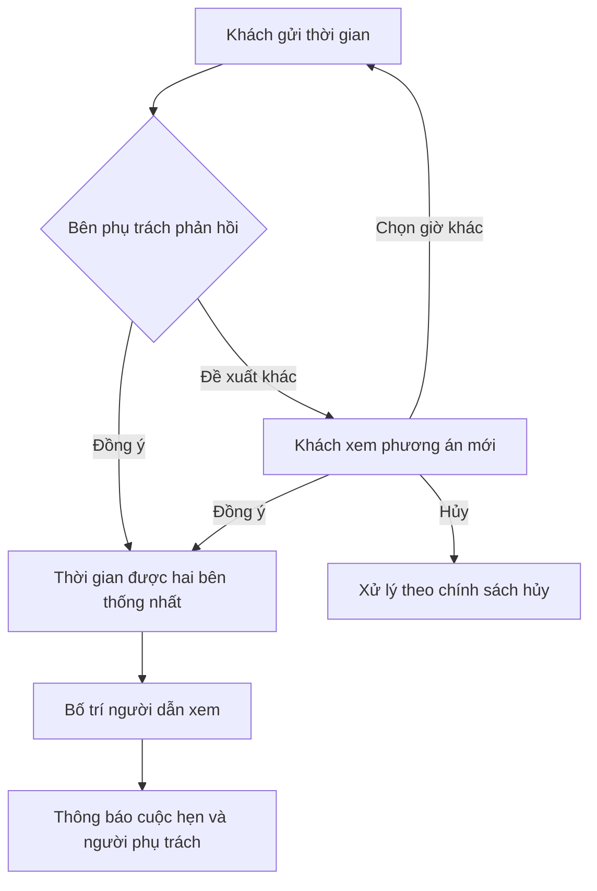

# Rooms — Brief mở rộng hành trình khách hàng từ Home101

- **Mã tài liệu:** `BRIEF-H101-01`.
- **Ngày:** 11/11/2026.
- **Mục đích:** đầu vào cho AI đọc spec, làm rõ nghiệp vụ, lập kế hoạch rồi triển khai trong dự án Rooms.
- **Trạng thái:** chủ dự án đã yêu cầu các nhóm tính năng dưới đây; các lựa chọn trong bảng `Q-H101-*` còn chờ trả lời. Chưa phải đặc tả đủ điều kiện code toàn bộ.
- **Phạm vi của lần bàn giao này:** một tài liệu yêu cầu. Chưa sửa code, schema, migration, dependency hay spec chính thức.

## 1. Yêu cầu của chủ dự án

Áp dụng vào Rooms những cách tham gia và sử dụng hệ thống đã tham khảo ở Home101:

1. Chọn mục đích sử dụng trước khi vào khu vực phù hợp; có tài khoản trước khi thuê và hỗ trợ nhiều ngôn ngữ.
2. Khách tự theo dõi lịch đã gửi, yêu cầu đổi giờ và hủy lịch xem.
3. Có trao đổi hai chiều: khách gửi giờ → bên phụ trách chấp nhận hoặc đề xuất giờ khác → khách phản hồi → bố trí người dẫn xem cho cuộc hẹn.
4. Điều phối người làm theo khu vực, kỹ năng và thời gian rảnh.
5. Bổ sung bộ lọc thuộc tính khi tìm phòng.
6. Có đánh giá dịch vụ sau khi sử dụng.

“Phase 1 của Home101” trong yêu cầu là tên nhóm **cách người dùng tham gia hệ thống** trong cuộc trao đổi trước. Không có nghĩa toàn bộ yêu cầu này nằm trong Phase 1 của roadmap Rooms. Thay đổi sẽ liên quan đến auth, phòng, lịch xem, hợp đồng, thông báo và có thể cả sự cố.

## 2. Cách dùng tài liệu và nguồn tham chiếu

- `[REQUESTED]`: mục tiêu chủ dự án đã yêu cầu; chi tiết còn có thể phụ thuộc câu hỏi mở.
- `[PROPOSAL]`: phương án đề xuất để chủ dự án chọn; chưa phải quyết định đã duyệt.
- `[OPEN Q-H101-xx]`: chưa đủ căn cứ để code hành vi liên quan. AI phải hỏi, không tự chuyển thành `[ASSUMPTION]`.
- Các mã `H101-*` là mã yêu cầu của brief này. Khi cập nhật spec, giữ bảng liên kết giữa chúng với mã spec chính thức.

### Nguồn Rooms phải đọc

Đường dẫn tính từ gốc repository:

| Tài liệu | Nội dung cần đối chiếu |
|---|---|
| `AGENTS.md`, `docs/spec/README.md`, `docs/spec/00-overview.md` | Quy trình làm việc, vai trò, quyết định, nguyên tắc toàn hệ thống |
| `docs/spec/01-architecture.md`, `docs/spec/02-database.md` | Auth, API, cache, phân quyền, schema và ràng buộc dữ liệu |
| `docs/spec/10-auth.md` | Đăng nhập, cấp tài khoản, điều hướng, phạm vi quyền |
| `docs/spec/11-buildings-rooms.md` | Điều kiện công khai phòng, thuộc tính và bộ lọc |
| `docs/spec/13-viewings.md` | Tạo lịch, khung giờ, đổi trạng thái, chống spam |
| `docs/spec/14-contracts.md` | Liên kết khách với người ký hợp đồng và tài khoản người thuê |
| `docs/spec/18-requests.md`, `docs/spec/19-notifications.md` | Sự cố, thông báo, việc cần xử lý |
| `docs/spec/20-reports-audit-settings.md` | Quyền, lưu vết, cài đặt cần bổ sung sau khi chốt phạm vi |
| `docs/spec/30-frontend.md`, `docs/spec/31-ui-kit.md` | Route, màn hình, ngôn ngữ và UI kit chính thức |

Đọc hướng dẫn từng app trước khi triển khai. Tại thời điểm viết, hai file thực tế là `Source/frontend/CLAUDE.md` và `Source/backend/CLAUDE.md`; chưa thấy `AGENTS.md` tại hai thư mục app. Đọc tiếp task file của feature có liên quan. Không tự tạo task file thay chủ dự án khi chưa được giao.

`docs/spec/README.md` hiện ghi Phase 1–2 đã hoàn thành, đang ở Phase 3; dòng trạng thái tại `AGENTS.md` gốc còn ghi chưa triển khai. Khi lập kế hoạch phải đối chiếu code và task file thực tế, không dựa riêng vào dòng trạng thái cũ. Brief này chưa kiểm toán toàn bộ mức hoàn thành của code.

### Nguồn Home101

- [Trang chào Home101](https://home101.vn/): bản công khai đọc ngày 11/11/2026 có lựa chọn ngôn ngữ, tiền tệ, nút tiếp tục và phần tử video nền.
- [Quy chế và quy trình Home101](https://home101.vn/WEBSITE.pdf): bản truy xuất trong lần này gồm 55 trang, đề ngày 09/07/2025. Tài liệu mô tả đăng ký trước giao dịch, chọn tư cách sử dụng, lịch xem và nhân viên hỗ trợ; phần dịch vụ tại nhà mô tả phân công theo khu vực, kỹ năng, thời gian rảnh và đánh giá sau dịch vụ.
- Các nhánh tham chiếu: [người mua/người thuê](https://home101.vn/buyer), [người sở hữu](https://home101.vn/owner), [dịch vụ tại nhà](https://home101.vn/home-services).

Home101 là nguồn tham khảo trải nghiệm. Những yêu cầu chi tiết bên dưới là đề bài cho Rooms, không phải khẳng định rằng từng hành vi đã được kiểm thử trên Home101. Không suy diễn thêm mô hình bán gói, mua bán bất động sản hay chủ nhà bên ngoài từ các liên kết này.

## 3. Những điểm phải thay đổi so với spec hiện tại

| Hiện tại trong Rooms | Yêu cầu mới | Việc AI phải xử lý trong kế hoạch |
|---|---|---|
| Khách không có tài khoản; không có đăng ký công khai (`D-01`, `D-02`, `AUTH-10`) | Tài khoản trước khi thuê | Sửa quyết định cấp tài khoản, onboarding, đăng ký, xác minh, khôi phục và nội dung trang đăng nhập |
| Đăng nhập chuyển theo vai trò (`AUTH-06`); `/` là trang tìm phòng | Màn chọn mục đích và khu vực khách trước khi thuê | Chốt route, đường quay lại, ghi nhớ lựa chọn và hành vi truy cập link trực tiếp |
| Chỉ tiếng Việt (`G-03`, `UI-01`, `KIT-04`); lỗi API có thông điệp tiếng Việt (`API-03`) | Nhiều ngôn ngữ | Chốt phạm vi dịch; đồng bộ FE, lỗi/validation BE, thông báo và fallback |
| Khách gửi form công khai; response không có id (`VIEW-01`, `VIEW-12`) | Khách tra cứu lịch riêng | Thiết kế quyền sở hữu/xác minh; giữ chống spam, không tạo API tra cứu chỉ bằng số điện thoại |
| Nhân sự sửa ngày/buổi trực tiếp (`VIEW-08`, `VIEW-09`) | Hai bên đồng ý thời gian | Bổ sung đề xuất, phản hồi, lịch sử; không coi đề xuất chưa được đồng ý là lịch đã chốt |
| Trạng thái chỉ `NEW`, `CONFIRMED`, `WON`, `LOST`, `CANCELLED` (`VIEW-04`) | Chờ phản hồi, phân công, hoàn tất buổi xem | Xác định trạng thái nào thuộc cuộc hẹn, đề xuất giờ, nhiệm vụ; không tự dùng `WON` cho “đã xem xong” |
| Công việc gắn với quản lý tòa hoặc Boss (`VIEW-07`, `SCOPE-02`, `SCOPE-04`) | Người thực hiện được phân theo từng việc | Tách người chịu trách nhiệm tòa với người được giao việc; không mặc nhiên mở quyền toàn tòa |
| Hợp đồng tạo/tái sử dụng TENANT theo điện thoại (`CON-07`); hủy có thể khóa tài khoản (`CON-12`) | Có tài khoản khách từ trước | Chốt liên kết danh tính, quyền sau khi ký và khi hết/hủy hợp đồng; không đặt lại mật khẩu của tài khoản đã có ngoài luồng được duyệt |
| Thông báo và `/me/*` chủ yếu dành cho TENANT (`API-07`, `NOTI-01`) | Khách và người nhận việc cũng cần thông báo | Mở rộng có kiểm soát theo từng đối tượng; không cho khách truy cập dữ liệu thuê chỉ vì có tài khoản |
| Bộ lọc quận/phường/tòa/giá trong `30-frontend.md` | Lọc thêm thuộc tính | Chốt trường, nguồn dữ liệu, cách nhập và lọc; không lọc bằng dữ liệu minh họa |
| Sự cố có xử lý/xác nhận hoàn thành (`REQ-06`) | Điều phối và đánh giá dịch vụ | Chốt có áp dụng cho sửa chữa hay không; không tự biến thành bán dịch vụ có thu tiền |

Đặc biệt: `/public/*` đang có chính sách cache công khai (`PUB-05`, `DEP-06`). Dữ liệu lịch riêng, tài khoản và thông báo không được lọt vào cache công khai dù người dùng truy cập qua đường dẫn từ trang tìm phòng.

## 4. Mô tả chức năng mong muốn

### 4.1. Màn chào và chọn mục đích sử dụng

- **H101-ENTRY-01 [REQUESTED]:** có màn chào cho người dùng chọn hướng sử dụng trước khi đến khu vực phù hợp.
- **H101-ENTRY-02 [PROPOSAL, Q-H101-01]:** ba lựa chọn phù hợp mô hình chuỗi hiện tại là **Tìm phòng**, **Tôi đang thuê**, **Quản lý tòa nhà**. Không gọi người quản lý nội bộ là chủ nhà độc lập.
- **H101-ENTRY-03:** lựa chọn mục đích chỉ điều hướng. Quyền đọc/ghi vẫn được BE kiểm tra theo tài khoản; chọn một mục không tự tạo vai trò hay nâng quyền.
- **H101-ENTRY-04 [OPEN Q-H101-02]:** chốt màn riêng tại `/` hay lớp chào lần đầu, có ghi nhớ lựa chọn hay không, và có video nền trong đợt này hay không. Các link phòng được chia sẻ, link đăng nhập và link thông báo phải giữ đúng đích.
- Nếu chọn video: dùng tài sản hình ảnh của Rooms, có ảnh tĩnh khi video không chạy, tắt chuyển động theo reduced-motion, dùng được bằng bàn phím/chạm và không tràn ngang ở 360 px (`KIT-05`). Vẫn dùng màu, chữ và component của Rooms.

### 4.2. Tài khoản trước khi thuê

- **H101-ACCOUNT-01 [REQUESTED]:** người chưa ký hợp đồng có thể tự tạo tài khoản và đăng nhập để quản lý hành trình tìm phòng.
- **H101-ACCOUNT-02 [OPEN Q-H101-03]:** xác định thông tin đăng ký, phương thức xác minh, cách đăng nhập/khôi phục và cách xử lý điện thoại/email đã tồn tại.
- **H101-ACCOUNT-03:** khu vực cá nhân cho khách phải có lịch hẹn và các phản hồi cần thực hiện. Tên/route và cấu trúc điều hướng được thiết kế sau khi chốt mục đích sử dụng.
- **H101-ACCOUNT-04 [OPEN Q-H101-04]:** chốt việc tái sử dụng tài khoản khi ký hợp đồng, giữ lịch sử khi thành người thuê, và quyền sau khi hủy/hết hợp đồng. Cần bao phủ tài khoản khách mới, TENANT cũ, tài khoản bị khóa và số của MANAGER/BOSS theo `CON-07`.
- Không ghép lịch cũ hoặc tài khoản với người đăng ký chỉ vì họ nhập đúng một số điện thoại. Kế hoạch phải mô tả bằng chứng sở hữu và cách xử lý trường hợp không đủ bằng chứng.
- Tài khoản khách không được xem hợp đồng, hóa đơn hoặc dữ liệu của người khác. Quyền cư dân không phát sinh từ việc bấm “Tôi đang thuê”.

### 4.3. Nhiều ngôn ngữ

- **H101-LOCALE-01 [REQUESTED]:** người dùng chọn được ngôn ngữ; lựa chọn áp dụng nhất quán trong phạm vi đã chốt.
- **H101-LOCALE-02 [OPEN Q-H101-05]:** chốt danh sách ngôn ngữ, khu vực được dịch, và có lựa chọn tiền tệ hay không. Nhiều ngôn ngữ không tự đồng nghĩa hỗ trợ số điện thoại quốc tế hay thanh toán ngoại tệ.
- Kế hoạch phải phân biệt bản dịch UI, dữ liệu người dùng nhập, mô tả phòng, thông báo/email và tài liệu hợp đồng. Nội dung chưa có bản dịch cần quy tắc fallback rõ ràng; không hiển thị khóa dịch thô.
- Không đổi đơn vị lưu tiền hoặc logic tính tiền chỉ vì đổi ngôn ngữ. `G-01` vẫn là số nguyên đồng; mọi mở rộng tiền tệ phải được chốt riêng.

### 4.4. Khách theo dõi và trao đổi lịch xem

- **H101-VIEW-01 [REQUESTED]:** có danh sách và chi tiết lịch của chính khách: phòng/tòa, thời gian đang có hiệu lực, đề xuất đang chờ, trạng thái, người dẫn xem khi đã được phân và lịch sử cập nhật liên quan.
- **H101-VIEW-02 [REQUESTED]:** khách gửi ngày/giờ mong muốn. Bên phụ trách có thể chấp nhận hoặc gửi một phương án khác; khách có thể đồng ý, từ chối hoặc yêu cầu thời gian khác.
- **H101-VIEW-03 [REQUESTED]:** khách yêu cầu đổi và có hành động hủy. Chính sách hiệu lực/hạn đổi-hủy thuộc `Q-H101-08`, không tự quyết là hủy ngay hay chờ duyệt.
- **H101-VIEW-04:** hiển thị rõ bên nào đang phải phản hồi. Không ghi đè thời gian đã xác nhận khi chỉ mới gửi đề xuất, trừ khi chủ dự án chọn chính sách khác và sửa spec tương ứng.
- **H101-VIEW-05:** hoàn tất buổi xem không đồng nghĩa chốt thuê. `WON` vẫn chỉ được gán bởi tạo hợp đồng theo `VIEW-04`, `VIEW-05`, trừ thay đổi spec được duyệt riêng.
- **H101-VIEW-06 [OPEN Q-H101-06..08]:** chốt quyền đặt khi chưa đăng nhập, cách chọn thời gian, thời lượng, hạn phản hồi/đổi/hủy, xử lý khách hoặc nhân sự vắng mặt và quyền ghi nhận thay khách khi trao đổi qua điện thoại.
- Khi phòng có HOLD, bị khóa/bảo trì hoặc tòa đổi quản lý, phải đánh giá tác động lên mọi lịch/đề xuất/phân công đang mở; kế thừa `VIEW-06`, `VIEW-13` và bổ sung cho trạng thái mới. Không tự đổi việc khóa phòng thành hủy toàn bộ lịch.

Luồng mục tiêu, chưa ấn định enum hay API:

### 4.5. Điều phối người làm

- **H101-DISPATCH-01 [REQUESTED]:** hỗ trợ phân công theo **khu vực, kỹ năng, thời gian rảnh**; cuộc hẹn có người dẫn xem cụ thể.
- **H101-DISPATCH-02 [OPEN Q-H101-09]:** chốt chỉ người dẫn xem hay cả kỹ thuật viên; nhân sự nội bộ hay đối tác ngoài; hệ thống gợi ý để người quản lý chọn hay tự động giao.
- Kế hoạch phải mô tả dữ liệu cần quản lý: khu vực phục vụ, loại việc/kỹ năng, lịch làm việc/nghỉ, lịch bận, thời lượng và khoảng di chuyển nếu được sử dụng. Không dùng “không thấy lịch bận” như bằng chứng đầy đủ rằng người đó sẵn sàng.
- **H101-DISPATCH-03:** trước khi phân công hoặc đổi giờ, kiểm tra lại điều kiện và xung đột đồng thời tại BE. Không giao một người hai việc chồng nhau. Nếu chưa có người phù hợp, hiển thị cần xử lý và bên chịu trách nhiệm; không báo đã bố trí thành công.
- **H101-DISPATCH-04:** cần luồng nhận việc/từ chối nếu được chọn, đổi người, người được giao nghỉ/bị khóa, và thông báo thay đổi cho các bên liên quan. Bước nhận việc và quyền đổi người thuộc `Q-H101-09`.
- **H101-DISPATCH-05:** người nhận việc chỉ được xem thông tin cần thiết của việc được giao. Không tự nhận quyền MANAGER, quyền thu tiền, CCCD, hợp đồng hoặc toàn bộ dữ liệu tòa. Cơ chế phân công không âm thầm bỏ giới hạn quản lý tối đa hai tòa.
- Nếu bao gồm sửa chữa: tích hợp với `REQ-06`; chi phí sửa chữa vẫn theo `D-15` hiện tại. Bán dịch vụ riêng, checkout, trả công nhân viên hay hoa hồng chưa được yêu cầu trong brief này.

### 4.6. Bộ lọc tìm phòng

- **H101-SEARCH-01 [REQUESTED]:** bổ sung lọc thuộc tính ngoài quận/phường/tòa/giá hiện có.
- **H101-SEARCH-02 [OPEN Q-H101-10]:** danh sách gợi ý gồm diện tích, sức chứa, tầng, nội thất, tiện ích tòa/phòng. Chủ dự án chọn các trường cần trong đợt này.
- Phải chỉ ra trường nào đã có dữ liệu cấu trúc, trường nào cần chuẩn hóa/nhập bổ sung. Không giả định mô tả tự do có thể lọc chính xác như checkbox.
- Lọc tại API trước phân trang, giữ điều kiện phòng công khai `ROOM-05`, phản ánh bộ lọc trong URL, có xóa bộ lọc và trạng thái không có kết quả. Không tự gắn thuộc tính vào phòng cũ khi chưa có dữ liệu.

### 4.7. Đánh giá dịch vụ

- **H101-REVIEW-01 [REQUESTED]:** có đánh giá chất lượng sau trải nghiệm/dịch vụ thực tế.
- **H101-REVIEW-02 [OPEN Q-H101-11]:** chốt đánh giá buổi dẫn xem, xử lý sự cố hay loại khác; ai được đánh giá; nội bộ hay công khai; thang điểm, sửa đánh giá và phản hồi/ẩn nội dung.
- Phải gắn đánh giá với lượt thực hiện đủ điều kiện; không biến thành trang nhận đánh giá của bất kỳ ai. Phân biệt điểm của buổi phục vụ, người thực hiện và phòng/tòa; không tự dùng chúng thay thế nhau.
- “Đã sửa xong” trong `REQ-06` và đánh giá chất lượng là hai hành động khác nhau. Đánh giá thấp không tự mở lại sự cố, đổi kết quả thuê hoặc phát sinh hoàn tiền nếu chưa có quy tắc được duyệt.

### 4.8. Thông báo và lưu vết

- **H101-NOTIFY-01:** các sự kiện cần xét gồm tạo lịch, đề xuất giờ, chấp nhận/từ chối, đổi/hủy, phân công/đổi người, nhắc lịch và mời đánh giá. Chốt người nhận, kênh và thời điểm tại `Q-H101-12`.
- Thông báo/link phải kiểm tra quyền ở đích; không mở dữ liệu lịch cá nhân công khai và không chia sẻ thông tin liên hệ đăng nhập ngoài chính sách đã duyệt.
- Kế hoạch phải có lịch sử người thao tác, thời điểm, nội dung thay đổi và nguồn thao tác, đồng thời phân biệt phần hiển thị cho khách với nhật ký nội bộ. Gửi lại sự kiện không được tạo thông báo lặp vô hạn.

## 5. Các quyết định cần chủ dự án trả lời trong một lượt

Các lựa chọn A bên dưới là **đề xuất**, không được coi là đã đồng ý nếu chưa có trả lời. Có thể trả lời theo mã, ví dụ `01A, 02B, 03: ...`; nếu sửa một chi tiết trong gói A, ghi rõ chi tiết đó.

| Mã | Câu hỏi cần chốt | A — phương án đề xuất | B / lựa chọn khác |
|---|---|---|---|
| **Q-H101-01** | Rooms vẫn phục vụ chuỗi của mình hay mở cho chủ nhà bên ngoài? Các lối vào nào? | Giữ chuỗi hiện tại; ba lối **Tìm phòng / Tôi đang thuê / Quản lý tòa nhà**. | Cho chủ nhà bên ngoài hoặc người mua dịch vụ độc lập vào hệ thống; cần mô tả thêm đối tượng và quyền, đây là mở rộng mô hình. |
| **Q-H101-02** | Màn chào xuất hiện thế nào, có video không? | Phủ lần đầu trên trang chủ `/`, ghi nhớ trên trình duyệt; có nút chọn lại; link phòng đi thẳng. Có video Rooms và ảnh tĩnh dự phòng. | `/` là trang chào riêng mỗi lần mở, chuyển trang nội dung sang route khác; hoặc chọn ảnh tĩnh trước. Nếu chọn video, chỉ rõ asset sẽ dùng/cung cấp. |
| **Q-H101-03** | Đăng ký và xác minh bằng gì? Có nhận số nước ngoài? | Điện thoại Việt Nam + mật khẩu; xác minh bằng SMS OTP, khôi phục qua số đã xác minh. Cần chủ dự án chọn/cung cấp nhà gửi SMS. | Email + mật khẩu + link xác minh; cần chốt cách xác minh số điện thoại trước khi nối lịch/hợp đồng. Hoặc chỉ rõ kênh khác, định dạng số quốc tế nếu cần. |
| **Q-H101-04** | Tài khoản khách có đi theo suốt thời gian thuê và sau khi rời đi không? | Một danh tính liên tục: ký hợp đồng được thêm quyền thuê phù hợp; giữ mật khẩu/lịch sử; hết hoặc hủy thuê vẫn giữ khu vực khách. Tài khoản bị khóa vì quản trị không tự mở lại. | Tách tài khoản khách và người thuê; cần quy tắc liên kết, đăng nhập và chuyển lịch sử riêng. |
| **Q-H101-05** | Dùng ngôn ngữ nào, ở khu vực nào, có chọn tiền tệ không? | Việt + Anh cho trang công khai, tài khoản khách và khu vực người thuê; nhân sự và hợp đồng tiếng Việt; chỉ VND. | Liệt kê ngôn ngữ/khu vực khác. Nếu có ngoại tệ, chốt chỉ quy đổi tham khảo hay có thu tiền ngoại tệ; không tự thay G-01. |
| **Q-H101-06** | Khách phải đăng nhập trước khi đặt lịch không? Lịch cũ/nhân sự tạo hộ được nhận về tài khoản thế nào? | Xem phòng không cần đăng nhập; đặt lịch cần tài khoản đã xác minh. Lịch tạo hộ/cũ chỉ nhận sau xác minh quyền sở hữu số và xác nhận liên kết rõ ràng. | Vẫn đặt không cần tài khoản; tra cứu/đổi/hủy qua liên kết bảo mật hoặc OTP. Cần chọn kênh nhận và cách thu hồi/hết hạn liên kết. |
| **Q-H101-07** | Lịch xem theo buổi hay giờ cụ thể; ca dài bao lâu, có đệm di chuyển không? | Giờ cụ thể, 30 phút/cuộc hẹn, đệm 15 phút; nhân sự nhập giờ làm/nghỉ. Giữ giới hạn đặt trong 30 ngày theo VIEW-08. | Giữ ba buổi hiện tại; cần chốt số cuộc hẹn/người/buổi. Hoặc ghi thời lượng, đệm, thời gian đặt trước mong muốn. Phải chốt cách xử lý lịch cũ chỉ có buổi. |
| **Q-H101-08** | Quy tắc đổi/hủy, hết hạn phản hồi và vắng mặt? | Khách hủy ngay trước giờ hẹn; đổi phải bên kia đồng ý, giữ giờ cũ đến khi thay đổi thành công. Đề xuất hết hiệu lực khi chạm giờ cũ hoặc giờ đề xuất, mốc nào sớm hơn; không tự coi im lặng là đồng ý. Nhân sự ghi nhận vắng mặt sau giờ hẹn, không phạt; được ghi nhận trao đổi qua điện thoại kèm nguồn/ghi chú. | Yêu cầu duyệt hủy, thời hạn báo trước hoặc hết hạn sau số giờ cụ thể; có giới hạn đổi hay xử lý vắng mặt khác. Cần ghi rõ các mốc/quyền thay cho A. |
| **Q-H101-09** | Điều phối ai, ai giao việc, gợi ý hay tự động? | Đợt đầu chỉ người dẫn xem nội bộ; Boss toàn hệ thống, quản lý trong tòa được giao. Hệ thống lọc người đủ điều kiện, nhân sự chọn; người nhận việc xác nhận hoặc từ chối, chưa nhận thì vẫn chờ phân công. | Thêm kỹ thuật viên/đối tác ngoài; hoặc tự động giao. Chỉ rõ nhóm, quyền giao/đổi việc, có cần nhận việc và tiêu chí ưu tiên nếu nhiều người phù hợp. |
| **Q-H101-10** | Những bộ lọc nào đưa vào đợt này? | Diện tích, số người tối đa, tầng, nội thất và tiện ích; chuẩn hóa danh mục nội thất/tiện ích trước khi lọc. | Chọn một phần hoặc thêm loại phòng, ban công, cửa sổ, thang máy, nuôi thú cưng...; chốt ai nhập và xử lý dữ liệu còn thiếu. |
| **Q-H101-11** | Đánh giá cái gì và ai được đọc? | Buổi dẫn xem đã hoàn tất; khách của lịch đánh giá 1–5 sao + nhận xét, một lần/lượt, được sửa trong 7 ngày. Boss/quản lý có phạm vi xem, chưa công khai; nội dung bị ẩn cần lý do và còn nhật ký. | Bao gồm sửa chữa hoặc trải nghiệm thuê; công khai trên phòng/tòa hoặc cho nhân viên phản hồi. Chốt quyền đọc, sửa, ẩn và điều kiện “đã hoàn tất” tương ứng. |
| **Q-H101-12** | Thông báo qua đâu, có nhắc lịch tự động không? | Trong tài khoản + email đã xác minh nếu có; thông báo khi có thay đổi, nhắc 24 giờ và 2 giờ trước lịch đã có người nhận việc. Nhắc bị lỡ chỉ gửi nếu lịch vẫn ở tương lai; gộp nếu trùng lúc, không gửi lại; email lỗi không làm hỏng thao tác. | Thêm SMS/Zalo/push hoặc thời điểm khác. Phân biệt SMS xác minh ở Q03 với SMS thông báo; cần chọn nhà cung cấp và cập nhật D-20 nếu dùng Zalo. |

Nếu chọn nhánh mở rộng ở Q01/Q09/Q11 hoặc kênh mới ở Q03/Q12, AI phải phân tích các quyết định phát sinh của nhánh đó và gom thành một lượt hỏi trước khi code phần liên quan. Không coi các phương án B là một gói có quy tắc đã đầy đủ.

## 6. Phạm vi cần giữ và phần chưa được yêu cầu

- Giữ stack, UI kit và nguyên tắc phân quyền BE của Rooms. Không tạo hệ thống component thứ hai.
- Chưa có yêu cầu sao chép thương hiệu, nội dung, code hay toàn bộ giao diện Home101. Chỉ áp dụng các hành vi đã chọn vào nhận diện Rooms.
- Chưa có yêu cầu mở mua bán bất động sản, Premium, coupon, giỏ hàng, thu phí dịch vụ theo đơn hoặc hoa hồng nhân viên. Nếu câu trả lời làm phát sinh các phần này, phải chốt phạm vi riêng.
- Quy tắc cọc, tiền thuê, điện nước, VietQR, webhook và quyết toán hiện tại tiếp tục theo spec; không sửa chỉ để thêm màn chào hoặc tài khoản khách.
- Không xem các con số thử nghiệm, trạng thái hay tên bảng trong kế hoạch là quyết định nghiệp vụ nếu chưa có căn cứ từ spec/câu trả lời.
- Không có `[ASSUMPTION]` nghiệp vụ mới được tự duyệt trong brief này; phương án chưa chốt đều mang `[PROPOSAL]`/`[OPEN]`.

## 7. Đầu ra cần yêu cầu AI lập kế hoạch

AI phải trả về một kế hoạch có thể triển khai theo từng checkpoint, gồm:

1. **Quyết định đã chốt:** câu trả lời Q-H101, phạm vi làm trước/sau và các điểm còn mở.
2. **Ma trận yêu cầu:** H101 → mã spec hiện tại cần sửa/thêm → task BE/FE → tiêu chí nghiệm thu. Cập nhật quyết định D-01/D-02 và các quy tắc xung đột có chủ đích; không âm thầm bỏ qua chúng.
3. **Luồng và phân quyền:** ma trận quyền cho khách ẩn danh, tài khoản khách, người thuê, quản lý, Boss và người nhận việc nếu có; trạng thái/chuyển trạng thái, người được thao tác và tác dụng phụ.
4. **Màn hình và API:** mô tả màn hình, route, link trực tiếp, trạng thái tải/trống/lỗi; hợp đồng API và lỗi. Tên enum/bảng/API do AI đề xuất từ code thực tế, không cần hỏi về lựa chọn kỹ thuật thuần túy không đổi nghiệp vụ.
5. **Dữ liệu và chuyển đổi:** tác động tới users/roles, lịch cũ theo buổi, lịch thủ công, số trùng, tài khoản bị khóa, hợp đồng, cache và dữ liệu thuộc tính phòng. Có kế hoạch chuyển đổi không mất lịch sử và xử lý trường hợp không thể suy ra giờ cụ thể/danh tính.
6. **Tích hợp:** xác minh tài khoản, bản dịch, thông báo, lịch rảnh; liệt kê dependency/provider thực sự cần, phần owner phải cấu hình và chi phí chưa có căn cứ. Không tự điền `.env*`.
7. **Kiểm tra:** test theo quyết định đã duyệt, ca đồng thời/ngoài phạm vi/đổi trạng thái; hướng dẫn thử thủ công và đo hiệu năng video nếu chọn.
8. **Checkpoint:** chia phần nhỏ có thể review/commit; thứ tự phụ thuộc, rủi ro, cách rollback và dữ liệu cần giữ. Dùng quy trình planner/reviewer hiện hành của repo; không giả vờ đã chạy model/agent không khả dụng.

Thứ tự gợi ý để planner đánh giá: chốt và cập nhật spec → tài khoản/quyền/ngôn ngữ/màn chào → lịch cá nhân và trao đổi giờ → điều phối → bộ lọc và đánh giá. Đây là gợi ý, không phải kế hoạch đã được chủ dự án duyệt.

## 8. Tiêu chí nghiệm thu cần cụ thể hóa sau khi chốt câu hỏi

Các ca dưới đây chỉ ra điều phải kiểm chứng; kỳ vọng cụ thể phải lấy từ câu trả lời và spec cập nhật, không lấy từ code đang viết.

| Nhóm | Tình huống cần kiểm chứng |
|---|---|
| H101-ENTRY | Chọn đúng luồng, đổi lựa chọn, truy cập link phòng trực tiếp, đã đăng nhập nhưng chọn nhầm mục; không thể nâng quyền qua lựa chọn |
| H101-ACCOUNT | Khách mới, thông tin chưa xác minh, tài khoản cũ/trùng/bị khóa, khôi phục, liên kết lịch cũ, ký hợp đồng, hủy/hết thuê; không mất mật khẩu/lịch sử ngoài chính sách |
| H101-LOCALE | Ngôn ngữ ở mọi màn trong phạm vi, validation/lỗi BE, fallback, thông báo; đổi ngôn ngữ không đổi giá trị tiền hay giờ hẹn |
| H101-VIEW | Đề xuất → đồng ý/từ chối/đề xuất lại; đổi/hủy/đề xuất hết hạn; thông điệp cũ được bấm sau khi có đề xuất mới; không tác động nhầm giờ hiện hành |
| H101-VIEW | Hai người thao tác đồng thời, phòng bị giữ/khóa/bảo trì, lịch thủ công/cũ; hoàn tất xem không tự thành WON |
| H101-DISPATCH | Đúng khu vực/kỹ năng/lịch rảnh; ca và khoảng đệm; giao trùng đồng thời, người từ chối/nghỉ/bị khóa, đổi người, không có người phù hợp; quyền chỉ đủ cho việc được giao |
| H101-SEARCH | Kết hợp bộ lọc và phân trang, URL chia sẻ, dữ liệu thiếu, không có kết quả; vẫn không lộ phòng không công khai |
| H101-REVIEW | Đúng người/đúng lượt/đúng điều kiện hoàn tất, chặn đánh giá trùng hoặc trái quyền; sửa/ẩn/công khai theo chính sách |
| H101-NOTIFY | Đúng người, đúng ngôn ngữ/kênh/thời điểm; không gửi lặp hay nhắc lịch đã hủy/đổi; link cũ không vượt quyền; không có dữ liệu riêng trong public cache |
| Hồi quy Rooms | Đăng nhập cũ, giới hạn quản lý hai tòa, Boss fallback, danh sách phòng công khai, chống spam, liên kết hợp đồng, UI kit và reduced-motion vẫn đúng spec |

Khi triển khai: chạy lint/tests của app đã sửa, frontend build, e2e phù hợp và DB check nếu schema thay đổi. Dùng `package.json` và checker thực tế làm căn cứ số lượng; README hiện ghi Phase 2 đã là 54/54, không dùng con số 50/50 cũ để bỏ qua constraint mới.

## 9. Prompt bàn giao cho AI

> Đọc `docs/home101-adoption-brief.md` cùng `AGENTS.md` và các spec được liệt kê. Tôi muốn mở rộng Rooms theo các nhóm H101 trong brief. Đầu tiên chạy git status, xác định code/task đã có và đối chiếu toàn bộ câu trả lời Q-H101. Các lựa chọn A chỉ là đề xuất, không phải mặc định được duyệt. Gom câu hỏi nghiệp vụ còn thiếu trong một lượt, có phương án cụ thể; không tự chuyển OPEN thành ASSUMPTION.
>
> Sau khi đủ quyết định, lập kế hoạch tại đường dẫn PLAN.md phù hợp quy trình dự án, gồm cập nhật spec, phân quyền, trạng thái, màn hình/API, dữ liệu và chuyển đổi, kiểm thử, checkpoint. Tham khảo Home101 về hành vi nhưng dùng UI kit Rooms. Kế hoạch phải bao phủ tài khoản trước khi thuê, liên kết với hợp đồng, lịch hai chiều, người thực hiện, đa ngôn ngữ, bộ lọc, đánh giá và thông báo trong phạm vi đã chốt.
>
> Trình kế hoạch và phần cập nhật spec để tôi kiểm tra trước khi code. Khi triển khai, sửa file chính theo checkpoint; không dùng thư mục draft cũ. Hỏi riêng trước mỗi thay đổi schema, áp dụng migration, xóa file hoặc cài dependency; `.env*` do tôi điền. Không tự commit; chỉ push khi tôi đồng ý. Cuối mỗi checkpoint báo file đổi, kết quả kiểm tra thật, cách thử tay, ASSUMPTION nếu có và commit message kèm mã task/spec. Sau khi tôi xác nhận đã kiểm tra và commit mới tiếp tục.
