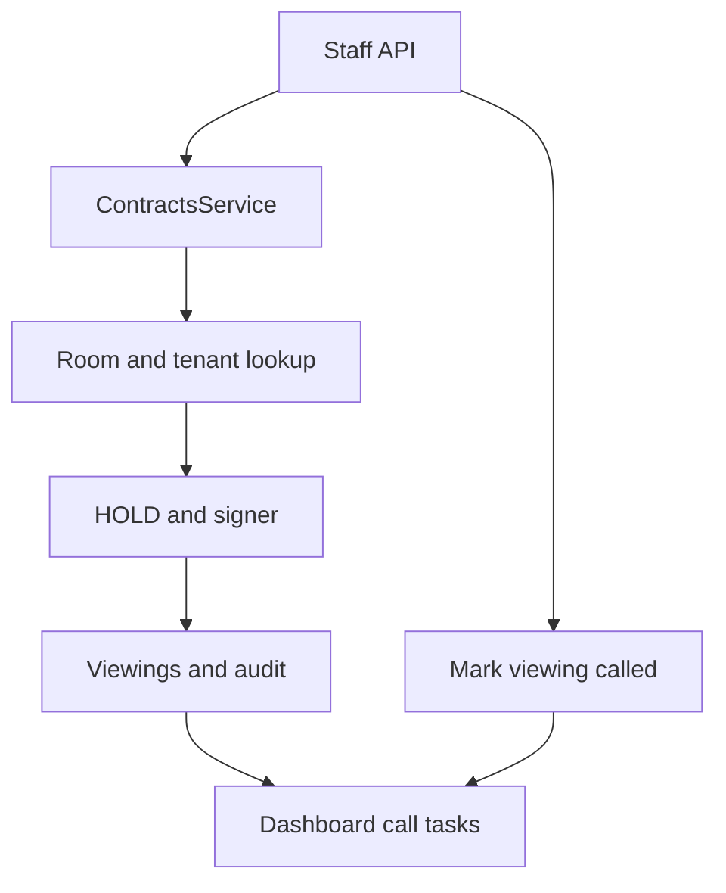

# P3-2 · Backend tạo hợp đồng và chốt lịch xem

## Mục tiêu và phạm vi

BE-P3-07..12 thực hiện CON-01..05, phần tạo của CON-07, VIEW-04..06, VIEW-16, NOTI-06, AUD-01, D-07, D-08, D-26, D-39..41 và SCOPE-02..05. Mốc đầu tạo HOLD và xử lý lịch trong một giao dịch, mốc hai thêm danh sách/chi tiết cùng việc “Đã gọi”, mốc ba chạy nghiệm thu. P3-3 xử lý ký, mật khẩu tạm, hóa đơn cọc, trang in và các route `/me/contracts`. Q-15 về mẫu in thuộc P3-3 trở đi.

## Kiến trúc

| File dưới `Source/backend/` | Trách nhiệm |
|---|---|
| `src/modules/contracts/contracts.module.ts`, `contracts.controller.ts`, `contracts.service.ts`, `dto/contracts.dto.ts`, `contracts.types.ts` | Route staff, DTO tạo/lọc, giao dịch và projection. Dùng `AuditModule`, module đã đăng ký ở P3-1. |
| `src/common/rooms/public-room.ts`, `src/common/date/period.ts`, `src/common/crypto/cccd.ts`, `src/common/rates/rates-at.ts` | Dùng lại ROOM-05, `contractEndDate`, `encryptCccd`, `last4` và kiểm tra giá dịch vụ có hiệu lực tại ngày bắt đầu hợp đồng. Ảnh riêng tư dùng luồng tài sản của P3-1 khi đính vào hợp đồng ở P3-5. |
| `src/modules/auth/auth.service.ts`, `otp.service.ts`, helper khóa định danh dùng chung | Đồng bộ tạo hợp đồng với đăng ký/xác minh, tách trạng thái chờ ký và bị khóa. |
| `src/modules/viewings/viewings.service.ts`, `src/common/viewings/viewing-lock.ts` | Tái sử dụng khóa mapping để đồng bộ hủy theo phòng với đặt lịch, đổi giờ và các thao tác trạng thái. Thêm định danh chủ lịch cho projection staff phục vụ “Chốt”. |
| `src/common/errors/all-exceptions.filter.ts`, các test liên quan | Kiểm tra danh sách cho phép của envelope lỗi. Chỉ lỗi xác nhận GUEST của POST tạo hợp đồng được mang tên/email, nếu cần dữ liệu có cấu trúc. Dùng mã có sẵn trong `error-code.ts` và `db-errors.ts`. |
| `src/modules/viewings/viewings.controller.ts`, `viewings.service.ts`, `src/modules/notifications/dashboard.service.ts`, test tương ứng | Đọc nhóm gọi khách, đánh dấu đã gọi trong scope, lặp lại giữ nguyên người gọi và thời điểm. |
| `prisma/schema.prisma`, `prisma/migrations/`, `prisma/constraints.sql`, `prisma/check-constraints.mjs` | BE-P3-11, sau khi duyệt. Metadata gọi, ràng buộc và kiểm tra trước khi xin áp dụng. |
| `src/modules/contracts/contracts*.spec.ts`, `test/contracts.e2e-spec.ts` | Kiểm tra DTO/HTTP, nhánh tài khoản, rollback, truy vấn, và hành vi đồng thời trên DB. |

### Hợp đồng API

Các route dưới `/api/v1`, BOSS và MANAGER. 401 thiếu phiên, 403 `FORBIDDEN` sai vai trò, 403 `OUT_OF_SCOPE` ngoài tòa, 404 `NOT_FOUND` khi id đích không tồn tại. Response thành công dùng `{ data }` và các danh sách dùng `meta` chuẩn API-02.

| Route | Request, response, lỗi theo nghiệp vụ |
|---|---|
| `POST /contracts` | `CreateContractDto { roomId: number; signer: SignerDto; startDate: string; termMonths: number; deposit?: number; serviceIds: number[]; terms?: string; viewingId?: number; confirmedGuestAccountId?: number; confirmDifferentViewingOwner?: boolean }`. `SignerDto { fullName: string; phone: string; email?: string; dateOfBirth?: string; idNumber?: string }`. Ngày dùng yyyy-mm-dd, `startDate ≥ todayHanoi()`, G-04 cho số điện thoại, trim tên, email chuẩn hóa như AUTH-11, tên tối đa 100/email 255 theo schema, id số nguyên dương, tiền đồng `0..2147483647`. Số giấy tờ tùy chọn, CCCD đúng 12 chữ số nếu cung cấp. `termMonths` nguyên ≥3 và ngày kết thúc biểu diễn được. 201 `{data: ContractSummary}`. 400 `VALIDATION_FAILED` trên field tương ứng hay `CONTRACT_TERM_TOO_SHORT`. 409 `ROOM_NOT_AVAILABLE`, `PRICE_NOT_APPROVED`, `CONFLICT_STATE` nếu trạng thái lịch không cho chốt hoặc thiếu xác nhận khi phone khác chủ lịch WEB, `PHONE_TAKEN` khi sử dụng số staff hay chưa xác nhận khách, `EMAIL_TAKEN` khi email cần ghi đã thuộc account khác. Tài khoản bị khóa dùng `ACCOUNT_LOCKED` 403 và `fields.signer.phone` đúng câu CON-07. |
| `GET /contracts?buildingId&status&q&page&limit` | `ContractsQueryDto` dùng `PaginationQuery`, `ContractStatus`, tìm theo tên/điện thoại tenant hoặc mã phòng, scope được kết hợp với các bộ lọc. `{data: ContractSummary[], meta: {page, limit, total}}`. Thứ tự mặc định tạo mới trước, `id` để thành phần phân trang ổn định. |
| `GET /contracts/:id` | `{data: ContractDetail}` gồm summary, `terms`, `signedAt`, `movedInAt`, `occupants`, `vehicles`, `services`, `depositInvoice`. Tóm tắt tiền cọc `null` hoặc `{id, status, total, issueDate, dueDate}` theo Invoice. `occupants` gồm id, tên, điện thoại, ngày sinh/vào/ra, `isSigner`, `idNumberLast4`. Dùng chọn cột cụ thể, giữ hình và scan riêng theo CON-16. |
| `GET /dashboard?buildingId` | Thêm `depositCancelledViewings: { count: number; items: ViewingView[] }` vào shape hiện có của NOTI-06. Chọn các lịch chờ gọi đúng người chịu trách nhiệm hiện tại theo SCOPE-04, áp dụng `buildingId` và quy ước tối đa 5 dòng/đếm đủ như các nhóm lịch hiện có. |
| `POST /viewings/:id/called` | Không cần body; trả `{data: ViewingView}` có `calledAt` và `calledById`. Lịch khác loại → 409 `CONFLICT_STATE`; gọi lặp trả cùng metadata. |

`ContractSummary { id, code, status, room: {id, code}, building: {id, code, name}, tenant: {id, fullName, phone, email}, startDate, endDate, termMonths, rent, deposit, createdAt }`. `serviceIds` gắn vào `contract_services` bằng `building_id` lấy từ phòng. Tách `tenant.fullName` hiện tại với `occupant.fullName` của người ký ghi trong hợp đồng. Dữ liệu GET staff chọn rõ từng cột, gồm cờ có ảnh nếu UI cần; không trả số CCCD đầy đủ, ciphertext, asset ID, URL riêng tư hay thông tin mật khẩu. Định dạng ngày-only dùng helper hiện hành.

Việc xác nhận A-18 gửi `confirmedGuestAccountId` là ID số của tài khoản đang hiển thị. Với GUEST đã xác minh chưa được xác nhận, lỗi 409 `PHONE_TAKEN` trả `fields.guestAccountId`, `fields.guestAccountName` và `fields.guestAccountEmail` theo định dạng chuỗi của API-03. Form đọc ba trường này và chỉ gửi ID sau khi nhân sự xác nhận. Các lỗi trùng số của staff dùng mã `PHONE_TAKEN` với envelope thông thường.

`confirmDifferentViewingOwner` là xác nhận riêng của staff, dùng boolean nghiêm ngặt khi phone người ký khác phone hiện tại của chủ lịch WEB. Thiếu hoặc `false` trả 409 với field `confirmDifferentViewingOwner`. Khi xác nhận thành công, tenant vẫn xác định theo phone người ký và `viewings.user_id` vẫn thuộc chủ lịch. Nếu cả hai tình huống xác nhận cùng xảy ra, yêu cầu đủ hai xác nhận.

### Giao dịch và thứ tự khóa

1. Kiểm tra role/scope trước khi lookup định danh. `POST /contracts` lấy `lockViewingMapping(tx, true)` ở đầu giao dịch, trước mọi khóa hàng hoặc khóa phone. Các luồng đặt lịch và đổi trạng thái dùng mapping shared nên tuần tự với thao tác hủy lịch của hợp đồng, kể cả kiểm tra VIEW-16 ở tòa khác. Giữ trật tự khóa hiện hành trong các luồng viewing. Hợp đồng khóa hàng phòng `FOR UPDATE` để tuần tự với cập nhật phòng và giá, rồi đọc lại scope và trạng thái. Giữ giao dịch ngắn, chỉ thực hiện thao tác DB và tính toán nhẹ trong lúc giữ khóa.
2. Đọc lại phòng/tòa đúng scope sau khi có khóa, giữ quy tắc `publicRoomWhere(todayHanoi())` trừ `contracts.none` và tách kiểm tra `rooms.price = null` để trả đúng `PRICE_NOT_APPROVED`. Giá chốt lấy từ `rooms.price`, kiểm tra ELECTRIC/WATER hiệu lực tại ngày hiện tại. Dịch vụ chọn mới phải active, ROOM/PERSON cùng tòa, có rate plan APPROVED hiệu lực tại `startDate` qua `ratesAt`; trả 400 `VALIDATION_FAILED` trên `serviceIds` khi không hợp lệ. `endDate = contractEndDate(startDate, termMonths)` gồm trừ một ngày, dùng P3-1 cho kẹp cuối tháng. `deposit ?? room.price` giữ giá trị 0. DB `contracts_one_open_per_room` là quyết định HOLD/ACTIVE, map `P2002` đúng index hoặc đích `room_id` sang `ROOM_NOT_AVAILABLE`. `code` bắt buộc và unique nên insert với giá trị tạm duy nhất vừa `varchar(20)` hoặc cấp id rồi insert theo cơ chế một giao dịch, chỉ xuất `HD` + id pad 6.
3. Khóa định danh phải dùng **cùng namespace** `otp:phone:${phone}` với AUTH-11, khóa email chuẩn hóa sau phone khi sẽ ghi email. Đây là khóa khác `viewing:phone`. Sau khi có khóa, đọc lại account, bảo vệ account hiện có bằng lock hàng/cập nhật có điều kiện và revalidate dấu xác nhận nếu có. AUTH-12 hiện đọc account ngoài transaction rồi cập nhật theo id đơn thuần. Sửa để hoạt động dưới cùng khóa định danh và điều kiện role/email/active hiện tại, tránh mã cũ kích hoạt row vừa chuyển TENANT. AUTH-11 có thể lấy row bằng email với một phone mới, nên cũng phải đọc lại/điều kiện khi thay row. Email của account khác trả `EMAIL_TAKEN` tại `signer.email`, theo AUTH-11, `users_email_key` và mapping hiện có. Áp dụng khi phải ghi email, gồm race `P2002`. Giữ email hiện hành khi reuse tài khoản đã xác minh.
4. CON-07: chưa có → TENANT inactive với một biểu diễn hash vô dụng nhận diện được; TENANT hiện có → reuse; GUEST verified đã đồng ý → chuyển role, giữ password, email, locale, lịch và lịch sử; GUEST active chưa verified → tái dùng row nhưng đặt tên/email theo người ký, chuyển TENANT inactive với hash vô dụng và vô hiệu hóa đường xác minh GUEST cũ. TENANT chưa kích hoạt do chính quy trình tạo phải tái dùng được, vì cùng số có thể thuê nhiều phòng. Phân biệt bằng marker của hash vô dụng/metadata hiện có, không dùng riêng `lastLoginAt` vì staff có thể khóa account chưa đăng nhập. Thiết kế marker cùng P3-3 để đăng ký công khai không thay được row và ký mới thay bằng đúng hash Argon2id. Với tài khoản staff đã khóa, dùng câu khóa của CON-07; đối với số staff active, dùng `PHONE_TAKEN`. Ghi `user.role_change` cho row GUEST được đổi role, kể cả bản chưa verify; payload audit cho phép rõ ràng.
5. DB `contracts_tenant_check` yêu cầu `users.role = 'TENANT'` trước insert; giữ trigger. Tạo contract, join services, signer, ghi lịch và audit trong một transaction. Lịch nguồn phải trùng phòng và CONFIRMED/DONE, cập nhật có điều kiện sang WON và gắn `contractId`; hủy các lịch NEW/CONFIRMED khác đúng phòng, `handledById = actor.id` cho thao tác staff, ghi nguyên văn “Phòng đã có người đặt cọc”. Lịch WEB gắn theo `userId`, không suy ra chủ từ số điện thoại. `VIEWING_INCLUDE` hiện chỉ select email/locale của user, cần projection tên và phone **hiện tại** cho route staff để FE đối chiếu, không đưa dữ liệu này sang route khách. Audit `contract.create` cùng giao dịch, lưu danh sách id lịch bị hủy cho BE-P3-11 nếu dùng phương án provenance ở dưới. Không đưa số CCCD, ảnh, mật khẩu, hash vào audit hoặc log.

## Quyết định CP-1 đã chốt

- Tạo HOLD với thông tin người ký, đính ảnh CCCD sau khi hợp đồng tồn tại ở P3-5 qua luồng private theo `contractId` (FE-P3-04, BE-P3-23). Phạm vi giấy tờ là khách Việt. Trường `idNumber` tùy chọn, nhận CCCD 12 chữ số khi cung cấp.
- Dịch vụ được chọn khi tạo phải hoạt động, thuộc ROOM/PERSON của cùng tòa và có giá hiệu lực tại `startDate`, ngày bắt đầu kỳ đầu. Giữ các dịch vụ đã chọn trên hợp đồng cũ.
- Cho phép chốt từ lịch WEB khi phone khác chủ lịch sau khi staff xác nhận riêng. Dùng phone người ký để tra tài khoản và giữ nguyên `viewings.user_id`. Lịch MANUAL/legacy không có chủ account vẫn dùng tên và số đã ghi trên lịch để điền sẵn.

## Câu hỏi bỏ ngỏ và duyệt migration

**Lần ký của tài khoản có nhiều HOLD · BE-P3-13, P3-3.** CON-07 cho reuse TENANT và cho cấp mật khẩu lúc ký khi “no other contract”. Hai HOLD khác phòng lập trước lần ký đầu có thể cùng không cấp mật khẩu. **A (đề xuất)** Lần ký hợp lệ đầu tiên của account còn marker hash vô dụng kích hoạt và cấp đúng một mật khẩu, bất kể các HOLD chưa ký khác. **B** Chỉ hợp đồng đã tạo account được kích hoạt, lưu hoặc xác định nguồn tạo và quy định chuyển quyền kích hoạt nếu hợp đồng đó bị hủy. CP-1 có thể giữ marker và reuse account trước khi owner chốt cách ký.

BE-P3-11 cần duyệt **tạo** migration rồi duyệt riêng **áp dụng**. Đề xuất `viewings.called_by_id Int NULL` (FK users, `ON DELETE RESTRICT`) và `called_at timestamptz NULL` với CHECK cùng null hoặc cùng có giá trị. Để phân loại chính xác kể cả khi staff nhập note trùng, đề xuất `deposit_cancelled_by_contract_id Int NULL` (FK contracts, `ON DELETE RESTRICT`), CHECK marker chỉ trên CANCELLED và metadata gọi chỉ khi có marker. CP-1 ghi id lịch được hủy trong audit `contract.create`; CP-2 backfill marker từ các audit mới có id liên kết và ghi marker trực tiếp với lần tạo tiếp theo. Nếu duyệt đúng hai cột theo task, có thể dùng provenance từ audit để nhận diện lịch chờ gọi, với cùng kiểm tra endpoint/dashboard. D-39 đã được chốt, nên việc giữ đến khi bấm và đích người gọi không cần hỏi lại. Câu hỏi/migration mốc sau không ngăn phần CP-1 đã có câu trả lời.

**[ASSUMPTION A-18]** Staff đang ở cùng người ký xác nhận tài khoản GUEST đã xác minh thuộc đúng người trước khi reuse. Khách phủ nhận hoặc chưa xác nhận trả `PHONE_TAKEN` cùng tên/email của đúng tài khoản cần xác nhận. Không có quyết định nghiệp vụ ngầm từ trạng thái A-18. `[ASSUMPTION A2-3]` về wording validation phân trang đã nằm trong helper dùng chung. `A-02` và `A-21` thuộc ký/tính tiền, không thực hiện trong mốc này.

## Các mốc kiểm chứng

| Mốc | Task và thay đổi | Done when và các ca test |
|---|---|---|
| CP-1 · HOLD | BE-P3-07..09. Module, DTO, đồng bộ auth/viewing, audit và unit/HTTP. Dừng để chủ dự án kiểm chứng và commit. | Lint/build, test liên quan và `npm run test`. CON-01: ngày bắt đầu hôm nay theo Hà Nội, ngày không tồn tại/hôm qua, term 2 → `CONTRACT_TERM_TOO_SHORT`, term 3 được, `deposit` âm/thập phân/vượt Int bị từ chối, 0 giữ nguyên. CCCD bỏ trống hoặc đúng 12 chữ số được chấp nhận, CMND 9 chữ số/chuỗi sai định dạng bị từ chối. CON-02/ROOM-05: khóa phòng/tòa, bảo trì, thiếu giá điện/nước → không khả dụng; giá phòng null → `PRICE_NOT_APPROVED`; hai tạo song song cùng phòng, một HOLD; manager ngoài scope và guest từ chối. CON-03/D-41: 31/01/2027 + 3 tháng kẹp 30/04 rồi trừ một ngày → 29/04/2027, `HD` pad 6, `rent` chốt giá hiện tại, deposit mặc định theo giá. CON-01/D-07/DB-B5: từ chối VEHICLE, service tòa khác, đã khóa, chưa có giá duyệt hoặc giá chỉ có hiệu lực sau `startDate`. Chấp nhận giá hiệu lực đúng `startDate`. CON-07/A-18: mọi nhánh kể cả TENANT inactive chờ ký, staff lock, verified GUEST chấp nhận/từ chối, giữ password/locale/history, OTP cũ không kích hoạt account, cùng phone tạo ở hai phòng dùng một account. CON-04/05/VIEW-04..06: signer first, đúng last4, CONFIRMED/DONE sang WON, NEW/CONFIRMED khác cùng phòng hủy, lịch khác phòng và lịch đã đóng giữ nguyên, NEW làm nguồn bị từ chối, lỗi audit rollback, đặt web đồng thời không để sót lịch NEW của phòng HOLD. Phone khác chủ lịch WEB cần xác nhận riêng; khi thành công lịch giữ `user_id` của chủ và hợp đồng dùng tenant theo phone người ký. |
| CP-2 · Danh sách, chi tiết và gọi khách | BE-P3-10..11. Projection truy vấn, dashboard, endpoint, migration + DB-check. Dừng riêng trước tạo, trước áp dụng theo quy trình, và sau BE-P3-11. | `npm run lint`, `npm run test`, `npm run build`, `node prisma/check-constraints.mjs . prisma` với số đếm thật. API-02/08, SCOPE-02..05: pagination `limit`, `meta.total`, search ba trường, status/building kết hợp scope, id ngoài tòa 403 và id thiếu 404, role tenant/guest không đọc staff route. CON-16: response và audit không mang ciphertext, password, private assets. NOTI-06/D-39/VIEW-06: manager nhận tòa được giao, Boss chỉ nhận nhóm fallback, id ngoài scope 403, lịch hủy thường không được đánh dấu, gọi xong mất khỏi nhóm, lặp/song song không đổi người/giờ, dữ liệu audit CP-1 lọt đúng nhóm sau migration. DB: metadata pair, trạng thái và FK nếu dùng marker. |
| CP-3 · Nghiệm thu | BE-P3-12. E2e hợp đồng và reviewer cuối phần trước khi owner xác nhận. | `npm run lint`, `npm run test`, `npm run build`, `npm run test:e2e` với runner hiện có, cộng cleanup list. Nếu lệnh mặc định tìm `../.env`, dùng lệnh chạy Vitest e2e đã ghi trong `docs/LESSONS.md` tại backend. `NODE_ENV=test` trước khi nạp AppModule và giữ mail test không gửi thực. E2e dùng dữ liệu riêng, có cleanup theo runner gồm join/signers/viewings/audit, chốt xác nhận VIEW-05/06, scope, rollback và đồng thời trên DB thật. Chạy cleanup chế độ list, báo số của chính lần chạy, đính toàn bộ nhận xét reviewer trước khi dừng. |
