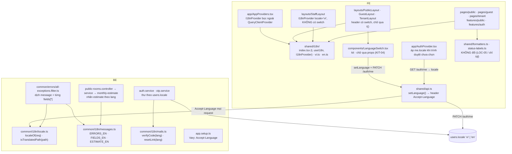

# PLAN · Phase Extra · EX-3 – Tiếng Việt + tiếng Anh (FE-EX-08..13, BE-EX-10..11)

Nguồn: `docs/phase-extra-home101/feature_ex-3-languages.md`, `README.md` (D-27, mục 3 H101-LOCALE-01/02, mục 5 luật chạy song song, mục 6), `PROGRESS.md`; spec `00-overview.md` (G-03, D-25, D-27, A-12, A-15), `01-architecture.md` (LOC-01..06, API-03, bảng mã lỗi, DEP-06), `10-auth.md` (AUTH-07, AUTH-11..15), `30-frontend.md` (UI-01, UI-02, UI-05, UI-12), `31-ui-kit.md` (KIT-04, KIT-07, KIT-13), `11-buildings-rooms.md` (BLD-08, ROOM-10, PUB-06); `docs/LESSONS.md`; và mã nguồn thật của hai app đọc ngày 13/11/2026.

Mọi con số, tên tệp, tên hàm, mã lỗi trong kế hoạch này đã được kiểm lại trực tiếp trên mã nguồn ngày 13/11/2026. Bản nháp cũ ở đường dẫn này bị ghi đè; danh sách điểm đã sửa so với bản nháp nằm ở §9. Ba câu hỏi mở đã được chủ dự án trả lời ngày 13/11/2026 và đã gấp vào thân kế hoạch (§8).

**Trước khi bắt đầu.** `git status` phải sạch, và đặc biệt **không được còn thay đổi chưa commit của EX-4, EX-5 hoặc EX-7** (README mục 5: ba phần đó sửa cùng các trang công khai / auth). Hiện tại `git status` chỉ có thư mục mới `docs/phase-extra-home101/plans/EX-3/`. Nếu thấy file đang sửa trong `src/pages/public/`, `src/features/public/`, `src/components/`, `src/modules/rooms/` hay `src/modules/viewings/` thì **dừng và hỏi chủ dự án**.

**Trạng thái mã khi viết kế hoạch** (đã kiểm): EX-1 + EX-2 + EX-5 đã nằm trong main — `users.locale` và `PATCH /auth/me { locale }` chạy rồi (AUTH-15, `auth.dto.ts` `UpdateMeDto.locale`), `GuestLayout` + `pages/guest/{GuestHomePage,GuestAccountPage}.tsx` + `/dang-ky` + `/xac-minh-email` đã có, `common/catalog/catalog.ts` đã có `labelEn` cho 8 tiện ích và 4 loại phòng và `GET /public/filters` đã trả `labelEn`, nhưng FE **chưa dùng** `labelEn` ở đâu cả. EX-3 chỉ thêm tầng ngôn ngữ lên trên; không có migration, không xóa file, không cài gói.

---

## 1. Mục tiêu và phạm vi

| Task | Nội dung | Spec |
|---|---|---|
| FE-EX-08 ⏸ | Lõi từ điển `src/shared/i18n/`: `vi`/`en`, `t(key, params)`, provider, nhớ lựa chọn trong trình duyệt, fallback về tiếng Việt, không bao giờ hiện khóa thô | LOC-03, LOC-04, UI-12 |
| FE-EX-09 | `LanguageSwitch` trong kit, đặt vào header `PublicLayout` / `GuestLayout` / `TenantLayout`; `shared/api.ts` gửi `Accept-Language` mọi request; đã đăng nhập thì lưu bằng `PATCH /auth/me { locale }` và đọc từ `GET /auth/me` | LOC-02, LOC-03, AUTH-15, KIT-04, UI-12 |
| FE-EX-10 | Trang công khai vào từ điển: home, `/phong`, `/toa/:id`, `/phong/:id`, header, footer, trạng thái danh sách; tiền và ngày **không** đổi theo ngôn ngữ | UI-01, UI-02, LOC-04, LOC-05 |
| FE-EX-11 ⏸ | Trang auth + khu khách + hai trang `/thue` hiện có vào từ điển, gồm thông điệp zod. Dừng, báo cáo FE-EX-08..11 | LOC-01, UI-05, UI-12 |
| BE-EX-10 | Ngôn ngữ của request: `Accept-Language` (`vi`/`en`, khác → `vi`), chỉ áp dụng cho `/public/*`, `/auth/*`, `/me/*`; một catalog thông điệp dùng bởi exception filter và validation; `code` không đổi | LOC-02, API-03 |
| BE-EX-11 | Chữ tiếng Anh cho mọi thông điệp mà `auth`, `rooms`/`buildings` công khai và `viewings` công khai trả được, kể cả `fields`; thư gửi khách theo `users.locale` | LOC-02, LOC-06 |
| FE-EX-12 ⏸ | `docs/phase-extra-home101/en-copy.md`: mọi câu marketing tiếng Anh kèm bản tiếng Việt; chủ dự án duyệt hoặc sửa | KIT-13 |
| FE-EX-13 ⏸ | `lint` + `build` + `test:components` (+ kiểm BE), đi tay hai ngôn ngữ ở 360 px và desktop | – |

**Trong phạm vi** (danh sách tệp đầy đủ ở §4): 11 trang `pages/public/`, 10 tệp `features/public/`, 6 tệp `features/auth/` có chữ, 2 trang `pages/guest/`, 2 trang `pages/tenant/`, 3 layout công khai/khách/thuê, `components/Navigation.tsx` + `components/RoomSearch.tsx`, `shared/api.ts` + `shared/form-errors.ts`; BE: filter lỗi, catalog thông điệp, hai mẫu thư, nhãn `estimate` của `/public/rooms/:id`.

**Ngoài phạm vi.** App nhân sự `/ql` (giữ tiếng Việt, LOC-01 — và phải *chứng minh được* là không đổi, §2.5). `src/shared/status-labels.ts` — đã kiểm: bốn map trong tệp này **chỉ** được `pages/staff/ViewingsPage.tsx`, `features/rooms/RoomInspector.tsx`, `features/rooms/RoomGrid.tsx`, `features/pricing/RatePlanList.tsx` dùng, tức là chỉ `/ql`; trang công khai không có trạng thái phòng (`PublicRoomDetail` trong `modules/rooms/public.types.ts` **không có** trường `status`, vì PUB/ROOM-05 chỉ công khai phòng trống). Vì vậy tệp này **không đổi** trong EX-3 (file task đã sửa theo, FE-EX-10 nay ghi rõ `status-labels.ts` giữ tiếng Việt).

**Form đặt lịch công khai cũ KHÔNG dịch** (chủ dự án 13/11/2026, OQ-2 = (b)): `src/features/public/ViewingForm.tsx`, `src/features/public/viewing-schema.ts` và các thông điệp `CreateViewingDto` của `POST /public/viewings` **giữ nguyên tiếng Việt**. Hệ quả phải nói rõ trong báo cáo và khi đi tay: **trang tiếng Anh hiển thị đúng một chỗ bằng tiếng Việt — form đặt lịch ở `/phong/:id` — cho tới khi EX-7 xong.** EX-6 xóa route, EX-7 thay giao diện đặt lịch và **phải viết chữ mới của mình vào từ điển ở cả hai ngôn ngữ**, đồng thời gỡ hai tệp này khỏi danh sách ngoại lệ của scan test (§2.5). `src/shared/formatters.ts` không đổi (LOC-05). Tài liệu hợp đồng, các trang `/thue` của Phase 3–5 chưa tồn tại, chữ do người nhập (A-12: tên quận/phường, tên tòa, tên dịch vụ, mô tả, nội thất, ghi chú, tiện ích chữ tự do cũ), mọi lựa chọn tiền tệ, prefix `/en` trong URL (LOC-03: route giống nhau ở hai ngôn ngữ), gửi thư thật (EX-8), nội dung mới của EX-4/EX-6/EX-7 (các part đó tự viết khóa của mình).

---

## 2. Kiến trúc



### 2.1 Quyết định: từ điển tự viết, **không** cài gói

Chọn **từ điển tự viết** trong `src/shared/i18n/` (≈70 dòng mã). Lý do, theo thứ tự quan trọng:

1. **LOC-05 cấm đúng phần giá trị nhất của một thư viện i18n.** `i18next`/`react-intl` bán kèm định dạng số/tiền/ngày theo locale; ở đây tiền phải là `2.984.000 đ` và ngày `dd/mm/yyyy` **giống nhau** ở cả hai ngôn ngữ. Dùng `Intl` theo `en-US` sẽ in `2,984,000` — thư viện trở thành rủi ro, không phải tiện lợi.
2. **Hạ tầng test của repo.** `npm run test:components` là `node --test` với DOM giả tự viết (`tests/p2/public-dom.mjs`) và một loader TS tự viết (`tests/draft-root.mjs`, `loadModule`). DOM giả **không có `localStorage`**, không có `Suspense` backend loader, và loader không có cơ chế stub module theo tên gói. Một thư viện cần `init()` bất đồng bộ phải được dựng lại trong từng test file (51 test file hiện có). Từ điển tự viết là một object tĩnh và `t()` chạy **không cần provider** (mặc định `vi`), nhờ đó gần như không test cũ nào phải sửa (§6).
3. **Kiểu dữ liệu làm việc kiểm thiếu khóa thay cho runtime.** `en.ts` khai báo `export const en: Record<keyof typeof vi, string>`: thiếu một khóa tiếng Anh hoặc thêm một khóa lạ là **lỗi biên dịch** của `npm run build` (`tsc -b`), không phải lỗi phát hiện muộn. `t()` nhận `key: DictKey` nên gõ sai khóa cũng là lỗi biên dịch → "không bao giờ hiện khóa thô" (LOC-04) được bảo đảm bởi trình biên dịch, test chỉ xác nhận lại.
4. Cài gói phải xin phép chủ dự án (root `CLAUDE.md` rule 7) cho một việc 70 dòng.

Không có yêu cầu nào của LOC-03, LOC-04, UI-12 mà từ điển tự viết không làm được: nhớ lựa chọn (`localStorage`), fallback `en → vi`, nội suy `{param}`, số nhiều (chỉ cần hai khóa `.one`/`.other`, §2.4), đổi ngay không reload (state của provider). Vì vậy **không hỏi chủ dự án về việc cài gói**, và tuyệt đối không chạy `npm install` trong part này.

### 2.2 Lõi từ điển (FE-EX-08)

```ts
// src/shared/i18n/vi.ts
export const vi = {
  'common.retry': 'Thử lại',
  'nav.findRoom': 'Tìm phòng',
  'rooms.list.count.one': '{count} phòng phù hợp',
  'rooms.list.count.other': '{count} phòng phù hợp',
  // …
} as const

// src/shared/i18n/en.ts
import { vi } from './vi'
export const en: Record<keyof typeof vi, string> = { /* cùng tập khóa, chữ tiếng Anh */ }

// src/shared/i18n/index.tsx
export type Lang = 'vi' | 'en'
export type DictKey = keyof typeof vi
export type Params = Record<string, string | number>
export const STORAGE_KEY = 'rooms.lang'

export function currentLang(): Lang
export function setStoredLang(next: Lang): void        // ghi localStorage (bọc try) + biến module
export function t(key: DictKey, params?: Params, lang?: Lang): string
export function useI18n(): { lang: Lang; t: (key: DictKey, params?: Params) => string; setLang: (next: Lang) => void }
export function I18nProvider(props: { children: ReactNode; locale?: Lang }): ReactElement
```

Luật của `t` (mỗi luật một test mang mã LOC):

| Luật | Hành vi |
|---|---|
| Tra khóa | `lang === 'en' ? (en[key] || vi[key]) : vi[key]` |
| LOC-04 fallback | chuỗi tiếng Anh rỗng → trả **chữ tiếng Việt** (kiểu đã chặn trường hợp thiếu hẳn khóa) |
| LOC-04 không khóa thô | không có khóa trong cả hai (chỉ xảy ra khi gọi `t()` với khóa động, ép kiểu): trả **chuỗi rỗng** + `console.error`; test khẳng định kết quả không chứa dấu `.` của khóa |
| Tham số | `{name}` thay bằng `String(params.name)`; thiếu tham số thì giữ nguyên `{name}` và `console.error`; không `eval`, không HTML, **không** định dạng số theo locale |
| Số nhiều | `t(key, { count })` thử `` `${key}.one` `` khi `count === 1`, ngược lại `` `${key}.other` ``, rồi mới tới `key` |
| Không provider | `t()` dùng biến module (`currentLang()`), `useI18n()` có giá trị context mặc định → component mount trần trong test cũ vẫn ra tiếng Việt, không throw |
| Nhớ lựa chọn | `localStorage['rooms.lang']` nếu là `'vi'`/`'en'`; giá trị lạ (`'fr'`, `''`, JSON) → `'vi'`. **Mọi truy cập `localStorage` bọc `try`** và kiểm `typeof localStorage === 'undefined'` — DOM giả của test không có `localStorage`, thiếu bước này mọi test mount trang sẽ đỏ |
| Đổi ngôn ngữ | `setLang` đổi state provider → React render lại; không reload, không remount route, không đổi `key` của form (UI-12) |
| `<html lang>` | provider đặt `document.documentElement.lang` trong `useEffect`, bọc `try` |
| `locale` ép cố định | `<I18nProvider locale="vi">` bỏ qua `localStorage` và không cho đổi (dùng cho `StaffLayout`) |

### 2.3 Bộ khóa – namespace phẳng theo vùng giao diện

Khóa phẳng `namespace.scope.name`, phần sau dấu chấm là **English camelCase**, không lồng object (so sánh hai từ điển bằng kiểu là đủ).

| Namespace | Dùng ở |
|---|---|
| `common` | nút/nhãn lặp lại: `common.retry`, `common.loading`, `common.save`, `common.cancel`, `common.genericError`, `common.yes`, `common.no` |
| `nav` | `RoomsHeader` của 3 layout + `LanguageSwitch` |
| `footer` | `RoomsFooter` (chỉ `PublicLayout` dùng footer) |
| `home` | `/` – hero, `budgets` (5 mốc), `reasons` (4 × 3 chuỗi), `steps` (3 × 2 chuỗi), khu vực, CTA |
| `rooms` | `/phong`, `RoomCard`, `RoomFilters`, `room-filters.ts`, `ListState` |
| `room` | `/phong/:id`: `RoomDetailView`, `RateTable`, `EstimatePanel`, `BookingJumpBar`, `attributes.ts` |
| `building` | `/toa/:id` |
| `auth` | 5 trang auth + `AuthFrame` + `ContactInfo` + `pendingVerification.ts` + `features/auth/schemas.ts` |
| `account` | `ProfileForm`, `ChangePasswordForm` (dùng chung khách / người thuê / **nhân sự**, §2.6) |
| `guest` | `/toi`, `/toi/tai-khoan` |
| `tenant` | `/thue`, `/thue/tai-khoan` |

Không có namespace `viewing`: form đặt lịch công khai cũ không dịch (OQ-2 = (b)). Khóa đặt lịch sẽ do EX-7 tạo.

Chữ marketing của trang chủ nằm trọn trong `home.*` và `footer.*` để FE-EX-12 trích ra `en-copy.md` bằng cách lọc tiền tố. Nếu một tệp từ điển vượt ~500 dòng thì tách `src/shared/i18n/vi/<namespace>.ts` và gộp ở `vi.ts` — quyết định khi thấy số thật, không tách trước.

### 2.4 Những gì **không** đổi theo ngôn ngữ (LOC-05)

| Thứ | Luật | Kiểm bằng |
|---|---|---|
| Tiền | `shared/formatters.ts` giữ nguyên `Intl.NumberFormat('vi-VN')` + `' đ'`; **không** thêm tham số lang, **không** import i18n | `formatMoney(2984000) === '2.984.000 đ'` ở cả `vi` và `en` |
| Ngày | `formatDate` giữ cách cắt chuỗi `dd/mm/yyyy` | `formatDate('2026-02-28') === '28/02/2026'` ở cả hai ngôn ngữ |
| Mốc giá trang chủ | `budgets` hiện là chuỗi cứng `'Đến 2.000.000 đ'`; chuyển thành `t('home.budget.upTo', { amount: formatMoney(2000000) })` để phần số đi qua formatter | test: nhãn tiếng Anh vẫn chứa `2.000.000 đ` |
| Số nhiều | đúng **2** khóa cần `.one`/`.other`: số phòng ở `/phong` và `{n} phòng trống` của thẻ khu vực trang chủ | test với `count` 0, 1, 2 ở cả hai ngôn ngữ |
| Chữ người nhập | A-12 | hiện nguyên văn ở cả hai ngôn ngữ (test ở CP-2) |
| Điện thoại | G-04 | không đổi |

### 2.5 Scan test "không còn chữ Việt" + parity (FE-EX-10, FE-EX-11)

`tests/ex/ex3-i18n.test.mjs` (Node test, chỉ đọc tệp bằng `fs`, không mount gì — chạy nhanh và không phụ thuộc DOM giả):

1. **Danh sách tệp in-scope là hằng số trong test**, không glob cả `src/` (để `/ql` không bị kéo vào). Danh sách = cột "Tệp" của §4 phần FE, cộng thêm `features/public/ViewingForm.tsx` và `features/public/viewing-schema.ts` (hai tệp này **nằm trong danh sách quét nhưng được allow-list ở bước 3**, để EX-7 có một chỗ nhắc hữu hình), trừ `src/shared/i18n/**`.
2. Với mỗi tệp: **bỏ comment trước** (`//…` và `/*…*/`) — bắt buộc, vì nhiều comment tiếng Anh có chen chữ Việt (ví dụ `features/public/attributes.ts` dòng 10 `"chưa nhập"`, `shared/api.ts`) — rồi tìm ký tự có dấu tiếng Việt (lớp ký tự `àáảãạăâ…đ` + chữ hoa). Mỗi lần khớp là một lỗi, in `tệp:dòng: <chuỗi>`.
3. Ngoại lệ ghi thẳng trong test, mỗi dòng một lý do:
   - `src/features/public/ViewingForm.tsx` và `src/features/public/viewing-schema.ts`: **thay bởi EX-6/EX-7** (chủ dự án 13/11/2026), giữ tiếng Việt. Dòng ngoại lệ này **EX-7 phải xóa** khi viết giao diện đặt lịch mới;
   - `districtImages` của `PublicHomePage.tsx` (`'Đống Đa'`, `'Ba Đình'`, `'Cầu Giấy'`): **khóa dữ liệu** khớp với `district` do API trả, không phải chữ hiển thị;
   - `src/shared/formatters.ts` hoàn toàn (đuôi `' đ'`, LOC-05) — tệp này không nằm trong danh sách bước 1;
   - một dòng có chú thích `// i18n-allow: <lý do>` được bỏ qua; dùng tối đa vài lần, mỗi lần phải nêu lý do.
4. **Parity**: `Object.keys(vi)` và `Object.keys(en)` bằng nhau; mọi giá trị `en` khác chuỗi rỗng. Danh sách `ALLOWED_MISSING_EN` trong test phải **rỗng** khi part kết thúc (Done when của FE-EX-08). Đây là lớp bảo vệ thứ hai: lớp thứ nhất là kiểu `Record<keyof typeof vi, string>` làm `npm run build` đỏ.
5. **Chứng minh `/ql` không đổi**: test khẳng định `src/layouts/StaffLayout.tsx` không import `LanguageSwitch` và không import `shared/i18n` để lấy `useI18n` (nó chỉ bọc `<I18nProvider locale="vi">`); và `src/pages/staff/**` + `src/features/{buildings,rooms,pricing,managers,viewings,dashboard}/**` **không** import `shared/i18n` (kiểm bằng `fs`, không mount).

Cách chuyển một trang (thủ công, từng tệp): mỗi literal → một khóa trong `vi.ts` với **đúng từng ký tự như hiện tại**, rồi thay bằng `t('…')`. Giữ nguyên văn tiếng Việt là điều kiện để test cũ không đỏ (§6) — nếu một test cũ đỏ vì chữ, **sửa chữ, không sửa test**. Chữ tiếng Anh viết song song vào `en.ts` ngay lúc đó.

### 2.6 Kit: `LanguageSwitch` và chữ cứng trong `Navigation.tsx`

Component kit mới (dùng ở 3 layout nên thuộc `src/components/`, KIT-07):

```tsx
// src/components/LanguageSwitch.tsx – KIT-04: mọi chữ qua props, kit không biết từ điển
export function LanguageSwitch(props: {
  value: 'vi' | 'en'
  onChange: (next: 'vi' | 'en') => void
  viLabel: string        // "Tiếng Việt"
  enLabel: string        // "English"
  groupLabel: string     // aria-label của nhóm: "Ngôn ngữ" / "Language"
}): ReactElement
```

Hai `<button type="button">` trong một `role="group"`, nút đang chọn có `aria-pressed="true"`; style bằng token của `rooms.css`; thêm mẫu vào `src/pages/ComponentPreview.tsx` và một test trong `tests/components.test.mjs` (KIT-07).

`components/Navigation.tsx` đang có chữ cứng tiếng Việt: `RoomsHeader` – `aria-label="Rooms — Trang chủ"`, `'Đóng'`/`'Menu'`, `aria-label="Điều hướng chính"`, `aria-label="Khám phá"`; `RoomsFooter` – `'Tìm phòng'`, `'Xem phòng đang trống và chọn lịch hẹn phù hợp.'`, `'Khu vực'`, `'Khám phá các tòa nhà tại Hà Nội theo khu vực.'`, `'Liên hệ'`, `'Thông tin đang được cập nhật.'`, `'Hà Nội · Việt Nam'`, và các `aria-label` của `<nav>`.

**Quyết định: đưa từng chuỗi đó ra prop *tùy chọn*, giữ nguyên chữ Việt hiện tại làm giá trị mặc định.** Lý do: KIT-04 chỉ cấm *"a hard-coded second language"* — tiếng Việt là ngôn ngữ mặc định, không phải ngôn ngữ thứ hai. Để mặc định thì `StaffLayout`, `ComponentPreview` và **mọi test cũ** của kit (`tests/components.test.mjs`, `tests/p2/cp3-kit.test.mjs`, `tests/p2/ui-11-navigation.test.mjs`, `tests/p2/cp2-staff-layout.test.mjs`, các test render layout qua `public-dom.mjs`) **không phải sửa một dòng nào**; nếu làm prop bắt buộc thì chúng đỏ hàng loạt và TypeScript đỏ ở 5 nơi gọi. Rủi ro duy nhất (một layout quên truyền prop → trang tiếng Anh lọt chữ Việt) được chặn bằng một test: **ba layout dịch phải truyền đủ mọi prop chữ** của `RoomsHeader`/`RoomsFooter` (kiểm bằng `fs` trên tệp layout, so với danh sách prop đọc từ `Navigation.tsx`).

`RoomsFooter` chỉ được `PublicLayout` dùng (`GuestLayout`, `TenantLayout`, `StaffLayout` không có footer). `components/RoomSearch.tsx` còn 3 dòng chữ Việt → cũng ra prop tùy chọn, `PublicHomePage` truyền `t(...)`.

### 2.7 Dòng chảy ngôn ngữ (FE-EX-09)

| Việc | Hành vi |
|---|---|
| Khởi động | `currentLang()` = `localStorage['rooms.lang']` nếu hợp lệ, ngược lại `'vi'` (mặc định LOC-01). `I18nProvider` nằm trong `app/AppProviders.tsx`, **bọc ngoài** `QueryClientProvider` để đổi ngôn ngữ không hủy cache query |
| Mỗi request | `shared/api.ts` thêm `headers['Accept-Language'] = language` trong `send()` cho **mọi** request, kể cả `/auth/refresh` và request của `/ql` (LOC-02 — BE tự lọc theo path). Nguồn: biến module `language` + `setLanguage(lang)`, đúng khuôn `accessToken` đang có; `I18nProvider` gọi `setLanguage` khi khởi tạo và mỗi lần đổi |
| Bấm switch | `setLang(next)` → ghi `localStorage` → `setLanguage(next)` → nếu đang đăng nhập: `PATCH /auth/me { locale: next }` (AUTH-15); lỗi thì **vẫn đổi giao diện**, chỉ log (đổi ngôn ngữ không được chặn vì mạng) |
| Đăng nhập / tải lại | `AuthProvider` sau khi có `me`: nếu `localStorage` **chưa** có lựa chọn → dùng `me.locale`; nếu đã có và khác `me.locale` → **giữ lựa chọn của trình duyệt** và gửi đúng một `PATCH /auth/me` cho khớp ([ASSUMPTION] A-EX3-1: hành động gần nhất của người dùng trên máy này thắng; LOC-03 không nói ai thắng) |
| `/ql` | `StaffLayout` bọc nội dung trong `<I18nProvider locale="vi">` và **không** render `LanguageSwitch`. `ProfileForm` / `ChangePasswordForm` dùng chung với `/ql` nên khi chúng gọi `useI18n()` trong `StaffAccountPage` sẽ nhận `vi` — đây là lý do cần `locale` ép cố định thay vì chỉ "không hiện nút" |
| Giữ dữ liệu đang gõ | đổi ngôn ngữ chỉ đổi state provider, không remount route, không đổi `key` form → react-hook-form giữ giá trị (UI-12) |

### 2.8 zod và `t`

`src/features/auth/schemas.ts` và `src/features/public/room-filters.ts` hiện là hằng số module, nên chữ bị "đóng băng" lúc import. Đổi thành **hàm nhận `t`**: `loginSchema(t)`, `registerSchema(t)`, … gọi trong `useMemo([lang])` của trang. Cách khác (truyền key rồi dịch khi render lỗi) phải sửa mọi chỗ đọc `errors.x.message` và `src/shared/form-errors.ts` — đắt hơn.

Chú ý (đã kiểm) các nơi gọi phải sửa theo: `pages/public/{LoginPage,RegisterPage,VerifyEmailPage,ForgotPasswordPage}.tsx`, `features/auth/{ChangePasswordForm,ProfileForm}.tsx` (`ProfileForm` dùng `staffProfileSchema`/`tenantProfileSchema` và `staffProfileSchema.omit({email:true})`), `features/public/RoomFilters.tsx` (`features/public/ViewingForm.tsx` **không đổi**, OQ-2). `ProfileForm`/`ChangePasswordForm` cũng được `pages/staff/StaffAccountPage.tsx` và `pages/tenant/TenantAccountPage.tsx` và `pages/guest/GuestAccountPage.tsx` dùng — tất cả đi qua `useI18n()`, không ai phải truyền `t` bằng tay.

Test cũ `tests/auth-schemas.test.mjs` nạp `schemas.ts` ở ba chỗ (dòng 104, 127, 164) và `tests/ex/ex-signup.test.mjs` ở dòng 28 → phải gọi thêm `(tVi)`; **mọi chuỗi mong đợi giữ nguyên** (§6).

### 2.9 Backend: ngôn ngữ của request và catalog (BE-EX-10, BE-EX-11)

Hai sự thật đã kiểm, quyết định toàn bộ thiết kế:

- **`error.message` chỉ đến từ một nơi.** `all-exceptions.filter.ts` dòng 77 lấy `const { status, message } = ERRORS[code]`; không service nào đặt `message` riêng (`body.message` chỉ được đọc để *suy ra code*). Vậy phần `message` của catalog tiếng Anh = đúng **29 mã lỗi** trong `common/errors/error-code.ts`.
- **`fields` là chuỗi tự do** do DTO (`class-validator`) hoặc service đặt. Filter là nơi duy nhất thấy cả `message` và `fields` trước khi ghi response → chỗ dịch duy nhất.

Tệp mới `src/common/i18n/`:

```ts
// locale.ts
export type Lang = 'vi' | 'en';
export function localeOf(req: { headers?: Record<string, unknown> }): Lang;   // khớp /^en\b/i ở token đầu → 'en', khác/thiếu → 'vi'
export function isTranslatedPath(path: string | undefined): boolean;          // /api/v1/public, /api/v1/auth, /api/v1/me (+ dấu / hoặc hết chuỗi)

// messages.ts
export const ERRORS_EN: Record<ErrorCode, string>;      // kiểu bắt buộc đủ 29 mã → thiếu một mã là lỗi biên dịch
export const FIELDS_EN: Record<string, string>;         // khóa = chuỗi tiếng Việt đúng từng ký tự
export const ESTIMATE_EN: { rent: string; waterPerPerson: string; meteredNote: string; missing: (name: string) => string };
export function errorMessage(code: ErrorCode, lang: Lang): string;            // en rỗng/thiếu → tiếng Việt (LOC-04)
export function translateField(text: string, lang: Lang): string;             // FIELDS_EN[text] ?? text

// mails.ts  (LOC-06)
export const MAILS: {
  verifyCode(lang: Lang, code: string): { subject: string; text: string };
  resetLink(lang: Lang, url: string): { subject: string; text: string };
};
```

Tệp sửa:

| Tệp | Việc |
|---|---|
| `src/common/errors/all-exceptions.filter.ts` | lấy `const req = host.switchToHttp().getRequest()`; nếu `isTranslatedPath(req?.path)` và `localeOf(req) === 'en'` thì `message = errorMessage(code, 'en')` và dịch **từng giá trị** của `fields`. `code`, HTTP status, cấu trúc body **không đổi** (API-03). Phải chịu được `req` thiếu `path`/`headers` (`?? ''`) |
| `src/common/errors/validation.ts` | **không đổi** (thông điệp `fields` đi qua filter) |
| `src/app.setup.ts` | thêm `res.setHeader('Vary', 'Accept-Language')` vào middleware đã có ở dòng 13 (một dòng, không thêm nhánh). **Bắt buộc**: DEP-06 cho CDN cache `GET /api/v1/public/*` 60 s; không có `Vary` thì bản tiếng Việt trong cache sẽ được trả cho người đọc tiếng Anh |
| `src/modules/auth/auth.controller.ts` | thay regex viết tay `/^en\b/i.test(acceptLanguage ?? '')` ở dòng 90 bằng `localeOf(req)` — một chỗ duy nhất đọc header |
| `src/modules/auth/otp.service.ts` | `deliver(email, issued, lang)` và `send(email, ip, lang)` dùng `MAILS.verifyCode(lang, code)`; `lang` mặc định `'vi'`. Người gọi truyền `user.locale` (hoặc locale của request khi `register` vì user vừa được tạo với chính locale đó) |
| `src/modules/auth/auth.service.ts` | `sendResetLink` nhận thêm `locale` của user (`forgotPassword` đã đọc `user`) và dùng `MAILS.resetLink`; hai mẫu thư chuyển sang `mails.ts`, **chữ tiếng Việt không đổi một ký tự** (`auth.reset.spec.ts` dòng 156 khẳng định subject) |
| `src/modules/rooms/public-rooms.controller.ts` → `public-rooms.service.ts` → `src/common/rooms/public-view.ts` → `monthly-estimate.ts` | truyền `lang` (mặc định `'vi'`) tới `buildEstimate` để dịch 3 nhãn cố định của `PublicEstimate`: `'Giá thuê'`, `'Nước (1 người)'`, `meteredNote`, và câu `chưa gồm: <tên> (chưa có giá)`. **Tên dịch vụ giữ nguyên văn** (A-12). Tham số mặc định → mọi test cũ của `monthly-estimate.spec.ts`, `public-view.spec.ts`, `rooms.detail.spec.ts` không phải sửa |

**Không** đưa vào catalog: toàn bộ `src/modules/viewings/dto/viewings.dto.ts`, **kể cả `CreateViewingDto` của `POST /public/viewings`** (chủ dự án 13/11/2026, OQ-2 = (b): route này bị EX-6 xóa). Test catalog ở CP-4 **không được** đòi chúng, và tệp này không nằm trong danh sách scan nguồn. Cũng không đưa vào: thông điệp của `buildings`/`rooms`/`pricing`/`managers`/`services` dành cho nhân sự (path không thuộc 3 nhóm in-scope → luôn tiếng Việt, LOC-01); `fields` trong `common/errors/db-errors.ts` (3 chuỗi: `rooms_building_id_code_key`, `BUILDING_MANAGER_ROLE`, `buildings_code_format` — đã kiểm: chỉ phát sinh từ `POST /rooms`, `POST/PATCH /buildings`, tức là path nhân sự; `users_phone_key`/`users_email_key` của đăng ký **không có** `fields`); `labelEn` của tiện ích và loại phòng (đã nằm trong `common/catalog/catalog.ts`, FE lấy qua `GET /public/filters`, **không gõ lại** trong từ điển FE).

**Danh sách chuỗi `fields` in-scope** (đếm thật trên mã, 13/11/2026) — scan test của BE đi đúng theo danh sách tệp này:

| Tệp | Nội dung | Số chuỗi khác nhau |
|---|---|---|
| `src/common/errors/error-code.ts` | `ERRORS[*].message` | 29 (qua `ERRORS_EN`) |
| `src/common/errors/validation.ts` | `FORBIDDEN_FIELD_MESSAGE` | 1 |
| `src/common/pagination.ts` | `PAGE_MSG`, `LIMIT_MSG` (dùng bởi `/public/rooms`) | 2 |
| `src/modules/auth/dto/auth.dto.ts` | login/register/verify/resend/forgot/reset/me | 12 |
| `src/modules/auth/auth.service.ts` | `PHONE_TAKEN_SIGNUP_MSG`, `EMAIL_TAKEN_SIGNUP_MSG`, `'Email đã được sử dụng'`, `'Mật khẩu hiện tại không đúng'`, `'Mật khẩu mới phải khác mật khẩu hiện tại'` | 5 |
| `src/modules/rooms/dto/public-rooms.dto.ts` | 15 bộ lọc công khai + `BOOLEAN_FILTER_MESSAGE` | 14 |
| `src/common/rooms/monthly-estimate.ts` | 3 nhãn + câu `missing` | 4 (qua `ESTIMATE_EN`) |

Tổng catalog BE: **29 message (`ERRORS_EN`) + 34 chuỗi `FIELDS_EN` (1 + 2 + 12 + 5 + 14) + 4 nhãn `ESTIMATE_EN` + 2 mẫu thư**. Năm tệp nguồn của `FIELDS_EN` (dùng cho scan test ở CP-4): `common/errors/validation.ts`, `common/pagination.ts`, `modules/auth/dto/auth.dto.ts`, `modules/auth/auth.service.ts`, `modules/rooms/dto/public-rooms.dto.ts`.

### 2.10 Hợp đồng API sau EX-3

| Method · Path | Thay đổi | Ghi chú |
|---|---|---|
| mọi request từ FE | thêm header `Accept-Language: vi` hoặc `en` | LOC-02; BE bỏ qua trên path nhân sự |
| `/api/v1/public/*`, `/api/v1/auth/*`, `/api/v1/me/*` | với `Accept-Language: en`: `error.message` và mọi `error.fields[*]` bằng tiếng Anh | `error.code`, HTTP status, cấu trúc `{ error: { code, message, fields? } }` **không đổi** (API-03) |
| `GET /api/v1/public/rooms/:id` | với `en`: `estimate.items[].label` (2 nhãn cố định), `estimate.meteredNote`, `estimate.missing[]` bằng tiếng Anh; tên dịch vụ nguyên văn | A-12; `price`, `deposit`, `monthlyEstimate` là số nguyên, không đổi |
| mọi response dưới `/api/v1` | thêm `Vary: Accept-Language` | DEP-06 |
| các path khác (`/buildings`, `/rooms`, `/pricing`, `/viewings`, `/services`, `/managers`, `/dashboard`, `/files/*`) | luôn tiếng Việt kể cả khi gửi `en` | LOC-01 |
| `PATCH /auth/me` | `locale: 'vi' \| 'en'` (đã có từ EX-1, `UpdateMeDto`) | AUTH-15 |
| `GET /auth/me` | `locale` trong `Me` (đã có) | AUTH-15 |
| thư gửi khách / người thuê | subject + body theo `users.locale`; thư cho nhân sự giữ tiếng Việt | LOC-06 |

**`/me/*` chưa tồn tại**: đã kiểm toàn bộ controller — không có `@Controller('me')` nào; `GET /me/viewings` đến ở EX-6 (VIEW-20). `isTranslatedPath` vẫn phủ `/me/` ngay từ bây giờ (miễn phí, EX-6 không phải sửa lại), nhưng test cho `/me/*` ở CP-4 là **unit test của `isTranslatedPath`**, không phải test HTTP.

---

## 3. Khối lượng (số đếm thật, ripgrep trên mã ngày 13/11/2026)

Số **dòng có chứa ký tự có dấu tiếng Việt** (gồm cả comment, nên là trần trên của số chuỗi cần chuyển):

| Vùng | Tệp | Dòng |
|---|---|---|
| `src/pages/public/` | 11 có chữ (`PlaceholderPage.tsx` 0) | **212** — `PublicHomePage` 58, `RoomDetailView` 36, `ForgotPasswordPage` 28, `PublicRoomsPage` 20, `PublicBuildingPage` 19, `LoginPage` 19, `RegisterPage` 12, `VerifyEmailPage` 10, `ChangePasswordPage` 6, `NotFoundPage` 2, `PublicRoomPage` 2 |
| `src/features/public/` | 10 (trừ `ViewingForm` 17 và `viewing-schema` 10 — OQ-2) | **62** — `RoomFilters` 23, `RateTable` 11, `attributes` 6, `room-filters` 6, `RoomCard` 6, `EstimatePanel` 3, `ContactCard` 2, `BookingJumpBar` 2, `ListState` 2, `api` 1 |
| `src/features/auth/` | 6 có chữ | **33** — `schemas` 11, `ChangePasswordForm` 9, `ProfileForm` 8, `AuthFrame` 3, `ContactInfo` 1, `pendingVerification` 1 |
| `src/pages/guest/` | 2 | **10** |
| `src/pages/tenant/` | 2 | **7** |
| `src/layouts/` (Public 6, Guest 4, Tenant 2) | 3 | **12** |
| `src/components/` (`Navigation` 13, `RoomSearch` 3) | 2 | **16** |
| `src/shared/` (`api` 2, `form-errors` 1) | 2 | **3** |
| **Tổng FE in-scope** | **38 tệp có chữ** (11 + 10 + 6 + 2 + 2 + 3 + 2 + 2) **+ 7 tệp hạ tầng** (`app/AppProviders`, `app/AuthProvider`, `features/auth/api.ts`, `components/index.ts`, `Navigation.css`, `StaffLayout`, `ComponentPreview`) **+ 4 tệp mới** | **355 dòng → ≈ 325 khóa × 2 ngôn ngữ** |
| **Tổng BE** | 3 tệp mới + 7 tệp sửa | **67 chuỗi tiếng Anh (29 + 34 + 4) + 2 mẫu thư** |

Ngoài phạm vi để so sánh: `pages/staff/` + `features/{buildings,rooms,pricing,managers,viewings,dashboard}/` + `shared/status-labels.ts` + `pages/ComponentPreview.tsx` (74 dòng, dữ liệu gallery minh họa, KIT-04) — **không chạm chữ**, chỉ `ComponentPreview` thêm mẫu `LanguageSwitch`.

**Đây là part nhiều tệp nhất của Phase Extra.** CP-2 là phần lớn nhất (≈ 280 khóa, 18 tệp). Nếu chủ dự án muốn commit nhỏ hơn, cắt CP-2 thành **CP-2a** (lõi switch + header/footer + trang chủ) và **CP-2b** (`/phong`, `/phong/:id`, `/toa/:id`); kế hoạch đã viết để cắt được như vậy mà không đổi gì khác.

---

## 4. Tệp thêm / sửa

### Frontend

| Tệp | Việc |
|---|---|
| `src/shared/i18n/index.tsx` (mới) | `t`, `useI18n`, `I18nProvider`, `currentLang`, `setStoredLang`, `STORAGE_KEY`, kiểu `Lang`/`DictKey` (§2.2) |
| `src/shared/i18n/vi.ts`, `src/shared/i18n/en.ts` (mới) | từ điển phẳng (§2.3); `en` kiểu `Record<keyof typeof vi, string>` |
| `src/shared/api.ts` | `setLanguage()` + `headers['Accept-Language']` trong `send()`; `GENERIC_MESSAGE` và `RangeError` của `listPath` lấy từ `t()` |
| `src/shared/form-errors.ts` | 1 chuỗi còn lại → `t()` (thông điệp `fields` từ API đã đúng ngôn ngữ nhờ BE-EX-10) |
| `src/app/AppProviders.tsx` | bọc `I18nProvider` ngoài `QueryClientProvider` |
| `src/app/AuthProvider.tsx` | sau khi có `me`: áp `me.locale` / đồng bộ ngược (§2.7) |
| `src/features/auth/api.ts` | `UpdateMeInput` thêm `locale?: 'vi' \| 'en'` (hiện là `Partial<Record<'email'\|'contactPhone'\|'zaloUrl'\|'facebookUrl', string\|null>>`, chưa có `locale`) |
| `src/components/LanguageSwitch.tsx` (mới), `src/components/index.ts`, `src/components/Navigation.css` | component kit + export + class dùng token `rooms.css` |
| `src/components/Navigation.tsx`, `src/components/RoomSearch.tsx` | chữ cứng ra prop tùy chọn, mặc định giữ chữ Việt hiện tại (§2.6) |
| `src/layouts/{PublicLayout,GuestLayout,TenantLayout}.tsx` | chữ qua `t`, thêm `LanguageSwitch` vào `action` của `RoomsHeader`, truyền đủ prop chữ |
| `src/layouts/StaffLayout.tsx` | bọc `<I18nProvider locale="vi">`; **không** switch, **không** `t` |
| `src/pages/public/` (11 tệp có chữ) | mọi chữ → `t`, kể cả `aria-label`, `alt`, `role="status"`, `role="alert"` |
| `src/pages/guest/{GuestHomePage,GuestAccountPage}.tsx` | như trên |
| `src/pages/tenant/{TenantHomePage,TenantAccountPage}.tsx` | như trên (LOC-01 nói khu người thuê **có** tiếng Anh; 7 dòng, và `ProfileForm`/`ChangePasswordForm` đã phải dịch cho khu khách) |
| `src/features/public/` (10 tệp; **không** `ViewingForm.tsx`, **không** `viewing-schema.ts`) | như trên; `attributes.ts` `labelOf` chọn `labelEn` khi `lang === 'en'`; `room-filters.ts` thành hàm nhận `t` |
| `src/features/auth/` (6 tệp) | như trên; `schemas.ts` thành hàm nhận `t` (§2.8) |
| `src/pages/ComponentPreview.tsx` | thêm mẫu `LanguageSwitch` (KIT-07); chữ gallery giữ tiếng Việt |
| `tests/ex/ex3-i18n.test.mjs` (mới) | lõi từ điển + parity + scan + chứng minh `/ql` (§2.5) |
| `tests/ex/ex3-language-switch.test.mjs` (mới) | switch, header `Accept-Language`, `PATCH /auth/me`, giữ dữ liệu đang gõ, trang hai ngôn ngữ |
| test cũ phải sửa | §6 |
| `docs/phase-extra-home101/en-copy.md` (mới) | FE-EX-12 |

`tests/ex/*.test.mjs` đã nằm trong `npm run test:components` (`package.json` dòng 11 có glob `tests/ex/*.test.mjs`) → không phải sửa script.

### Backend

| Tệp | Việc |
|---|---|
| `src/common/i18n/locale.ts`, `messages.ts`, `mails.ts` (mới) | §2.9 |
| `src/common/i18n/i18n.spec.ts` (mới) | test catalog + `localeOf` + `isTranslatedPath` + scan nguồn (CP-4) |
| `src/common/errors/all-exceptions.filter.ts` | dịch `message` + `fields` theo path và header |
| `src/app.setup.ts` | `Vary: Accept-Language` |
| `src/modules/auth/auth.controller.ts` | dùng `localeOf(req)` |
| `src/modules/auth/otp.service.ts`, `auth.service.ts` | thư theo `users.locale`, mẫu thư chuyển sang `mails.ts` |
| `src/modules/rooms/public-rooms.controller.ts`, `public-rooms.service.ts`, `src/common/rooms/public-view.ts`, `src/common/rooms/monthly-estimate.ts` | `lang` (mặc định `'vi'`) tới `buildEstimate` |
| `src/modules/viewings/dto/viewings.dto.ts` | **không chạm** (OQ-2 = (b)): không sửa mã, không vào `FIELDS_EN`, không vào scan test |

Không thêm mã lỗi → `src/app.setup.spec.ts` (bảng `EXPECTED` 29 mã) **không** phải sửa. Không thêm module → `src/common/prisma/prisma.service.spec.ts` không phải sửa. Không thêm khóa `DB_ERROR_MAP` → `db-errors.spec.ts` không phải sửa. Không thêm trường vào `Me` → `ME_KEYS` của `auth.me.spec.ts` và `auth.account.spec.ts` không phải sửa (LESSONS BE-P2-02, BE-P2-10, BE-EX-34). **Nếu một trong các tệp đó phải sửa thì kế hoạch có chỗ sai: dừng và nói.**

---

## 5. Checkpoints

Lệnh viết cho PowerShell (dấu `;` nối lệnh). Ở mỗi ⏸: cập nhật `PROGRESS.md` (dòng EX-3 + một dòng nhật ký) và thêm vào `LESSONS.md` lỗi nào tốn một vòng sửa, **rồi** báo cáo; không bao giờ tự `git commit`.

Mốc test hiện tại để so sánh (PROGRESS 13/11/2026): FE `test:components` **788/788**, BE unit **1631/1631**, BE e2e **53/53**, lint 0 lỗi, build OK. Số test chỉ được tăng.

### CP-1 · FE-EX-08 – lõi từ điển (⏸ của file task)

Tệp: `src/shared/i18n/{index.tsx,vi.ts,en.ts}`, `tests/ex/ex3-i18n.test.mjs`. Ở CP này `vi.ts`/`en.ts` chỉ cần các khóa `common.*` + `nav.*` để test chạy; chưa đổi trang nào.

**Done when**
```powershell
cd D:\Rooms\Source\frontend; npm run lint; npm run build; npm run test:components
```
→ lint 0 lỗi, build thành công, test ≥ 788 + số test mới, 0 fail. Dán output thật. (Lần đầu đỏ bất thường thì chạy lại một lần và báo cả hai lần — LESSONS P2-QA-02 và 13/11/2026.)

**Kịch bản test**

| Kịch bản | Spec | Kỳ vọng |
|---|---|---|
| `t('common.retry')` ở `vi` và ở `en` | LOC-01 | đúng chữ của từng từ điển |
| Khóa có `vi`, `en` là chuỗi rỗng | LOC-04 | trả **chữ tiếng Việt** |
| Khóa không có trong cả hai (ép kiểu trong test) | LOC-04 "a raw key is never shown" | kết quả không chứa tên khóa; `console.error` được gọi |
| `t('x', { name: 'An' })` / thiếu tham số | UI-12 | thay đúng / giữ `{name}` + log, không throw |
| `count` = 0, 1, 2 với khóa có `.one`/`.other` | LOC-04 | `en` đúng số ít/số nhiều; `vi` cùng một câu cho cả ba |
| `Object.keys(vi)` vs `Object.keys(en)`; mọi giá trị `en` không rỗng; `ALLOWED_MISSING_EN` rỗng | LOC-04 | bằng nhau; test in tên khóa thiếu khi đỏ |
| Xóa một khóa khỏi `en.ts` | LOC-04 | `npm run build` đỏ (kiểm tay một lần, ghi vào báo cáo) |
| `t()` gọi khi chưa có provider | – | ra tiếng Việt, không throw |
| `localStorage` không tồn tại (DOM giả) | LOC-03 | `currentLang() === 'vi'`, không throw |
| `localStorage` ném lỗi khi ghi (Safari private) | LOC-03 | vẫn đổi được trong bộ nhớ, không throw |
| Giá trị lạ trong `localStorage`: `'fr'`, `''`, `'{"a":1}'` | LOC-01 (mặc định `vi`) | `vi` |
| `formatMoney(2984000)`, `formatDate('2026-02-28')` ở cả hai ngôn ngữ | LOC-05 | `2.984.000 đ`, `28/02/2026` — giống nhau |
| `t('rooms.list.count', { count: 1234 }, 'en')` | LOC-05 | chứa `1234`, không `1,234` |

### CP-2 · FE-EX-09, FE-EX-10 – nút đổi ngôn ngữ và trang công khai (⏸ **tùy chọn**, đề xuất dừng vì đây là phần lớn nhất)

Tệp: `src/components/{LanguageSwitch.tsx,Navigation.tsx,RoomSearch.tsx,index.ts,Navigation.css}`, `src/layouts/*` (cả 4), `src/app/{AppProviders,AuthProvider}.tsx`, `src/shared/{api.ts,form-errors.ts}`, `src/features/auth/api.ts`, `src/pages/public/{PublicHomePage,PublicRoomsPage,PublicRoomPage,RoomDetailView,PublicBuildingPage,NotFoundPage}.tsx`, `src/features/public/*` (trừ `ViewingForm.tsx` và `viewing-schema.ts`), `src/pages/ComponentPreview.tsx`, `tests/ex/ex3-language-switch.test.mjs`, test cũ ở §6.

**Done when**: lệnh của CP-1 xanh; scan test (§2.5) chạy với danh sách tệp mở rộng tới `pages/public/` (trừ 5 trang auth) + `features/public/` + `layouts/` + `components/{Navigation,RoomSearch,LanguageSwitch}` → **0 chuỗi** ngoài ngoại lệ; đi tay trên seed: `/` → đổi sang English → `/phong` → `/phong/:id`, giá vẫn `2.984.000 đ`, ngày `dd/mm/yyyy`, tải lại trang vẫn English, mở `/ql` vẫn tiếng Việt.

**Kịch bản test**

| Nhóm | Kịch bản | Spec | Kỳ vọng |
|---|---|---|---|
| kit | `LanguageSwitch` nhận chữ qua props | KIT-04, KIT-07 | 2 nút trong `role="group"`, `aria-pressed` đúng, có mẫu trong `ComponentPreview` |
| kit | `RoomsHeader`/`RoomsFooter` gọi không truyền prop chữ | KIT-04 | giữ đúng chữ Việt hiện tại (test cũ xanh) |
| kit | ba layout dịch truyền **đủ** mọi prop chữ | §2.6 | test `fs` so danh sách prop của `Navigation.tsx` với từng layout |
| switch | bấm "English" trên `/` | UI-12 | tiêu đề đổi **ngay**, không reload, URL không đổi (không prefix `/en`, LOC-03) |
| switch | gõ số điện thoại ở `/dang-nhap` rồi đổi ngôn ngữ | UI-12 | ô input còn đúng chuỗi đã gõ |
| switch | đổi ngôn ngữ khi **chưa** đăng nhập | LOC-03 | chỉ ghi `localStorage`; **không** request nào tới `/auth/me` |
| switch | đổi ngôn ngữ khi **đã** đăng nhập | AUTH-15, LOC-03 | đúng 1 `PATCH /auth/me { locale: 'en' }` |
| switch | `PATCH /auth/me` trả 500 | UI-05 | giao diện **vẫn** đổi, không chặn người dùng |
| switch | header của `StaffLayout` | LOC-01 | **không** có switch; `/ql` tiếng Việt dù `localStorage = 'en'` |
| switch | 3 layout công khai / khách / thuê | LOC-03 | cả ba có switch trong header |
| header | `GET /public/rooms`, `POST /auth/refresh`, `GET /buildings` | LOC-02 | mỗi request có `Accept-Language` bằng ngôn ngữ đang chọn |
| đăng nhập | `localStorage` rỗng, `me.locale = 'en'` | LOC-03, AUTH-15 | giao diện thành English, **không** `PATCH` |
| đăng nhập | `localStorage = 'vi'`, `me.locale = 'en'` | A-EX3-1 | giữ `vi`, gửi đúng 1 `PATCH { locale: 'vi' }` |
| trang | `/` ở `en`: hero, 4 lý do, 3 bước, CTA, 5 mốc giá | LOC-01, KIT-13 | mọi câu tiếng Anh; mốc giá vẫn chứa `2.000.000 đ` |
| trang | `/phong` ở `en`: nhãn 9 bộ lọc, trạng thái rỗng, phân trang, số kết quả | LOC-01, PUB-06 | tiếng Anh; số nhiều đúng với 0/1/nhiều phòng |
| trang | `/phong` ở `en`: tên quận, tên phường, tên tòa, mô tả, nội thất, tên dịch vụ | A-12, LOC-04 | **nguyên văn tiếng Việt** |
| trang | `/phong/:id` ở `en`: tiện ích tòa + loại phòng | LOC-04, BLD-08, ROOM-10 | nhãn `labelEn` lấy từ `GET /public/filters`, không gõ lại trong FE |
| trang | `/phong/:id` ở `en`: giá, cọc, ước tính, bảng đơn giá, ngày hiệu lực | LOC-05 | số và ngày **y như** bản tiếng Việt |
| trang | `/toa/:id` ở `en` | LOC-01 | mọi chữ cố định tiếng Anh; nhãn tiện ích theo `labelEn` |
| trang | 404 `/duong-dan-la` ở `en` | LOC-01 | chữ tiếng Anh |
| lỗi API | API trả `error.message` tiếng Anh (CP-4 chưa làm → giả trong test) | UI-05, LOC-02 | FE hiện nguyên `message` của API, **không** dịch lại |
| 360 px | `/`, `/phong`, `/phong/:id` ở `en` | UI-07, KIT-05 | không tràn ngang; switch bấm được trong menu đã mở |
| form đặt lịch | phần đặt lịch cũ ở `/phong/:id` khi đang xem bản `en` | OQ-2 = (b) | **vẫn tiếng Việt**, không lỗi, không khóa thô — ghi vào báo cáo là điểm đã biết, hết khi EX-7 xong |
| scan | danh sách tệp in-scope của CP này | FE-EX-10 Done when | 0 chuỗi tiếng Việt ngoài ngoại lệ (2 tệp đặt lịch nằm trong ngoại lệ) |

### CP-3 · FE-EX-11 – trang auth, khu khách, khu người thuê (⏸ của file task; báo cáo FE-EX-08..11)

Tệp: `src/pages/public/{LoginPage,RegisterPage,VerifyEmailPage,ForgotPasswordPage,ChangePasswordPage}.tsx`, `src/pages/guest/*`, `src/pages/tenant/*`, `src/features/auth/*` (gồm `schemas.ts` thành hàm nhận `t`), test cũ ở §6.

**Done when**: lệnh của CP-1 xanh; scan test mở rộng tới toàn bộ danh sách §4 → 0 chuỗi; đi tay ở `en`: `/dang-ky` → mã sai → mã đúng → `/toi` → `/toi/tai-khoan` → `/doi-mat-khau` → `/quen-mat-khau`; cập nhật `PROGRESS.md` + `LESSONS.md` trước khi báo cáo.

**Kịch bản test**

| Nhóm | Kịch bản | Spec | Kỳ vọng |
|---|---|---|---|
| zod | `/dang-nhap` ở `vi`, số điện thoại `123` | UI-05, G-04 | đúng chữ `Số điện thoại không hợp lệ` như hiện nay, không đổi một ký tự |
| zod | cùng ca ở `en` | LOC-01, UI-05 | thông điệp tiếng Anh |
| zod | đang hiện lỗi tiếng Việt rồi đổi sang `en` | UI-12 | thông điệp đổi ngôn ngữ, giá trị đã gõ còn nguyên |
| zod | `/dang-ky`: họ tên rỗng · 100 ký tự · 101 ký tự; email `abc`; mật khẩu 7 và 8 ký tự | AUTH-11, AUTH-03 | biên đúng ở cả hai ngôn ngữ (8 ký tự hợp lệ, 7 lỗi; 100 hợp lệ, 101 lỗi) |
| zod | `/xac-minh-email`: mã 5 số · 6 số · 7 số | AUTH-13 | lỗi / hợp lệ / lỗi ở cả hai ngôn ngữ |
| zod | `/doi-mat-khau`: nhập lại không khớp | AUTH-05 | lỗi gắn đúng ô `confirmPassword` ở cả hai ngôn ngữ |
| trang | `/quen-mat-khau` ở `en`: đã gửi, link hết hạn, link đã dùng | AUTH-07 | mọi câu tiếng Anh |
| trang | `/dang-nhap` ở `en`: `EMAIL_NOT_VERIFIED` → chuyển `/xac-minh-email` | AUTH-12 (EX-2) | điều hướng không đổi, chữ tiếng Anh |
| trang | `/toi` ở `en`: trạng thái rỗng | VIEW-20 | chữ rỗng + nút "Find a room" tiếng Anh |
| trang | `/toi/tai-khoan` ở `en`: lưu email thành công; API trả `EMAIL_TAKEN` | UI-05, LOC-02 | thông báo của FE tiếng Anh; chữ lỗi là `message` của API |
| trang | `/thue`, `/thue/tai-khoan` ở `en` | LOC-01 | chữ cố định tiếng Anh; `{user.fullName}` nguyên văn (A-12) |
| quyền | GUEST mở `/ql/...`; TENANT mở `/toi` | SCOPE-05, EX-2 | điều hướng/403 y như trước; ngôn ngữ không ảnh hưởng guard |
| `/ql` | `StaffAccountPage` với `localStorage = 'en'` | LOC-01 | `ProfileForm` + `ChangePasswordForm` hiện **tiếng Việt** |
| scan | toàn bộ danh sách in-scope | FE-EX-11 Done when | 0 chuỗi |
| hồi quy | `tests/auth-login-flow.test.mjs`, `tests/ex/ex-signup.test.mjs`, `tests/ex/ex-guest-shell.test.mjs`, `tests/ex/ex5-room-filters.test.mjs`, `tests/p2/*` | Phase 1/2, EX-2, EX-5 | xanh với chữ tiếng Việt **không đổi** |

### CP-4 · BE-EX-10, BE-EX-11 – ngôn ngữ của request và catalog (⏸ **tùy chọn**, đề xuất dừng: đây là phần backend duy nhất)

Tệp: §4 phần Backend.

**Done when**
```powershell
cd D:\Rooms\Source\backend; npm run lint; npm run test; npm run build
# e2e: trên máy này .env nằm ở Source\backend, script "test:e2e" đọc ..\.env nên sẽ lỗi (LESSONS BE-EX-06)
cd D:\Rooms\Source\backend; node --env-file=.env ./node_modules/vitest/vitest.mjs run --config ./vitest.config.e2e.ts
```
→ lint 0 lỗi, unit ≥ 1631 + test mới và 0 fail, build OK, e2e ≥ 53 và 0 fail. Dán output thật. Không chạy migration, không chạy seed.

**Kịch bản test** (giá trị mong đợi lấy từ spec, không lấy từ mã)

| Nhóm | Kịch bản | Spec | Kỳ vọng |
|---|---|---|---|
| catalog | `ERRORS_EN` đủ 29 mã, mỗi chuỗi khác rỗng và khác chuỗi tiếng Việt | LOC-02, BE-EX-11 Done when | xanh; thiếu một mã là lỗi biên dịch, test in tên mã khi rỗng |
| catalog | scan nguồn: mọi chuỗi có dấu tiếng Việt trong **5 tệp nguồn của `FIELDS_EN`** (§2.9) là một khóa của `FIELDS_EN` | LOC-02 | 0 chuỗi thiếu; test in chuỗi thiếu kèm tên tệp |
| catalog | `modules/viewings/dto/viewings.dto.ts` | OQ-2 = (b) | **không** nằm trong danh sách scan; test không đòi bản tiếng Anh cho các chuỗi của nó |
| catalog | `FIELDS_EN` không có khóa lạ (chuỗi không còn trong mã) | – | tập khóa = tập chuỗi thu được |
| catalog | `auth.service.ts`, `otp.service.ts` không còn chuỗi tiếng Việt nào ngoài comment | BE-EX-11 | mẫu thư đã nằm ở `mails.ts` |
| locale | `Accept-Language`: `en` · `vi` · `en-US` · `EN` · `en-GB,en;q=0.9` · `fr` · `''` · thiếu header | LOC-02 "any other value → Vietnamese" | `en` cho `en`, `en-US`, `EN`, `en-GB,…`; `vi` cho `vi`, `fr`, rỗng, thiếu |
| path | `isTranslatedPath` cho `/api/v1/public/rooms`, `/api/v1/auth/login`, `/api/v1/me/viewings`, `/api/v1/rooms`, `/api/v1/buildings/1`, `/api/v1/public`, `/api/v1/authx` | LOC-02 | `true,true,true,false,false,true,false` |
| HTTP | `POST /auth/login` mật khẩu sai + `Accept-Language: en` | LOC-02, AUTH-01 | 401, `code = INVALID_CREDENTIALS` **không đổi**, `message` tiếng Anh |
| HTTP | cùng request với `Accept-Language: fr` | LOC-02 | `message` tiếng Việt `Số điện thoại hoặc mật khẩu không đúng` |
| HTTP | `GET /public/rooms?minArea=abc` + `en` | LOC-02, PUB-06 | 400 `VALIDATION_FAILED`, `message` **và** `fields.minArea` tiếng Anh |
| HTTP | `POST /rooms` (nhân sự) + `en` | LOC-01 | `message` và `fields` **tiếng Việt** |
| HTTP | `PATCH /buildings/:id` ngoài phạm vi + `en` | LOC-01, SCOPE-02 | 403 `OUT_OF_SCOPE`, chữ tiếng Việt |
| HTTP | `GET /auth/me` không token + `en` | LOC-02 | 401 `UNAUTHENTICATED` tiếng Anh |
| HTTP | `/api/v1/khong-ton-tai` + `en` | API-03 | 404 `NOT_FOUND`, tiếng Việt (không thuộc 3 nhóm) |
| HTTP | mọi response dưới `/api/v1` | DEP-06 | có header `Vary: Accept-Language` |
| cấu trúc | so body lỗi `vi` và `en` của cùng một request | API-03 | chỉ `message`/`fields` khác; `code`, status, tập khóa y nhau |
| estimate | `GET /public/rooms/:id` + `en` | LOC-04, A-12, ROOM-08 | `estimate.items[0].label` tiếng Anh; nhãn dịch vụ do nhân sự nhập **nguyên văn**; `monthlyEstimate` là số nguyên y bản `vi` |
| estimate | `buildEstimate(input)` không truyền `lang` | – | y hệt hôm nay (mọi test cũ xanh) |
| register | `POST /auth/register` + `Accept-Language: en` | AUTH-15, LOC-02 | user mới có `locale = 'en'` (hành vi EX-1 giữ nguyên, nay dùng `localeOf`) |
| thư | mã xác minh cho user `locale = 'en'` và `'vi'` | LOC-06, AUTH-13 | subject + body đúng ngôn ngữ; mã 6 số như nhau; chữ Việt không đổi |
| thư | link đặt lại mật khẩu, `locale = 'en'` | LOC-06, AUTH-07 | thư tiếng Anh, URL y hệt, vẫn không `await` trong `forgotPassword` |
| thư | user `locale = 'en'` nhưng mẫu `en` rỗng | LOC-04 | gửi bản tiếng Việt, không lỗi |
| bảo mật | `Accept-Language: <script>alert(1)</script>` và chuỗi 10 KB | API-03 | `vi`, không throw, không vào response |
| fallback | xóa một chuỗi khỏi `FIELDS_EN` (test tự dựng) | LOC-04 | trả chữ tiếng Việt, không khóa thô, không 500 |

### CP-5 · FE-EX-12 – chữ tiếng Anh cho chủ dự án duyệt (⏸ của file task)

Tệp: `docs/phase-extra-home101/en-copy.md` (mới). Bảng 3 cột **khóa | tiếng Việt | tiếng Anh**, nhóm theo `home.*` rồi `nav.*`/`footer.*`, để chủ dự án sửa xong dán thẳng vào `en.ts`. Phải có đủ: hero, 5 mốc giá (`budgets`), 4 thẻ "Vì sao chọn ROOMS?" (`reasons`, mỗi thẻ 3 chuỗi: `title`, `body`, `note`), 3 bước (`steps`, mỗi bước 2 chuỗi), thẻ khu vực, CTA liên hệ, 8 chuỗi của footer.

**Phải ghi rõ trong file**: hai câu hiện tại nói về **buổi** xem phòng — `reasons[1].note` (`'Chọn Sáng, Chiều hoặc Tối'`) và `steps[1].body` (`'Chọn ngày, buổi xem…'`) — sẽ bị EX-6/EX-7 thay bằng chọn **từng giờ** (D-29). Đánh dấu hai dòng đó là tạm, đừng để chủ dự án mất công gọt câu sắp bị xóa.

**Done when**: file có **mọi** khóa `home.*` + `footer.*` + `nav.*` của `en.ts` (đối chiếu số dòng với số khóa), và câu trả lời của chủ dự án (duyệt hoặc chữ đã sửa) được ghi vào chính file đó kèm ngày (KIT-13). **Không thêm cơ chế kỹ thuật nào** để chặn bản chưa duyệt (chủ dự án 13/11/2026, OQ-1 = (a)): CP-5 nằm trước CP-6, chủ dự án duyệt `en-copy.md` rồi mới commit phần chữ tiếng Anh, nên không có bản chưa duyệt nào tồn tại trên production. Không thêm cờ build, không thêm biến `.env`.

### CP-6 · FE-EX-13 – kiểm tra cuối (⏸ của file task, kết thúc part)

**Done when**
```powershell
cd D:\Rooms\Source\frontend; npm run lint; npm run build; npm run test:components
cd D:\Rooms\Source\backend;  npm run lint; npm run test; npm run build
```
tất cả xanh, dán output thật. Một lần đỏ do timing (approvals, pricing) thì chạy lại riêng tệp đó **và** cả bộ một lần nữa, báo cả hai lần (LESSONS 13/11/2026). Đi tay **cả hai ngôn ngữ** ở 360 px và desktop trên dữ liệu seed: `/` → `/phong` (có lọc) → `/phong/:id` → `/toa/:id` → `/dang-ky` → `/xac-minh-email` → `/dang-nhap` → `/toi` → `/toi/tai-khoan` → `/quen-mat-khau` → `/doi-mat-khau`, rồi `/ql` (phải vẫn tiếng Việt). Liệt kê `[ASSUMPTION]` đã dùng (A-12, A-15 cho email quản lý, và §7 của kế hoạch). Cập nhật `PROGRESS.md` và `LESSONS.md`.

**Kịch bản test cuối**

| Kịch bản | Spec | Kỳ vọng |
|---|---|---|
| Scan test + parity, `ALLOWED_MISSING_EN` rỗng | LOC-04 | xanh |
| Mọi test cũ của Phase 1, Phase 2, EX-2, EX-5 | – | xanh, chữ tiếng Việt không đổi một ký tự |
| `/ql` với `localStorage = 'en'` và BE nhận `Accept-Language: en` | LOC-01 | giao diện **và** thông điệp lỗi tiếng Việt |
| Tải lại trang ở `en` | LOC-03 | vẫn `en`; `<html lang="en">` |
| Đăng xuất rồi vào lại khi chưa đăng nhập | LOC-03 | lựa chọn trình duyệt vẫn còn |
| Tiền và ngày trên mọi trang ở `en` | LOC-05 | `2.984.000 đ`, `dd/mm/yyyy` |
| Form đặt lịch cũ ở `/phong/:id` khi xem bản `en` | OQ-2 = (b) | vẫn tiếng Việt — nêu trong báo cáo cuối là điểm đã biết, EX-7 dọn |

---

## 6. Test cũ sẽ đỏ (phải sửa trong cùng thay đổi)

Chiến lược giữ danh sách này **rất nhỏ**: (1) chữ tiếng Việt chuyển **nguyên văn** vào `vi.ts`; (2) `vi` là mặc định; (3) `t()` chạy không cần provider; (4) prop chữ của kit **tùy chọn**, mặc định là chữ Việt hiện tại; (5) tham số `lang` của BE có giá trị mặc định `'vi'`. Nhờ đó mọi test đọc chữ hiển thị (`tests/p2/fe-p2-14-home`, `fe-p2-15-search`, `fe-p2-16-detail`, `ui-23`, `ui-24`, `ui-25`, `ui-30`..`ui-33`, `ex-signup`, `ex-guest-shell`, `ex5-room-filters`, `auth-login-flow`, …) **phải vẫn xanh**. Một test như vậy đỏ nghĩa là chữ bị đổi — sửa chữ, không sửa test.

**Frontend**

| Tệp | Vì sao | Sửa |
|---|---|---|
| `tests/auth-schemas.test.mjs` (3 chỗ nạp `schemas.ts`), `tests/ex/ex-signup.test.mjs` (dòng 28) | `schemas.ts` thành hàm nhận `t` | gọi `loginSchema(tVi)`…; **giữ nguyên** mọi chuỗi mong đợi |
| `tests/p2/public-dom.mjs` | DOM giả không có `localStorage`; test của switch cần đặt/đọc lựa chọn | thêm một `localStorage` giả tối thiểu (`getItem`/`setItem`/`removeItem`) **vào harness dùng chung**, không vá từng test (LESSONS FE-EX-18..20). Lõi i18n vẫn phải chịu được khi không có `localStorage` |
| `tests/p2/cp1-routes.test.mjs`, `tests/auth-guards.test.mjs` | đọc `routes[0..2]` và stub import theo đường dẫn; `AppProviders` thêm một import | EX-3 **không** thêm route; nếu test nạp `AppProviders` thì thêm stub cho `shared/i18n` (LESSONS FE-EX-03). Chạy trước khi sửa |
| `tests/components.test.mjs` | thêm test `LanguageSwitch` (KIT-07) | test mới, không sửa test cũ |
| `tests/p2/{cp3-kit,ui-11-navigation,cp2-staff-layout}.test.mjs` | prop chữ của kit **tùy chọn** → không đổi hành vi | dự kiến **không** phải sửa; nếu đỏ thì prop đã bị làm bắt buộc — quay lại §2.6 |
| `src/pages/ComponentPreview.tsx` | thêm mẫu `LanguageSwitch` | mẫu mới; chữ gallery không đổi |

**Backend**

| Tệp | Vì sao | Sửa |
|---|---|---|
| `src/common/errors/all-exceptions.filter.spec.ts` | `fakeHost()` (dòng 9–16) **không có** `getRequest` → filter sẽ crash cả 15 test | thêm `getRequest: () => ({ path: '/api/v1/rooms', headers: {} })` vào **một** helper `fakeHost()`; 15 test cũ giữ nguyên kỳ vọng tiếng Việt; thêm 2–3 test `LOC-02` với `path`/`headers` khác |
| `src/modules/auth/auth.signup.spec.ts` | `otp.send(email, ip)` thêm tham số `lang` | cập nhật lời gọi/spy; thêm ca thư `en` |
| `src/modules/auth/auth.reset.spec.ts` | `sendResetLink` nhận `locale`; dòng 156 khẳng định subject tiếng Việt | subject tiếng Việt **không đổi**; thêm ca `locale = 'en'`; static check ở dòng 506–514 không bị ảnh hưởng (chỉ đọc thân `forgotPassword`) |
| `src/modules/rooms/public-rooms.detail.http.spec.ts` | chuỗi mới `lang` qua controller → service | chạy lại; chỉ sửa nếu đỏ, thêm 1 ca `en` |
| `src/app.setup.spec.ts`, `validation.spec.ts`, `db-errors.spec.ts`, `prisma.service.spec.ts`, `auth.me.spec.ts`, `auth.account.spec.ts`, `monthly-estimate.spec.ts`, `public-view.spec.ts` | **không** phải sửa | nếu phải sửa thì kế hoạch sai: dừng và nói |
| `test/*.e2e-spec.ts` | không gửi `Accept-Language` → mặc định `vi` | không sửa; thêm 1 ca e2e `/auth/login` với `en` |

---

## 7. `[ASSUMPTION]` kế hoạch dùng (liệt kê lại trong báo cáo FE-EX-13)

- **A-EX3-1** Trình duyệt thắng khi `localStorage` và `users.locale` khác nhau, và FE đồng bộ ngược bằng một `PATCH /auth/me`; máy chưa có lựa chọn thì dùng `users.locale` (LOC-03 không nói ai thắng).
- **A-EX3-2** Toàn bộ **bản dịch tiếng Anh** của giao diện và thông điệp lỗi do agent đề xuất; chữ marketing được chủ dự án duyệt ở FE-EX-12 (KIT-13), chữ còn lại (nút, nhãn, lỗi) chỉ liệt kê trong báo cáo cuối, không cần duyệt trước (chủ dự án 13/11/2026, OQ-3 = (a)).
- **A-EX3-3** Khóa thiếu ở **cả hai** từ điển → chuỗi rỗng + `console.error` (kiểu `DictKey` đã làm trường hợp này gần như không thể xảy ra).
- **A-EX3-4** `Accept-Language` chỉ xét token đầu (`en`, `en-US`, `en-GB,en;q=0.9` → `en`); không phân tích `q=`. FE của ta luôn gửi đúng `vi`/`en`.
- **A-EX3-5** Nhãn cố định của `estimate` (`Giá thuê`, `Nước (1 người)`, `meteredNote`, câu `missing`) do **BE** dịch theo `Accept-Language` trên `/public/*`; LOC-02 chỉ nói rõ về lỗi, LOC-04 đòi "fixed lists are translated". Trạng thái phòng thì **FE** dịch — nhưng chỉ `/ql` dùng, nên EX-3 không chạm.
- **A-EX3-6** Chữ do người nhập không dịch (A-12): tên quận/phường, tên tòa, tên dịch vụ, mô tả phòng/tòa, nội thất, tiện ích chữ tự do cũ, ghi chú, họ tên.
- **A-EX3-7** `labelEn` của tiện ích và loại phòng lấy từ `GET /public/filters`, **không** gõ lại trong từ điển FE.

---

## 8. Đã trả lời (chủ dự án, 13/11/2026) – không còn câu hỏi bỏ ngỏ

| Mã | Câu hỏi | Chủ dự án chọn | Đã gấp vào kế hoạch ở |
|---|---|---|---|
| OQ-1 | Giữ "bản tiếng Anh chưa duyệt không lên production" bằng cách nào? | **(a)** Không thêm cơ chế kỹ thuật. Chủ dự án duyệt `en-copy.md` ở điểm dừng FE-EX-12, chữ tiếng Anh mới được commit | CP-5 |
| OQ-2 | Có dịch form đặt lịch công khai cũ không? | **(b)** **Không dịch.** `features/public/ViewingForm.tsx`, `features/public/viewing-schema.ts` và thông điệp `CreateViewingDto` giữ tiếng Việt; EX-6 xóa route, EX-7 thay giao diện và viết chữ mới vào từ điển ở **cả hai** ngôn ngữ rồi gỡ dòng ngoại lệ của scan test | §1 "Ngoài phạm vi", §2.3, §2.5 (ngoại lệ), §2.8, §2.9, §3, §4, CP-2, CP-4, CP-6 |
| OQ-3 | Chữ tiếng Anh của thông điệp lỗi và nhãn có cần duyệt không? | **(a)** Chỉ duyệt chữ marketing (KIT-13). Phần còn lại người làm tự viết và **liệt kê trong báo cáo cuối** (A-EX3-2 giữ nguyên) | §7 A-EX3-2, CP-5, CP-6 |

Nếu trong lúc làm phát sinh câu hỏi mới, ghi vào mục "Questions for the owner" của `feature_ex-3-languages.md` và dừng ở checkpoint gần nhất — không tự quyết luật nghiệp vụ.

---

## 9. Những điểm đã sửa so với bản nháp cũ ở đường dẫn này

1. `src/shared/status-labels.ts` **không** trở thành song ngữ: đã kiểm, bốn map của tệp này chỉ được 4 tệp của `/ql` dùng, và `PublicRoomDetail` không có trường `status`. Bản nháp (và câu "status labels" trong file task) dựa trên giả định sai.
2. Prop chữ của `RoomsHeader`/`RoomsFooter` là **tùy chọn, mặc định chữ Việt hiện tại**, không phải "bắt buộc, không mặc định": cách của bản nháp làm đỏ 4 test file kit + TypeScript ở 5 nơi gọi mà không được thêm gì (KIT-04 chỉ cấm ngôn ngữ **thứ hai** cứng trong kit).
3. `RoomsFooter` chỉ dùng ở `PublicLayout`; `GuestLayout`/`TenantLayout`/`StaffLayout` không có footer (nháp ghi footer ở 3 layout).
4. `tests/auth-api.test.mjs` **không** đỏ vì `Accept-Language`: dòng 79–80 chỉ khẳng định từng header riêng lẻ (`Accept`, `Content-Type`), không khẳng định toàn bộ tập header.
5. `all-exceptions.filter.spec.ts` sẽ đỏ vì lý do khác với nháp: `fakeHost()` **không có `getRequest`** (dòng 9–16), nên cả 15 test crash nếu filter gọi `getRequest()`; sửa một helper là đủ.
6. Catalog BE chia làm **`ERRORS_EN: Record<ErrorCode, string>`** (29 mã, kiểm bởi trình biên dịch) và `FIELDS_EN` (khóa là chuỗi tiếng Việt), thay vì một bảng khóa-bằng-chuỗi-Việt duy nhất: `error.message` chỉ sinh từ `ERRORS[code]` (filter dòng 77), không service nào đặt message riêng.
7. `fields` của `common/errors/db-errors.ts` (3 chuỗi) **không** vào catalog: chúng chỉ phát sinh trên path nhân sự; `users_phone_key`/`users_email_key` của đăng ký không mang `fields`.
8. Thêm hai thứ bản nháp thiếu hẳn: `Vary: Accept-Language` (DEP-06 cache CDN 60 s sẽ trả bản tiếng Việt cho người đọc tiếng Anh) và việc **`/me/*` chưa tồn tại** (không có `@Controller('me')`; `GET /me/viewings` đến ở EX-6) nên test `/me/*` là unit test của `isTranslatedPath`.
9. Số đếm đã đo lại: `pages/public/` **212** dòng có dấu tiếng Việt trên **11** tệp có chữ (nháp ghi 211/11 nhưng bỏ sót `PlaceholderPage.tsx`), `features/public/` 89 trên 12 tệp, `features/auth/` 33, tổng in-scope ≈ 382. `public-rooms.dto.ts` có **14** chuỗi khác nhau (nháp ~16); `auth.dto.ts` 12; hai mẫu thư nằm ở `otp.service.ts` và `auth.service.ts`.
10. Bỏ hai câu hỏi không cần hỏi và quyết dứt điểm: **cài gói i18n** (quyết định: tự viết, nên không có việc xin phép `npm install`) và **hai trang `/thue`** (LOC-01 nói khu người thuê *có* tiếng Anh → dịch luôn, 7 dòng). Thêm bảo đảm mà nháp không có: `en` khai báo `Record<keyof typeof vi, string>` nên thiếu khóa là lỗi `npm run build`, và lõi i18n phải chịu được `localStorage` không tồn tại (DOM giả của test không có).
