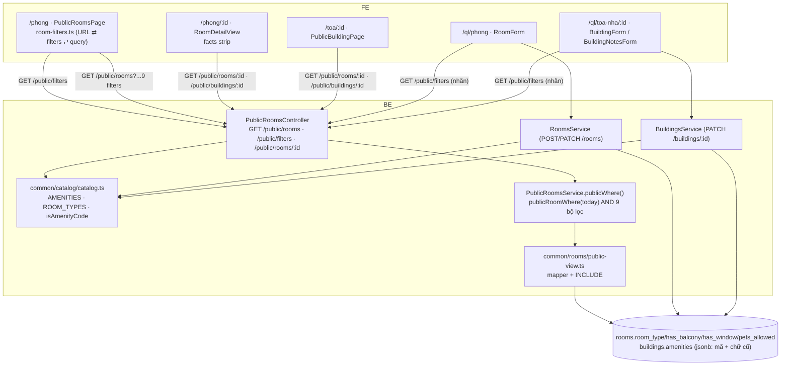

# PLAN · Phase Extra · EX-5 – Thuộc tính phòng và bộ lọc (BE-EX-12..16, FE-EX-18..21)

Nguồn: `docs/phase-extra-home101/feature_ex-5-room-filters.md`, `docs/spec/00-overview.md` (D-32, Q-09..Q-11, A-12), `docs/spec/11-buildings-rooms.md` (BLD-02, BLD-08, ROOM-01, ROOM-05, ROOM-10, PUB-01..06, bảng API, Acceptance), `docs/spec/02-database.md` (DB-07, "Planned changes" EX-5), `docs/spec/01-architecture.md` (LOC-04, bảng mã lỗi), `docs/spec/30-frontend.md` (`/phong`, `/phong/:id`, `/ql/phong`, `/ql/toa-nha/:id`, UI-03), `docs/LESSONS.md` và mã nguồn hiện tại (`src/modules/rooms/`, `src/modules/buildings/`, `src/common/rooms/`, `src/features/public/`, `src/features/rooms/`, `src/features/buildings/`).

---

## 1. Mục tiêu và phạm vi

| Task | Nội dung | Spec |
|---|---|---|
| BE-EX-12 ⏸ | Migration **`room_attributes`**: enum `RoomType` + 4 cột null trên `rooms`. `buildings` **không** đổi schema (§2.3) | ROOM-10, DB-07, "Planned changes" EX-5 |
| BE-EX-13 | `src/common/catalog/` – 8 mã tiện ích + 4 loại phòng kèm nhãn Việt/Anh; `GET /public/filters` | BLD-08, ROOM-10, PUB-06, PUB-05, LOC-04 |
| BE-EX-14 | Form nhân sự: 4 trường phòng (null ≠ false), `amenities` của tòa chỉ nhận mã trong danh mục, chữ tự do cũ được trả riêng và không bị chuyển đổi; quản lý vẫn chỉ sửa được `amenities` + `description` | ROOM-10, BLD-08, BLD-02 |
| BE-EX-15 ⏸ | 9 bộ lọc mới của `/public/rooms` (AND, trước phân trang, trên nền ROOM-05); danh sách + chi tiết trả thuộc tính mới và mã tiện ích của tòa | PUB-06, PUB-01, PUB-04, ROOM-05 |
| BE-EX-16 | Seed dev có giá trị cho các trường mới | DEP-08 |
| FE-EX-18 | `RoomForm` ("Loại phòng" + 3 lựa chọn Có/Không/Chưa nhập ×3) và trang tòa (checklist tiện ích + khối "Tiện ích cũ (chưa chọn lại)") | ROOM-10, BLD-08, BLD-02 |
| FE-EX-19 | `/phong`: các bộ lọc mới, tất cả nằm trong URL query, "Xóa bộ lọc", trạng thái rỗng, dùng được ở 360 px | PUB-06, UI-03 |
| FE-EX-20 | Hiện thuộc tính ở `/phong/:id` (facts strip) và tiện ích tòa ở `/toa/:id`; "chưa nhập" không hiện | ROOM-10, BLD-08, LOC-04 |
| FE-EX-21 ⏸ | lint + build + test:components + reviewer + đi tay trên seed | – |

**Ngoài phạm vi**: lọc theo nội thất (D-32 nói không), suy giá trị từ `description`/`furniture` (ROOM-10), tự điền cho phòng cũ, bản dịch tiếng Anh của giao diện (EX-3 sở hữu từ điển – part này chỉ sinh **nhãn tiếng Anh của hai danh sách** trong `/public/filters` và ghi lại để EX-3 nạp vào từ điển), header `Cache-Control` của `/public/*` (hiện **chưa** có trong mã BE – không có interceptor nào, PUB-05 do CDN/DEP-06 lo; **không** tự thêm ở part này), lịch xem phòng (EX-6/EX-7).

---

## 2. Kiến trúc



### 2.1 Tệp thêm / sửa

**Backend**

| Tệp | Việc |
|---|---|
| `prisma/schema.prisma` | `enum RoomType`; 4 trường null trong `model Room`. Sửa tay từng dòng, **không** chạy `prisma format` (LESSONS BE-EX-01) |
| `prisma/migrations/20261113000000_room_attributes/migration.sql` (mới) | SQL ở §2.2 – viết tay, **chỉ tạo file**, xin OK riêng trước khi áp |
| `prisma/schema.sql` | sinh lại bằng `migrate diff --from-empty` (file checker đọc) |
| `prisma/constraints.sql` | **không đổi** (§2.2) |
| `prisma/check-constraints.mjs` | +3 tình huống `Phòng`: 63 → **66** |
| `src/common/catalog/catalog.ts` (mới) | hai danh sách + helper (§2.4) |
| `src/common/catalog/catalog.spec.ts` (mới) | so danh sách với chữ trong spec |
| `src/modules/rooms/dto/public-rooms.dto.ts` | 9 trường lọc (§2.6) |
| `src/modules/rooms/dto/rooms.dto.ts` | 4 trường trong `CreateRoomDto`, `UpdateRoomDto` |
| `src/modules/rooms/rooms.service.ts` | `create` + `updateData` + `toView` mang 4 trường |
| `src/modules/rooms/rooms.types.ts` | `RoomView`, `RoomGridItem` |
| `src/modules/rooms/public.types.ts` | `PublicRoomListItem`, `PublicRoomDetail`, `PublicFiltersView` |
| `src/common/rooms/public-view.ts` | `PUBLIC_ROOM_LIST_INCLUDE` lấy thêm `building.amenities`; 2 mapper |
| `src/modules/rooms/public-rooms.service.ts` | `publicWhere()` thêm 9 điều kiện; `filters()` trả danh mục |
| `src/modules/rooms/public-rooms.controller.ts` | `@Public() @Get('filters')` |
| `src/modules/buildings/dto/buildings.dto.ts` | `amenities` chỉ nhận mã; `legacyAmenities?: []` (OQ-1) |
| `src/modules/buildings/buildings.service.ts` | ghi: giữ chữ cũ; đọc: tách `amenities` / `legacyAmenities` |
| `src/modules/buildings/buildings.types.ts` | `legacyAmenities: string[]` |
| `src/modules/buildings/building-write.guard.ts` | `MANAGER_BUILDING_FIELDS` thêm `legacyAmenities` (BLD-02, OQ-1) |
| `prisma/seed.ts`, `prisma/seed.spec.ts` | BE-EX-16 (§2.9) |
| `docs/spec/02-database.md` | xóa 2 dòng EX-5 ở "Planned changes", ghi cách lưu `amenities` đã chốt |
| `docs/phase-extra-home101/PROGRESS.md`, `docs/LESSONS.md` | cập nhật trước mỗi ⏸ |
| Test cũ phải sửa | §5 |

**Frontend**

| Tệp | Việc |
|---|---|
| `src/features/public/api.ts` | type thuộc tính mới, `PublicFiltersView`, `listPublicFilters()`, `publicQueryKeys.filters` |
| `src/features/public/room-filters.ts` | 9 trường trong `PublicFilters`, parse/to-params/to-query/validate (§2.8) |
| `src/features/public/RoomFilters.tsx` | select loại phòng, 3 nhóm Có/Không-quan-tâm, checklist tiện ích, 4 ô số |
| `src/features/public/public.css` | khung cho các control mới, 1 cột ở 360 px |
| `src/features/public/amenity-labels.ts` (mới, nhỏ) | `labelOf(code, options)` – không có trong danh mục thì trả nguyên chữ (A-12, LOC-04) |
| `src/pages/public/PublicRoomsPage.tsx` | nạp `/public/filters`, truyền options, đổi chữ trạng thái rỗng thành "Không có phòng phù hợp" (30-frontend) |
| `src/pages/public/PublicRoomPage.tsx` | tính `attributeFacts` từ dữ liệu + nhãn, truyền xuống |
| `src/pages/public/RoomDetailView.tsx` | prop `attributeFacts?: { label: string; value: string }[]` thêm vào facts strip |
| `src/pages/public/PublicBuildingPage.tsx` | tiện ích hiện bằng nhãn |
| `src/features/rooms/schemas.ts`, `RoomForm.tsx`, `api.ts` | 4 trường, `'' = chưa nhập` → `null` |
| `src/features/buildings/schemas.ts`, `BuildingForm.tsx`, `api.ts` | checklist mã; khối "Tiện ích cũ (chưa chọn lại)" |
| `src/pages/staff/BuildingDetailPage.tsx` | dòng "Tiện ích" hiện nhãn + khối chữ cũ |
| `tests/ex/ex5-room-filters.test.mjs`, `tests/ex/ex5-staff-attributes.test.mjs` (mới) | §4 CP-4 |
| Test cũ phải sửa | §5 |

### 2.2 Migration `room_attributes` (BE-EX-12)

Thư mục: `prisma/migrations/20261113000000_room_attributes/migration.sql`. Viết tay theo đúng kiểu `20261112010000_email_verification`: **chỉ thêm** enum và cột, không sửa/xóa gì, nên chạy được trên DB đang có dữ liệu và mọi phòng cũ nhận `NULL` ("chưa nhập", ROOM-10).

```sql
-- EX-5 / BE-EX-12: thuộc tính phòng cho bộ lọc công khai (D-32, ROOM-10, PUB-06).
-- Chỉ thêm: một enum và bốn cột null. Phòng đã có giữ NULL = "chưa nhập".

-- 1. Loại phòng (Q-10, owner 12/11/2026)
CREATE TYPE "RoomType" AS ENUM ('STUDIO', 'LOFT', 'ONE_BEDROOM', 'TWO_BEDROOM');

-- 2. rooms: null khác false (ROOM-10)
ALTER TABLE "rooms" ADD COLUMN "room_type" "RoomType";
ALTER TABLE "rooms" ADD COLUMN "has_balcony" BOOLEAN;
ALTER TABLE "rooms" ADD COLUMN "has_window" BOOLEAN;
ALTER TABLE "rooms" ADD COLUMN "pets_allowed" BOOLEAN;
```

- **Không CHECK, không index, không trigger** → `constraints.sql` giữ nguyên. Enum đã tự chặn giá trị lạ; cột boolean null không có luật nào để kiểm. Không thêm index vì số phòng của chuỗi này ở mức vài trăm dòng và mọi truy vấn lọc đều đi kèm `publicRoomWhere` (`shortcut: chưa có index cho bộ lọc; thêm khi bảng rooms vượt ~10.000 dòng hoặc EXPLAIN cho thấy seq scan tốn kém`).
- **`buildings` không có migration** (§2.3).
- `schema.prisma`:

```prisma
enum RoomType {
  STUDIO
  LOFT
  ONE_BEDROOM
  TWO_BEDROOM
}

model Room {
  // ... giữ nguyên
  roomType    RoomType? @map("room_type")   // ROOM-10, null = chưa nhập
  hasBalcony  Boolean?  @map("has_balcony")
  hasWindow   Boolean?  @map("has_window")
  petsAllowed Boolean?  @map("pets_allowed")
}
```

- `check-constraints.mjs`: thêm 3 tình huống nhóm `Phòng`, **63 → 66** (số hiện tại do checker in ra, không dùng số 50/54 trong tài liệu cũ – LESSONS 12/11/2026):

| Tình huống | SQL (rút gọn) | Spec | Mong đợi |
|---|---|---|---|
| Loại phòng ngoài danh sách | `UPDATE rooms SET room_type = 'DUPLEX' WHERE id = 1` | ROOM-10 | `invalid input value for enum "RoomType"` |
| Phòng cũ mặc định "chưa nhập" | insert phòng mới rồi `DO $$` kiểm `room_type IS NULL AND has_balcony IS NULL AND has_window IS NULL AND pets_allowed IS NULL` | ROOM-10 | `ok` |
| `false` khác `NULL` | `UPDATE rooms SET has_balcony = false WHERE id = 1` rồi `DO $$` kiểm `has_balcony IS NOT NULL AND has_balcony = false` | ROOM-10 | `ok` |

### 2.3 `buildings.amenities` lưu thế nào (BLD-08) – đã chốt trong kế hoạch

**Giữ nguyên một cột `amenities jsonb` (mảng chuỗi), không thêm cột, không migration cho `buildings`.** Phần tử là **mã** khi nó nằm trong danh mục 8 mã của BLD-08; mọi phần tử khác là **chữ tự do cũ**. BE tách khi đọc và gộp lại khi ghi.

Vì sao:

1. BLD-08 chỉ yêu cầu "chữ cũ được giữ và hiện cho nhân sự, không bao giờ tự chuyển đổi, không dùng để lọc" – phân biệt bằng danh mục là đủ, không cần cột thứ hai.
2. Không thể trùng: mã là `^[A-Z_]+$` do ta định nghĩa, chữ cũ do nhân sự nhập là tiếng Việt có dấu/chữ thường ("Thang máy", "wifi"). Một chuỗi bằng đúng `ELEVATOR` thì cũng chính là tiện ích đó, hiểu là mã không gây sai.
3. Một part một migration nhỏ (README mục 6): part này đã có migration `rooms`; thêm cột `buildings` làm migration to hơn mà không đổi được hành vi nào.
4. Bộ lọc dùng `amenities @> '["CODE"]'` (jsonb, `array_contains` của Prisma) nên chữ cũ **tự nhiên không khớp** bất kỳ mã nào – đúng "không dùng để lọc" mà không cần code lọc bỏ.

Hệ quả hành vi (BE):

- **Đọc** (`BuildingView`, `/buildings`): `amenities` = các phần tử là mã (theo thứ tự danh mục), `legacyAmenities` = các phần tử còn lại (theo thứ tự đã lưu). Công khai (`/public/buildings/:id`, `/public/rooms/:id.building`, item danh sách) chỉ trả **mã** – chữ cũ là ghi chú nội bộ của nhân sự, không hiện cho khách (PUB-04); xem OQ-5 nếu chủ dự án muốn hiện.
- **Ghi** (`PATCH /buildings/:id { amenities: [mã…] }`): lưu `[...mã đã chọn (đã lọc trùng, theo thứ tự danh mục), ...chữ cũ đang có]`. Mã lạ → 400 `VALIDATION_FAILED` + `fields.amenities = 'Tiện ích không có trong danh mục'`. Chữ cũ **không bao giờ** bị chuyển thành mã và không bị mất khi lưu mã (Done when của BE-EX-14).
- **Xóa chữ cũ**: `legacyAmenities: []` (chỉ nhận mảng rỗng, giá trị khác → `VALIDATION_FAILED`) – xem **OQ-1**.
- `POST /buildings` (Boss tạo mới): `amenities` chỉ nhận mã, không có chữ cũ.

### 2.4 Danh mục dùng chung (BE-EX-13)

`src/common/catalog/catalog.ts` – một file, không module Nest, nên **`AppModule` không đổi** (LESSONS BE-P2-10):

```ts
export interface CatalogItem { code: string; label: string; labelEn: string }   // label = tiếng Việt (G-03)

export const AMENITIES: readonly CatalogItem[];   // 8 mã theo đúng thứ tự BLD-08
export const ROOM_TYPES: readonly CatalogItem[];  // 4 mã theo đúng thứ tự ROOM-10
export const AMENITY_CODES: readonly string[];
export function isAmenityCode(value: string): boolean;
export function isRoomTypeCode(value: string): boolean;
```

| `amenities[].code` | `label` (BLD-08, đúng từng chữ) | `labelEn` [ASSUMPTION] → OQ-3 |
|---|---|---|
| `ELEVATOR` | Thang máy | Elevator |
| `PARKING` | Chỗ để xe | Parking |
| `SECURITY` | Bảo vệ | Security guard |
| `CAMERA` | Camera | Security cameras |
| `SHARED_WASHER` | Máy giặt chung | Shared washing machine |
| `DRYING_AREA` | Sân phơi | Drying area |
| `FINGERPRINT_LOCK` | Khóa vân tay | Fingerprint lock |
| `FREE_HOURS` | Giờ giấc tự do | No curfew |

| `roomTypes[].code` | `label` (ROOM-10, đúng từng chữ) | `labelEn` [ASSUMPTION] → OQ-3 |
|---|---|---|
| `STUDIO` | Studio | Studio |
| `LOFT` | Có gác xép | With a loft |
| `ONE_BEDROOM` | 1 phòng ngủ | One bedroom |
| `TWO_BEDROOM` | 2 phòng ngủ | Two bedrooms |

Thứ tự của hai mảng là thứ tự hiển thị trên mọi giao diện (nhân sự và công khai).

### 2.5 `GET /public/filters` (PUB-06)

| Method · Path | Quyền | Request | Thành công | Lỗi |
|---|---|---|---|---|
| `GET /public/filters` | `@Public()` | – | 200 `{ data: PublicFiltersView }` | – (không có tham số nên không có 400) |

```ts
export interface PublicFiltersView {
  amenities: { code: string; label: string; labelEn: string }[];
  roomTypes: { code: string; label: string; labelEn: string }[];
}
```

- Hằng số trong bộ nhớ, **không truy vấn DB**; phản hồi không chứa dữ liệu tòa/phòng nào (Done when của BE-EX-13).
- Đặt trong `PublicRoomsController` (module `rooms`) cạnh `rooms`, `featured-rooms`, `rooms/:id` – không thêm module, không đụng `AppModule`. Đường dẫn `filters` không trùng mẫu `rooms/:id`.
- Về cache: route là `GET /public/*` giống mọi route công khai khác, nên nó nhận **đúng cùng cách xử lý** – hiện mã BE không đặt `Cache-Control` ở đâu cả (PUB-05 do CDN lo, DEP-06). Không thêm interceptor trong part này.

### 2.6 Bộ lọc `/public/rooms` (BE-EX-15, PUB-06)

`PublicRoomsQueryDto` (thêm vào 6 trường hiện có; thông điệp lỗi tiếng Việt vì LOC-02 của EX-3 chưa tới):

```ts
export class PublicRoomsQueryDto extends PaginationQuery {
  // … district, ward, buildingId, minPrice, maxPrice, sort giữ nguyên
  minArea?: number;        // Type(Number) · IsNumber(maxDecimalPlaces 1) · Min 0.1 · Max 9999.9
  maxArea?: number;        // như trên
  minOccupants?: number;   // Type(Number) · IsInt · Min 1 · Max 2147483647
  floor?: number;          // Type(Number) · IsInt · Min 1 · Max 2147483647
  amenities?: string[];    // '?amenities=ELEVATOR,PARKING' → Transform split(',') + trim + bỏ rỗng + dedupe
                           // ArrayMaxSize(8) · IsIn(AMENITY_CODES, { each: true })
  balcony?: true;          // chỉ nhận chuỗi 'true' (OQ-2)
  window?: true;
  pets?: true;
  roomType?: RoomType;     // IsIn(ROOM_TYPE_CODES)
}
```

Thông điệp lỗi (`fields.<tên>`): `'Diện tích tối thiểu không hợp lệ'`, `'Diện tích tối đa không hợp lệ'`, `'Số người không hợp lệ'`, `'Tầng không hợp lệ'`, `'Tiện ích không có trong danh mục'`, `'Giá trị bộ lọc không hợp lệ'` (3 boolean), `'Loại phòng không hợp lệ'`. Giới hạn số lấy từ cột (`area_m2 Decimal(5,1)`, `floor`/`max_occupants` là `Int`) để một số quá lớn ra 400 chứ không phải 500 (LESSONS BE-P2-17).

`publicWhere(query, today)` – thêm vào **cùng mảng `AND` sẵn có**, nên mọi điều kiện ghép AND và nằm trong truy vấn trước `skip/take` (PUB-06), kể cả nhánh `sort=newest` vì `newestRoomIds(prisma, where, today)` nhận cùng `where`:

| Query | Prisma fragment | "chưa nhập" |
|---|---|---|
| `minArea` | `{ areaM2: { gte: new Prisma.Decimal(minArea) } }` | cột NOT NULL |
| `maxArea` | `{ areaM2: { lte: … } }` | cột NOT NULL |
| `minOccupants` | `{ maxOccupants: { gte: minOccupants } }` | cột NOT NULL |
| `floor` | `{ floor }` | cột NOT NULL |
| `balcony` | `{ hasBalcony: true }` | `NULL` không khớp (Prisma sinh `= true`) |
| `window` | `{ hasWindow: true }` | như trên |
| `pets` | `{ petsAllowed: true }` | như trên |
| `roomType` | `{ roomType }` | `NULL` không khớp |
| `amenities` | **một fragment mỗi mã**: `{ building: { amenities: { array_contains: [code] } } }` | chữ cũ không bằng mã nào → không khớp (BLD-08) |

Ghi chú: một `array_contains` cho mỗi mã (không gộp một mảng nhiều phần tử) để chắc chắn là "tòa có **tất cả** mã đã chọn" theo đúng PUB-06, và để lỗi dễ đọc. `meta.total` vẫn là `room.count({ where })` nên bằng số sau khi lọc ở mọi trang (Done when BE-EX-15).

Phản hồi (PUB-04 vẫn giữ: không thêm trường nội bộ nào):

```ts
export interface PublicRoomListItem {
  // … 12 trường hiện có
  roomType: 'STUDIO' | 'LOFT' | 'ONE_BEDROOM' | 'TWO_BEDROOM' | null;
  hasBalcony: boolean | null;
  hasWindow: boolean | null;
  petsAllowed: boolean | null;
  buildingAmenities: string[];   // chỉ mã (BLD-08); chữ cũ không ra ngoài
}

export interface PublicRoomDetail {
  // … các trường hiện có; building.amenities vẫn chỉ chứa mã
  roomType: … | null; hasBalcony: boolean | null; hasWindow: boolean | null; petsAllowed: boolean | null;
}
```

`PUBLIC_ROOM_LIST_INCLUDE.building.select` thêm `amenities: true`; mapper dùng lại `jsonStrings()` + `isAmenityCode` để chỉ giữ mã.

### 2.7 Form nhân sự (BE-EX-14)

```ts
// rooms.dto.ts – CreateRoomDto và UpdateRoomDto, mỗi trường optional, null là giá trị hợp lệ
roomType?: 'STUDIO' | 'LOFT' | 'ONE_BEDROOM' | 'TWO_BEDROOM' | null;   // ValidateIf(≠ undefined && ≠ null) + IsIn
hasBalcony?: boolean | null;    // ValidateIf(≠ undefined && ≠ null) + IsBoolean
hasWindow?: boolean | null;
petsAllowed?: boolean | null;

// buildings.dto.ts – Create và Update
amenities?: string[];           // IsIn(AMENITY_CODES, { each: true }), ArrayMaxSize(8)
legacyAmenities?: [];           // chỉ mảng rỗng (ArrayMaxSize(0)) – lệnh "xóa chữ cũ" (OQ-1)
```

- `RoomsService.create`: chỉ ghi khóa nào có trong dto; thiếu → cột để `NULL`. `updateData`: `if (dto.roomType !== undefined) data.roomType = dto.roomType;` (… 4 lần) – nhờ vậy `null` ghi được và `false` **không** bị coi là "không gửi" (ROOM-10). Bỏ khóa `undefined` trước khi so "chỉ các trường này được phép" (LESSONS BLD-02 03/11/2026).
- `RoomView`/`RoomGridItem` thêm 4 trường (grid dùng để hiện nhanh ở `/ql/phong` nếu cần; không bắt buộc hiển thị).
- `BuildingsService.update`: khi `dto.amenities !== undefined` → đọc `current.amenities`, tách chữ cũ, ghi `[...codes, ...legacy]`; khi `dto.legacyAmenities !== undefined` (chỉ có thể là `[]`) → ghi `[...codes hiện tại hoặc dto.amenities, ...[]]`. Việc đọc-rồi-ghi này nằm **trong `$transaction` + `SELECT … FOR UPDATE`** đã có ở `update()` (LESSONS BE-P2-17 "check, then write").
- BLD-02 không đổi: `MANAGER_BUILDING_FIELDS = { amenities, description, legacyAmenities }`; mọi trường khác của quản lý → 403 `FORBIDDEN`.
- Không thêm mã lỗi mới → `app.setup.spec.ts` (đếm `ErrorCode`) **không** phải sửa (LESSONS BE-P2-02).

### 2.8 Vòng tròn URL ⇄ bộ lọc ⇄ API trên FE (FE-EX-19)

```ts
export interface PublicFilters {
  district: string; ward: string; buildingId: string; minPrice: string; maxPrice: string; sort: PublicRoomSort;
  minArea: string; maxArea: string; minOccupants: string; floor: string;   // ô số, '' = không lọc
  amenities: string[];                                                     // mã đã tick
  balcony: boolean; window: boolean; pets: boolean;                        // chỉ true được gửi
  roomType: string;                                                        // '' = mọi loại
}
```

| Hàm | Luật |
|---|---|
| `parseFilters(params)` | số: lấy nguyên chuỗi để zod báo lỗi dưới ô (như `minPrice`); `amenities`: `split(',')` rồi **bỏ mã không có trong danh mục** và bỏ trùng; `roomType`: không thuộc 4 mã → `''`; `balcony/window/pets`: `=== 'true'` (mọi giá trị khác, kể cả `false`, coi như không lọc) |
| `filtersToParams(values)` | bỏ ô rỗng, bỏ `sort` mặc định, boolean chỉ ghi khi `true`, `amenities.join(',')` (bỏ qua khi rỗng). Thứ tự khóa cố định để link chia sẻ ổn định |
| `filtersToQuery(values)` | `minArea/maxArea` → `Number`, `minOccupants/floor` → `Number`, `amenities` → chuỗi `A,B` hoặc `undefined`, boolean → `true | undefined`, `roomType` → `string | undefined`. `'0'` vẫn là giá trị thật (chỉ `''` là rỗng) |
| `validFilters(values)` | `filterSchema` thêm 4 refine số (thông điệp **copy đúng chữ** của DTO BE); mã/loại phòng không cần refine vì parse đã bỏ |

`danh mục` cho FE lấy từ `GET /public/filters` (`publicQueryKeys.filters`, dùng cả ở trang nhân sự – endpoint công khai nên không cần quyền): không có bảng nhãn thứ hai trong FE, không lệch chữ với BE. Trong lúc chưa tải xong: ô "Loại phòng" và checklist tiện ích hiện disabled với chữ "Đang tải…"; các bộ lọc khác vẫn dùng được (UI-03).

`/phong` ở 360 px: các control mới xếp một cột trong `public-filters` (CSS grid sẵn có, thêm `@media (max-width: 480px)` nếu cần); checklist tiện ích là `<fieldset><legend>Tiện ích tòa</legend>` + 8 checkbox; 3 thuộc tính phòng là 3 checkbox "Có ban công" / "Có cửa sổ" / "Cho nuôi thú cưng" (một checkbox = lọc `true`, bỏ tick = không lọc, khớp OQ-2).

### 2.9 Seed dev (BE-EX-16)

`RoomSpec` thêm `roomType`, `hasBalcony`, `hasWindow`, `petsAllowed`; `BuildingSpec` thêm `amenities: string[]` (mã). Giá trị mẫu để thử lọc bằng tay (mỗi bộ lọc có cả phòng khớp và phòng không khớp, và **ít nhất một phòng để trống hoàn toàn** cho ca "chưa nhập"):

| Tòa / phòng | `amenities` tòa | `roomType` | `hasBalcony` | `hasWindow` | `petsAllowed` |
|---|---|---|---|---|---|
| CG01 | `ELEVATOR`, `PARKING`, `CAMERA` | | | | |
| CG01/203 | | `STUDIO` | true | true | false |
| CG01/204 | | `ONE_BEDROOM` | false | true | true |
| CG01/301 (chưa có giá) | | null | null | null | null |
| DD01 | `PARKING`, `SECURITY`, `FREE_HOURS` | | | | |
| DD01/101 | | `LOFT` | true | false | true |
| DD01/102 | | `TWO_BEDROOM` | false | false | false |
| HM01 | `ELEVATOR`, `SHARED_WASHER`, `DRYING_AREA`, `FINGERPRINT_LOCK` | | | | |
| HM01/101 | | `STUDIO` | null | true | null |
| HM01/201 | | `TWO_BEDROOM` | true | true | true |

Chạy lại seed phải an toàn: phòng dùng `upsert` với `update: { roomType, hasBalcony, hasWindow, petsAllowed }` và tòa (hiện là `findFirst` + `create` vì trigger quản lý) thêm một `update({ data: { amenities } })` khi dòng đã có – nhờ vậy DB dev hiện tại (phòng/tòa đã tồn tại) cũng nhận giá trị để lọc thử. **Ghi đè giá trị nhân sự đã nhập trên DB dev** – xem **OQ-4**. Không chạm dữ liệu production (seed chỉ dùng cho dev, DEP-08).

---

## 3. Câu hỏi bỏ ngỏ

Xem §6 (cuối file). `[ASSUMPTION]` kế hoạch dùng:

- Nhãn tiếng Anh của 8 tiện ích và 4 loại phòng (§2.4) – spec yêu cầu có nhãn Anh (LOC-04) nhưng không ghi chữ (OQ-3).
- `amenities` truyền trên query dạng chuỗi ngăn bởi dấu phẩy (`?amenities=ELEVATOR,PARKING`), tối đa 8, bỏ trùng.
- Chữ tự do cũ của tòa **không** hiện cho khách ở `/public/*` (chỉ nhân sự thấy) – PUB-04 (OQ-5).
- Thông điệp lỗi tiếng Việt của 9 bộ lọc mới và của `fields.amenities` (§2.6, §2.7).
- Thẻ phòng ở `/phong` **không** hiện thuộc tính mới (chỉ `/phong/:id` hiện) để không phình thẻ (OQ-5).
- `RoomGridItem` mang 4 trường mới nhưng `/ql/phong` chưa hiển thị (chỉ form sửa dùng).
- Seed ghi đè giá trị cũ của phòng/tòa mẫu khi chạy lại (OQ-4).

---

## 4. Checkpoints

### CP-1 · BE-EX-12 – migration + kiểm ràng buộc (⏸)

Tệp: `prisma/schema.prisma`, `prisma/migrations/20261113000000_room_attributes/migration.sql`, `prisma/schema.sql`, `prisma/check-constraints.mjs`.

**Hỏi trước**: (1) trước khi tạo file migration, (2) trước khi áp vào DB dev (root `CLAUDE.md` rule 7). Mã nguồn chưa biên dịch với client mới cho tới CP-2; chạy `npx prisma generate` sau khi sửa schema và nói rõ trong báo cáo nếu `npm run test` còn đỏ vì type.

**Done when**
```bash
cd D:/Rooms/Source/backend
# 1. Migration tay phản ánh đúng diff schema cũ -> mới (offline, KHÔNG dùng DB dev làm shadow – LESSONS BE-EX-01)
git show HEAD:Source/backend/prisma/schema.prisma > "$SCRATCH/schema.old.prisma"
npx prisma migrate diff --from-schema-datamodel "$SCRATCH/schema.old.prisma" --to-schema-datamodel prisma/schema.prisma --script
#    kỳ vọng: CHỈ 1 CREATE TYPE "RoomType" + 4 ALTER TABLE "rooms" ADD COLUMN, không có dòng nào khác
# 2. schema.sql sinh lại + kiểm ràng buộc
npm i --no-save @electric-sql/pglite@0.2          # LESSONS P1-QA-04
npx prisma migrate diff --from-empty --to-schema-datamodel prisma/schema.prisma --script -o prisma/schema.sql
node prisma/check-constraints.mjs . prisma         # kỳ vọng: 66/66 tình huống đúng như mong đợi
```
Sau khi chủ dự án cho phép áp: `npx prisma migrate deploy` trên DB dev chạy sạch, `npx prisma migrate status` không drift, `npx vitest run prisma/seed.spec.ts` xanh, và một truy vấn tay cho thấy mọi phòng cũ có `room_type IS NULL`.

**Kịch bản test** (trong `check-constraints.mjs`, mong đợi lấy từ spec)

| Kịch bản | Spec | Kỳ vọng |
|---|---|---|
| `room_type = 'DUPLEX'` | ROOM-10 (4 loại) | lỗi enum `RoomType` |
| Phòng mới không ghi 4 trường | ROOM-10 ("chưa nhập") | `ok`, cả 4 cột `NULL` |
| `has_balcony = false` | ROOM-10 (null ≠ không) | `ok` và `IS NOT NULL` |
| 63 tình huống cũ | DB-07 | không đổi, vẫn PASS |

### CP-2 · BE-EX-13, BE-EX-14, BE-EX-15 – danh mục, form nhân sự, bộ lọc (⏸ báo cáo BE-EX-12..15)

Tệp: `src/common/catalog/*`, `src/modules/rooms/dto/*`, `rooms.service.ts`, `rooms.types.ts`, `public.types.ts`, `public-rooms.service.ts`, `public-rooms.controller.ts`, `src/common/rooms/public-view.ts`, `src/modules/buildings/dto/buildings.dto.ts`, `buildings.service.ts`, `buildings.types.ts`, `building-write.guard.ts`, cùng các test ở §5.

**Done when**
```bash
cd D:/Rooms/Source/backend && npm run lint && npm run test && npm run build
# e2e: LESSONS BE-EX-06 – trên máy này .env nằm ở Source/backend
node --env-file=.env ./node_modules/vitest/vitest.mjs run --config ./vitest.config.e2e.ts
```
Tất cả xanh (dán output thật). Ba dòng Acceptance mới của spec 11 có test mang mã PUB-06/BLD-08. `GET /api/v1/public/filters` trả đúng 8 + 4 phần tử và **không** có khóa nào khác (`Object.keys(data).sort() === ['amenities','roomTypes']`).

**Kịch bản test** (mong đợi lấy từ spec, không lấy từ mã)

| Nhóm | Kịch bản | Spec ID | Kỳ vọng |
|---|---|---|---|
| catalog | `AMENITIES` và `ROOM_TYPES` khớp đúng từng chữ và đúng thứ tự với BLD-08 / ROOM-10 | BLD-08, ROOM-10 | 8 và 4 phần tử, `label` đúng chữ spec, mọi `labelEn` không rỗng (LOC-04) |
| filters | `GET /public/filters` | PUB-06 | 200, chỉ 2 khóa, không dữ liệu tòa/phòng, không truy vấn Prisma nào |
| filters | gọi không có `Authorization` và với token rác | PUB-05, API-07 | 200 cả hai lần |
| lọc happy | `?balcony=true&minArea=25` | spec 11 Acceptance (PUB-06) | chỉ phòng công khai có ban công và ≥ 25 m²; phòng "chưa nhập" ban công **không** có trong kết quả; `meta.total` là số sau khi lọc |
| lọc null | `?window=true` với phòng `has_window = null` và phòng `= false` | PUB-06, ROOM-10 | cả hai đều bị loại |
| lọc null | `?roomType=STUDIO` với phòng `room_type = null` | PUB-06 | bị loại |
| lọc AND | `?balcony=true&pets=true&roomType=LOFT&minOccupants=2` | PUB-06 (AND) | chỉ phòng khớp **tất cả** |
| lọc tiện ích | `?amenities=ELEVATOR,PARKING` | PUB-06, BLD-08 | chỉ phòng của tòa có **cả hai** mã; tòa chỉ có `ELEVATOR` bị loại |
| lọc tiện ích | tòa có `amenities = ['Thang máy']` (chữ cũ), lọc `?amenities=ELEVATOR` | BLD-08 (chữ cũ không dùng để lọc) | không trả phòng nào của tòa đó |
| lọc biên | `minArea = maxArea = diện tích đúng của một phòng`; `minArea = 0.1`; `maxArea = 9999.9` | PUB-06 | phòng đó có trong kết quả |
| lọc biên | `minOccupants` = đúng `max_occupants` / lớn hơn 1 đơn vị | PUB-06 (`≥`) | có / không có |
| lọc biên | `floor` = tầng của phòng / tầng không có phòng nào | PUB-06 | 1 phòng / rỗng, `total = 0` |
| lọc biên | `minArea > maxArea` | PUB-06 | 200, danh sách rỗng, `total = 0` (BE không sửa ý người dùng) |
| lọc phân trang | 25 phòng khớp, `?limit=20&page=2` | PUB-06 ("trước phân trang") | 5 dòng, `meta.total = 25` |
| lọc + sort | mọi bộ lọc trên với `sort=newest` và `sort=-price` | PUB-01, PUB-06 | cùng tập phòng, chỉ khác thứ tự |
| lọc bảo mật | phòng không công khai (giá null / bảo trì / có hợp đồng HOLD / tòa khóa / thiếu giá điện) với **mọi** bộ lọc | ROOM-05, spec 11 Acceptance | không bao giờ xuất hiện |
| lọc validate | `?amenities=WIFI`, `?roomType=DUPLEX`, `?balcony=maybe`, `?minArea=abc`, `?minArea=10000`, `?floor=0`, `?floor=2147483648`, `?minOccupants=0` | PUB-06, API-03 | 400 `VALIDATION_FAILED` + `fields` đúng tên trường, **không** 500 (LESSONS BE-P2-17) |
| lọc validate | `?amenities=ELEVATOR,ELEVATOR` và `?amenities=` (rỗng) | PUB-06 | 200, coi như một mã / không lọc |
| phản hồi | khóa của một item danh sách | PUB-04 | đúng 17 khóa (12 cũ + 4 thuộc tính + `buildingAmenities`), không trường nội bộ |
| phản hồi | `/public/rooms/:id` của phòng đã nhập đủ và của phòng "chưa nhập" | ROOM-10, PUB-04 | 4 trường có giá trị / đều `null`; `building.amenities` chỉ chứa mã |
| phản hồi | tòa có cả mã và chữ cũ, đọc công khai | BLD-08, PUB-04 | chỉ mã ra ngoài |
| form phòng | `POST /rooms` không gửi 4 trường | ROOM-10 | 201, cả 4 cột `NULL` |
| form phòng | `PATCH /rooms/:id { hasBalcony: false }` | ROOM-10 (null ≠ false) | 200, cột `false`, các cột khác không đổi |
| form phòng | `PATCH /rooms/:id { hasBalcony: null }` sau khi đã là `true` | ROOM-10 | 200, về `NULL` ("chưa nhập") |
| form phòng | `roomType: 'DUPLEX'` / `hasBalcony: 'yes'` | ROOM-10, API-03 | 400 `VALIDATION_FAILED` + `fields.roomType` / `fields.hasBalcony` |
| form phòng | sửa phòng ngoài tòa của quản lý | SCOPE-02 | 403 `OUT_OF_SCOPE` (không đổi) |
| form tòa | `PATCH /buildings/:id { amenities: ['ELEVATOR'] }` khi đang lưu `['Thang máy','ELEVATOR']` | BLD-08 (giữ chữ cũ) | 200, DB còn `['ELEVATOR','Thang máy']`; đọc ra `amenities: ['ELEVATOR']`, `legacyAmenities: ['Thang máy']` |
| form tòa | `amenities: ['wifi']` | BLD-08 | 400 `VALIDATION_FAILED` + `fields.amenities` |
| form tòa | `legacyAmenities: []` | BLD-08, OQ-1 | 200, chữ cũ biến mất, mã giữ nguyên |
| form tòa | `legacyAmenities: ['x']` | OQ-1 | 400 `VALIDATION_FAILED` |
| form tòa | quản lý gửi `{ amenities, description, legacyAmenities }` cho tòa của mình / gửi thêm `name` | BLD-02 | 200 / 403 `FORBIDDEN` |
| form tòa | quản lý sửa tòa không phải của mình | SCOPE-02 | 403 `OUT_OF_SCOPE` |
| form tòa | hai PATCH song song cùng tòa (một gửi mã, một gửi mã khác) | BLD-08, LESSONS BE-P2-17 | không mất chữ cũ, không mất mã của lần ghi sau |

### CP-3 · BE-EX-16 – seed dev (không có ⏸, làm tiếp sang CP-4)

Tệp: `prisma/seed.ts`, `prisma/seed.spec.ts`.

**Done when**
```bash
cd D:/Rooms/Source/backend && npx vitest run prisma/seed.spec.ts && npm run lint
```
xanh; chạy seed hai lần trên DB dev không thêm dòng nào và lần hai không đổi số phòng/tòa (nói trước với chủ dự án vì seed đặt lại mật khẩu các tài khoản mẫu – LESSONS P1-QA, 30/10/2026).

**Kịch bản test**

| Kịch bản | Spec | Kỳ vọng |
|---|---|---|
| Mỗi tòa mẫu có ≥ 3 mã tiện ích, tất cả đều thuộc danh mục | BLD-08 | đúng, không chuỗi lạ |
| Có ≥ 1 phòng mỗi `roomType`, ≥ 1 phòng `hasBalcony = false`, ≥ 1 phòng cả 4 trường `null` | ROOM-10, PUB-06 | đúng (để thử "chưa nhập" bằng tay) |
| Chạy `seed()` hai lần | DEP-08 | số phòng/tòa/tài khoản không đổi, thuộc tính bằng đúng bảng §2.9 |

### CP-4 · FE-EX-18..21 – giao diện nhân sự, bộ lọc, hiển thị, kiểm tra cuối (⏸)

Thứ tự làm: FE-EX-18 → FE-EX-19 → FE-EX-20 → FE-EX-21. Tệp: §2.1 (phần Frontend) + test ở §5.

**Done when**
```bash
cd D:/Rooms/Source/frontend && npm run lint && npm run build && npm run test:components
```
tất cả xanh, dán output thật (nếu lần đầu đỏ bất thường thì chạy lại một lần và báo cả hai – LESSONS P2-QA-02). Chạy **reviewer** một lần trên thay đổi chưa commit và dán toàn bộ báo cáo. Đi tay trên seed: mở `/phong`, tick 3 bộ lọc (ví dụ "Có ban công" + `Thang máy` + "Loại phòng: Studio"), copy URL mở ở tab mới thấy đúng bộ lọc và đúng kết quả, bấm "Xóa bộ lọc" về `/phong`; mở `/phong/:id` của một phòng đã nhập đủ và một phòng "chưa nhập"; mở `/ql/phong` lưu phòng mà không chạm trường mới → vẫn "Chưa nhập"; mở `/ql/toa-nha/:id` tick tiện ích, thấy khối "Tiện ích cũ (chưa chọn lại)" nếu tòa còn chữ cũ. Kiểm ở 360 px.

**Kịch bản test** (Node test như `tests/p2/*`, DOM giả `public-dom.mjs`; mong đợi lấy từ spec)

| Nhóm | Kịch bản | Spec ID | Kỳ vọng |
|---|---|---|---|
| URL → form | `/phong?minArea=20&maxArea=30&minOccupants=2&floor=3&amenities=ELEVATOR,PARKING&balcony=true&pets=true&roomType=STUDIO` | PUB-06 | mọi control hiện đúng giá trị; request tới `/public/rooms` có **đúng** các tham số đó + `page=1&limit=20` |
| form → URL | tick "Có cửa sổ" + `Máy giặt chung` rồi "Áp dụng bộ lọc" | PUB-06 | URL thêm `window=true&amenities=SHARED_WASHER`, bỏ `page`, request khớp URL |
| round trip | `filtersToParams(parseFilters(p))` với URL đầy đủ ở trên | PUB-06 | bằng `p` (cùng tập khóa/giá trị) |
| URL rác | `amenities=WIFI,ELEVATOR`, `roomType=DUPLEX`, `balcony=false`, `pets=1` | PUB-06, UI-05 | mã lạ/loại lạ bị bỏ, boolean khác `true` bị bỏ; trang **không** trắng, request không mang tham số đó |
| URL rác | `minArea=abc`, `minArea=10000`, `floor=0` | UI-05 | thông điệp dưới ô đúng chữ của BE, **không** gọi API |
| biên | `minArea=0.1`, `maxArea=9999.9`, `minOccupants=1`, `floor=1` | PUB-06 | gửi đúng, không báo lỗi |
| xóa lọc | "Xóa bộ lọc" khi đang có 5 bộ lọc | UI-03 | URL về `/phong`, request không còn bộ lọc nào, `sort=price&page=1` |
| rỗng | API trả `[]` | UI-03, 30-frontend | hiện "Không có phòng phù hợp" + nút "Xóa bộ lọc" |
| options | `/public/filters` đang tải / lỗi | UI-03 | select + checklist disabled kèm "Đang tải…"; lỗi không làm trắng trang, các bộ lọc còn lại vẫn chạy |
| nhãn | nhãn hiện trên giao diện lấy từ `/public/filters` | BLD-08, ROOM-10, LOC-04 | "Thang máy", "Có gác xép"… đúng chữ spec; không hardcode trong FE |
| 360 px | khung lọc ở chiều rộng 360 | UI-13 | một cột, mọi control có `<label>`/`<legend>` |
| chi tiết | `/phong/:id` phòng đủ 4 giá trị | ROOM-10 | facts strip có "Loại phòng: 1 phòng ngủ", "Ban công: Có", "Cửa sổ: Có", "Cho nuôi thú cưng: Không" |
| chi tiết | phòng cả 4 trường `null` | ROOM-10 ("chưa nhập" không hiện) | **không** dòng nào trong 4 dòng đó, phần còn lại của trang không đổi |
| chi tiết | phòng `hasBalcony = false`, `roomType = null` | ROOM-10 | hiện "Ban công: Không", không hiện "Loại phòng" |
| tòa | `/toa/:id` với `amenities = ['ELEVATOR','CAMERA']` | BLD-08 | hiện "Thang máy", "Camera" |
| tòa | `/toa/:id` với chuỗi không phải mã (dữ liệu cũ nếu có) | LOC-04, A-12 | hiện nguyên chữ, không hiện mã thô, không rơi ra lỗi |
| form phòng | lưu phòng mới không chạm trường mới | ROOM-10 | body **không** có 4 khóa (hoặc có với `null`), form hiện "Chưa nhập" |
| form phòng | chọn "Không" cho "Ban công" rồi lưu | ROOM-10 | body `hasBalcony: false` |
| form phòng | sửa phòng đang `true` về "Chưa nhập" | ROOM-10 | body `hasBalcony: null` |
| form phòng | mở form của phòng có sẵn giá trị | ROOM-10 | 3 nhóm hiện đúng lựa chọn, select đúng loại |
| form tòa | tick 2 tiện ích rồi lưu | BLD-08 | body `amenities: ['ELEVATOR','PARKING']` (mã, không phải nhãn) |
| form tòa | tòa có chữ cũ | BLD-08 | khối "Tiện ích cũ (chưa chọn lại)" liệt kê đúng chữ; nút xóa gửi `legacyAmenities: []` (OQ-1) |
| form tòa | `BuildingNotesForm` của quản lý | BLD-02 | chỉ gửi `{ amenities, description }` (+ `legacyAmenities` khi bấm xóa), không có `code`/`name`/`managerId` |

---

## 5. Test cũ sẽ đỏ (phải sửa trong cùng thay đổi)

**Backend**

| Tệp | Vì sao | Sửa |
|---|---|---|
| `src/modules/rooms/public-rooms.http.spec.ts` | test `PUB-04` khẳng định **đúng 12 khóa** của item danh sách (dòng ~284) | thêm 4 thuộc tính + `buildingAmenities` vào danh sách khóa (giữ `.sort()`) |
| cùng tệp – fake `matches()` / `toIncludeShape()` / `ROOMS` | fake Prisma tự diễn giải `where`; không hiểu `areaM2.gte`, `maxOccupants.gte`, `floor`, `hasBalcony`, `roomType`, `building.amenities.array_contains` | mở rộng fake **trước** khi viết test lọc; mỗi test lọc phải khẳng định đúng tập id trả về, không chỉ "không lỗi" (LESSONS BE-EX-08: fake trả `[]` ở cả hai nhánh làm test không bắt được lỗi) |
| `src/modules/rooms/public-rooms.detail.http.spec.ts` | bản ghi phòng giả thiếu 4 cột mới; có test `building.amenities` | thêm 4 cột vào fixture; thêm ca "chưa nhập" |
| `src/modules/rooms/rooms.service.spec.ts`, `rooms.spec.ts`, `rooms.http.spec.ts`, `rooms.detail.spec.ts`, `rooms.grid.spec.ts`, `rooms.cp1.spec.ts` | fixture phòng và so khớp `toView`/`toGridItem` | thêm 4 cột vào fixture; cập nhật object mong đợi |
| `src/modules/rooms/dto/rooms.dto.spec.ts` | có test "chỉ các trường này được phép" | thêm 4 trường vào ca hợp lệ; thêm ca `roomType` lạ bị từ chối |
| `src/modules/buildings/dto/buildings.dto.spec.ts` (dòng ~63–69) | đang khẳng định `amenities: ['Thang máy','Wifi']` **hợp lệ** | đổi sang mã; `['Thang máy']` giờ là ca **bị từ chối**; thêm ca `legacyAmenities` |
| `src/modules/buildings/buildings.service.spec.ts` (dòng ~79) | quản lý lưu `['Wifi']` | đổi sang `['ELEVATOR']`; thêm test giữ chữ cũ |
| `src/modules/buildings/buildings.http.spec.ts`, `buildings.unlock-price.spec.ts`, `public-buildings.detail.http.spec.ts` | fixture `amenities: []` / `['Thang máy']`, và `BuildingView` thêm khóa `legacyAmenities` | cập nhật fixture và object mong đợi |
| `src/modules/buildings/building-write.guard.spec.ts` | tập trường của quản lý | thêm `legacyAmenities` vào ca cho phép |
| `test/fixtures/fake-prisma.ts` | bản ghi phòng/tòa mặc định thiếu cột mới | thêm 4 cột (mặc định `null`) và mã tiện ích mẫu |
| `prisma/seed.spec.ts` | khẳng định dữ liệu seed | thêm khẳng định của CP-3 |
| `prisma/check-constraints.mjs` | 63 tình huống | → **66** |
| `src/app.setup.spec.ts`, `src/common/errors/db-errors.spec.ts`, `src/common/prisma/prisma.service.spec.ts` | **không** phải sửa: không thêm mã lỗi, không thêm khóa `DB_ERROR_MAP`, không thêm module vào `AppModule` | – (nếu phải sửa thì có gì sai với kế hoạch, dừng và nói) |

**Frontend**

| Tệp | Vì sao | Sửa |
|---|---|---|
| `tests/p2/fe-p2-15-search.test.mjs` #5, #7 | khẳng định chữ `'Chưa có phòng phù hợp với bộ lọc'`; 30-frontend yêu cầu `'Không có phòng phù hợp'` | đổi chữ mong đợi trong test cùng lúc đổi `PublicRoomsPage` (spec thắng mã – root `CLAUDE.md`) |
| `tests/p2/fe-p2-15-search.test.mjs` #14 | duyệt danh sách control có `<label>` | thêm các control mới vào danh sách |
| `tests/p2/fe-p2-15-search.test.mjs` #15 | gọi `filtersToParams/filtersToQuery` với object thiếu khóa mới | thêm khóa mới vào object của test (giữ các khẳng định cũ) |
| `tests/p2/ui-22-building-filter.test.mjs` | cùng trang `/phong`, cùng harness | chạy lại và sửa khẳng định nào đếm control/nút |
| `tests/p2/cp5-buildings-services.test.mjs` (dòng ~526, ~536) | `BuildingNotesForm` được dùng như ô chữ `amenities` và khẳng định body `{ amenities: ['Thang máy'], description }` | viết lại theo checklist: tick mã, body `{ amenities: ['ELEVATOR'], description }` |
| `tests/p2/cp5-buildings-services.test.mjs` (dòng ~351–373) | tạo tòa không chạm tiện ích | vẫn phải gửi `amenities: []` – giữ khẳng định, chỉ sửa nếu checklist làm nó đổi |
| `tests/p2/cp7-rooms.test.mjs` | `RoomForm` thêm control; `mountRoomForm` chờ `byName('code')` | thêm khẳng định cho control mới; không phá các ca biên cũ |
| `tests/p2/ui-23-room-detail.test.mjs`, `ui-25-building-detail.test.mjs`, `fe-p2-16-detail.test.mjs` | facts strip và tiện ích đổi | thêm/điều chỉnh khẳng định |
| `src/pages/ComponentPreview.tsx` (nếu dùng `RoomDetailView`) | prop mới là optional | không bắt buộc sửa; nếu TS đỏ thì truyền `[]` |

---

## 6. Open questions (chủ dự án trả lời trước checkpoint ghi trong ngoặc)

1. **OQ-1 (CP-2, BE-EX-14; CP-4, FE-EX-18) – xóa "Tiện ích cũ (chưa chọn lại)".** BLD-08 nói chữ cũ được giữ và hiện cho nhân sự "cho tới khi họ chọn lại từ danh mục", nhưng không nói ai xóa nó và khi nào.
   (a) Giữ mãi, chỉ hiện cho nhân sự, không có cách xóa trong giao diện · (b) **nút "Xóa tiện ích cũ"** trên trang tòa, gửi `legacyAmenities: []`, quản lý cũng dùng được cho tòa của mình · (c) tự xóa ngay lần đầu nhân sự lưu một mã bất kỳ.
   **Đề xuất (b)**: chữ cũ không mất ngoài ý muốn, nhưng có đúng một cách rõ ràng để dọn; (c) làm mất dữ liệu người ta chưa kịp đọc.

2. **OQ-2 (CP-2, BE-EX-15) – ba bộ lọc boolean có nhận `false` không?** PUB-06 ghi "`balcony`, `window`, `pets` (`true` only)".
   (a) Chỉ nhận `true`; `?balcony=false` → 400 `VALIDATION_FAILED` · (b) nhận `false` nghĩa là "lọc phòng **không** có" (phòng "chưa nhập" vẫn không khớp) · (c) nhận `false` nhưng bỏ qua như không lọc.
   **Đề xuất (a)**: đúng chữ PUB-06, giao diện chỉ cần 3 checkbox, không ai phải đoán nghĩa của "false".

3. **OQ-3 (CP-2, BE-EX-13) – nhãn tiếng Anh của 8 tiện ích và 4 loại phòng** (LOC-04 bắt buộc có, spec không ghi chữ).
   (a) Duyệt bảng đề xuất ở §2.4 (Elevator, Parking, Security guard, Security cameras, Shared washing machine, Drying area, Fingerprint lock, No curfew; Studio, With a loft, One bedroom, Two bedrooms) · (b) chủ dự án sửa lại từng chữ · (c) để `labelEn` rỗng, giao diện tiếng Anh dùng tạm chữ tiếng Việt (LOC-04 cho phép fallback).
   **Đề xuất (a)**, và EX-3 nạp đúng các chữ này vào từ điển; chủ dự án vẫn duyệt lại trước production (KIT-13).

4. **OQ-4 (CP-3, BE-EX-16) – seed có ghi đè thuộc tính của phòng/tòa mẫu đang có trên DB dev?** Các phòng và tòa mẫu đã tồn tại, nên nếu seed chỉ ghi lúc `create` thì DB dev vẫn trống bốn trường mới và không thử lọc được bằng tay.
   (a) Luôn đặt lại theo bảng §2.9 mỗi lần chạy seed (ghi đè giá trị bạn đã nhập tay trên **DB dev**) · (b) chỉ ghi khi tạo dòng mới; bạn tự nhập tay trên dev · (c) ghi đè chỉ khi cả bốn trường còn `NULL`.
   **Đề xuất (a)**: seed là dữ liệu dev, vốn đã đặt lại mật khẩu khi chạy lại; cách này cho thử bộ lọc ngay.

5. **OQ-5 (CP-4, FE-EX-19/FE-EX-20) – khách thấy gì?** Spec chỉ nói `/phong/:id` hiện thuộc tính và không hiện "chưa nhập"; không nói về thẻ phòng trong danh sách và về chữ tiện ích cũ.
   (a) Thẻ phòng ở `/phong` giữ nguyên như hiện nay (không hiện thuộc tính); chữ cũ của tòa **không** hiện cho khách, chỉ nhân sự thấy · (b) thẻ phòng hiện thêm 3 dấu nhỏ (ban công / cửa sổ / thú cưng) khi có · (c) chữ cũ của tòa cũng hiện cho khách ở `/toa/:id` cùng các mã.
   **Đề xuất (a)**: thẻ phòng đang vừa đủ ở 360 px, và chữ cũ là ghi chú nội bộ chưa được chuẩn hóa (PUB-04).
