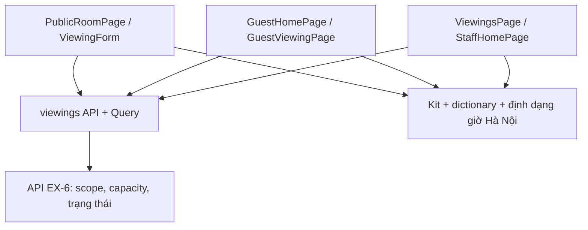

# EX-7 — Frontend viewings (FE-EX-22..27)

Ngày lập: 15/11/2026. Planner dùng model kế thừa của phiên vì Opus 5 không có trong môi trường; không thay cấu hình agent. Chỉ viết PLAN.md. Đã kiểm tra git status: các thay đổi EX-4/EX-6 thuộc công việc Phase Extra đang được chủ dự án cho phép làm liên tục và commit sau; không reset, commit hay sửa chúng trong bước lập kế hoạch.

## Mục tiêu và phạm vi

Thay form ba buổi bằng lịch tháng và giờ chính xác, nối tài khoản GUEST/TENANT, trang đặt thành công, lịch hẹn của tôi, thao tác nhân sự và Việc hôm nay. Thực hiện FE-EX-22..27 theo VIEW-01..22, AUTH-12, LOC-01..06, UI-02/03/05/07/08/09/12, KIT-01/05/06/07 và NOTI-06.

Không làm hợp đồng, inbox, claim lịch cũ, email template production hoặc quy tắc capacity phía FE. Không cài dependency, xóa file, thay schema/migration hoặc sửa .env. Sửa nội dung các file form/test cũ tại chỗ. Backend EX-6 là contract hiện hành; chủ dự án đã chốt option B cho TENANT ngày 15/11/2026, xem quyết định bên dưới. Dùng Source/frontend/CLAUDE.md vì Source/frontend/AGENTS.md không tồn tại. Đã đọc root CLAUDE.md, LESSONS, spec README/overview, spec 13/30/31/19, AUTH-12 và code public/viewings/dashboard/guest/router/API cùng các test liên quan. Không tìm được ảnh lịch có tên nhận diện trong assets; mô tả lịch ở feature/spec đủ để triển khai, không chặn vì thiếu ảnh.

## Kiến trúc

Mỗi vùng giữ server state qua TanStack Query. Calendar là UI riêng của feature, dùng token, nút thật và trạng thái chữ; không cần thêm calendar library. Public/guest lấy mọi text và validation message từ từ điển VI/EN; staff VI. Giữ BookingJumpBar, bố cục RoomDetailView và helper giờ Hà Nội sẵn có; tái dùng kit StatusBadge, RoomsButton, TextField, FormError, Spinner và mẫu confirm dialog hiện tại.

| File dưới Source/frontend/ | Thay đổi |
|---|---|
| src/features/viewings/api.ts | Contract staff, own list/detail/cancel/book, availability anonymous/account và confirm |
| src/features/viewings/time.ts (mới) | Định dạng exact/legacy, instant bắt đầu và nhóm ngày Hà Nội; không tính capacity |
| src/shared/status-labels.ts; src/shared/i18n/vi.ts; en.ts | Sáu trạng thái, text public/guest và legacy theo ngôn ngữ |
| src/features/public/api.ts | Bỏ hàm gọi POST /public/viewings; giữ các API phòng |
| src/features/public/ViewingForm.tsx; viewing-schema.ts; booking-panel.css | Calendar + giờ, note, login gate, lỗi và thành công; thay nội dung form cũ |
| src/features/public/ViewingCalendar.tsx (mới nếu cần tách) | Lịch tháng có disabled/selected, phím và nút điều hướng tháng |
| src/pages/public/PublicRoomPage.tsx; RoomDetailView.tsx; features/public/BookingJumpBar.tsx | Chỉ chỉnh wiring/anchor cần thiết, giữ cấu trúc kit và reduced motion |
| src/pages/guest/GuestHomePage.tsx; GuestViewingPage.tsx (mới); src/app/routes.tsx | Danh sách thật, detail, confirm cancel; route lich-hen/:id trong guard hiện có |
| src/features/viewings/ViewingForm.tsx; ViewingCard.tsx; schemas.ts; viewings.css | Manual exact hour, đổi giờ, PHONE/EMAIL, DONE/CANCELLED/LOST |
| src/pages/staff/ViewingsPage.tsx; StaffHomePage.tsx; src/features/dashboard/api.ts | Ngày/giờ, flags BE và overlappingViewings |
| tests/p2/fe-p2-17-viewing-form.test.mjs; ui-24-booking-panel.test.mjs; fe12-viewing-form.test.mjs; fe12-viewings-page.test.mjs; fe12-dashboard.test.mjs | Viết lại các expectation đã lỗi thời theo spec hiện tại |
| tests/ex/ex7-*.test.mjs (mới); test i18n scan hiện có; tests/auth-guards.test.mjs; tests/p2/cp1-routes.test.mjs và harness liên quan | API, giờ/lịch, guest, cache account, i18n; cập nhật import stubs khi thêm page, bỏ exemption viewing |
| docs/phase-extra-home101/feature_ex-7-frontend-viewings.md; PROGRESS.md; docs/LESSONS.md | Main session cập nhật trạng thái/bằng chứng checkpoint, chỉ thêm lesson nếu có lỗi phải làm lại |

### Contract phải giữ

Các path dưới đây tương đối với /api/v1; shared apiRequest unwrap `{data}`, apiRequestPage giữ `{data,meta:{page,limit,total}}`. Danh sách mặc định 20, tối đa 100/trang.

| Method / path | Request | Response / lỗi cần hiển thị |
|---|---|---|
| GET /public/rooms/:id/viewing-times | from,to YYYY-MM-DD; tối đa 31 ngày inclusive | ViewingDay[]; 404 NOT_FOUND, VALIDATION_FAILED |
| GET /me/rooms/:id/viewing-times | cùng range; không phone/userId | ViewingDay[]; no-store, GUEST/TENANT; FORBIDDEN/NOT_FOUND |
| POST /me/viewings | {roomId,visitAt,note?} | OwnViewingView; ROOM_NOT_AVAILABLE, VIEWING_TIME_TAKEN, CONFLICT_STATE, EMAIL_NOT_VERIFIED, 429, VALIDATION_FAILED |
| GET /me/viewings | page,limit | paginated OwnViewingView[]; chỉ user_id hiện tại |
| GET /me/viewings/:id | không body | OwnViewingView; 404 NOT_FOUND cho người khác |
| POST /me/viewings/:id/cancel | không cần body | OwnViewingView; CONFLICT_STATE tại/sau start, 404 người khác |
| GET /viewings | buildingId?,status?,from?,to?,page,limit | paginated ViewingView[]; OUT_OF_SCOPE/FORBIDDEN |
| POST /viewings | {roomId,guestName,guestPhone,visitAt,note?} | ViewingView; VALIDATION_FAILED, VIEWING_TIME_TAKEN, scope/state errors |
| PATCH /viewings/:id | {status?,outcomeNote?,visitAt?,note?} | ViewingView; CONFLICT_STATE, VIEWING_TIME_TAKEN, fields.visitAt/outcomeNote |
| POST /viewings/:id/confirm | {via:'PHONE'\|'EMAIL'} | ViewingView; CONFLICT_STATE hoặc MAIL_UNAVAILABLE; mail thất bại giữ NEW |
| GET /dashboard | buildingId? | {newViewings,overlappingViewings,pendingPrices}; mỗi viewing group có count/items |

`ViewingDay = { date: string; hours: string[] }`: hours là **ISO instant UTC** từ BE, không phải chuỗi HH:mm. Hiển thị theo Asia/Ho_Chi_Minh, gửi lại ISO đã chọn. Render toàn bộ 08:00..19:00 cho ngày đã chọn; các giờ không có trong API bị disabled. Giữ ngày ngoài phạm vi/không giờ trống trên lưới tháng nhưng disabled. Ngày 30 là ngày lịch Hà Nội, không tự chuyển thành 30*24h tính từ giờ hiện tại.

`ViewingStatus = 'NEW'|'CONFIRMED'|'DONE'|'WON'|'LOST'|'CANCELLED'`. Staff `ViewingView` giữ id, roomId, roomCode, buildingId, buildingName, guestName, guestPhone, **guestEmail:string|null**, visitAt:string|null, visitDate:string|null, timeSlot:TimeSlot|null, timeSlotLabel:string|null, note, source, status, statusLabel, handledById, outcomeNote, **overdue:boolean, overlap:boolean, roomLocked:boolean**, createdAt, updatedAt. Không dùng handledById để suy diễn bên hủy; không có confirmation metadata.

`OwnViewingView` chỉ gồm id, roomId, roomCode, buildingName, buildingAddress, visitAt, visitDate, timeSlot, note, status, contact, bossContact, createdAt. Contact là `{phone:string|null,zaloUrl:string|null,facebookUrl:string|null}|null`. Dùng contact/bossContact API trả; không lộ số đăng nhập, không suy đoán manager từ số điện thoại. Deduplicate số Boss khi fallback để không hiện hai lần.

Form staff: tên trim 2..100, phone `^0[0-9]{9}$`, note/outcomeNote tối đa 500; CANCELLED và LOST phải có outcomeNote không trắng. `via` chỉ là discriminator của request, không lưu state metadata. Xác nhận phải dùng endpoint confirm, không PATCH status CONFIRMED. Hiển thị DONE sau start cho cả NEW/CONFIRMED; LOST chỉ sau DONE; WON chưa có mutation FE.

Props dự kiến: `ViewingForm({roomId:number,roomCode?:string})`; `ViewingCalendar({days:ViewingDay[],selectedDay:string,onSelectDay:(day:string)=>void,disabled?:boolean})`; `ViewingCard({viewing:ViewingView})`. Giữ tên export cũ nơi phù hợp để giảm thay đổi wiring. Legacy dùng visitDate/timeSlot, start lần lượt 08:00/14:00/18:00 Hà Nội như BE; không chuyển legacy thành exact trừ staff đổi giờ.

Query keys availability phải tách anonymous và account id; không đưa phone vào request/key. Không để dữ liệu phiên trước hiện cho người mới khi auth đổi. Invalidations sau booking/cancel/staff mutation gồm own-list/detail liên quan, availability tất cả phòng có thể bị ảnh hưởng, staff viewings và dashboard. Không tự trả lại một chỗ trống sau cancel: BE tính lại còn phòng nào của cùng phone. TIME_TAKEN refetch và xóa lựa chọn đã mất; không tự POST lần hai.

GET /me/viewings hiện sắp createdAt desc, không phải upcoming trước. Cần một alignment nhỏ phía BE: áp dụng thứ tự upcoming NEW, upcoming CONFIRMED rồi phần còn lại **trước server pagination**, vẫn lọc user_id hiện tại và giữ nguyên envelope/page/limit. Đây là lựa chọn triển khai để đạt spec, không phải câu hỏi nghiệp vụ mới. Main session ghi nhận việc này vào phạm vi EX-6/EX-7 trước khi code; planner không sửa BE. Files liên quan: Source/backend/src/modules/viewings/viewings.service.ts và test service/HTTP hiện có. Kiểm tra bộ dữ liệu hơn một trang, trong đó lịch sắp tới được tạo sớm hơn nhiều lịch quá khứ: trang đầu phải có lịch sắp tới, meta.total đúng, không lọt lịch người khác. Sau alignment, FE hiển thị phân trang hoặc tải thêm có giới hạn, không bắt tải toàn bộ lịch sử. Không suy diễn manual ownership theo phone. Nếu chạm BE phải chạy npm run lint, npm run test và HTTP/e2e phù hợp tại Source/backend, ghi output cùng checkpoint.

DB chỉ BE dùng: viewings.user_id/guest_phone/visit_at/visit_date/time_slot/status/source/handled_by_id/outcome_note; rooms.building_id; buildings.manager_id/is_active; users.email/email_verified_at/phone/is_active và settings.default_contact. FE không truy DB, không đổi schema, không tính capacity/phân quyền.

## Câu hỏi bỏ ngỏ

**Q-EX7-01 / Q-EX6-4 — đã chốt B (15/11/2026):** TENANT bắt buộc có email, không cần xác minh để đặt lịch. Thiếu email thì trả VALIDATION_FAILED / fields.email và dẫn tới /toi/tai-khoan để bổ sung. GUEST vẫn phải xác minh email. Resend gửi email, không dùng SMS. Sửa điều kiện book() và test, không thêm luồng xác minh tenant hoặc migration.

`[ASSUMPTION]` kế thừa: A-03 quota 3 WEB/account/ngày; A-13 overdue NEW không tự đổi; A-14 thay người phụ trách giữ lịch và đánh dấu conflict thật. Không thêm giả định nghiệp vụ mới.

## Checkpoints

Chia hai checkpoint đúng các điểm dừng FE-EX-24 và FE-EX-27; theo chỉ đạo phiên hiện tại có thể triển khai liên tục và chủ dự án commit sau. Trong từng checkpoint làm task theo thứ tự. Không báo manual pass khi chưa chạy. Main session cập nhật PROGRESS/feature và báo file, output thật, manual, assumptions, commit gợi ý. Reviewer chạy một lần trước báo cáo cuối của nhóm lớn/rủi ro quyền; sửa blocking findings hoặc nêu rõ phần chưa sửa.

### CP-1 — FE-EX-22..24: API, lịch đặt và thành công

Files: API/labels/time/dictionaries, public form/schema/calendar/CSS/wiring, test API/calendar và hai test public cũ; scan i18n bỏ exemption. Không xóa file.

Done when (Source/frontend): `node --test tests/p2/fe-p2-17-viewing-form.test.mjs tests/p2/ui-24-booking-panel.test.mjs` và test ex7 mới tương ứng đều pass; `npm run lint`, `npm run build`, `npm run test:components` exit 0. Manual dev server: đăng nhập/đăng ký trở về cùng phòng, đặt thành công hiện room/time/contact/link; quan sát log mailer BE gửi tới người phụ trách. Tenant case chỉ pass sau Q-EX7-01 được giải quyết.

Kịch bản test:

- VIEW-10/UI-02: đủ sáu nhãn chuẩn, NEW Chờ xác nhận, DONE Đã xem; text + màu; không NO_SHOW.
- VIEW-01/21: anonymous chỉ GET public, gate next=/phong/:id; GUEST/TENANT GET me, không gửi phone; MANAGER/BOSS không được book như guest; auth đổi không tái dùng availability của account trước.
- VIEW-08: hôm nay, day30, day31, tháng/năm mới, ngày không giờ, 08:00/19:00, 07:00/20:00/10:30, giờ đã bắt đầu; API ISO hiển thị đúng Hà Nội cả khi máy có timezone khác. Legacy vẫn giữ nhãn cũ.
- VIEW-16/21: fixtures 1/2 guest còn giờ, 3 guest anonymous disabled; account cùng phone đã có WEB hoặc MANUAL vẫn chọn được khi đầy; khác tòa bị loại. FE thể hiện API, không đếm lại.
- VIEW-01/02/02a/UI-05: lỗi ROOM_NOT_AVAILABLE, 429, duplicate CONFLICT_STATE, fields.visitAt/note; note 500 được, 501 lỗi; double-submit chỉ một request; lỗi không biến thành success.
- VIEW-21: TIME_TAKEN reload giờ và buộc chọn lại nếu giờ mất; không POST /public/viewings hoặc payload honeypot/name/phone.
- VIEW-14: manager + Boss; không manager chỉ Boss; contact null không sinh số giả; success đúng câu spec, đúng ID detail.
- LOC/UI/KIT: switch VI/EN không mất note, toàn bộ form/validation/legacy text dùng dictionary; keyboard, touch, 360px và reduced motion.

Commit gợi ý: `feat(viewings): add account calendar booking (FE-EX-22..24, VIEW-01/08/14/21)`.

### CP-2 — FE-EX-25..27: guest, staff, dashboard và kiểm chứng tích hợp

Files: guest home/detail/route, staff cards/forms/schema/list/dashboard API+page/CSS, dictionary bổ sung, tests guest/fe12/route/harness và docs progress.

Done when (Source/frontend): `node --test tests/p2/fe12-viewings-page.test.mjs tests/p2/fe12-viewing-form.test.mjs tests/p2/fe12-dashboard.test.mjs` và test ex7 guest/API pass; `npm run lint`, `npm run build`, `npm run test:components` exit 0. Báo output thật, không lấy số test cũ trong docs. Manual đa tài khoản với mailer dev log theo FE-EX-27; nếu môi trường thiếu account/data, ghi chưa kiểm và bước chủ dự án cần thực hiện.

Kịch bản test:

- VIEW-20/UI-03: own list loading/empty+Tìm phòng/error+retry/data; upcoming NEW rồi CONFIRMED, past sau; kiểm tra phân trang theo thứ tự server đã alignment, không cần tải toàn bộ lịch sử. BE test bảo đảm upcoming xuất hiện trang đầu dù createdAt cũ hơn nhiều lịch past. Detail 404 người khác; manual cùng phone không xuất hiện.
- VIEW-18: cancel phải confirm; đóng dialog không POST; trước start một phút được, tại start không có nút, stale state bị BE từ chối; cancel refetch list/detail/availability, không giả định giải phóng capacity sau một phòng.
- VIEW-03/08/09: manual exact hour, room active không public vẫn chọn được trong scope; room scope khác trả lỗi; đổi giờ theo phone agreement, TIME_TAKEN giữ form và báo lỗi; legacy sang exact chỉ khi staff lưu đổi giờ.
- VIEW-04/15/15a: PHONE/EMAIL dùng đúng endpoint/body, thiếu owner email không cho EMAIL; mail lỗi giữ NEW; cả hai confirm sau start được. NEW/CONFIRMED trước start không DONE, sau start DONE trực tiếp; CANCELLED cần note; DONE→LOST cần note; không NEW/CONFIRMED→LOST, không PATCH WON, không metadata/no-show.
- VIEW-07/17/22/NOTI-06: render overdue/overlap BE trả, overlappingViewings kể cả CONFIRMED; nhóm hợp lệ cùng tòa <=3 guest không báo conflict; Boss dashboard theo trách nhiệm, trang lịch Boss toàn tòa; manager chỉ scope BE.
- VIEW-16/18/21 manual: guest 1/2 giữ giờ available, guest 3 làm đầy, guest 4 bị từ chối; cùng guest thêm phòng không tăng chỗ; WEB/MANUAL cùng phone tính một; guest/người phụ trách không chiếm hai tòa; đóng phòng cuối mới giải phóng chỗ tương ứng.
- UI-07/08/09/LOC: 360px, keyboard/focus dialog, pending chặn double-submit, invalidation sau mutation, guest VI/EN và staff chỉ VI.

Commit gợi ý: `feat(viewings): add owner pages and staff outcomes (FE-EX-25..27, VIEW-04/15/18/20/22, NOTI-06)`.
