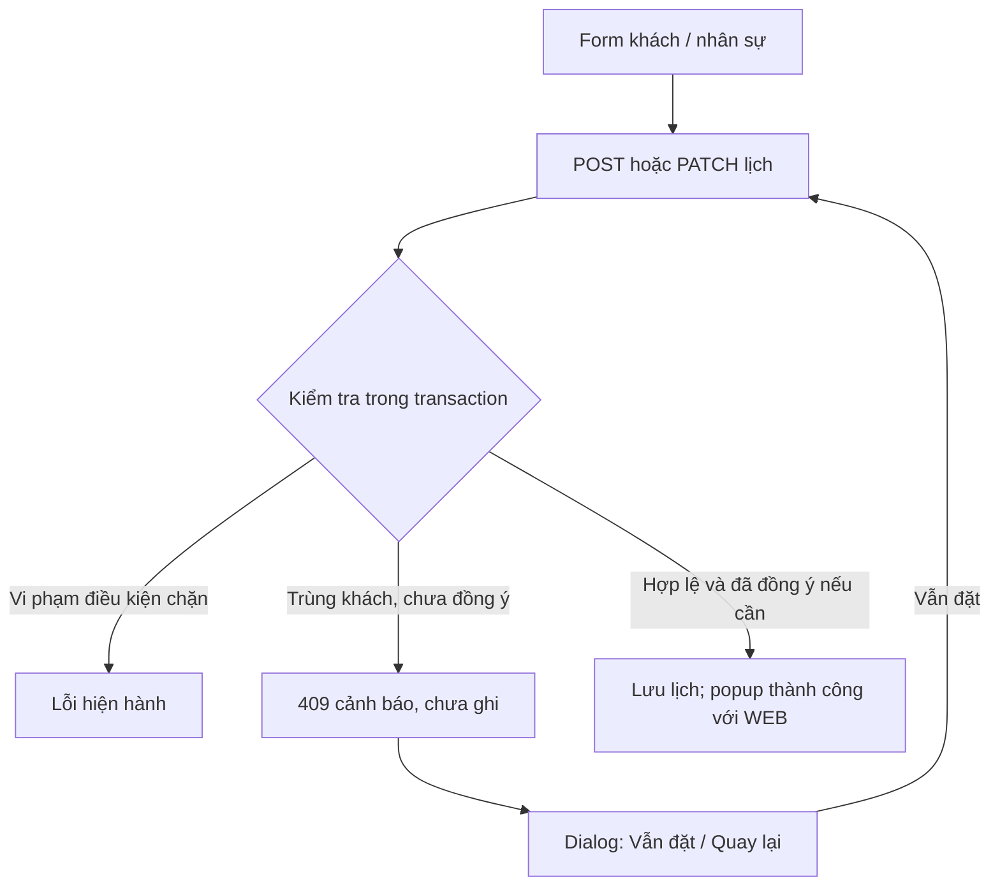

# FE-EX-27 — Cảnh báo lịch hai tòa và popup thành công

> **For agentic workers:** Main session triển khai theo `superpowers:executing-plans`; planner chỉ viết file này. Không commit. Chủ dự án đã chọn phương án B ngày 16/11/2026; không hỏi lại lựa chọn đó.

**Goal:** Cho cùng khách đặt hai tòa cùng giờ sau cảnh báo và thao tác tiếp tục rõ ràng, đồng thời hiển thị popup khi đặt thành công.

**Architecture:** Backend phân biệt điều kiện chặn với cảnh báo có thể tiếp tục, kiểm tra trong transaction hiện có. Frontend hiển thị cảnh báo do backend trả và chỉ gửi lại chính yêu cầu đó với `acceptOverlap: true` khi người dùng xác nhận; không tính capacity hoặc quyền ở frontend. Dùng dialog, từ điển và query invalidation hiện có.

**Tech Stack:** NestJS 12, Prisma 6, React 19, TanStack Query, react-hook-form, zod, Rooms UI kit; không thêm dependency.

**Spec:** `docs/spec/13-viewings.md`, `30-frontend.md`, `31-ui-kit.md`; Q-EX7-03 phương án B và phần Manual feedback trong `docs/phase-extra-home101/feature_ex-7-frontend-viewings.md`. Main session cập nhật spec trước test/code để phản ánh quyết định mới. Phạm vi task: BE-EX-19/20/21/23/24, FE-EX-23/24/26/27.

Ngày lập: 16/11/2026. Model planner kế thừa của phiên vì Opus 5 không có trong môi trường; không sửa cấu hình agent. `git status` chỉ có tài liệu QA đang làm cùng task, giữ nguyên. Đã đọc DTO/service/capacity/reservation, filter lỗi/i18n, public/staff form, kit dialog và test harness hiện có; app hướng dẫn nằm ở `CLAUDE.md`.

## Mục tiêu và phạm vi

- VIEW-02a/16/21/22: cùng stored phone, cùng giờ chính xác nhưng khác tòa trở thành cảnh báo; được tiếp tục sau xác nhận, áp dụng cả WEB, MANUAL và đổi giờ của nhân sự.
- VIEW-07/16: người phụ trách vẫn không giữ lịch mở ở hai tòa cùng giờ. Một tòa/giờ tối đa 3 số điện thoại khác nhau. Cùng phone thêm phòng trong một tòa không cần cảnh báo mới.
- VIEW-02/02a: vẫn tối đa 3 lượt tạo WEB/account/ngày Hà Nội và một lịch NEW/CONFIRMED/account/phòng.
- VIEW-14: popup chỉ mở sau khi server trả thành công, lịch vẫn NEW; đóng popup vẫn còn kết quả inline và link lịch hẹn.
- Không sửa auth: Q-EX7-02 chưa được trả lời. Không áp migration/seed, sửa `.env`, đổi hai Vitest config, chạy HTTP/e2e, cài dependency, xóa file hoặc commit.

## Kiến trúc và hợp đồng

### API chính xác

Không thêm route hoặc schema DB. Các response thành công giữ nguyên shape.

| Route | Thay đổi request | Kết quả |
|---|---|---|
| `POST /me/viewings` | Thêm `acceptOverlap?: boolean` vào `BookViewingDto` | Lịch của owner như cũ, hoặc cảnh báo dưới đây |
| `POST /viewings` | `CreateViewingDto` kế thừa cùng field | MANUAL vẫn không owner/email |
| `PATCH /viewings/:id` | Thêm `acceptOverlap?: boolean` vào `UpdateViewingDto` | Cảnh báo khi đổi giờ tạo xung đột khách; không cảnh báo trên thao tác chỉ hủy/xác nhận/đổi kết quả |
| Hai route `GET .../viewing-times` | Không đổi input/output `{date,hours}[]` | Giờ có xung đột khách vẫn chọn được nếu qua capacity và người phụ trách; không thêm dữ liệu lịch/phone/quận vào response |

`acceptOverlap` chỉ nhận boolean thật hoặc bị bỏ qua khi absent; `null`, chuỗi `"true"`, số, array/object → VALIDATION_FAILED. Giá trị `false` hoặc absent chưa phải đồng ý. Giá trị true không bỏ qua scope, quyền, state, phòng public, thời gian, capacity, người phụ trách, quota hay duplicate room.

Thêm một error code `VIEWING_OVERLAP_WARNING` (409) vào error enum/map, spec API và EN map. Dùng nguyên envelope hiện có:

`{ error: { code: 'VIEWING_OVERLAP_WARNING', message: string, fields: { visitAt: string } } }`.

Thông báo chung: `Khách đã có lịch xem ở tòa khác vào cùng giờ` / `The guest already has a viewing at another building at this time`

`fields.visitAt` chọn một trong hai câu cố định, được dịch qua `FIELDS_EN`:

- Cùng quận: `Khách đã có lịch xem ở tòa khác vào cùng giờ. Bạn có muốn tiếp tục?`
- Có ít nhất một tòa ở quận khác: `Khách đã có lịch xem ở tòa thuộc quận khác vào cùng giờ. Vui lòng cân nhắc thời gian di chuyển trước khi tiếp tục.`

Không đưa tên/id tòa hay lịch, địa chỉ, số điện thoại hoặc nội dung MANUAL/người khác vào cảnh báo. Không khẳng định khoảng cách thực tế. So sánh trường `buildings.district` đã lưu (trim/case-fold cho khác biệt nhập liệu), không gọi bản đồ/geocoding. Dữ liệu quận chỉ dùng nội bộ backend.

### Backend

- `canBookViewing(holds, candidate): boolean` chỉ quyết định hard capacity và responsible-person; loại nhánh chặn theo phone khác tòa. `viewingOverlapIds(...)` không coi guest overlap đã được cho phép là lỗi "Trùng giờ"; giữ flag thật khi quá capacity hoặc người phụ trách trùng tòa.
- Thêm `district` trong `ViewingHold` và query/select/map của `viewingHolds`; giữ ngoài các response public/owner/staff hiện có. Candidate lấy quận từ `ReservationRoom.building.district` đã có.
- `reserveViewingHour(tx, room, phone, at, excludeId?, acceptOverlap?: boolean): Promise<void>` tiếp tục khóa phone/responsible/building rồi đọc hold trong cùng transaction. Trước hết từ chối hard conflict bằng VIEWING_TIME_TAKEN; sau đó tìm NEW/CONFIRMED khác tòa, cùng phone/exact instant, loại edited row, và throw cảnh báo nếu chưa accept. Legacy/closed/different-hour không cảnh báo. Nếu true, tiếp tục các kiểm tra và ghi như cũ.
- Ba caller `book/create/update` truyền acknowledgement. Không persist flag; không thêm confirmation metadata. Lượt cảnh báo không insert/update, không gửi email, không tăng quota. Retry true kiểm lại toàn bộ, kể cả đổi state/giờ/quota trong thời gian dialog mở.
- Giữ advisory lock theo phone để hai lần đặt đồng thời của một phone được tuần tự hóa: lần chưa đồng ý thứ hai thấy lịch đã lưu và nhận cảnh báo. Không tuyên bố đã kiểm concurrency PostgreSQL trong phiên này; chỉ cập nhật kịch bản e2e để owner chạy sau.

### Frontend

- `features/viewings/api.ts`: thêm optional `acceptOverlap` cho book/create/update và whitelist field này vào payload; absent không bị gửi thành false/true mặc định.
- Tại public `ViewingForm`, MANUAL `ViewingForm` và `ReschedulePanel`: bắt code cảnh báo riêng trước `applyApiError`, lưu snapshot payload gây cảnh báo cùng text, mở kit `ConfirmDialog`. Quay lại/đóng không gọi mutation. **Vẫn đặt** (public/manual) hoặc **Vẫn đổi giờ** (reschedule) gửi snapshot đó + true, không tự retry. Mỗi lần edit chọn room/hour/account mới phải bỏ acknowledgement cũ. Khóa các field bên dưới khi dialog mở hoặc đóng dialog khi payload thay đổi; không cho chấp thuận nhầm một payload khác.
- Pending dùng guard chống click đôi; Escape/đóng không hủy một request đã gửi. Lỗi hard conflict sau confirm hiện lỗi thật, giữ nội dung nhập và cập nhật availability theo handling hiện có. Không hiển thị success khi chỉ nhận warning.
- WEB success dùng dialog title `Đặt lịch thành công`, lời nhắc `Yêu cầu đang chờ xác nhận. Quản lý tòa sẽ liên hệ với bạn.`, room/time và public contacts từ response. Nút `Xem lịch hẹn` đi đúng created id; `Đóng` trở về kết quả inline còn nguyên. Với Boss fallback, text nên dùng người phụ trách/liên hệ Rooms nếu response chỉ có Boss để không hứa một quản lý không tồn tại; giữ số Boss đúng response.
- Public/guest có VI/EN, staff luôn VI. Reuse kit `ConfirmDialog`; nếu description chứa links, focus trap phải bao quát links/buttons chứ không chỉ buttons. Đóng success phải đưa focus tới kết quả inline vì nút submit cũ đã unmount; 360 px không tràn, không phụ thuộc animation.

### File map

| File | Trách nhiệm |
|---|---|
| `docs/spec/13-viewings.md`, `01-architecture.md` | Quyết định B, popup, error contract và acceptance mới; giữ các ID |
| `Source/backend/src/modules/viewings/viewing-capacity.ts`, `viewing-reservations.ts`, `viewings.service.ts`, `dto/viewings.dto.ts` | Tách hard checks/cảnh báo, acknowledgement xuyên transaction |
| `Source/backend/src/common/errors/error-code.ts`, `common/i18n/messages.ts` | Code/status và VI/EN, field translation |
| `Source/backend/test/fixtures/viewing-prisma.ts` | District trong dữ liệu/select giả lập thực; không mock service dưới test |
| Backend `viewing-capacity.spec.ts`, `viewing-overlap.spec.ts`, `viewings.service.spec.ts`, `viewings.service.cp4.spec.ts`, `viewings.validation.spec.ts`, filter/i18n specs | Biên/cảnh báo/side effects/quyền/dịch lỗi |
| `Source/backend/src/app.setup.spec.ts`, `test/viewings.e2e-spec.ts` và HTTP specs bị ảnh hưởng | Sửa snapshot error count 30→31 và kỳ vọng cũ; **chỉ sửa source, không chạy các test HTTP/e2e** |
| `Source/frontend/src/features/viewings/api.ts`, `public/ViewingForm.tsx`, `viewings/ViewingForm.tsx`, `viewings/ViewingCard.tsx` | Payload retry có xác nhận, success, staff reschedule |
| `Source/frontend/src/shared/i18n/{vi,en}.ts`, `src/components/ConfirmDialog.tsx` nếu cần, CSS kit/booking trong phạm vi cần thiết | Nội dung, keyboard/focus, mobile; không design system mới |
| FE `tests/p2/fe-p2-17-viewing-form.test.mjs`, `ui-24-booking-panel.test.mjs`, `fe12-viewing-form.test.mjs`, `fe12-viewings-page.test.mjs`, `tests/ex/ex7-api.test.mjs` và dialog/harness liên quan | Đồng bộ test main; thêm test hành vi warning/confirm/cancel/success |
| `docs/phase-extra-home101/feature_ex-6-backend-viewings.md`, `feature_ex-7-frontend-viewings.md`, `FE-EX-27-MANUAL-CHECKLIST.md`, `PROGRESS.md` | Ghi quyết định, sửa kỳ vọng manual X2, mở lại phần verification của code mới, checkpoint |

## Câu hỏi bỏ ngỏ

Không còn câu hỏi nghiệp vụ cho mục 3: owner chọn B. Q-EX7-02 về khoảng trắng ở SĐT/mật khẩu còn mở nhưng không chặn nhóm booking này; không sửa auth. A-03/A-13/A-14 kế thừa, A-14 cập nhật theo định nghĩa conflict mới. Không thêm giả định về khoảng cách, thời gian di chuyển hoặc tự xác nhận lịch.

## CP-1 — Nhóm feedback booking hoàn chỉnh

Một checkpoint cho nhóm owner đã chọn: backend + frontend + docs. Main session tự viết code/test, sau đó chạy reviewer độc lập một lần và sửa lỗi chặn trước khi báo. Không dừng giữa backend và frontend với contract chưa khớp.

- [x] Cập nhật spec và đánh dấu task đang làm; ghi Q-EX7-03 đã chọn B, không đóng Q-EX7-02.
- [x] Viết/rerun các ca đỏ **offline**: VIEW-16 khác-manager + same-phone nhận warning trước insert/email; true cho phép; cùng-manager hoặc guest thứ tư vẫn hard failure với true; same-building extra room không warning; reschedule exclude chính nó; stale retry/quota/state vẫn lỗi; DTO từ chối null/string; không leak metadata; guest overlap không tạo dashboard hard flag.
- [x] Sửa backend nhỏ nhất, cập nhật fixture; kiểm warning same/different district, MANUAL/WEB cả hai chiều, closed/legacy/different-hour và lỗi không tạo mail/quota. Hai requests chưa accept có kết quả lưu+cảnh báo trong e2e source mới; không chạy e2e.
- [x] Viết ca đỏ FE: first warning không success; Quay lại không request thứ hai; Vẫn đặt gửi đúng snapshot + true; click đôi một retry; thay payload không dùng acknowledgement cũ; retry hard error không success; manual/reschedule tương tự; popup success có đúng room/time/link/contacts, đóng vẫn giữ kết quả và focus; VI/EN.
- [x] Sửa FE bằng kit, bổ sung harness chỉ khi component thật cần API DOM tương ứng; giữ bộ test cũ có ý nghĩa.
- [x] Chạy BE `npm run lint`, `npm run build` và Vitest **danh sách file offline cụ thể**, ví dụ `npx vitest run src/modules/viewings/viewing-capacity.spec.ts src/modules/viewings/viewing-overlap.spec.ts src/modules/viewings/viewings.service.spec.ts src/modules/viewings/viewings.service.cp4.spec.ts src/modules/viewings/viewings.validation.spec.ts src/common/errors/all-exceptions.filter.spec.ts`; Chỉ kiểm danh mục i18n qua script parse source offline; không chạy file i18n.spec.ts có lẫn HTTP. Không dùng `npm run test` toàn bộ vì có HTTP. Giữ nguyên `MAIL_PROVIDER: ''` cả hai config. Ghi output thực, không suy ra full backend/e2e pass.
- [x] Chạy FE test file liên quan, `npm run lint`, `npm run build`, `npm run test:components`. Nếu có lỗi, sửa nguyên nhân rồi chỉ lặp phần có căn cứ.
- [x] Reviewer đọc diff/spec, không đọc PLAN; main session lưu report theo quy trình. Chốt `git diff --check`, docs task/checklist/PROGRESS; không tự commit.
- [x] Chuẩn bị checklist bàn giao owner; các ca trình duyệt vẫn CHƯA KIỂM: hai tòa khác người phụ trách, warning đúng hai loại quận, Quay lại giữ form, Vẫn đặt mới có success; đồng quản lý/đầy tòa vẫn không cho override; thử staff manual/đổi giờ; ghi rõ các ca chưa có fixture hoặc chưa chạy.

**Done when:** mọi check đã chạy có output thật và lỗi chặn đã giải quyết; đồng bộ source test HTTP/e2e nhưng ghi chưa chạy. Backend 1806/1806 và e2e 54/54 của 16/11 là bằng chứng cho luật cũ, không phải chứng cứ cho phần sửa này. FE-EX-27 chưa Done đến khi owner hoàn thành manual và xử lý phản hồi auth còn mở.

Commit gợi ý: `feat(viewings): acknowledge cross-building overlaps and show booking success (BE-EX-19/23, FE-EX-24/27, VIEW-14/16/21/22)`.

## Kết quả triển khai 16/11/2026

Source và tài liệu đã triển khai, reviewer DUYỆT sau sửa hai finding về stacking context và focus. Kết quả kiểm tra, sai sót chọn nhầm file i18n có hai ca HTTP EACCES và hướng dẫn owner: [checkpoint](../../CHECKPOINT-2026-11-16-booking-feedback.md). Bản copy API/UI trong spec 13 là chính thức. Không commit; manual và host integration cho luật mới vẫn chờ.
