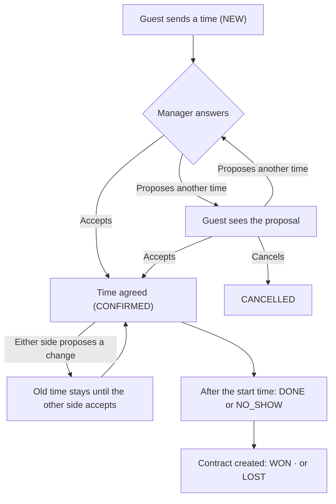

# 13 · Viewings (lịch hẹn xem phòng)

Module: `viewings`. Tables: `viewings`, `viewing_proposals`, `viewing_events` (the last two and the new `viewings` columns are planned, [02-database.md](02-database.md#planned-changes)).

> Changed 12/11/2026 (owner, Home101 brief, D-28..D-31). Phase 2 built the old rules: a public form without an account, three slots a day, staff editing the date directly. The code follows this file after Phase Extra parts EX-6..EX-8. Rule numbers VIEW-01..13 are kept; VIEW-14..23 are new. The old text is in git history before 12/11/2026.

## Flow

## Rules

- **VIEW-01** Booking needs an account with a verified phone (D-28). A GUEST or TENANT sends `POST /me/viewings { roomId, visitAt, note }`; name and phone are copied from the account. Room MUST be public (ROOM-05), else `ROOM_NOT_AVAILABLE`; the time follows VIEW-08. Phone not verified → `PHONE_NOT_VERIFIED`. Not logged in: the room page shows the booking panel with "Đăng nhập để đặt lịch" and returns to the same room after login or sign-up. Browsing rooms needs no login.
- **VIEW-02** Limit [ASSUMPTION A-03]: 3 bookings per account per day (Asia/Ho_Chi_Minh) → 429. Count and insert run in one transaction under `pg_advisory_xact_lock` on the user, counting `source = WEB` viewings of that user created today. The honeypot, the per-IP limit and the per-phone limit of the old public form are removed together with `POST /public/viewings`; sign-up and SMS codes have their own limits (AUTH-13).
- **VIEW-03** Staff MAY add a viewing manually for guests who called or messaged (`source = MANUAL`, `{ roomId, guestName, guestPhone, visitAt, note }`). The room must be active and in scope but need not be public (a guest may ask about a room that becomes free soon); the time follows VIEW-08. It has no owner account until the guest claims it (VIEW-21).
- **VIEW-04** Status flow: `NEW` → `CONFIRMED` → `DONE` → `WON` | `LOST`; `CONFIRMED` → `NO_SHOW` | `LOST`; `NEW`/`CONFIRMED` → `CANCELLED`. `DONE` ("the viewing took place") and `NO_SHOW` are set by staff only, and only after the start time (D-30); `NO_SHOW` has no penalty. `DONE` is not a rental: `WON` is set **only** by contract creation (VIEW-05, Phase 3); `PATCH /viewings` cannot set it. Every staff change records `handled_by_id`; LOST needs `outcome_note`. Other moves → `CONFLICT_STATE` (conditional update on the current status).
- **VIEW-05** "Chốt" on a CONFIRMED or DONE viewing opens contract creation prefilled (room, guest name, phone, and the guest's account when the viewing has one, CON-07). Creating the contract sets the viewing `WON` and `contract_id`.
- **VIEW-06** When a HOLD contract is created for a room, all other NEW/CONFIRMED viewings of that room become `CANCELLED` with note "Phòng đã có người đặt cọc" and their pending proposals expire. Guests with an account are notified (NOTI-08); the manager gets a task to call the others.
- **VIEW-07** The person responsible for a viewing is the building's manager, or Boss if the building has no active manager (SCOPE-04). That person conducts the viewing; no other staff are assigned (D-31). A manager who is busy at the requested time proposes another time (VIEW-14). "Việc hôm nay": a manager counts the viewings of their buildings that wait for staff (NEW, or a pending proposal from the guest); Boss counts those of buildings without an active manager. Boss's "Lịch hẹn" page still shows every building.
- **VIEW-08** Time (D-29): `visitAt` is the exact start; a viewing lasts 30 minutes. It must be in the future and at most 30 days ahead (Asia/Ho_Chi_Minh), else `VALIDATION_FAILED` with `fields.visitAt`. Start times are 8:00 to 19:30 every day, on the hour or the half hour (owner 12/11/2026, Q-12); any other time → the same error. There are no days off to enter: a manager who cannot come proposes another time (VIEW-07). With the 15-minute buffer of VIEW-16, a confirmed 10:00 viewing blocks 9:30 and 10:30 for the same person. Viewings made before the change keep `visit_date` + `time_slot` and are shown with the old labels "Sáng (8:00–11:00)", "Chiều (14:00–17:00)", "Tối (18:00–20:00)"; they get an exact time only when a new time is agreed.
- **VIEW-09** Staff no longer overwrite the time. A time changes only by an accepted proposal (VIEW-14, VIEW-15), also when staff record the guest's answer given by phone (VIEW-19). Allowed only while NEW or CONFIRMED.
- **VIEW-10** Labels (UI-02): NEW "Mới", CONFIRMED "Đã xác nhận", DONE "Đã xem", NO_SHOW "Khách không đến", WON "Đã chốt", LOST "Không thành", CANCELLED "Đã hủy". The guest also sees whose turn it is: "Chờ quản lý phản hồi" / "Chờ bạn phản hồi".
- **VIEW-11** Replaced 12/11/2026 by VIEW-02 (the per-phone and per-IP limits belonged to the removed public form).
- **VIEW-12** Removed 12/11/2026: `POST /me/viewings` returns the created viewing with its id to its owner.
- **VIEW-13** When a room stops being public by maintenance or lock, or its building is locked, NEW/CONFIRMED viewings and their pending proposals are **not** cancelled; staff see "Còn N lịch hẹn chưa xử lý" before confirming, contact the guests and change the status themselves (owner 01/11/2026). A locked building has no manager (BLD-06), so its viewings go to Boss (VIEW-07).
- **VIEW-14** Time proposals (D-30). On a NEW or CONFIRMED viewing either side may propose another time: the guest with `POST /me/viewings/:id/proposals { visitAt, note }`, staff with `POST /viewings/:id/proposals`. A viewing has at most one PENDING proposal. A proposal from the other side answers the pending one (it becomes REJECTED); a new one from the same side replaces it (WITHDRAWN). A proposal never changes the time in effect: a CONFIRMED viewing keeps its time and status until the proposal is accepted.
- **VIEW-15** Answering. The other side accepts → the viewing's time becomes the proposed time, status CONFIRMED, proposal ACCEPTED. Rejects → proposal REJECTED, the viewing is unchanged. Staff "Xác nhận" on a NEW viewing accepts the time the guest asked for. Accepting checks VIEW-08 and VIEW-16 again in the same transaction, with a conditional update on the proposal being PENDING: a button pressed on an old message after a newer proposal exists returns `CONFLICT_STATE` and changes nothing.
- **VIEW-16** No double booking (D-29): confirming or accepting checks that the person responsible (VIEW-07) has no other CONFIRMED viewing whose 30 minutes, plus 15 minutes of travel before and after, overlap the new one → `VIEWING_TIME_TAKEN`. The check and the update run under `pg_advisory_xact_lock` on that user. NEW requests do not block a time. A viewing is never reported as confirmed when this check fails.
- **VIEW-17** Expiry (D-30). A PENDING proposal expires at the proposed time, or at the time in effect of a CONFIRMED viewing, whichever is earlier; answering it afterwards → `PROPOSAL_EXPIRED`. Silence is never agreement. [ASSUMPTION A-13] A NEW viewing whose requested time has passed stays NEW and is marked "Quá giờ, chưa xác nhận" for staff, who propose a new time or close it.
- **VIEW-18** Cancelling (D-30). The guest cancels their own NEW or CONFIRMED viewing at any moment before the start time, effective at once, no approval: `POST /me/viewings/:id/cancel`. After the start time the guest cannot cancel. Staff cancel as before, with a note. The viewing records which side cancelled.
- **VIEW-19** By phone (D-30). Staff may record what the guest said on the phone: accept, reject, a new time, or cancel. Such an action has source `PHONE` and needs a note; the guest sees it in the history as "Ghi nhận qua điện thoại".
- **VIEW-20** The guest's own viewings: `GET /me/viewings` and `/me/viewings/:id` return room and building, the time in effect, the pending proposal, whose turn it is, the status, the public contact of the person responsible (BLD-04; never a login phone) and the history the guest may see (VIEW-22). Another user's id → 404 (SCOPE-03). There is no lookup by phone number.
- **VIEW-21** Claiming (D-28). Viewings without an owner account whose `guest_phone` equals the account's **verified** phone are listed at `GET /me/viewings/claimable`. They are linked only when the user confirms: `POST /me/viewings/claim { ids }`. Nothing is linked automatically at sign-up, and typing a phone number is never enough (AUTH-14).
- **VIEW-22** History. Every creation, proposal, answer, status change and cancel writes one `viewing_events` row: who (guest, staff user, system), when, what changed (old → new), source (`WEB`, `PHONE`, `SYSTEM`) and note. Staff see everything; the guest sees the same events without internal notes (`outcome_note`) and without staff ids.
- **VIEW-23** [ASSUMPTION A-14] When the person responsible for a building changes (manager reassigned, deactivated, building locked), open viewings stay as they are and follow the building (VIEW-07). Confirmed viewings that now overlap for the new person are marked "Trùng giờ"; that person rearranges them with proposals.

## API

| Method | Path | Who |
|---|---|---|
| GET | `/public/rooms/:id/viewing-times?date=` | public – start times of that day that can still be requested (VIEW-08, VIEW-16); no personal data |
| GET/POST | `/me/viewings` | guest, tenant – own list; book (VIEW-01) |
| GET | `/me/viewings/:id` | owner (VIEW-20) |
| POST | `/me/viewings/:id/proposals` | owner – propose a time (VIEW-14) |
| POST | `/me/viewings/:id/proposals/:pid/accept` · `/reject` | owner (VIEW-15) |
| POST | `/me/viewings/:id/cancel` | owner (VIEW-18) |
| GET/POST | `/me/viewings/claimable` · `/me/viewings/claim` | guest, tenant (VIEW-21) |
| GET | `/viewings?buildingId&status&from&to` | staff |
| POST | `/viewings` | staff (manual) |
| PATCH | `/viewings/:id` | staff – status, note (VIEW-04); not the time (VIEW-09) |
| POST | `/viewings/:id/proposals` · `/proposals/:pid/accept` · `/reject` | staff; with `source: PHONE` + note when recording the guest's answer (VIEW-19) |

Removed: `POST /public/viewings`.

## Acceptance

- [ ] Booking for a non-public room returns `ROOM_NOT_AVAILABLE`; booking without login is refused; booking with an unverified phone returns `PHONE_NOT_VERIFIED` (VIEW-01).
- [ ] The 4th booking of one account in a day returns 429; two parallel bookings of an account that already has 2 today save only one (VIEW-02).
- [ ] Creating a HOLD contract from viewing A cancels viewing B of the same room and expires B's pending proposal (VIEW-06).
- [ ] A start time in the past, more than 30 days ahead, at 7:30, at 20:00 or at 10:15 is rejected with `fields.visitAt`; 8:00 and 19:30 are accepted (VIEW-08).
- [ ] `PATCH /viewings/:id` with `status: WON` returns `CONFLICT_STATE`; NEW → LOST also does; DONE before the start time also does (VIEW-04).
- [ ] The manager proposes 15:00 for a viewing confirmed at 10:00: the guest still sees 10:00 confirmed until they accept (VIEW-14).
- [ ] The guest accepts an old proposal after the manager sent a newer one → `CONFLICT_STATE`, time unchanged (VIEW-15).
- [ ] Two guests accept 10:00 and 10:30 of the same manager at the same moment: one gets `VIEWING_TIME_TAKEN` (VIEW-16).
- [ ] A proposal for 15:00 on a viewing confirmed at 10:00 cannot be accepted at 10:01 → `PROPOSAL_EXPIRED` (VIEW-17).
- [ ] The guest cancels one minute before the start: CANCELLED at once; one minute after: refused (VIEW-18).
- [ ] An answer recorded by staff without a note is refused; with a note the guest sees "Ghi nhận qua điện thoại" (VIEW-19).
- [ ] Guest X gets 404 for guest Y's viewing; no `/public/*` response contains a viewing (VIEW-20, PUB-05).
- [ ] A viewing entered by staff for phone P is not in the list of a new account with phone P until P is verified and the user confirms the claim (VIEW-21).
- [ ] A viewing made before the change still shows "Chiều (14:00–17:00)" and can be confirmed, cancelled or given an exact time by proposal (VIEW-08).
