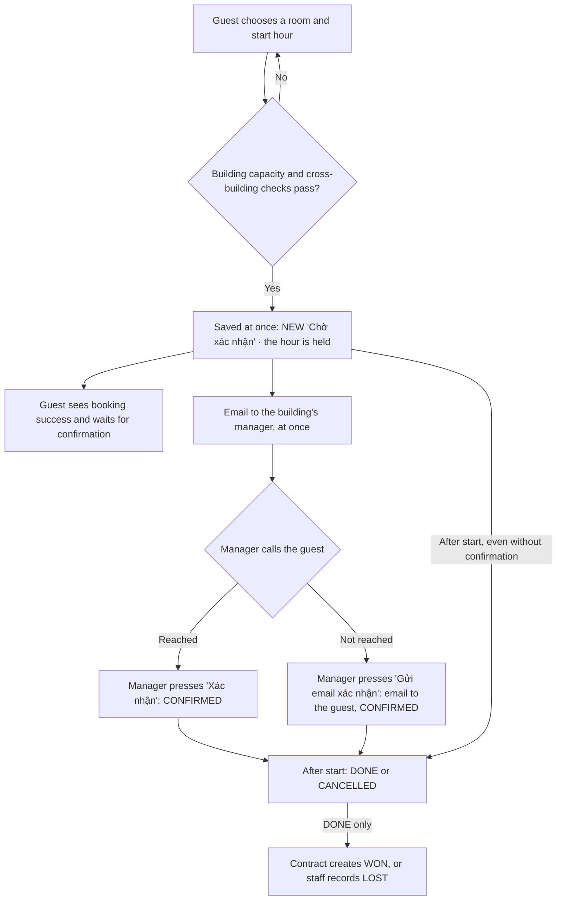

# 13 · Viewings (lịch hẹn xem phòng)

Module: `viewings`. Table: `viewings` (new columns planned, [02-database.md](02-database.md#planned-changes)).

> Changed 12/11/2026; revised by the owner on 14/11/2026 before applying viewing_hours: simplified status/metadata, capacity per building, and multiple rooms per guest. Follow-up clarification on 15/11/2026: count the same phone once across WEB/MANUAL; overdue NEW may become DONE directly. Phase 2 still uses the old public form until EX-6/EX-7 are implemented together.

## Flow

## Rules

- **VIEW-01** Booking requires an email address. A GUEST must have verified that email; a TENANT may book without email verification (owner option B, 15/11/2026; AUTH-12, D-28). A TENANT without email receives VALIDATION_FAILED with fields.email and must add an email via the account page before booking. A GUEST or TENANT sends `POST /me/viewings { roomId, visitAt, note? }`; name and phone are copied from the account. Room MUST be public (ROOM-05), else `ROOM_NOT_AVAILABLE`; the time follows VIEW-08 and VIEW-16. Not logged in: the room page shows the booking panel with "Đăng nhập để đặt lịch" and returns to the same room after login or sign-up. Browsing rooms needs no login.
- **VIEW-02** Limit [ASSUMPTION A-03]: 3 bookings per account per day (Asia/Ho_Chi_Minh) → 429. Count and insert run in one transaction under `pg_advisory_xact_lock` on the user, counting `source = WEB` viewings of that user created today. The honeypot, the per-IP limit and the per-phone limit of the old public form are removed together with `POST /public/viewings`; sign-up and email codes have their own limits (AUTH-13).
- **VIEW-02a** Owner decision 14/11/2026: one account may have at most one NEW or CONFIRMED viewing for the same room (`CONFLICT_STATE` on a duplicate). Multiple rooms are allowed, including the same hour within one building; each booking still counts toward the 3 WEB creations/account/day. The same guest may hold open viewings at the same hour in different buildings after acknowledging VIEW-16a (owner option B, 16/11/2026).
- **VIEW-03** Staff MAY add a viewing manually for guests who called or messaged (`source = MANUAL`, `{ roomId, guestName, guestPhone, visitAt, note }`). The room must be active and in scope but need not be public (a guest may ask about a room that becomes free soon); the time follows VIEW-08 and VIEW-16. A manual viewing belongs to no account and sends no email.
- **VIEW-04** Status flow: NEW → CONFIRMED; NEW or CONFIRMED → DONE only after the start time, or → CANCELLED with a staff note. Overdue NEW may become DONE directly (owner clarification 15/11/2026). The two outcome buttons for an open viewing after its start are "Đã xem" (DONE) and "Hủy" (CANCELLED); a guest who does not arrive is cancelled, with no separate no-show status or penalty. DONE → LOST requires `outcome_note`; WON is set only by contract creation from CONFIRMED or DONE (VIEW-05, Phase 3), never by PATCH. NEW/CONFIRMED → LOST is no longer allowed; this supersedes the earlier overdue-NEW exception. Every staff change records `handled_by_id`; guest cancellation clears it (VIEW-18). Other transitions return CONFLICT_STATE and use a conditional update on the current state. Rescheduling remains VIEW-09; late confirmation remains VIEW-15a.
- **VIEW-05** "Chốt" on a CONFIRMED or DONE viewing opens contract creation prefilled (room, guest name, phone, and the guest's account when the viewing has one, CON-07). Creating the contract sets the viewing `WON` and `contract_id`.
- **VIEW-06** When a HOLD contract is created for a room, all other NEW/CONFIRMED viewings of that room become `CANCELLED` with note "Phòng đã có người đặt cọc", and the manager gets a task to call those guests.
- **VIEW-07** The person responsible for a viewing is the building's manager, or Boss if the building has no active manager (SCOPE-04). That person conducts the viewing; no other staff are assigned (D-31). "Việc hôm nay": a manager counts the NEW viewings of their buildings; Boss counts those of buildings without an active manager. Boss's "Lịch hẹn" page still shows every building.
- **VIEW-08** Time (D-29): `visitAt` is the start; it is on the hour, from 8:00 to 19:00, any day, in the future and at most 30 days ahead (Asia/Ho_Chi_Minh), else `VALIDATION_FAILED` with `fields.visitAt`. The guest picks a day on a calendar, then one of that day's hours; days and hours that cannot be booked are shown but disabled. Viewings made before the change keep `visit_date` + `time_slot` and are shown with the old labels "Sáng (8:00–11:00)", "Chiều (14:00–17:00)", "Tối (18:00–20:00)"; they get an exact hour only when staff set one.
- **VIEW-09** The time may be changed by staff only (after agreeing it with the guest by phone, D-30), while NEW or CONFIRMED, with the rules of VIEW-08 and VIEW-16. The guest cannot change the time online; they call, or cancel and book again.
- **VIEW-10** Labels (UI-02): NEW "Chờ xác nhận", CONFIRMED "Đã xác nhận", DONE "Đã xem", WON "Đã chốt", LOST "Không thành", CANCELLED "Đã hủy". NEW was "Mới" before 12/11/2026. The cancellation action is labelled "Hủy"; there is no "Khách không đến" status/button.
- **VIEW-11** Replaced 12/11/2026 by VIEW-02 (the per-phone and per-IP limits belonged to the removed public form).
- **VIEW-12** Removed 12/11/2026: `POST /me/viewings` returns the created viewing with its id to its owner.
- **VIEW-13** When a room stops being public by maintenance or lock, or its building is locked, NEW/CONFIRMED viewings are **not** cancelled; staff see "Còn N lịch hẹn chưa xử lý" before confirming, call the guests and change the status themselves (owner 01/11/2026). A locked building has no manager (BLD-06), so its viewings go to Boss (VIEW-07).
- **VIEW-14** After booking (D-30) the guest sees "Đặt lịch thành công. Vui lòng đợi Rooms xác nhận." with the room, the time, the public phone of the building's manager (BLD-04) and Boss's phone (`settings.default_contact`); when the building has no active manager, Boss's phone only. The viewing is NEW until staff confirm it. Owner feedback 16/11/2026: also open a success popup only after saving, titled "Đặt lịch thành công", with "Yêu cầu đang chờ xác nhận. Quản lý tòa sẽ liên hệ với bạn.", room/time and the same public contacts. Actions: "Xem lịch hẹn" and "Đóng". Closing retains the inline result and focuses it. Vietnamese and English, including at 360 px.
- **VIEW-15** Staff confirm a NEW viewing by "Xác nhận" after a phone call, or "Gửi email xác nhận" which sends the room, building/address, time and public contact in the guest's language (LOC-06). Both actions set CONFIRMED and `handled_by_id`; the EMAIL action sets CONFIRMED only after successful delivery, otherwise returns the mail error and leaves NEW. EMAIL requires an owner account with an email. The request discriminator `via: PHONE | EMAIL` selects the action only: no confirmation method or timestamp is stored or returned.
- **VIEW-15a** Owner decision 14/11/2026, revised before migration: late confirmation of NEW is allowed by either action. It does not change the appointment time and does not store a confirmation time. Eligibility and delivery rules of VIEW-15 still apply.
- **VIEW-16** Capacity is per building and exact start hour (owner revision 14/11/2026). At most 3 distinct guests may have NEW or CONFIRMED viewings in one building at that hour. Count distinct stored `guest_phone` across both WEB and MANUAL: the same phone counts once even across sources or multiple rooms (owner clarification 15/11/2026). Adding another room for an already-counted guest does not consume another place. Independently, the person responsible (VIEW-07, including Boss fallback) cannot hold open viewings in two different buildings at that hour. A guest identified by the same phone may hold open viewings across buildings after acknowledging VIEW-16a (owner option B, 16/11/2026). A booking, manual creation or time change violating the hard capacity or responsibility checks returns VIEWING_TIME_TAKEN; guest overlap follows VIEW-16a. Check the proposed result with the edited row excluded, then reinserted, inside the same transaction as the write, under advisory locks covering guest phone, building capacity and responsibility across buildings; WEB quota also locks the account (VIEW-02). Legacy slot-only rows hold no exact hour. Ownership remains `user_id`, never phone matching: counting a manual/legacy phone does not give an account access to its rows.
- **VIEW-16a** Owner option B, 16/11/2026: guest cross-building overlap is a warning. For WEB booking, MANUAL creation and staff time changes, check other NEW/CONFIRMED exact-hour rows with the same stored phone in different buildings, excluding the edited row. Enforce VIEW-16 hard limits first. If a guest overlap remains without `acceptOverlap: true`, return 409 `VIEWING_OVERLAP_WARNING`, save nothing and send no email. `fields.visitAt` is "Khách đã có lịch xem ở tòa khác vào cùng giờ. Bạn có muốn tiếp tục?"; if a matching building has a different district, use "Khách đã có lịch xem ở tòa thuộc quận khác vào cùng giờ. Vui lòng cân nhắc thời gian di chuyển trước khi tiếp tục.". Include no viewing IDs, guest details, building names or addresses. The UI opens "Chọn giờ khác" / "Vẫn đặt" (rescheduling: "Vẫn đổi giờ"); explicit continue resends the same values with `acceptOverlap: true`. Every retry rechecks time, room, scope, hard capacity/responsibility limits, duplicate room and WEB quota transactionally under the existing locks. The acknowledgement is an optional strict boolean request field, not stored; null, strings and numbers are invalid. Closing or changing room/time discards it. It never bypasses hard rules. Compare existing district values; no map lookup or inferred distance. Failed/abandoned warnings do not consume quota.
- **VIEW-17** [ASSUMPTION A-13] A NEW viewing past its start remains NEW and is flagged "Quá giờ, chưa xác nhận". Staff can mark DONE directly, cancel with a note (VIEW-04), confirm late (VIEW-15a), or agree a new time by phone (VIEW-09). Nothing changes automatically.
- **VIEW-18** The guest may cancel their own NEW or CONFIRMED viewing only before its start: POST /me/viewings/:id/cancel. Cancellation sets CANCELLED and explicitly clears `handled_by_id`, including a previously confirmed viewing. Staff cancellation requires a note and sets `handled_by_id` to the acting staff user; no separate cancellation-side column is stored. Capacity is recomputed from remaining open rows: cancelling one of a guest's several rooms does not free their place until their last open viewing in that building/hour closes. The responsible person may accept another building at that hour only when no open viewing remains in the previous building.
- **VIEW-19** New-booking email (D-34). Right after a `POST /me/viewings` is saved, one email goes to the person responsible: the building's active manager when they have an email, else Boss. It contains the guest's name, phone and email, the room, the building, the date and hour, and the note, in Vietnamese, so the manager can call without opening the site. It is sent after the transaction; a failure is logged, retried once and never fails the booking (NOTI-07). The booking also appears in "Việc hôm nay" (VIEW-07).
- **VIEW-20** GET /me/viewings and /me/viewings/:id return the owner's room/building, appointment time, status and current public contact (BLD-04; never a login phone). No confirmation method, confirmation time or cancellation-side field is returned. Another user's id returns 404 (SCOPE-03); no ownership lookup by phone and no claiming manual/legacy viewings. The only public viewing data is availability (VIEW-21), never guest details.
- **VIEW-21** GET /public/rooms/:id/viewing-times?from&to returns future VIEW-08 hours per day over at most 31 days for an additional distinct guest: fewer than 3 stored guest phones in the building/hour, and no open viewing in another building for its responsible person. This is anonymous, identically cached availability with no personal data or internal responsibility IDs. Signed-in GUEST/TENANT use GET /me/rooms/:id/viewing-times?from&to (no-store), which reads the guest phone from the authenticated account and applies the VIEW-16 hard capacity and responsibility rules: an already-counted phone may add a room at a full building/hour, including when their existing place comes only from a MANUAL row; their hours in another building remain selectable if hard limits pass; VIEW-16a is checked on submission. Both routes require a public room and return only dates/hours, never viewing records or phone numbers. Do not accept a phone/account id override from the caller, personalize the public cache, or grant access to manual rows. Every booking rechecks current capacity transactionally.
- **VIEW-22** [ASSUMPTION A-14] Reassignment, manager deactivation or building lock preserves open viewings and follows current responsibility (VIEW-07). Mark "Trùng giờ" when the current responsible person has open exact-hour viewings in different buildings, when a building/hour exceeds 3 distinct guest phones. Accepted guest overlaps under VIEW-16a are not marked as hard conflicts. Several rooms or up to 3 guests in the same building are not by themselves overlaps. Staff rearrange by phone (VIEW-09). Closed and legacy slot-only rows do not participate.

## API

| Method | Path | Who |
|---|---|---|
| GET | `/public/rooms/:id/viewing-times?from&to` | public - anonymous free hours (VIEW-21) |
| GET | `/me/rooms/:id/viewing-times?from&to` | guest/tenant - free hours for authenticated account phone, no-store (VIEW-21) |
| GET/POST | `/me/viewings` | guest, tenant – own list; book (VIEW-01) |
| GET | `/me/viewings/:id` | owner (VIEW-20) |
| POST | `/me/viewings/:id/cancel` | owner (VIEW-18) |
| GET | `/viewings?buildingId&status&from&to` | staff |
| POST | `/viewings` | staff (manual, VIEW-03) |
| PATCH | `/viewings/:id` | staff – status, note, time (VIEW-04, VIEW-09) |
| POST | `/viewings/:id/confirm` `{ via: "PHONE" | "EMAIL" }` | staff – VIEW-15 |

Removed: `POST /public/viewings`.

## Acceptance

- [ ] A TENANT with an unverified email may book; without email, booking returns fields.email and creates no viewing. GUEST still requires verified email (VIEW-01, owner option B).

- [ ] Booking for a non-public room returns `ROOM_NOT_AVAILABLE`; booking without login is refused (VIEW-01).
- [ ] The 4th booking of one account in a day returns 429; two parallel bookings of an account that already has 2 today save only one (VIEW-02).
- [ ] Creating a HOLD contract from viewing A cancels viewing B of the same room (VIEW-06).
- [ ] A start time in the past, more than 30 days ahead, at 7:00, at 20:00 or at 10:30 is rejected with `fields.visitAt`; 8:00 and 19:00 are accepted (VIEW-08).
- [ ] PATCH cannot set WON. NEW/CONFIRMED → DONE before start returns CONFLICT_STATE; after start either may become DONE directly. NEW/CONFIRMED → LOST is refused; DONE → LOST requires outcome_note. Staff cancellation requires a note (VIEW-04).
- [ ] Two guests simultaneously request the last place of a building/hour already holding 2 distinct phones: one succeeds, the other gets VIEWING_TIME_TAKEN. A fourth distinct guest is refused; a second room for an existing phone is allowed without increasing the count (VIEW-16).
- [ ] With 1 or 2 distinct guests, the hour stays publicly available in that building; at 3 it disappears. Another building of the same responsible person is unavailable as soon as the first building has an open viewing; an unrelated manager/building remains available (VIEW-16, VIEW-21).
- [ ] A booking sends exactly one email, to the building's manager; to Boss when the building has no active manager or the manager has no email; a failing mailer still saves the booking (VIEW-19).
- [ ] PHONE confirmation sets CONFIRMED; EMAIL sends the email then sets CONFIRMED, or stays NEW on failure. Both allow late confirmation, set handled_by_id, and save no method/timestamp (VIEW-15).
- [ ] Guest cancellation one minute before start succeeds and clears handled_by_id, including after staff confirmation; at/after start it is refused. Staff cancellation records their id. With multiple rooms for one phone, only closing the last open row releases that guest's place (VIEW-18).
- [ ] Guest X gets 404 for guest Y's viewing; `viewing-times` contains no name, phone or email (VIEW-20, VIEW-21).
- [ ] A viewing made before the change still shows "Chiều (14:00–17:00)", can be confirmed and cancelled, and gets an exact hour when staff set one (VIEW-08, VIEW-09).

- [ ] WEB and MANUAL with the same phone count once. The same phone at the same hour in another building with a different manager receives VIEWING_OVERLAP_WARNING first and may proceed with acceptOverlap: true; a shared responsible person still prevents it. Account/room duplicates still return CONFLICT_STATE, and each WEB room creation counts toward the daily limit (VIEW-02, VIEW-02a, VIEW-16).
- [ ] Parallel manual creation and WEB booking cannot exceed 3; concurrent same-phone requests to different buildings without acknowledgement save one first and warn the other; an explicitly acknowledged retry may then succeed if hard limits pass. Rescheduling obeys the same locks and excludes only its own row from capacity checks (VIEW-16).
- [ ] At full capacity a signed-in guest with the same phone as an existing WEB or MANUAL place can select that hour for another room in the same building through the no-store availability route, even with no account-owned viewing yet. The same phone in another building remains selectable when hard limits pass, with a warning on submission. Public availability is identical regardless of login and both routes return only dates/hours; MANUAL rows remain unreadable through /me/viewings (VIEW-20, VIEW-21).
- [ ] After reassignment, only actual capacity or responsible-person cross-building conflicts are marked; accepted guest-only overlaps are not flagged; up to 3 distinct guests and several rooms for the same guest within one building are not flagged (VIEW-22).
