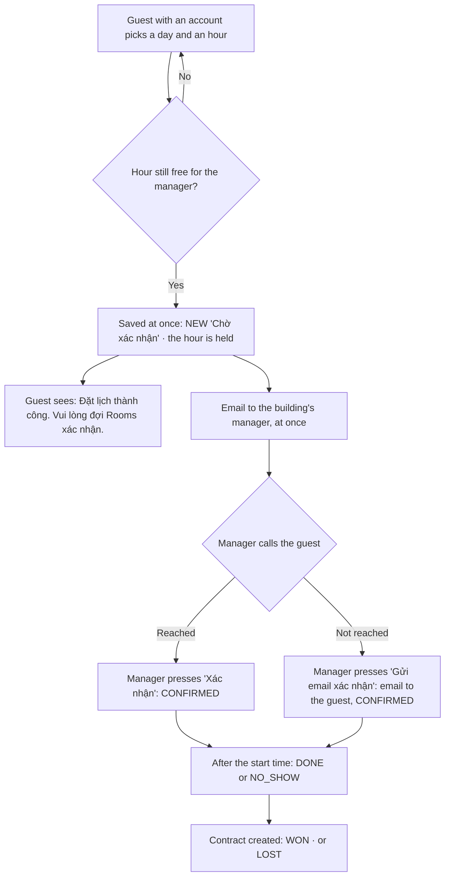

# 13 · Viewings (lịch hẹn xem phòng)

Module: `viewings`. Table: `viewings` (new columns planned, [02-database.md](02-database.md#planned-changes)).

> Changed 12/11/2026 (owner, Home101 brief, D-28..D-31, D-34, final text of the same day). Phase 2 built the old rules: a public form without an account and three slots a day. The code follows this file after Phase Extra parts EX-6 and EX-7. Rule numbers VIEW-01..13 are kept; VIEW-14..22 are new. The old text is in git history before 12/11/2026.

## Flow

## Rules

- **VIEW-01** Booking needs an account with a verified email (D-28). A GUEST or TENANT sends `POST /me/viewings { roomId, visitAt, note? }`; name and phone are copied from the account. Room MUST be public (ROOM-05), else `ROOM_NOT_AVAILABLE`; the time follows VIEW-08 and VIEW-16. Not logged in: the room page shows the booking panel with "Đăng nhập để đặt lịch" and returns to the same room after login or sign-up. Browsing rooms needs no login.
- **VIEW-02** Limit [ASSUMPTION A-03]: 3 bookings per account per day (Asia/Ho_Chi_Minh) → 429. Count and insert run in one transaction under `pg_advisory_xact_lock` on the user, counting `source = WEB` viewings of that user created today. The honeypot, the per-IP limit and the per-phone limit of the old public form are removed together with `POST /public/viewings`; sign-up and email codes have their own limits (AUTH-13).
- **VIEW-03** Staff MAY add a viewing manually for guests who called or messaged (`source = MANUAL`, `{ roomId, guestName, guestPhone, visitAt, note }`). The room must be active and in scope but need not be public (a guest may ask about a room that becomes free soon); the time follows VIEW-08 and VIEW-16. A manual viewing belongs to no account and sends no email.
- **VIEW-04** Status flow: `NEW` → `CONFIRMED` → `DONE` → `WON` | `LOST`; `CONFIRMED` → `NO_SHOW` | `LOST`; `NEW`/`CONFIRMED` → `CANCELLED`. `DONE` ("the viewing took place") and `NO_SHOW` are set by staff only, and only after the start time (D-30); `NO_SHOW` has no penalty. `DONE` is not a rental: `WON` is set **only** by contract creation (VIEW-05, Phase 3); `PATCH /viewings` cannot set it. Every staff change records `handled_by_id`; LOST needs `outcome_note`. Other moves → `CONFLICT_STATE` (conditional update on the current status).
- **VIEW-05** "Chốt" on a CONFIRMED or DONE viewing opens contract creation prefilled (room, guest name, phone, and the guest's account when the viewing has one, CON-07). Creating the contract sets the viewing `WON` and `contract_id`.
- **VIEW-06** When a HOLD contract is created for a room, all other NEW/CONFIRMED viewings of that room become `CANCELLED` with note "Phòng đã có người đặt cọc", and the manager gets a task to call those guests.
- **VIEW-07** The person responsible for a viewing is the building's manager, or Boss if the building has no active manager (SCOPE-04). That person conducts the viewing; no other staff are assigned (D-31). "Việc hôm nay": a manager counts the NEW viewings of their buildings; Boss counts those of buildings without an active manager. Boss's "Lịch hẹn" page still shows every building.
- **VIEW-08** Time (D-29): `visitAt` is the start; it is on the hour, from 8:00 to 19:00, any day, in the future and at most 30 days ahead (Asia/Ho_Chi_Minh), else `VALIDATION_FAILED` with `fields.visitAt`. The guest picks a day on a calendar, then one of that day's hours; days and hours that cannot be booked are shown but disabled. Viewings made before the change keep `visit_date` + `time_slot` and are shown with the old labels "Sáng (8:00–11:00)", "Chiều (14:00–17:00)", "Tối (18:00–20:00)"; they get an exact hour only when staff set one.
- **VIEW-09** The time may be changed by staff only (after agreeing it with the guest by phone, D-30), while NEW or CONFIRMED, with the rules of VIEW-08 and VIEW-16. The guest cannot change the time online; they call, or cancel and book again.
- **VIEW-10** Labels (UI-02): NEW "Chờ xác nhận", CONFIRMED "Đã xác nhận", DONE "Đã xem", NO_SHOW "Khách không đến", WON "Đã chốt", LOST "Không thành", CANCELLED "Đã hủy". (NEW was "Mới" before 12/11/2026.)
- **VIEW-11** Replaced 12/11/2026 by VIEW-02 (the per-phone and per-IP limits belonged to the removed public form).
- **VIEW-12** Removed 12/11/2026: `POST /me/viewings` returns the created viewing with its id to its owner.
- **VIEW-13** When a room stops being public by maintenance or lock, or its building is locked, NEW/CONFIRMED viewings are **not** cancelled; staff see "Còn N lịch hẹn chưa xử lý" before confirming, call the guests and change the status themselves (owner 01/11/2026). A locked building has no manager (BLD-06), so its viewings go to Boss (VIEW-07).
- **VIEW-14** After booking (D-30) the guest sees "Đặt lịch thành công. Vui lòng đợi Rooms xác nhận." with the room, the time, the public phone of the building's manager (BLD-04) and Boss's phone (`settings.default_contact`); when the building has no active manager, Boss's phone only. The viewing is NEW until staff confirm it.
- **VIEW-15** Confirming (D-30). Staff confirm a NEW viewing in one of two ways, both NEW → CONFIRMED: "Xác nhận" after reaching the guest by phone, or "Gửi email xác nhận" when the guest could not be reached, which sends the guest an email with the room, the building and its address, the time and the phone of the person responsible, in the guest's language (LOC-06). The viewing stores how it was confirmed (`PHONE` / `EMAIL`). The email button is offered only for a viewing whose owner account has an email; if sending fails the viewing stays NEW and staff see the error. Confirming is expected before the start time (VIEW-17).
- **VIEW-16** One open viewing per person per hour (D-29). A booking, a manual viewing and a time change are refused with `VIEWING_TIME_TAKEN` when the person responsible (VIEW-07) already has a NEW or CONFIRMED viewing at that hour in any room of their buildings. The check and the insert or update run in one transaction under `pg_advisory_xact_lock` on that user, so two guests can never get the same hour. Old slot viewings have no hour and do not block one.
- **VIEW-17** [ASSUMPTION A-13] A NEW viewing whose start time has passed stays NEW and is marked "Quá giờ, chưa xác nhận" for staff, who close it (DONE is not allowed from NEW; LOST or CANCELLED with a note, or a new time by VIEW-09). Nothing is confirmed or cancelled automatically.
- **VIEW-18** Cancelling (D-30). The guest cancels their own NEW or CONFIRMED viewing at any moment before the start time, effective at once: `POST /me/viewings/:id/cancel`; the hour becomes free again. After the start time the guest cannot cancel. Staff cancel as before, with a note. The viewing records which side cancelled.
- **VIEW-19** New-booking email (D-34). Right after a `POST /me/viewings` is saved, one email goes to the person responsible: the building's active manager when they have an email, else Boss. It contains the guest's name, phone and email, the room, the building, the date and hour, and the note, in Vietnamese, so the manager can call without opening the site. It is sent after the transaction; a failure is logged, retried once and never fails the booking (NOTI-07). The booking also appears in "Việc hôm nay" (VIEW-07).
- **VIEW-20** The guest's own viewings: `GET /me/viewings` and `/me/viewings/:id` return room and building, the time, the status, how and when it was confirmed, and the public contact of the person responsible (BLD-04; never a login phone). Another user's id → 404 (SCOPE-03). There is no lookup by phone number, and nothing about a viewing is served under `/public/*` except free hours (PUB-05).
- **VIEW-21** Free hours: `GET /public/rooms/:id/viewing-times?from&to` returns, for each day in the range (at most 31 days), the hours of VIEW-08 that are in the future and not held (VIEW-16) for the person responsible for that room. It contains no guest data.
- **VIEW-22** [ASSUMPTION A-14] When the person responsible for a building changes (manager reassigned, deactivated, building locked), open viewings stay as they are and follow the building (VIEW-07). Open viewings that now share an hour for the new person are marked "Trùng giờ"; that person rearranges them by phone (VIEW-09).

## API

| Method | Path | Who |
|---|---|---|
| GET | `/public/rooms/:id/viewing-times?from&to` | public – free hours (VIEW-21) |
| GET/POST | `/me/viewings` | guest, tenant – own list; book (VIEW-01) |
| GET | `/me/viewings/:id` | owner (VIEW-20) |
| POST | `/me/viewings/:id/cancel` | owner (VIEW-18) |
| GET | `/viewings?buildingId&status&from&to` | staff |
| POST | `/viewings` | staff (manual, VIEW-03) |
| PATCH | `/viewings/:id` | staff – status, note, time (VIEW-04, VIEW-09) |
| POST | `/viewings/:id/confirm` `{ via: "PHONE" | "EMAIL" }` | staff – VIEW-15 |

Removed: `POST /public/viewings`.

## Acceptance

- [ ] Booking for a non-public room returns `ROOM_NOT_AVAILABLE`; booking without login is refused (VIEW-01).
- [ ] The 4th booking of one account in a day returns 429; two parallel bookings of an account that already has 2 today save only one (VIEW-02).
- [ ] Creating a HOLD contract from viewing A cancels viewing B of the same room (VIEW-06).
- [ ] A start time in the past, more than 30 days ahead, at 7:00, at 20:00 or at 10:30 is rejected with `fields.visitAt`; 8:00 and 19:00 are accepted (VIEW-08).
- [ ] `PATCH /viewings/:id` with `status: WON` returns `CONFLICT_STATE`; NEW → LOST also does; DONE before the start time also does (VIEW-04).
- [ ] Two guests book 10:00 on the same day for two different rooms of the same manager at the same moment: one is saved, the other gets `VIEWING_TIME_TAKEN`; after the first is cancelled the hour can be booked again (VIEW-16, VIEW-18).
- [ ] After a booking, `viewing-times` no longer lists that hour for any room of that manager's buildings, and still lists it for another manager's rooms (VIEW-16, VIEW-21).
- [ ] A booking sends exactly one email, to the building's manager; to Boss when the building has no active manager or the manager has no email; a failing mailer still saves the booking (VIEW-19).
- [ ] "Xác nhận" sets CONFIRMED with `PHONE`; "Gửi email xác nhận" sends one email to the guest and sets CONFIRMED with `EMAIL`; when the email cannot be sent the viewing stays NEW (VIEW-15).
- [ ] The guest cancels one minute before the start: CANCELLED at once; one minute after: refused (VIEW-18).
- [ ] Guest X gets 404 for guest Y's viewing; `viewing-times` contains no name, phone or email (VIEW-20, VIEW-21).
- [ ] A viewing made before the change still shows "Chiều (14:00–17:00)", can be confirmed and cancelled, and gets an exact hour when staff set one (VIEW-08, VIEW-09).
