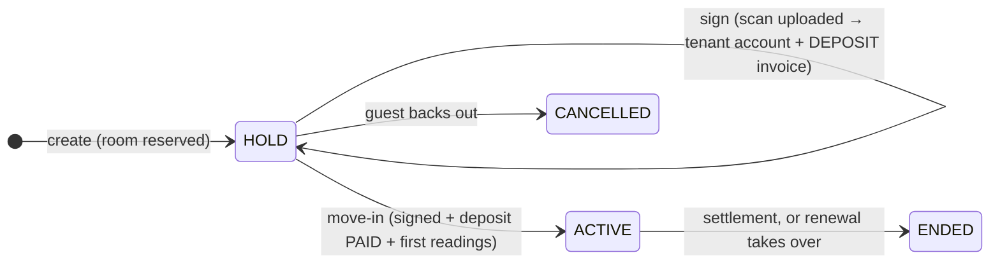

# 14 · Contracts, tenant account, occupants, vehicles

Module: `contracts`. Tables: `contracts`, `contract_services`, `occupants`, `vehicles`, `users` (tenant), `invoices` (deposit).

## Lifecycle

| Status | Vietnamese |
|---|---|
| `HOLD` | "Giữ chỗ" |
| `ACTIVE` | "Đang hiệu lực" |
| `ENDED` | "Đã kết thúc" |
| `CANCELLED` | "Đã hủy" |

## Create

- **CON-01** Input: `roomId`, signer `{ fullName, phone, email?, dateOfBirth?, idNumber?, idFront?, idBack? }`, `startDate` (move-in date, ≥ today), `termMonths` (integer ≥ 3), `deposit` (≥ 0, default = room price), `serviceIds[]` (ROOM/PERSON units of the same building), `terms?`, `viewingId?`.
- **CON-02** Room MUST be public-eligible except for the "no open contract" check being the DB's job (`ROOM_NOT_AVAILABLE`). `rooms.price` null → `PRICE_NOT_APPROVED`.
- **CON-03** `rent` = `rooms.price` (D-08). `billing_day` = day of `startDate`. `end_date` per [16-billing.md#periods](16-billing.md#periods). `code` = `HD` + id zero-padded to 6 (`HD000123`), set right after insert in the same transaction.
- **CON-04** The signer is inserted as an occupant with `is_signer = true`, `move_in_date = startDate`. CCCD number encrypted (AES-256-GCM, key from env `CCCD_KEY`), `id_number_last4` stored in clear.
- **CON-05** Side effects in the same transaction: viewing → WON (if given); other viewings of the room cancelled (VIEW-06); audit log.

## Sign

- **CON-06** `POST /contracts/:id/sign` with the uploaded scan URL. Requires HOLD and not yet signed.
- **CON-07** Tenant account (`contracts.tenant_id` is required, so this starts at create):
  - At **create** (CON-01): find `users` by signer phone. None → insert TENANT with `is_active = false` and an unusable password hash. Exists as TENANT → reuse. Exists as MANAGER/BOSS → `PHONE_TAKEN` (staff cannot rent with their staff phone).
  - At **sign**: if the user was created for this contract (never logged in, no other contract) → set a random 10-character temporary password, `must_change_password = true`, `is_active = true`. If the user already had an account → just set `is_active = true`; do not touch the password.
- **CON-08** Create the `DEPOSIT` invoice: one line `DEPOSIT` = deposit, `issue_date` = today, `due_date` = max(today, startDate) [ASSUMPTION A-02], status UNPAID. Skip when deposit = 0 or when this is a renewal (deposit carried).
- **CON-09** Response returns the temporary password **once** (only when a new password was set) so the manager can hand it over. It is never stored in clear or logged.

## Move-in

- **CON-10** `POST /contracts/:id/move-in` `{ electric, water, readOn, photos }`. Requires signed, deposit invoice PAID (or deposit = 0) → else `DEPOSIT_NOT_PAID`. Records first meter readings (water reading required even if `water_mode = PER_PERSON`, for history), sets `moved_in_at`, status ACTIVE.
- **CON-11** `readOn` SHOULD equal `start_date`; if different by more than 3 days, require a note. Billing still anchors on `start_date`.

## Cancel (before move-in)

- **CON-12** `POST /contracts/:id/cancel` `{ reason, depositKept? }` on HOLD only. If the deposit invoice is UNPAID → cancel it (reason). If PAID → create a settlement with `deposit` = paid amount, `deposit_forfeit` = `depositKept` (manager decides, 0..deposit), other parts 0, `net` = refund. Status CANCELLED, room becomes "Trống". Deactivate the tenant account if they have no other HOLD/ACTIVE contract.

## Occupants and vehicles

- **CON-13** Staff manage occupants (`full_name`, `phone`, `date_of_birth`, CCCD, photos, `move_in_date`, `move_out_date`). Active occupants ≤ `max_occupants`. Exactly one signer.
- **CON-14** Staff manage vehicles: `plate` (normalized uppercase, no spaces), `type`, `service_id` (a VEHICLE service of the building). Removing sets `is_active = false`, `removed_at`.
- **CON-15** Tenants never write occupants or vehicles directly; they send `OCCUPANT_CHANGE` / `VEHICLE_CHANGE` requests ([18-requests.md](18-requests.md)).
- **CON-16** CCCD photos are uploaded as Cloudinary authenticated assets. Viewing them goes through `GET /contracts/:id/occupants/:oid/id-photos` which returns signed URLs valid ≤ 5 minutes and writes an audit log. Allowed: staff in scope. Tenants see only their own number's last 4 digits.

## Renewal

- **CON-17** From an ACTIVE contract (usually after an approved `RENEW` request): create a new contract with `previous_contract_id`, same room, same tenant, `rent` = old rent, `billing_day` = old billing day, `start_date` = old `end_date` + 1, `termMonths` ≥ 3, `deposit` = old deposit (no new deposit invoice), services copied (editable).
- **CON-18** The renewal is signed like CON-06 (no new account, no deposit invoice). No move-in step: on its `start_date` the 00:05 cron sets the old contract ENDED and the new one ACTIVE (`moved_in_at` = start), using the period-end reading of the old contract as the new start reading.
- **CON-19** Occupants and active vehicles are copied to the new contract at switch time.

## Expiry

- **CON-20** Contracts ACTIVE with `end_date` within 30 days and no renewal/settlement show in "Việc hôm nay" and notify the tenant (30 and 7 days before).
- **CON-21** After `end_date` without renewal or settlement: flagged red "Hợp đồng quá hạn chưa xử lý"; no new invoices (D-13). Termination follows [16-billing.md#settlement](16-billing.md#settlement).

## API

| Method | Path | Notes |
|---|---|---|
| GET | `/contracts?buildingId&status&q` | doubles as tenant list; `q` matches name, phone, room code |
| POST | `/contracts` | CON-01..05 |
| GET | `/contracts/:id` | includes occupants, vehicles, services, invoices summary |
| GET | `/contracts/:id/pdf` | PDF from `settings.contract_template` |
| POST | `/contracts/:id/sign` · `/move-in` · `/cancel` · `/renew` · `/reset-password` | |
| GET/POST/PATCH | `/contracts/:id/occupants` · `/vehicles` · `/services` | staff |
| GET | `/contracts/:id/occupants/:oid/id-photos` | CON-16 |
| GET | `/vehicles?plate=` | staff "Tra cứu xe" |
| GET | `/me/contracts` · `/me/contracts/:id` | tenant, own only |

## Acceptance

- [ ] Guest signs: tenant account exists, temporary password shown once, deposit invoice UNPAID with VietQR.
- [ ] Move-in before deposit paid → `DEPOSIT_NOT_PAID`.
- [ ] Same phone renting a second room reuses the account and its password.
- [ ] A manager's phone used as signer → `PHONE_TAKEN`.
- [ ] Cancel after deposit paid with 1.000.000 kept from 2.500.000 → settlement net 1.500.000, room public again.
- [ ] Renewal switches on `start_date` without a new deposit invoice; tenant keeps one account and sees both contracts.
