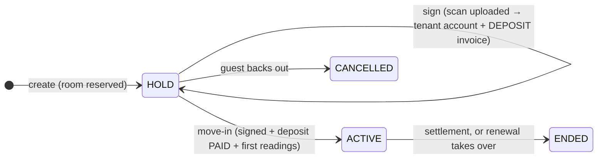

# 14 · Contracts, tenant account, occupants, vehicles

Module: `contracts`. Tables: `contracts`, `contract_services`, `occupants`, `vehicles`, `users` (tenant), `invoices` (deposit).

> Phase 3 builds CON-01..16 and CON-22 with the deposit loop of D-35 (owner 16/11/2026). CON-17..19 (renewal) come in Phase 5; CON-20/21 (expiry) need the billing and 08:00 cron of Phases 4–5. Task files: `docs/phase-3-contracts/`.

## Lifecycle

| Status | Vietnamese |
|---|---|
| `HOLD` | "Giữ chỗ" |
| `ACTIVE` | "Đang hiệu lực" |
| `ENDED` | "Đã kết thúc" |
| `CANCELLED` | "Đã hủy" |

## Create

- **CON-01** Input: `roomId`, signer `{ fullName, phone, email?, dateOfBirth?, idNumber? }`, `startDate` (move-in date, ≥ today), `termMonths` (integer ≥ 3), `deposit` (≥ 0, default = room price), `serviceIds[]`, `terms?`, `viewingId?`. Owner 17/11/2026: the current intake is for Vietnamese renters. When supplied, `idNumber` accepts a 12-digit CCCD. Attach its private images to the signer after creation (CON-13, CON-16). Each selected service must be an active ROOM/PERSON service of the same building with an approved rate in effect on the move-in date.
- **CON-02** Room MUST be public-eligible except for the "no open contract" check being the DB's job (`ROOM_NOT_AVAILABLE`). `rooms.price` null → `PRICE_NOT_APPROVED`.
- **CON-03** `rent` = `rooms.price` (D-08). Periods are calendar months (D-40); `end_date` = exactly `termMonths` after `startDate` minus one day, with partial first and last periods prorated (D-41, [16-billing.md#periods](16-billing.md#periods)). `code` = `HD` + id zero-padded to 6 (`HD000123`), set right after insert in the same transaction.
- **CON-04** The signer is inserted as an occupant with `is_signer = true`, `move_in_date = startDate`. CCCD number encrypted (AES-256-GCM, key from env `CCCD_KEY`), `id_number_last4` stored in clear.
- **CON-05** Side effects in the same transaction: viewing → WON (if given); other viewings of the room cancelled (VIEW-06); audit log.

## Sign

- **CON-06** `POST /contracts/:id/sign` with the uploaded scan (image or PDF), sent as the Cloudinary asset of a private `CONTRACT_SCAN` upload (FILE-01) and verified like FILE-02; the BE stores the asset id, never a public URL (D-37). Requires HOLD and not yet signed.
- **CON-07** Tenant account (`contracts.tenant_id` is required, so this starts at create):
  - At **create** (CON-01): find `users` by signer phone. None → insert TENANT with `is_active = false` and an unusable password hash. Exists as TENANT → reuse. Exists as GUEST with a verified email (owner 12/11/2026, D-26) → the form shows that account's name and email, and the staff member confirms with the signer, who is present, that it is theirs [ASSUMPTION A-18]; then it is reused and its role becomes `TENANT` in the same transaction; password, viewings and `locale` are untouched. If the signer says it is not theirs, the contract is not created (`PHONE_TAKEN`) and Boss sorts out the account. Exists as GUEST never verified (AUTH-11; it cannot log in) → treat it as "none" by replacing that row's name and email and giving it an unusable password hash. Exists as MANAGER/BOSS → `PHONE_TAKEN` (staff cannot rent with their staff phone). An existing account that staff locked (`is_active = false` after it had been used) is **not** reused silently: the response says "Tài khoản của số này đang bị khóa" and Boss unlocks it on purpose first.
  - At **sign**: a new pending tenant account receives a random 10-character temporary password, `must_change_password = true`, `is_active = true`. [ASSUMPTION A-22] If it has multiple unsigned HOLD contracts, the first successful signature performs this activation once. If the user already had an account (tenant or former guest) → keep the password and omit a temporary one from the response (CON-09).
  - The account is always found by the signer's phone. When the contract comes from a viewing that has an owner account (VIEW-05), the form shows that account's name and phone. If the staff member confirms that the signer is a different person, the viewing keeps its original owner (owner 17/11/2026).
- **CON-08** Create the `DEPOSIT` invoice: one line `DEPOSIT` = deposit, `issue_date` = today, `due_date` = max(today, startDate) [ASSUMPTION A-02], status UNPAID. Skip when deposit = 0 or when this is a renewal (deposit carried).
- **CON-09** Response returns the temporary password **once** (only when a new password was set) so the manager can hand it over. It is never stored in clear or logged.

## Move-in

- **CON-10** `POST /contracts/:id/move-in` `{ electric, water, readOn, note?, electricReplacement?: { oldMeterFinal }, waterReplacement?: { oldMeterFinal } }` (no photo, D-38). Electric/water and any oldMeterFinal are nonnegative integers within the DB Int range. A replacement object declares replacement of that meter (MTR-04): electric/water is the new meter's first reading, oldMeterFinal the old meter's last reading. Requires signed HOLD, deposit invoice PAID (or deposit = 0) → else `DEPOSIT_NOT_PAID`; other lifecycle conflicts return `CONFLICT_STATE`. The manager enters the room's actual current electric and water readings when the new tenant moves in (water required even if `water_mode = PER_PERSON`, for history). These are this contract's own opening readings; never reuse or overwrite the previous tenant's closing readings, even on the same day (owner 20/11/2026, MTR-02). Sets `moved_in_at`, status ACTIVE; both readings and audit `contract.move_in` are in the same transaction. First-period utility consumption starts from this baseline, excluding consumption between tenants; monthly billing itself is Phase 4. Ambiguous same-day reset histories are subject to A-24.
- **CON-11** `readOn` SHOULD equal `start_date`; if different by more than 3 days, require a note. Billing still anchors on `start_date`.

## Cancel (before move-in)

- **CON-12** `POST /contracts/:id/cancel` `{ reason, depositKept? }` on HOLD only. Reason is required; omitted `depositKept` defaults to 0. If the direct deposit invoice is UNPAID → cancel it with that reason. If PAID → retain the invoice/payment and create one settlement with `deposit` = actual `payment.amount`, `deposit_forfeit` = `depositKept` (manager decides, 0..paid amount), other parts 0, `net` = refund. Without a paid deposit, the received amount is 0 and a positive depositKept is invalid; no refund settlement is created for an unpaid/no-invoice HOLD. Status CANCELLED, room becomes "Trống" through its derived contract status. Settlement.moveOutDate records today's Hanoi business date for this cancellation; `refund_paid_at` stays null because recording the refund as paid belongs to Phase 4 (Q-P3-3). API-05 idempotency applies; recheck current scope before replay. Cancellation, invoice/settlement changes, idempotency result and audit `contract.cancel` are atomic. Deactivate the account only if it was created for this contract and was never activated (CON-07, still `is_active = false` with an unusable password); the current intake model already leaves such a pending account inactive, so cancellation does not update user/session state. An account that existed before, or that has logged in, stays active and keeps its guest area; the same holds when a contract ends by settlement (owner 12/11/2026, D-26, A-16). Cancellation does not reopen old viewing appointments or reassign their history.

## Occupants and vehicles

- **CON-13** Staff manage occupants (`full_name`, `phone`, `date_of_birth`, CCCD, photos, `move_in_date`, `move_out_date`). Owner 20/11/2026: the tenant may also directly add roommates to their own contract from their account, without waiting for a staff approval request (CON-15). Roommates' CCCD numbers/photos are optional; provided values retain the existing encryption/private-asset safeguards. Exactly one signer; adding a roommate never changes the contract's signer or tenant account. Active occupants ≤ `max_occupants`. For a room limit change, active occupants are those on ACTIVE contracts with `move_in_date <= today` and `move_out_date IS NULL OR move_out_date >= today` in `Asia/Ho_Chi_Minh`; departure today counts through the day (DB-B6, owner 04/11/2026). Adding people does not multiply room rent or room electricity charges. Chosen PERSON fees take effect in their month of entry at month-end billing (Phase 4, Q-P3-18 for mid-month calculation); parking still depends on registered vehicles (D-07), not one vehicle inferred per person. Q-P3-16/17 remain open for writable statuses and capacity across scheduled/backdated stays; the owner has not removed max_occupants.
  - BE-P3-23 implements the previously presented defaults as **A-25/26**, pending the owner's individual policy confirmation: mutations on HOLD/ACTIVE only, historical ENDED/CANCELLED readable; validate inclusive overlap across affected stay dates including HOLD. A room-limit decrease keeps DB-B6's current-day check and adds future plans from today onward; move-in rechecks the same capacity under the room lock. Do not treat the fee answer as confirmation of these two defaults.
  - Q-P3-18 is answered: +1 unit for the additional person in their move-in month regardless of day, without extra individual day-proration. Keep D-41 for the contract's own partial months; calculation remains Phase 4.
- **CON-14** Staff manage vehicles: `plate` (normalized uppercase, no spaces), `type`, `service_id` (a VEHICLE service of the building). Removing sets `is_active = false`, `removed_at`.
- **CON-15** Owner 20/11/2026 supersedes the request-only flow for adding roommates: tenants directly add them to their own contract through `POST /me/contracts/:id/occupants` (CON-13), without staff approval. This grants no right to change tenantId/isSigner, access another contract or read stored CCCD numbers/photos of other people. Other occupant mutations and vehicle changes retain the Phase 5 request flow (`OCCUPANT_CHANGE` / `VEHICLE_CHANGE`, [18-requests.md](18-requests.md)) until separately specified; do not broaden the new addition permission to arbitrary contract edits.
- **CON-16** CCCD photos and the signed contract scan are uploaded as Cloudinary authenticated assets (D-37). CCCD photos are viewed through `GET /contracts/:id/occupants/:oid/id-photos`, the scan through `GET /contracts/:id/scan` (staff in scope) and `GET /me/contracts/:id/scan` (the contract's tenant); each returns signed URLs valid ≤ 5 minutes and writes an audit log (`occupant.view_id`, `contract.view_scan`). Tenants see only their own CCCD number's last 4 digits, never CCCD photos.

## Renewal

- **CON-17** From an ACTIVE contract (usually after an approved `RENEW` request): create a new contract with `previous_contract_id`, same room, same tenant, `rent` = old rent, `start_date` = old `end_date` + 1, `termMonths` ≥ 3, `deposit` = old deposit (no new deposit invoice), services copied (editable).
- **CON-18** The renewal is signed like CON-06 (no new account, no deposit invoice). No move-in step: the first billing cron run on or after its `start_date` (00:05 or app start, BIL-06) sets the old contract ENDED and the new one ACTIVE (`moved_in_at` = start), using the period-end reading of the old contract as the new start reading.
- **CON-19** Occupants and active vehicles are copied to the new contract at switch time.

## Expiry

- **CON-20** Contracts ACTIVE with `end_date` within 30 days and no renewal/settlement show in "Việc hôm nay" and notify the tenant (30 and 7 days before).
- **CON-21** After `end_date` without renewal or settlement: flagged red "Hợp đồng quá hạn chưa xử lý"; no new invoices (D-13). Termination follows [16-billing.md#settlement](16-billing.md#settlement).

## Print

- **CON-22** The contract is printed, not generated as a PDF (D-36). `GET /contracts/:id/print` (staff in scope) and `GET /me/contracts/:id/print` (the tenant) return the filled `settings.contract_template` (placeholders such as `{{tenant.fullName}}`, `{{room.code}}`, `{{contract.rent}}`, money as `2.500.000 đ`, dates `dd/mm/yyyy`; CCCD as last 4 digits only); the FE shows it as a print page and the user prints or saves it as PDF. While the template is the draft (Q-15) the page shows "BẢN NHÁP – chưa dùng để ký".

## API

| Method | Path | Notes |
|---|---|---|
| GET | `/contracts?buildingId&status&q` | doubles as tenant list; `q` matches name, phone, room code |
| POST | `/contracts` | CON-01..05 |
| GET | `/contracts/:id` | includes occupants, vehicles, services, invoices summary |
| GET | `/contracts/:id/print` · `/me/contracts/:id/print` | filled template for the print page (CON-22, D-36; replaces `/pdf`) |
| POST | `/contracts/:id/sign` · `/move-in` · `/cancel` · `/renew` · `/reset-password` | |
| GET/POST/PATCH | `/contracts/:id/occupants` · `/vehicles` · `/services` | staff |
| GET | `/contracts/:id/occupants/:oid/id-photos` | CON-16 |
| GET | `/contracts/:id/scan` · `/me/contracts/:id/scan` | signed URL of the signed scan (CON-16, D-37) |
| GET | `/vehicles?plate=` | staff "Tra cứu xe" |
| GET | `/me/contracts` · `/me/contracts/:id` | tenant, own only |
| POST | `/me/contracts/:id/occupants` | tenant directly adds a roommate to their own contract, no approval request (CON-13/15); lifecycle gates Q-P3-16 |

## Acceptance

- [ ] Guest signs: tenant account exists, temporary password shown once, deposit invoice UNPAID with VietQR.
- [ ] Move-in before deposit paid → `DEPOSIT_NOT_PAID`.
- [ ] Same phone renting a second room reuses the account and its password.
- [ ] A manager's phone used as signer → `PHONE_TAKEN`.
- [ ] A guest with a verified email signs after the staff member confirms the account is theirs: the same account becomes TENANT, keeps its password and its viewings, and no temporary password is returned (CON-07, D-26).
- [ ] Cancelling that guest's HOLD contract leaves the account active with its viewings; cancelling the contract of an account created for it and never activated deactivates it (CON-12).
- [ ] A never-verified self-registered account with the signer's phone gives no access to the contract: its password is unusable after the contract is created; when staff do not confirm an existing guest account the contract is refused with `PHONE_TAKEN` (CON-07).
- [ ] Cancel after deposit paid with 1.000.000 kept from 2.500.000 → settlement net 1.500.000, room public again.
- [ ] Renewal switches on `start_date` without a new deposit invoice; tenant keeps one account and sees both contracts.
